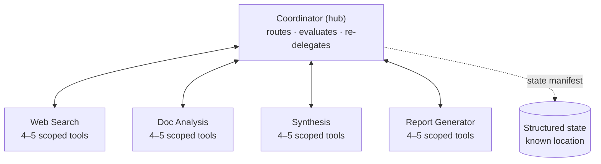

# Cheat sheet: Multi-agent patterns & agentic loop (Q01–Q128, no Q50, Q61–Q63, Q70, Q87–Q90, Q94, Q96, Q97, Q99–Q109 or Q127)

**Domains:** D1 › 1.2, 1.3, 1.4, 1.5, 1.6, 1.7 · D2 › 2.1, 2.2, 2.3, 2.4, 2.5 · D3 › 3.1, 3.2, 3.3, 3.4, 3.5 · D4 › 4.1, 4.2, 4.3, 4.4, 4.5 · D5 › 5.1, 5.2, 5.3, 5.4, 5.5, 5.6
**Built from:** [Q01](../questions/Q01-source-attribution-multi-agent/question.md) · [Q02](../questions/Q02-context-passing-source-index/question.md) · [Q03](../questions/Q03-crash-recovery-state-manifest/question.md) · [Q04](../questions/Q04-tool-scoping-per-subagent/question.md) · [Q05](../questions/Q05-goals-not-procedures-delegation/question.md) · [Q06](../questions/Q06-coordinator-gap-loop/question.md) · [Q07](../questions/Q07-context-flows-through-coordinator/question.md) · concepts: [claim-source-mapping](../concepts/claim-source-mapping.md), [extract-first-summarize-second](../concepts/extract-first-summarize-second.md), [url-vs-excerpt](../concepts/url-vs-excerpt.md)

## The reference system



## The 3 master rules

| # | Rule | Why |
|---|---|---|
| 1 | **Structure beats instructions** for anything that must be reliable: schemas, scoped tools, gates in code | Prompts are **probabilistic** (~90–95%). Code is **deterministic** (100%) |
| 2 | **Everything goes through the coordinator**, which passes context **explicitly** in the next prompt | Subagents have **isolated context**: *"receives only what the coordinator writes"* |
| 3 | **Be strict about outputs and boundaries, flexible about method** | Reliability where it matters, adaptability where it helps |

## One line per question

| Q | Situation | ✅ Answer | Key idea |
|---|---|---|---|
| **Q01** | Citations lost after summarization | Structured output: content **separate from** source metadata | Free-text summaries drop metadata. Use fields instead |
| **Q02** | What to pass to the report generator | Synthesis draft + **structured source index** (claim → URL + excerpt) | Complete ≠ everything. Pass findings + metadata + links, not 120K raw tokens |
| **Q03** | Pipeline crashed at 12/28 | Agents export structured state → **coordinator loads manifest** → injects into prompts | Exact state, held centrally, handed out selectively |
| **Q04** | Agents call other roles' tools | **18 tools → 4–5 per role** | Fewer, scoped tools = reliable selection. Remove access, don't forbid it |
| **Q05** | Subagent gives up, misses new angles | **Goals + quality criteria**, not steps | Delegate the *what* and *how good*, not the *how* |
| **Q06** | Synthesis flags gaps, coordinator ignores them | Coordinator **evaluates → re-delegates targeted → re-synthesizes** | Closed loop with a cap. After the cap: report gaps / escalate |
| **Q07** | How search → doc analysis info flows | Coordinator **includes findings in the next prompt** | Hub-and-spoke. If it's not in the prompt, the subagent doesn't know it |
| **Q08** | Conflicting estimates: false certainty or vague hedging | Report sections for **established vs contested**, preserving each source's value + method | Annotate conflicts. Don't pick, average or filter |
| **Q09** | Subagents cite correctly, **synthesis** loses links when combining | Structured claim-source mappings that synthesis must **preserve and merge** | Don't reconstruct provenance. Preserve it |
| **Q10** | Synthesis says "no findings were provided" | Coordinator **didn't include** prior outputs in the prompt | API is stateless, subagents isolated. Context exists only if written into the prompt |
| **Q11** | Analysis spots gaps, strict pipeline can't act | Analysis **reports gaps explicitly** → coordinator: targeted search → **re-analysis** → until sufficient | Explicit signal + complete loop (beats inferred signal + half loop) |
| **Q12** | How to give synthesis what it needs | **Complete findings** from both subagents **directly in its prompt** | No inheritance, no callbacks, no shared-store lookups |
| **Q36** | Coordinator says "I'll ask the web search agent…", but no subagent **ever** runs; no errors | **`"Task"` missing from the coordinator's `allowedTools`** | Saying ≠ doing. No tool → no `tool_use` → nothing runs, nothing fails. Exam name "Task" (current Claude Code: "Agent") |
| **Q39** | Follow-up "summarize what we learned" takes 40+ s: coordinator spawns synthesis with 80K+ findings it **already has** | **Coordinator answers simple summaries directly**; spawn only for complex work | Remove the unnecessary hop. *"Selects only the subagents it needs"* (1.2), which may be none |

### Agentic loop & support agent (single agent)

| Q | Situation | ✅ Answer | Key idea |
|---|---|---|---|
| **Q13** | After `lookup_order`, refund or escalate? | Tool result **appended to the conversation**, and the **model reasons** about the next action | Code runs tools + checks `stop_reason`. The model chooses. Gates in tools enforce must-hold rules |
| **Q14** | Escalate a $847 refund; human can't see the transcript | **Structured summary**: customer ID, root cause, amount, recommended action (+ what was tried) | Self-contained, decision-ready. Conclusions, not raw history |
| **Q15** | Mid-process: promo pricing error needs manager approval | **Compile a structured handoff** (customer, order, issue) **before** `escalate_to_human` | Stop at the authority limit. Package what you already found. Don't try the action anyway |
| **Q16** | Which escalation trigger is most reliable? | **Instruct**: human requested · policy exception/gap · no meaningful progress | The 3 valid triggers (5.2). Judgment calls → model; computable limits → gate |
| **Q17** | One unified order tool → missing / irrelevant params | **Split** into `issue_refund`, `cancel_order`, `request_reshipment`, each with only its required params | Purpose-specific tools (2.1). Make the wrong call impossible to express |
| **Q18** | "Ready to post. Confirm?": 98% approved in 2 s, errors slip through | **Show the details**: full text, account, time, platform | Reviewers can't catch what they can't see. Fix content, not friction |
| **Q19** | `get_neighborhood_info(address)` always needs `get_property_details` first | Tool **accepts `property_id`**, resolves the address internally | Inputs = identifiers the agent has. Deterministic steps go into code |
| **Q20** | Claude omits `user_id` / wrong structure: what helps it *understand*? | **Clear parameter descriptions** (meaning, format, example, required) | Schema = shape, description = meaning, errors = recovery. "Guarantee structure" would flip to schema |
| **Q21** | Agent over- AND under-escalates on confidence scores | Tool returns scores + **`request_review` flag from tested thresholds** + **`review_reasons`** | Don't let the model interpret raw numbers. Decision in code, per field, with reasons |
| **Q22** | Agent retries after 0 results (HTTP 200, `[]`) | **`success: true` + `results: []`**; `isError` only for real execution failures | Empty ≠ error. "Found nothing" vs "could not search" must be distinguishable |
| **Q23** | "Remove old backups" → `delete_file`; descriptions are one-liners | **Expand descriptions**: when to use / NOT use, which tool instead | Descriptions = primary selection mechanism. "Improve selection" → A; "guarantee" → server-side check |
| **Q24** | Tool raises exceptions → agent says "I'm having trouble" | **Structured error as tool output**: type, retryable, actionable context | The model can only recover from what it can see. Different failures → different next steps |
| **Q25** | MCP: missing required param · API 404 · API 503 | Missing param = **JSON-RPC protocol error**; 404 + 503 = **tool result `isError: true`** | Did the tool run? No → protocol error. Yes but failed → `isError` (model sees it) |
| **Q26** | `send_notification` times out, agent retries → duplicates | Error says **"status unknown, may have been sent, avoid retry"** | Side-effecting + not idempotent → transient ≠ retry-safe. Correct meaning beats structure with wrong meaning |
| **Q27** | Device timeout → agent only says "not responding" | Error with **likely cause + troubleshooting steps** to offer the user | Write errors for the model/user, not a debugger. In-result, not via another tool |
| **Q28** | $500 reimbursement threshold must be tamper-proof | **Tool enforces it internally**: <$500 pay, >$500 create approval request + "pending" | Rule lives in the code that moves money, on real data. No agent-set flags |
| **Q29** | 18+ sequential calls; selection needs editorial judgment over all candidates | **`discover_and_analyze`** composite returning all candidates + scores; `add_to_collection` separate | Combine the mechanical steps; keep the judgment and the action with the model |
| **Q30** | Generic `analyze_document(doc, instruction)` returns wrong output types; 35% re-requests | **Split**: `extract_data_points`, `summarize_content`, `verify_claim_against_source`, each with I/O contracts | The guide's own 2.1 example. Tool choice = task; contract = output shape |
| **Q31** | Refunds > $500 must **automatically** escalate; a clear prompt still fails 3% | **PreToolUse hook**: intercept `process_refund`, block > $500, **invoke escalation** | 100% requirement → hook (1.5, the guide's own example). Enforce the whole rule: block **and** route |
| **Q32** | `lookup_order` errors all say "Operation failed" → agent retries / escalates / asks the user at random | Errors carry **`errorCategory`** + **`isRetryable`** + **description** | Each behaviour was right for a *different* error. Missing signal, not bad reasoning. Fix it at the source |
| **Q33** | How should `lookup_order` report "Order not found" / DB failures? | Error message in the **tool result** with **`isError: true`** | The tool ran → execution error → the model must see it. Don't hide it (exception), disguise it (empty) or contradict it (success + status) |
| **Q34** | Agent wastes 3–4 turns retrying **business** errors (12%); plain-text errors; poor customer replies | Structured errors: **`retriable: false`** for business errors + **customer-friendly explanation** | Two goals → the two fields. The tool knows the facts, so it writes the explanation |
| **Q35** | `get_portfolio_value`: JSON fields or formatted text? | Agent **reliably extracts** exact values without parsing prose → fewer errors downstream | Reliability, not determinism. Structure ≠ correctness. Not about tokens |
| **Q37** | Assistant answers "help me with the report?" with 3 clarifying questions → 40% abandon | **System prompt: assume from context, state the assumptions, offer to adjust** | Help now, with the guess visible and correctable. Ask only when a wrong guess is costly or irreversible (5.2) |
| **Q38** | 30+ turns: slower, less coherent; 50K tokens; 94% only reference the last 3–5 exchanges; the 6% could easily re-state | **Sliding window**: system prompt + last 8–10 turns; for older references, **acknowledge and ask to re-state** | Let usage data size the context. Capped size → faster; less noise → more coherent; honest about the gap |
| **Q40** | 3 issues in one session; turn 48 asks about the refund (turns 1–15); near context limits | **Extract and persist structured issue data** (order IDs, amounts, statuses) into a **separate context layer** | Guide 5.1 nearly word for word. One entry per issue, in every prompt, never summarised |
| **Q41** | Billing dispute: `get_customer` ✅, `lookup_order` ✅, `process_refund` **times out** | **Explain the billing + confirm eligibility, acknowledge the system issue, offer escalation or retry later** | Partial success: deliver what worked, be honest about what didn't, next step. Timeout on a refund = unknown outcome → check status before any retry (Q26) |
| **Q42** | `lookup_order` returns 40+ fields per call; tool outputs are most of the context; two more lookups coming | **Extract only the return-relevant fields** (items, purchase date, return window, status) | Guide 5.1: *"You need 5."* Trim in code, keep the key; from now on trim in a **PostToolUse** hook or the tool itself |
| **Q43** | "Going back and forth for days… I just want to speak to **someone who can actually help** me"; return is straightforward and eligible | **Acknowledge frustration, say it's resolvable now, offer to complete it or escalate** | Frustration ≠ explicit human request. Customer chooses; repeats "a person" → escalate |
| **Q44** | "Explained twice… I want to talk to a **real person NOW**"; no tools called yet | **Immediately call `escalate_to_human`** with what's known | Explicit request → escalate in that reply: no investigation, no offer, no question. Q43's twin |
| **Q45** | Customer returns after 4 h; old session has `PENDING` results; agent quotes stale data **even after fresh calls** | **New session + structured summary** (issue, actions, status) **+ fresh tool calls** before engaging | Guide 1.7: *"The new session has no stale tool results."* Remove stale data, don't argue with it |
| **Q46** | After the 3rd verification answer the agent asks for the name again, "as if the earlier exchange never happened" | **Conversation history isn't being passed** in later API requests | The API is stateless: the model knows only what's in the current request. Your code is the memory |
| **Q47** | 4 → 10 tools, accuracy 88% → 71%; logs: `issue_credit` vs `process_refund`, `check_delivery_status` vs `lookup_order` | **Merge the overlapping tools** (variant becomes a parameter) | "Structurally eliminates" → merge. One tool per purpose: split many-jobs tools (Q17, Q30), merge same-job tools. 2.1's consolidation trap = only as a *first step* |
| **Q48** | Agent calls `process_refund` with a **fabricated** `order_id` instead of calling `lookup_order` first | **Description states the source**: order_id must come from a prior `lookup_order` call, never assumed or invented | Root cause = the model doesn't know where the value comes from. Validation (D) = safety net, not the cause |
| **Q49** | `lookup_order` returns `is_error: true` + "Tool execution failed" for everything → agent retries forever **or** escalates at once | **Error-type-specific messages with `is_error: true`**: what went wrong + what to try next | Anthropic docs: *"Write instructive error messages."* Only the tool knows what happened |
| **Q50** | *Gap: question text not available* (no ExamTopics discussion page; the question list needs a login) | | |
| **Q51** | Warranty claim, several sequential tool calls: what decides whether the loop continues or stops? | **`stop_reason`**: `"tool_use"` → continue, `"end_turn"` → stop, anything else → check why | Not text presence, not a call cap (safety net only), not `tool_choice: "none"` after a "last expected" call |
| **Q52** | CLAUDE.md "always run Prettier": 30% violations; "IMPORTANT: MUST" → 15% | **PostToolUse hook, `Edit\|Write` matcher, runs Prettier** on each modified file | Hooks = *"certain actions always happen rather than relying on the LLM."* Mechanical rule → command hook |
| **Q53** | Add one date-validation conditional to one function in one file | **Direct execution** | Problem, location and approach all clear → no plan mode. *"Ambiguity, not difficulty"* decides (3.4) |
| **Q54** | 500-line root CLAUDE.md; Terraform rules load while editing Kubernetes files | **`.claude/rules/` files with `paths:` globs** (`terraform/**/*`) | Root CLAUDE.md loads every session. Path rules load only when Claude touches a matching file (3.3) |
| **Q55** | Complex graph algorithm (cycles, disconnected nodes, weights, performance): best way to iterate? | **Write the tests first; Claude codes to pass them; share the failures each round** | *"Expected X, got Y" has a single meaning.* Same bar every round; regressions caught (3.5) |
| **Q56** | Project CLAUDE.md's ApiError convention followed only in some sessions: first diagnostic step? | **`/memory`: check which instruction files loaded** (real use: `/context`) | Diagnose before fixing: if Claude can't see the file, nothing in it matters. Commands *show*, they don't load (3.1) |
| **Q57** | Custom DevOps MCP server exposes **prompts** (`deploy_checklist`, `incident_response`): how do they show up in Claude Code? | **Slash commands** you run: `/mcp__server__prompt arg1 arg2` (listed as `/server:prompt (MCP)`) | Prompts are **user**-controlled; resources = `@` mentions; tools = model calls them (MCP spec) |
| **Q58** | One-off payment module; you've identified 3 files that show the patterns | **`@`-reference the 3 files in the prompt** | Real code beats prose (3.5); you already know where (no exploring); one-off → not CLAUDE.md |
| **Q59** | Team venue-lookup MCP server + your own experimental playlist server | **Venue → `.mcp.json`** (project root, in git) · **playlist → `~/.claude.json`** (personal) | *"Project-level `.mcp.json` is version-controlled and shared. User-level `~/.claude.json` is personal."* (2.4) |
| **Q60** | Monorepo, 3 shared standards, 15 packages with **no naming pattern**; maintainers know their domain; every package CLAUDE.md duplicates all 3 | **Each package's CLAUDE.md `@`-imports only the standards it needs** | *"Per-package CLAUDE.md files can import only the standards that apply to them."* One copy each, loaded only where picked (3.1) |
| **Q61–Q63** | *Gap: question text not available* | | |
| **Q64** | Redis cache for `/products`; you're **new to production caching**, unsure what else to consider | **Have Claude interview you before implementing** (invalidation, consistency, failure modes…) | *"In a domain where you lack expertise, have Claude ask questions before implementing."* (3.5) |
| **Q65** | 8-item review checklist **pasted at every review**; team also uses Claude for features, debugging, docs | **`/review` slash command** with the checklist, in the project's `.claude/commands/` (or `.claude/skills/review/SKILL.md`) | *"Putting task-specific workflows in CLAUDE.md"* is a trap: they *"belong in skills that are invoked on demand."* (3.2) |
| **Q66** | Critical production bug, **clear stack trace to a specific function**, module you've **never worked with** | **Direct execution**: read the trace and the code, find the root cause, fix | *"A difficult but well-defined bug fix (clear stack trace, single function, known cause) suits direct execution."* (3.4) |
| **Q67** | Research system: **web search subagent times out** on a complex topic; how to propagate it? | **Structured error context** to the coordinator: failure type, attempted query, partial results, alternatives | *"The coordinator can only make an intelligent decision about recovery from what the subagent tells it."* (5.3) |
| **Q68** | Agent SDK dev tool: understand the caching layer (**15 files, ~8,000 lines**) before adding an invalidation trigger | **Find the base cache class via imports/class hierarchy, Read its interface, then trace the invalidation implementations** | *"Read only what you need. Justify each file you read by what you found in the previous step."* (2.5) |
| **Q69** | Unfamiliar error `SYNC_CONFLICT: entity version mismatch detected` in prod logs; which of 12 services? | **Grep the distinctive text** (`SYNC_CONFLICT`, `entity version mismatch`), then Read only the matches | *"Grep to find entry points. Search for the function name, class name or error message that starts your investigation."* (2.5) |
| **Q70** | *Gap: question text not available* | | |
| **Q71** | After 25 min exploring rendering, answers say **"typical rendering patterns"** instead of `VulkanPipeline`/`FrameGraph`; next task: physics ↔ rendering | **Summarise the rendering findings, spawn a physics subagent with that summary in its initial context** | *"Before spawning Phase 2 subagents, summarise the main Phase 1 findings and inject them into the initial context of those subagents."* (5.4) |
| **Q72** | Exploration session resumed by stored ID: 1 h on a legacy auth module, 12 files read; a teammate's merge changed **3 of the 12** overnight | **Resume + tell the agent which 3 files changed** for targeted re-analysis | *"If most of the context is still valid, resume and tell the agent which files changed."* (1.7) Not a bare fresh start, not re-read all 12 |
| **Q73** | PR review assistant: style, security, docs; each = read files, run a tool, write a section; **the same three-step workflow for every PR** | **Prompt chaining** (fixed sequential pipeline): one step per aspect, then a **synthesis** step | *"Fixed pipelines suit predictable, structured tasks with known steps: code reviews…"* (1.6) Code decides the steps, not the model |
| **Q74** | New MCP refactoring server (`extract_function`, `rename_variable`, `inline_function`), **connected and healthy**; agent still refactors with **Write and Bash `sed`**; descriptions like *"Extracts a function from code"* | **Enhance the MCP tool descriptions**: when each beats text manipulation (and why), expected inputs, outputs | *"When an MCP tool has a sparse description, the agent may prefer the built-in tool even when the MCP tool is more capable."* (2.4) |
| **Q75** | One endpoint **intermittently** returns 500s; 200+ files; developer **doesn't know which components are involved**; error crosses routing, middleware, logic, DB | **Dynamic adaptive decomposition**: generate subtasks from what each step finds, adapt the plan as the error path emerges | *"Debugging an unfamiliar system"* → *"Dynamic decomposition"*: *"Root cause is unknown; investigation must adapt"* (1.6) |
| **Q76** | Insert a helper **between two functions** in a 150-line module; **Edit fails**: no unique `old_string` (repetitive docstrings, names, structure) | **Read the file, add the function in place, Write the complete file** | *"Read + Write works every time, because it does not rely on Edit to find the text to change."* (2.5) |
| **Q77** | Yesterday: legacy auth module analysed, **two refactoring approaches** found (microservice vs in place); today: **explore both in depth before deciding** | **`fork_session`**: two forks from yesterday's session, one approach in each | *"Comparing two refactoring approaches"* → *"fork_session"*: *"Divergent exploration from shared baseline"* (1.7) |
| **Q78** | Untested paths in a 45-file legacy payment module; **after 8 files** the agent is **forgetting earlier patterns**; test files and payment flows still to do | **Subagents for specific questions** (find the test files, trace the refund flow); the main agent **coordinates** and keeps the high-level picture | *"Each subagent explores verbosely in its own isolated context, then returns a structured summary."* (5.4) |
| **Q79** | Sessions of **30+ minutes**: **inconsistent answers** about code discussed earlier; engineers **repeat context** | **Scratchpad file** of key findings, referenced for later questions | *"Scratchpad files are the primary way to limit context degradation."* (5.4) |
| **Q80** | Knowledge manager structuring source material for a **long evaluation task**: which **two** practices use the context window better? | **B** each source **delimited** so claims can be attributed + **E** most reference-critical material **near the beginning or end** | *"Models process information at the beginning and end of long inputs reliably."* (5.1) · *"wrap each document in <document> tags with <document_content> and <source>"* (Anthropic docs) |
| **Q81** | Find **all files that import `@company/auth`** in a monorepo | **Grep** the import pattern across file contents | *"Grep searches file contents for patterns. Use it to find function callers, error messages, import statements and variable assignments."* (2.5) |
| **Q82** | Web search: **2024: 35%** adoption; internal reports: **2021: 18%**; synthesis flags them as **contradictory** instead of growth | **Require publication or data-collection dates in the subagents' structured outputs** | *"Without these dates, the synthesis agent cannot put two numbers for one measure in date order."* (5.6) |
| **Q83** | Simple fact queries (*"What year was the Paris Agreement signed?"*) run through **all four subagents**: 40+ s; complex research needs the full chain; query mix **diverse and evolving** | **The coordinator analyses each query and decides which subagents to invoke** | *"The coordinator analyses what a query requires and selects only the subagents it needs."* (1.2) |
| **Q84** | Document analysis handles a case's **12 precedents sequentially**: 3+ minutes; cut latency **and keep the coordinator able to monitor and debug** | **Coordinator spawns parallel document analysis subagents** (a subset each), **aggregates**, then synthesis | *"Spawn independent subagents in parallel by emitting multiple Task tool calls in a single coordinator response."* (1.3) |
| **Q85** | New subagents: financial API (JSON numbers), news (prose), patents (lists); synthesis turns **everything into bullet points**: tables and narrative lost | **Synthesis renders each content type appropriately**: financials as tables, news as prose (patents as structured lists) | *"The synthesis agent selects the format from the content type."* (5.6) |
| **Q86** | Claude Code PDF report: columns too narrow, dates unformatted, page breaks wrong; **the issues interact** (widths affect dates, breaks depend on content height) | **All three in one detailed message**, exact specs for each | *"Single message (batch) when fixes interact with each other."* (3.5) |
| **Q91** | Exploration **subagent** interrupted after 30 min / 47 files; meanwhile a PR **renamed two utility functions**; continue the same exploration | **Resume the subagent + tell it about the renamed functions** | *"If most of the context is still valid, resume and tell the agent which files changed."* (1.7) |
| **Q92** | Claude Code: continue **yesterday's 2-hour** auth investigation; **three other codebases** since; the session was **named "auth-deep-dive"** | **`claude --resume auth-deep-dive`**: load that session **by name** | *"Resume continues a specific named session from the point where it stopped."* (1.7) |
| **Q93** | Find **all callers** of a core-library function **before removing it**; **wrapper modules rename it** (`calculateTax` → `computeOrderTax` in orders) | **Read the library + wrapper modules to list every exposed name, then Grep each name** across the codebase | *"Grep for each exported name across the codebase to find all consumers."* (2.5) |
| **Q95** | Extraction system after **3 months of 100% human review**: ≥90% confidence = **97% accurate overall**; plan to automate high-confidence items. Most critical check? | **Break accuracy down by document type and field**: verify every segment holds up, not just the aggregate | *"Always validate accuracy by document type and field segment before automating."* (5.5) |
| **Q98** | 847 reviewer corrections; **23%** are recipes with **informal measurements** ("a handful", "a splash"): the model **invents amounts or leaves fields empty** | **Few-shot examples** showing informal amounts **extracted verbatim** (not converted, not omitted), with reasoning | *"When output is inconsistent, use few-shot examples first."* (4.2) |
| **Q110** | Daily batch of 10,000: **300 failed with context length exceeded**; the results file lists them **by custom_id**. Most cost-effective fix? | **Resubmit only the 300, chunked** into smaller pieces, then **combine the partial extractions** | *"Resubmit only failures with modifications."* (4.5) |
| **Q111** | Same schema, two document types: **monthly reports** (archived) and **urgent exception reports** (alert **within 30 min**); minimise cost, meet latency | **Monthly → Batch API** (50% off), **urgent → real-time Messages API** | *"Use the synchronous API for blocking workflows and the batch API for latency-tolerant ones."* (4.5) |
| **Q112** | Product specs to JSON: `materials` comes back as **"cotton blend"**, **"Cotton/Polyester mix"**, or **missing** although the text names it; the schema is well defined | **Few-shot examples** (2–3 input-output pairs) showing the **standard material format** | *"Few-shot examples are the most effective technique for consistent, well-formatted output from Claude."* (4.2) |
| **Q113** | Strict schema: syntax errors gone, but **5%** have `[]` / `null` for **citations, methodology**; the papers **contain them** in varied structures (inline vs bibliography, methods in the intro) | **Few-shot examples of extraction from those varied structures** | *"The model sees correct extraction from varied structures: inline citations and bibliographies"* (4.2) |
| **Q114** | **12%** semantic errors pass the schema ("30 minutes" in a quantity field); reviewers can check only **20%**. How to allocate them? | **Field-level confidence scores, calibrated on a labelled validation set** → review the most uncertain first | *"Route the highest-uncertainty items to reviewers first."* (5.5) |
| **Q115** | Coordinator invokes web search, **waits**, then doc analysis; tasks are **independent** | **Emit both Task calls in a single coordinator response** | *"Emit multiple Task tool calls in a single response"* (1.3). One response = parallel; one call per turn = sequential |
| **Q116** | 50 non-blocking PR security reviews/day, $150; batch for −50%? | Decided by **whether feedback up to 24 h later is still actionable** | *"Use the synchronous API for blocking workflows and the batch API for latency-tolerant ones."* (4.5) |
| **Q117** | CI `claude -p --system-prompt "review the diff"` never reads other repo files | **`--append-system-prompt`** instead of `--system-prompt` | `--system-prompt` *"Replaces the entire default system prompt"* (3.6): the tool-use guidance is gone |
| **Q118** | Static review (diff + changed files) misses callers in **unchanged** files; 35% of incidents | **Turn-limited agentic review** with Read/Grep to follow references | The model can't review code it can't see. *"Grep to find entry points"*, *"Read to follow imports"* (2.5) |
| **Q119** | Same Claude session reviews its own refactor; separate CI review finds bugs it missed | **Same session retains its reasoning → less likely to question its own decisions** | *"Use independent instances for review, because same-session review keeps its reasoning."* (4.6) |
| **Q120** | 200 commit summaries weekly, needed next morning; cut per-token cost, **same model + prompts** | **Message Batches API** with `custom_id`s (−50% input + output) | The only option meeting all constraints. Check every option against **every** constraint |
| **Q121** | 35% review false positives in consistent patterns (style, safe-in-context security, perf); must **generalise to novel code** | **Few-shot examples with annotations: acceptable vs genuine, per category** | *"The reasoning teaches the model to generalise its judgement to novel patterns."* (4.2) |
| **Q122** | Half of review findings dismissed: **accurate** but minor style / local patterns; fix in the prompt | **Explicit criteria: report bugs/security, skip minor style/local patterns** | *"Explicit categorical criteria always outperform vague instructions and confidence-based filtering."* (4.1) |
| **Q123** | Review flags the team's **intentional** patterns (force-unwrap in tests, big coordinators, internal "deprecated" modules); prevent them **in the first place**, **every review** | **Document accepted conventions in project CLAUDE.md** (CI loads it every run) | *"In CI, Claude Code reads the project's CLAUDE.md files exactly as it does interactively."* (3.6) |
| **Q124** | 55% generated tests low-value (trivial "doesn't throw", duplicate coverage, ignore fixtures); prevent **in the first place** | **CLAUDE.md testing standards: valuable-test criteria, fixtures + use, examples behavioural vs trivial** | *"Without this context, test generation in CI produces low-value boilerplate."* (3.6) |
| **Q125** | CI startup 18 s from auto-discovery (hooks, MCP, plugins, skills, nested CLAUDE.md); must still enforce **root** CLAUDE.md standards | **`--bare` + `--append-system-prompt-file ./CLAUDE.md`** | *"It skips auto-discovery of hooks, skills, plugins, MCP servers, auto memory and CLAUDE.md, so scripted calls start faster."* (3.6) |
| **Q126** | Prompt says "only definite failures, ignore anything uncertain"; model **investigated real bugs but didn't report**; output must stay tagged | **Report all findings with confidence + severity tags; filter downstream** | *"The model is often sure about wrong findings and hesitant about right ones."* (4.1) |
| **Q128** | **Managed** Code Review (GitHub App): noise from lint dupes, `src/gen/`, rendering helpers that only *look* like anti-patterns | **REVIEW.md: skip CI-enforced categories + generated paths; rendering findings must cite a line showing incorrect behaviour** | Docs: REVIEW.md = *"instructions for reviews alone… what to flag, at what severity, and what to skip"* |

- Loop control: `stop_reason == "tool_use"` → run tool, append `tool_result`, call again · `"end_turn"` → stop. *"The only reliable signal."*
- ❌ Parse "I'm done" text · ❌ iteration cap as **main** stop (OK as a safety limit) · ❌ "has text = finished" (Claude writes text **alongside** `tool_use`) · ❌ `tool_choice: "none"` after a "last expected" call (the path isn't fixed) (Q51) · Any other `stop_reason` (`max_tokens`, `pause_turn`, `refusal`…) = **not finished, check why**. `max_tokens` = your **output cap** cut the response short → raise `max_tokens` (or continue) and retry; **never run a truncated `tool_use`**. Not a handoff to another agent (Q51 check). `model_context_window_exceeded` = context full → treat as truncated, trim context
- Policy must hold (e.g. 30-day refunds): **gate inside the tool** or a **PreToolUse hook** → return a **structured error** with "what to do instead" → the model reasons again and self-corrects. **But** if the rule says the follow-up must happen **automatically** (e.g. escalate), code has to do it too, not an error asking the model to (Q31)

## Distractor signals ❌

| If the option says… | It's usually wrong because… | Seen in |
|---|---|---|
| "**Instruct** the agent to…" / **emphatic CAPS** ("CRITICAL", "NEVER") / **few-shot** examples (for must-have behaviour) | Probabilistic. Louder or more examples ≠ guaranteed. Look for schema / gate / code | Q01 D, Q05 follow-up, Q31 B, D |
| Must-hold **mechanical** rule in Claude Code (formatting) → **path-scoped rules** / a **skill** with examples / **Stop hook with a prompt-based check** | Changes *when* guidance loads, not *whether* it's followed / on-demand guidance / a model judging whitespace, at end of turn, then re-edits. Use a **command** hook that runs the tool | Q52 B, C, D |
| Clear single-file change → **plan mode** for a strategy / **plan mode** to analyse impact elsewhere / **extended thinking** | Overhead with no design choice to make / invents complexity the question says isn't there / more reasoning for a trivial conditional | Q53 A, B, D |
| Load only relevant conventions → **subdirectory CLAUDE.md** / **`@path` imports** / **headers** in root CLAUDE.md | Tied to one **folder**, not a file type; conventions shared by folders get copied / imports are inlined, so the context is the **same size** / same file, still loads every session | Q54 A, B, C |
| Iterating on complex code → **extended-thinking plan, then implement it all** / **rewrite a reference implementation**, compare outputs / **detailed prose spec + manual review** | One attempt, nothing measures it / the reference lacks *your* edge cases and performance budget / prose is open to interpretation and **you** become the test suite (misses regressions, can't time it) | Q55 A, B, C |
| CLAUDE.md followed inconsistently, *first diagnostic* → **add more examples** / **search `~/.claude/` for conflicts that "override"** / **move to path rules** | Fixes that assume the file is loaded / a narrow guess, and nothing "overrides": files are **concatenated**, conflicts resolved **arbitrarily** / solves token loading (Q54), not this | Q56 A, C, D |
| MCP **prompts** surface as **@-mentionable resources** / **auto-prepended to every conversation** / **tools the model invokes** | That's **resources** / that's CLAUDE.md, no MCP primitive loads itself / that's **tools**; prompts are user-controlled | Q57 A, B, C |
| One-off task, example files known → **document in CLAUDE.md** / **describe the patterns in prose** / **ask Claude to explore** for them | Loads in **every future session** for a one-off task / your summary is less precise than the code / searching for what you've already found (context cost, may pick a legacy example) | Q58 A, B, C |
| MCP scopes → **both in `~/.claude.json`** / **team server in `~/.claude.json`, personal in `.mcp.json`** / **both in `.mcp.json`** | Team never gets it (not in git) / exactly backwards / your experiment is pushed to everyone | Q59 A, B, D |
| Per-package standards, no naming pattern → **path rules listing every package dir** / **all in root + "ignore X when…"** / **one combined import for everyone** | Hand-kept central lists, taken from the maintainers who know; new package silently missed / loads everything, adds a conflict, asks Claude to guess / removes duplication, still loads everything | Q60 A, B, C |
| New to the domain → **minimal prompt, fix as problems surface** / **spec with "TBD"s that Claude fills while implementing** / **plan mode on the existing endpoint** | You only test for what you know; problems appear in production / covers only the gaps you know about, and Claude decides them silently / explores the **code**, not your missing domain knowledge | Q64 A, B, D |
| Checklist pasted for one kind of task → **review subagent** / **plan mode for reviews** / **"Code Review" section in CLAUDE.md** | Isolation the task doesn't need (docs: *"Consider Skills instead"* for reusable prompts in the main conversation) / a working mode, not instructions: you'd still paste the checklist / loads in **every** session (features, debugging, docs) | Q65 B, C, D |
| Clear stack trace in unfamiliar code → **direct, then plan mode for a "comprehensive solution"** / **plan mode to explore the module's architecture** / **plan mode to enumerate possible causes** | Plans whatever the code shows (the guide's hybrid is plan → execute, for big multi-file work) / the trace already says where: exploration the task doesn't need (exam trap) / guessing causes instead of reading the line the trace points to | Q66 A, B, C |
| Subagent timeout → **`[]` marked successful** / **exception to a top-level handler, end the run** / **retry indefinitely, then generic "search unavailable"** | **Silent suppression**, *"the worst anti-pattern"*: coordinator thinks it found nothing, never retries, the gap is invisible / **workflow termination**: discards the other subagents' finished work / no bound + a generic status hides query, partial results and alternatives (exam trap) | Q67 A, B, C |
| Understand a 15-file layer under context limits → **Read all 15 files** / **Glob caching filenames, read largest first** / **Grep "invalidate"/"expire", read only those lines** | Exam trap: *"Reading all source files upfront"*; later files push earlier ones back (5.4) / Glob matches **paths** (files already known), size ≠ relevance / fragments without the structure; keywords guessed before you know the code. Grep is the good **second** step | Q68 A, B, D |
| Find which service emits an error → **Glob `errors/`, `exceptions/`, `handlers/`, read each** / **README, then read every service** / **Grep imports of the error module** | Glob matches **paths**, not contents: a guess about where it lives / upfront reading (exam trap) / right tool, wrong term: a stand-in that matches most of the codebase, when you hold the real text | Q69 A, B, D |
| Context degraded ("typical patterns") → **keep going, name the classes in prompts** / **subagent without the summary, merge by hand** / **`/clear`, restart from CLAUDE.md paths** | Treats the symptom; more exploration = more output = more degradation / **cold start** (*"does not see the parent's conversation history"*), and the merge relies on the degraded memory / *"Restarting loses all accumulated knowledge"* (exam trap) | Q71 A, C, D |
| 3 of 12 files changed since the last session → **fresh session** (no summary) / **resume + re-read all 12** / **resume, say nothing** | Throws away an hour of valid analysis (*"resume is more efficient"* when the context is still valid) / *"Full re-exploration is wasteful"*: 9 reads of unchanged files / **stale context problem**: reasons from the old versions of the 3 | Q72 A, C, D |
| Same 3 checks for every PR → **routing** by PR type / **one comprehensive prompt** / **orchestrator-workers** deciding which checks are needed | Nothing to route: every type needs the same 3 checks / too few passes = **attention dilution**, and no step to debug / dynamic decomposition for known steps (exam trap): less predictable, harder to debug, and it may **skip** the security check. *"Not what sounds more sophisticated"* | Q73 A, C, D |
| MCP tool ignored for a built-in → **routing classifier** before the agent / **remove Write** / **accept it, sed is predictable** | Over-engineered first step that *"bypasses the LLM's natural language understanding"* (2.1 trap) / *"removing built-in tools breaks work they still do"* (2.4 trap), and Bash `sed` is still there / text edits can't see scope; the cause is cheap to fix | Q74 A, B, C |
| Unknown cause, unknown components → **map all code paths before reading** / **parallel workers, one per layer** / **fixed step sequence regardless of findings** | Can't map paths without reading code; *"Reading all source files upfront"* (2.5 trap) / subtasks **pre-defined** by an assumed structure: effort on irrelevant layers, and a cause that **spans** layers is seen in halves / *"Applying fixed pipelines to open-ended investigation tasks"* (1.6 trap) | Q75 B, C, D |
| Edit can't find a unique anchor → **30+ line `old_string`** / **Bash heredoc append** / **`replace_all` with the function in the replacement** | Repeated blocks repeat at any length: *"no anchor, however long, would be unique"* (2.5 trap), and 30+ lines must match exactly / lands at the **end** of the file, not between the functions / *"replace_all changes every occurrence"*: a copy of the helper at every match | Q76 A, B, C |
| Compare two approaches from yesterday's analysis → **two fresh sessions + manual summary** / **resume, both in one thread** / **resume for one, recreate context for the other** | Fresh start is for **stale or degraded** context; *"If the prior context is still valid … resume is more efficient"*, and a summary loses the detail code changes need / approach 2 sees approach 1 (*"neither branch can see the other's results"* is the point) / unequal starting points, so the comparison isn't fair | Q77 A, B, C |
| Context degrading, 37 of 45 files to go → **Grep instead of Read** / **summary report, clear, report as sole reference** / **`/clear`, re-read critical files, then a scratchpad** | Smaller steps, same single context: *"every search that it runs adds verbose output"* / report written **from the degraded context**, then the same context fills again / cleared **before** saving: *"Restarting … without saving state"* (5.4 trap); a scratchpad is *"not an emergency fix"* | Q78 A, C, D |
| Long sessions, inconsistent answers → **clear context every 15 min** / **higher-capacity model, bigger window** / **summaries of all files before exploring** | Restart without saving: findings wiped, engineers repeat **more** (5.4 trap) / *"not a token problem"*: a bigger window fills with the same output (5.4 trap) / reads everything up front (2.5 trap; 5.4's *"Pre-load the entire codebase"* distractor), and has none of the **findings** | Q79 A, B, C |
| Long context, many sources → **paste every document regardless of relevance** / **repeat the same instruction at start, middle and end** / **mix sources in one block to synthesise freely** | No selection: budget spent, critical items pushed into the **middle** (5.1) / duplicates add no information, copies can drift apart / *"Attribution is lost"* (5.6): nobody can tell which source said what, conflicts blur | Q80 A, C, D |
| Files that import a package → **Read `package.json` files first** / **Glob for "auth" in names** / **Bash `find -type d -name "*auth*"`** | Dependency declarations are per **package**, not per file; reading your way there = *"Reading all source files upfront"* / *"Glob cannot find function callers"*: a path says nothing about imports / directory names (still paths) + reading, via Bash for a built-in's job | Q81 A, B, D |
| Older vs newer values flagged as a conflict → **most recent is authoritative, older in an appendix** / **conflict-resolution agent discards older data** / **web search limited to the last 6 months** | Picks one value: *"destroys information and presents a false certainty"*, hides the trend, and needs the missing dates anyway / the same, automated (5.6 trap: *"Selecting the most recent source"*) / cuts data, adds no dates: the 2021 report still arrives undated | Q82 A, B, D |
| Simple queries run the whole pipeline → **fast path bypassing all subagents, full pipeline for the rest** / **pattern-based routing to predefined combinations** / **trained complexity classifier, retrained periodically** | Two fixed paths; everything else still runs every subagent (1.2 trap), and no subagent = no source / fixed categories go stale as usage evolves; structure ≠ needs (an internal-data fact needs document analysis) / labels + retraining, learns the past; *"over-engineered … bypasses the LLM's natural language understanding"* (2.1, by analogy) | Q83 A, B, C |
| Speed up independent analysis, keep monitoring → **recursive agent hierarchy** / **subagent spawns its own subagents** / **message queue + worker pool** | Work and messages move **below** the coordinator: no *"log and monitor every message in one place"* (1.2) / same, one level down; shape varies per case / infrastructure **outside** the hub: monitoring and errors live in the queue | Q84 A, C, D |
| Everything rendered as bullets → **all outputs to prose with citations** / **all outputs to JSON claim/evidence/source/confidence** / **conversion layer to one intermediate format** | One format for all content: *"Putting every content type into one format is also wrong"* (5.6); tables lost entirely / good provenance for synthesis's **input**, but the reader's format is still synthesis's choice, and news loses its narrative / flattens the differences before synthesis, adds a component | Q85 B, C, D |
| Issues that interact → **fix one, verify, then the next** / **show an example report instead of listing the issues** / **start fresh with a detailed prompt** | *"If you send them apart, one fix targets a state that the next fix changes"* (3.5), however disciplined it sounds / examples are for a known transformation Claude **misreads**, and the exact specs are lost / throws away the working query; *"the first output is rarely the final one"* | Q86 B, A, D |
| Small known change after an interruption → **resume, say nothing** / **fresh subagent + the whole prior transcript in its prompt** / **fresh subagent + summary** | The old names still look current: *"refers to code that no longer exists"* (1.7) / every stale result pasted back in, nothing flagged, 47 files' worth in one prompt; a fresh start is only useful because it *"has no stale tool results"* / the tool for **stale** context; throws away valid detail when resume is available, and doesn't mention the renames either | Q91 A, B, C |
| Continue a specific earlier session you know by name → **`--continue`** / **start fresh and re-read the files** / **`--session-id` with the UUID from the transcript file** | *"resumes the most recent conversation in the current directory without naming anything"* (1.7): chosen by recency, not by investigation / throws away 2 h of still-valid context: *"resume is more efficient"* / sets the conversation's ID (CLI reference), it isn't the resume flag; `--resume` takes an ID or a name, and the name is already known | Q92 B, C, D |
| All callers of a renamed / re-exported function → **Grep only the original name** / **Grep imports of the library + wrappers, then Read each file** / **search the docs** | *"A Grep for the original name misses every consumer that imports through the wrapper"* (2.5) / a core library is imported almost everywhere: reads most of the codebase, and you still need the names to spot the calls / intended usage, not the actual calls | Q93 C, B, A |
| Before automating high-confidence extractions → **check 97% against downstream requirements** / **compare thresholds (85/90/96%) for the best cutoff** / **pilot 25% straight to downstream, watch error reports** | Still the aggregate: a system fed handwritten receipts gets 72%, not 97% / every cutoff is judged on one aggregate number; thresholds come later, *"per field type per document type"* / errors reach production first, reports are late, and a random 25% is mostly the easy segment | Q95 A, C, D |
| Recurring extraction mistake on ambiguous input → **add a `measurement_type` enum** / **regex post-processor fills empty fields** / **fine-tune on the corrections** | A label, the amount is still invented or empty / misses the invented amounts (not empty) and every phrase nobody listed; code that converts "a handful" invents too / heavy model change, most of the 847 are other errors; *"use few-shot examples first"* (4.2) | Q98 A, B, D |
| Some batch requests too long for the context → **rerun the whole batch with prompt caching** / **raise `max_tokens` and resubmit** / **rerun everything on a bigger-context model** | Pays for the 9,700 successes again, and caching doesn't shorten a document / `max_tokens` caps the **output**, the **input** is what's too long / a full rerun + a model change (exam is model-agnostic) | Q110 B, C, D |
| Mixed deadlines → **everything to the Batch API, alert when results arrive** / **hourly batches, urgent ones "expedited" on return** / **everything real-time for consistent latency** | Up to 24 h, *"No guaranteed latency SLA"* (4.5): the alert can be a day late / the delay is **inside** the batch, a flag can't reach it (*"Assuming batch results arrive quickly because they often do"*) / full price for work nobody waits for | Q111 A, B, C |
| Field format varies / field skipped → **more capable model** / **make the field required** / **temperature 0** | No model knows your standard until you show it (model-agnostic exam) / forces *a* value, not the format, and invents where there's none (*"A required field pressures the model to produce a value"*, 4.3) / randomness on one input, the variation is **across** inputs; *"temperature adjustments all do less"* (4.2), and 0 isn't fully deterministic | Q112 B, C, D |
| Valid JSON, empty fields, info **is** in the document → **regex fill-in** / **re-send when a field is empty** / **make the fields optional + manual review** | Patterns can't recognise a methodology in an intro; finds only what it was written for / same prompt, same miss (*"Re-running a document returns the same empty fields"*, 4.2) / records a miss as "absent"; nullable is for information that **may be lacking** (4.3) | Q113 A, B, D |
| Limited reviewers → **prioritise empty / "not found" fields** / **review all documents with unusual layouts** / **random 20%** | The errors are **filled** fields with wrong values / a guess about where errors are, not measured accuracy / an even spread catches errors only at their base rate (~20% of them): *"Do not spread reviewer capacity evenly"* (5.5) | Q114 A, C, D |
| Independent subagents run one after another → **external async layer / parallel coordinator pairs** / **prompt explaining parallel benefits** / **switch to a faster model** | Outside the hub, no single place to monitor / motivation without the mechanism / model swap: still sequential (exam is model-agnostic) | Q115 A, B, C |
| "Is batch appropriate?" → **result order** / **single-request structure** / **batch makes it near-instant** | Solved by `custom_id` / real but secondary constraint (no multi-turn tool calling) / backwards: batch is slower (up to 24 h) | Q116 B, C, D |
| Agent stops exploring in CI → **embed diff instead of stdin** / **CLAUDE.md because --system-prompt is "incompatible with tools"** / **--allowedTools because -p "disables" tools** | False claims about the CLI: stdin is normal (*"Process piped content"*), tools aren't disabled, permissions were already skipped | Q117 B, C, D |
| Cross-file bugs missed → **per-file parallel passes + summary** / **CoT about callers** / **include all files within 2 hops** | Fragmented + lossy merge / reasoning can't replace missing code / *"Reading every file upfront… is the most costly mistake"* (2.5) | Q118 B, C, D |
| Self-review missed bugs → **prompt too general** / **context window full** / **local session sees only one file** | Not the stem's contrast (same vs separate) / amount, not content of context / false: a local session can read the repo | Q119 A, B, C |
| Cut per-token cost → **parallel/concurrent calls** / **all items in one request** / **cheaper model tier** | Concurrency changes time, not price / billed per token, not per request; changes the prompt, quality risk / violates "same model" | Q120 A, B, D |
| Review false positives → **exhaustive spec of what not to flag** / **keyword filter on findings** / **"be conservative, only definite issues"** | Covers only listed cases, no reasoning transfers / deletes real findings by wording / vague: suppresses real bugs too (*"Explicit categorical criteria always outperform vague instructions"*, 4.1) | Q121 A, B, D |
| Accurate-but-unwanted findings → **self-rated confidence ≥ 8** / **"only if highly confident"** / **classifier on predicted acceptance** | Wrong axis: accurate nits score high anyway; *"self-reported confidence is poorly calibrated"* / vague, uncalibratable / infrastructure, which the stem rules out | Q122 B, C, D |
| Project-specific false positives → **inline suppress-comments** / **keyword filter on findings** / **diff-only, no file context** | Manual per line and hides code / after the fact, drops real bugs / less context = more false positives | Q123 A, B, D |
| Low-value generated tests → **disable generation where acceptance is low** / **2nd call scores + filters** / **drop tests that don't raise line coverage** | Avoids instead of fixing / after the fact, 2× cost / wrong metric: trivial tests raise coverage, valuable edge-case tests may not | Q124 B, C, D |
| Slow CI startup → **`--system-prompt-file ./CLAUDE.md`** / **`--bare` + criteria typed into `-p`** / **`--exclude-dynamic-system-prompt-sections`** | Replace drops tool guidance and still discovers / duplicates standards, drifts from CLAUDE.md / prompt-cache flag, wrong problem | Q125 A, C, D |
| Prompt suppresses uncertain findings → **2nd pass, same prompt** / **extended thinking** / **remove severity instructions, default judgment** | Same cause runs again / model already reasoned, detection wasn't the problem / loses the tags downstream filtering needs, still vague | Q126 A, B, C |
| Managed Code Review noise → **GitHub Actions workflow prompt** / **explain patterns in CLAUDE.md** / **separate workflow per code area** | Different system: the GitHub App service reads REVIEW.md + CLAUDE.md, not workflows / context, not "don't report" rules or evidence bars / same wrong system + complexity | Q128 B, C, D |
| "Use a **bigger / better model**" | Exam is model-agnostic. Fix the design | concept: extract-first |
| "Pass the **full / raw / all** context" / **complete transcript** | Floods context. Complete ≠ everything | Q01 C, Q02 A, Q14 D |
| Handoff with **only** diagnosis + amount, or **only** raw excerpts / **only the original message** | Not self-contained: no ID / root cause / recommended action, so the human re-investigates | Q14 B, C · Q15 C |
| "**Persist** full history to a DB, pass a **reference ID**" | Raw, not decision-ready. The human has to dig. Fine for audit **in addition**, not instead | Q15 B (cf. Q12 C) |
| "**Attempt the action anyway**, escalate only if the system **rejects** it" | Acts beyond authority on purpose. A gate is a safety net, not a strategy, and it may not catch this case | Q15 D |
| Escalate on **sentiment / frustration score** or **self-reported confidence** | *"Frustration does not correlate with case complexity."* Confidence is *"poorly calibrated"* | Q16 A |
| Escalate after **N failed attempts** / **rules engine** by category, "removing model judgment" | Arbitrary proxies. Miss policy gaps and explicit human requests. A count is a safety cap, not the trigger | Q16 B, D |
| Fix rubber-stamp approvals with **friction** (type a phrase, waiting period) or **auto-approve** routine cases | Friction ≠ information; auto-approve = less review. Show the decision-relevant details instead | Q18 A, B, C |
| Too many clarifying questions → **one question per turn** / **smaller model scores ambiguity** and routes to a clarification dialog / **default interpretations without stating them** | Same interrogation spread over more turns / still interrogates the ambiguous cases, with an uncalibrated score / hidden guesses the user can't see or correct | Q37 A, B, D |
| Long conversation slow / incoherent → **prompt caching** + keep the full history / **semantic retrieval** of past turns / **running summary**, "full context in condensed form" | A cost tool for a quality problem (still reads 50K) / heavy, approximate machinery for a rare, easily re-stated case / extra calls, lossy and invisible (*"condensed"* = lossy) | Q38 A, B, C |
| Unneeded subagent is slow → **prompt caching** on it / **pre-generate** summaries / spawn it **thin, fetch on demand** | Keeps the unnecessary step: *"adds latency and API call overhead, cached or not"* (1.2 trap) / wasted, stale pre-computation / more round trips (no callback channel) | Q39 A, C, D |
| Multi-issue support session near limits → **narrative summary** of earlier turns / **re-fetch with MCP tools** on demand / **sliding window** of recent turns | Listed trap: summaries drop the specifics / circular: the order ID needed to fetch was in the dropped turns / drops exactly the early issue being asked about (truncation trap) | Q40 B, C, D |
| One action fails mid-resolution → **confirm it will be processed** and close / **retry with backoff until it succeeds**, conversation held open / **escalate immediately** | False promise (fake success) / unbounded wait + double-refund risk on an unknown-outcome timeout / disproportionate: throws away the completed work, and a timeout isn't an escalation trigger | Q41 B, C, D |
| Tool outputs bloat the context → **vector DB** + semantic retrieval / **carry on unchanged** / model writes **prose summaries** replacing the structured results | Approximate search for a need you already know / listed trap: *"the model might need them later"* / structure → prose loses exact values | Q42 A, B, C |
| Frustrated customer, straightforward case → **process it silently**, then report / **escalate immediately** / **ask what went wrong before** deciding | Acts over the customer's head without confirming / treats frustration as an explicit human request (queue for a one-reply fix) / more back-and-forth, and the agent keeps the decision | Q43 A, C, D |
| **Explicit** "real person NOW" → **offer to resolve** first, escalate if repeated / **investigate** (get_customer, lookup_order) first / **one targeted question** first | Q43's answer on the wrong case: *"turns a clear instruction into a negotiation"* / *"No investigation"* / makes the escalation conditional on a third explanation | Q44 B, C, D |
| Stale tool results in a resumed session → resume but **strip tool_results** / resume + **re-call every tool** / resume + **"prefer the most recent results"** | Assistant turns restated the stale data / fresh results sit **next to** stale ones (the question shows this fails) + *"Full re-exploration is wasteful"* / a prompt can't remove what's in context | Q45 B, C, D |
| Overlapping tools (same job) → **tool search / deferred loading** / **split into subagents** by role / **few-shot** for choosing | A fix for **size** (30–50+ tools), the pair still meets when loaded / the confused pairs land in the **same** subagent + coordinator hops / mitigation, not elimination | Q47 A, B, C |
| Fabricated parameter → **`tool_choice: "any"`** / **pre-parse** messages for IDs / server-side **"ID exists"** check | Forces *a* call, not the right *value* (adds pressure) / nothing to extract ("my recent purchase") / catches the effect, not the cause; a fabricated ID that **exists** passes | Q48 A, C, D |
| Generic "failed" errors → **retries inside the tool** / a **classifier in the loop** tags errors / **drop `is_error`** | Fixes only transient errors, message stays generic / nothing to classify once the tool flattened it / fake success, adds no info | Q49 A, B, C |
| Tool chain problem → add a **helper tool** / **retries** / **merge into one mega-tool** | Same chain (A), symptom fix (B), over-fetching + listed trap (D). Change the dependent tool's **input** instead | Q19 A, B, D |
| For "help Claude **understand**": **schema types only** / **verbose names** (`user_id_string_uuid_format`) / **detailed error responses** | Types = shape not meaning; names aren't docs; errors help only **after** a mistake | Q20 A, B, C |
| **Raw confidence** + few-shot to interpret · **aggregate** quality score · `verified`/`needs_verification` groups without reasons | Model guesses (trap: *"raw… scores without calibration"*); averages hide the bad field; no decision/why | Q21 A, C, D |
| Empty result → **`isError: true`** / **prose** message / **suggestions** field | Flags success as failure → retries (trap); prose re-interpreted; add-on doesn't fix the signal. Opposite trap: failure returned as silent empty success | Q22 A, B, C |
| Backend error → **throw an exception** "so the framework can log it" / **log + empty result** / **success + "status" field** | Hidden from the model / disguised as "no data" (false answer) / fake success that contradicts `isError`. Logging is fine **in addition**, never instead | Q33 A, C, D |
| Retries wasted on **permanent** errors → tool **auto-retries transient** errors only / **few-shot** to parse error text / mandatory **pre-check tool** | Fixes the wrong half (business errors still plain text) / brittle guessing / workflow change that leaves the error signal unchanged. None improves customer replies | Q34 A, B, D |
| Structured output "is processed **deterministically** by the model" / schema "**automatically validates** the data is **correct**" / "far fewer **tokens**" | Overclaims: the model is always probabilistic; a schema checks shape, not truth; JSON often isn't shorter, and cost isn't the point | Q35 A, B, C |
| Misrouting with minimal descriptions → **few-shot** / **routing classifier** / **"type CONFIRM"** / server **rejects after** | Few-shot + classifier are listed traps; confirm = friction; rejection = guarantee, not selection | Q23 B, C, D |
| Tool errors → **generic `lookup_failed`** / extra **recovery tools** or an **`analyze_error`** tool / **few-shot** to read error text / **retry everything** inside the tool | Hides *why*; extra tools have nothing to analyze; examples can't read missing info; retry helps only transient errors | Q24 A, C, D · Q32 A, B, D |
| External API **404 / 503** reported as a **JSON-RPC protocol error** | Those happen **after** the tool ran = API failures → `isError: true`. HTTP codes from the API ≠ MCP request errors | Q25 B, D |
| Unknown-outcome timeout on a **side-effecting** action → `retry_safe: true` / "please retry" / echo the content | Causes duplicates (double send / double charge). Say "outcome unknown, don't resend"; check status or escalate | Q26 A, C, D |
| Unhelpful error replies → **raw debug data** / **separate troubleshooting tool** / **`is_error: false` "pending"** | Engineers' data, not actionable; extra hop often skipped; fake success | Q27 A, B, C |
| "Tamper-proof" via **agent-set approval boolean** + audit / **prompt routing** + **PostToolUse** log / hook that only **adds a flag** | Self-attestation; probabilistic; Post = too late (trap); split enforcement relies on hook config | Q28 B, C, D |
| Tool **returns an error telling the model to escalate** (when the rule says escalate **automatically**) | Half-enforced: the action is blocked, but the required escalation is still the model's choice | Q31 A |
| Too many calls + judgment needed → **caching** / **mega-tool with thresholds** / **preview + approve predefined rules** | Same call count; thresholds/rules replace judgment about the *set* | Q29 A, B, D |
| Generic tool → **coordinator pre-classifies** / **mode enum** on one tool / **more examples** in description | Routing classifier = listed trap; one tool = one loose output contract; prose doesn't fix the contract | Q30 A, B, C |
| Keep **one unified tool** + nested object / **if-then-else schema** / **all-optional + few-shot** | Same ambiguity, hidden deeper. Few-shot *"adds token overhead without addressing the root cause"*. Split instead (but don't **merge** similar tools as a first step: also a trap) | Q17 A, B, D |
| "Subagents **directly** call / **callbacks** / **shared** store / **subscribe** / **queue**" / "spawn all at once and tell the dependent one to **wait** for the others" | Breaks hub-and-spoke. A subagent's prompt is fixed when it's spawned and only the coordinator receives results, so it can't wait for or receive another subagent's output | Q03 B/C, Q07 A/B/D, Q12 B/C, Q36 check 3 |
| "Give the subagent **more tools / access**" | Breaks tool scoping. Route back to the coordinator | Q04, Q06 D |
| "**Remove all detail**: 'research X thoroughly'" | Overcorrection. Loses quality criteria | Q05 C |
| "**Add more fallback rules** to the procedure" | Patches one symptom. Still brittle | Q05 B |
| "**Note the limitation** in the output" / flag for **manual review** | Documents the problem instead of fixing it (OK as a **fallback**) | Q06 A, Q11 D |
| "**Post-process** / re-locate / **reconstruct** sources afterwards (logs, similarity matching)" | Fixes too late. Metadata is already lost, and guessing is approximate | Q01 A, Q02 C, Q09 B/C |
| "Embed source **markers / prefixes / inline citations** in the text" | Still prose. Rewriting drops or misplaces them | Q01 D, Q09 D |
| "Orchestration layer **routes automatically** / tool **sequence planned up front** / pre-configured **decision tree**" (for *how an agentic loop* picks the next tool) | That's a workflow. In an agentic loop the **model reasons** over the appended tool result | Q13 A/C/D |
| "Shared **API connection** / **automatic** context sharing / context **inheritance**" / "configure **explicit context forwarding** in ClaudeAgentOptions" / "memory limited to **N turns by default**" / a tool "**clears the agent's internal state**" / "tell Claude to **remember**" | No such mechanism. The API is stateless and subagents are isolated. Context goes in the Task prompt / the `messages` your code re-sends | Q10 A, Q12 A, Q36 D, Q46 A, B, D |
| An option that explains a **different symptom** (e.g. "context window too small" when the agent says "nothing provided") | **Symptom mismatch.** Pick the cause that produces *exactly* the observed behaviour | Q04 B, Q04 D, Q10 D, Q36 A, C, D |
| "**Broader** queries / **plan or decompose more** up front" (for depth gaps found later) | Open loop. Guessing instead of feedback | Q06 B, Q11 A |
| A loop where the coordinator **infers** problems from prose, or that **skips a step** (re-search without re-analysis, no stop condition) | Inferred signal + incomplete loop. Prefer an explicit report + full loop | Q11 C |
| "**Semantic / vector search** to restore exact state" | Approximate retrieval ≠ exact state | Q03 B |
| "**Average** / normalize to **one score** / **pick** the best source" (for conflicts) | Destroys information, creates false certainty | Q08 D |
| "**Filter** to high-confidence / require **≥2 sources**" | Drops valid findings before anyone can judge. Corroboration is a **label**, not a filter | Q08 A, B |

## Decision cheats

| Need | Use |
|---|---|
| Must **always** happen (money, compliance) | **Prerequisite gate** in the tool / **hook** / fixed **workflow** in code |
| Which hook? (Q31, Q42, Q52) | **Block** before an action (refund > $500) → **PreToolUse**. **Fix/transform** after (format the edited file, trim a result) → **PostToolUse**. Mechanical rule → **command** hook (deterministic); judgment → prompt hook. **Keep the agent out** of something (e.g. `/migrations`) → Claude Code **permission deny rule** `Edit(/migrations/**)` (enforced by Claude Code, deny beats allow and hooks; use `Edit(...)`, not `Write(...)`); sandbox for OS-level (scripts) (Q52 check) |
| Confidence threshold for review? Automate high-confidence items? (Q21, Q95, 5.5) | **Per field**, **tested** on a validation set (known answers), **stricter where mistakes are costly** (amount > vendor). Never one made-up number for all. **Before cutting review on high-confidence items:** break accuracy down **by document type × field** (months of 100% review = a labelled set already). An aggregate (97%) is weighted by volume, so the big easy segment hides weak ones (receipts 72%, international 65%). Automate only the segments that hold up, keep review on the rest. ✗ 97% vs downstream requirements (still the aggregate) ✗ the best single cutoff on the aggregate ✗ pilot straight to production (Q95). **After automating:** review doesn't stop, it becomes **stratified random sampling** of the **automated** items: a sample from **every stratum** (document type, confidence band, field), **high-confidence included**, compared with its validated rate at regular intervals. It catches **novel error patterns** (a big supplier's new layout read wrong at 95% confidence) that your own checks pass (line items do sum to the subtotal). Without it you hear from **downstream failures**. A segment drops → back to human review, re-validate. ✗ sample only low-confidence items (Q95 check) |
| Limited reviewer capacity: who checks what? (Q114, 5.5) | **Field-level** confidence (the error sits in one field) → **calibrate** on a labelled validation set (raw 0.95 can mean 88% or 99% by field) → order the queue by calibrated uncertainty → reviewers take it **from the top**, next item = highest uncertainty left, not the oldest. Add semantic validators for errors you can describe in code (a time unit in `quantity`). ✗ empty fields only (the errors are filled) ✗ "unusual layouts" (a guess) ✗ random 20% (even spread) ✗ raw scores (Q114) |
| Reviewer corrections show a recurring mistake? Inconsistent field format? Empty fields? (Q98, Q112, Q113, 4.2) | **Diagnose the pattern** (which input, which wrong output) → if it's **how the model reads ambiguous text** (an informal amount: convert, omit or copy?) or **empty fields for information that's there** → **2–4 few-shot examples with reasoning** covering exactly that case ("a handful" → `"a handful"`, plus a precise contrast). The reasoning carries over to "a pinch", "a knob". Re-run the corrected cases as a test set. Make sure the field's type can hold the answer (text, not only numbers). ✗ enum label ✗ regex fill-in ✗ fine-tune. **Same field in varying formats, or skipped although it's in the text, despite a schema** ("cotton blend" / "Cotton/Polyester mix" / missing) → decide the **standard**, then **2–4 examples with reasoning** that show it. The schema checks **shape, not wording** (*"the schema guarantees structure, not correctness"*). ✗ bigger model ✗ required field ✗ temperature 0 (Q112). **Which examples?** One per **failure type**: vague ("cotton blend" → names, no shares), other notation ("Cotton/Polyester mix (65/35)" → standard list), **skipped** (material only in running text → extracted). Separators and abbreviations go in the **reasoning** line, not in separate examples. Room for a 4th → no material at all → `null`. Frequency: count it **among the failures** (*"Cover the failing cases"*) (Q112 check). **Strict schema, valid JSON, but `[]` / `null` where the document has the information** in another structure (inline citations vs a bibliography, methods inside the introduction) → **examples of those structures**, with reasoning on how to recognise the content anywhere. Schema = shape only. ✗ regex fill-in ✗ plain re-send ✗ optional + manual review (the info isn't absent) (Q113). **Retry for what's left** → send **the original document + the failed extraction + the specific error** ("`citations` is empty, but the document has markers like [3] and a Sources list"); a regex is a fine **detector** for that error, not a filler. **No retry helps** when the information is genuinely absent, only in an external document not provided, or needs knowledge the model lacks → `null` (if allowed) or human review (4.4) (Q113 check). Few-shot **is** right for reading/judgement; it's **wrong** for rules that must always hold (thresholds, policy, tool design → code: Q17, Q21, Q23, Q34). **The amount isn't in the source at all** ("Garnish with parsley." → model writes "1 tbsp") → **schema first: make the field nullable / optional** (`"type": ["string", "null"]`, required = only what's always there). *"A required field pressures the model to produce a value even when the source has none."* (4.3). ✗ "tell it not to invent" alone (the guide's scenario: *"has not stopped it"*; the schema still demands a value) ✗ another few-shot first (*"Fabrication of missing data should not improve"*). Then an example/instruction for when to use `null` (Q98 check) |
| Batch or real-time? (Q111, 4.5) | Ask **does anyone wait for the result?** Yes (an alert within 30 min, a pre-merge check, a client on the phone) → **real-time API**. No (archive, overnight report, weekly audit) → **Batch API**, 50% off. Mixed traffic → a **router**: same prompt and schema, two transports. A batch has **no latency guarantee** (up to 24 h): never put a deadline on it because it *usually* finishes fast. ✗ all batch ✗ hourly batches + "expedite on return" ✗ all real-time (Q111). **Batch with a promise** ("archived within 36 h") → worst case = a document that just missed a submission: **interval + 24 h ≤ promise** → 36 − 24 = **12 h is the zero-margin limit**; submit more often (every 8 h → 32 h worst case, 4 h spare for collecting, validating, archiving, delays). Guide's version: 30 h → 6 h buffer → every 4 h. An `expired` request has used its 24 h already → resend it real-time to keep the promise (Q111 check) |
| Batch requests failed? (Q110, 4.5) | **Find them by `custom_id`** in the results file → **resubmit only the failures** (*"you pay again for documents that already succeeded"* otherwise) → **with a change that fixes the cause**. Input too long for the context → **chunk** (`doc-123-retry-1-part-n`), then combine per document and validate against the schema. ✗ rerun everything (with caching or a bigger model) ✗ raise `max_tokens` alone (output cap; the input is the problem). Q51 contrast: output cut off (`stop_reason: "max_tokens"`) → raise `max_tokens`. **Match the change to the cause:** `errored` + request invalid (too long) → fix first (chunk); `errored` + server error → resend as is; **`expired`** (the 24 h ran out before the request reached the model, not billed) → **resend unchanged**; `succeeded` → leave alone. All failures can share one retry batch. ✗ chunk the expired ones (Q110 check) |
| Tool result types (Q22, Q32, 2.2) | 0 matches → `success: true, results: []` · **transient** (timeout) → `isError`, `isRetryable: true`, capped retry · **validation** → fix input · **business** → explain/alternative/escalate · **permission** → escalate. Never report a failure as "no results" |
| What should an error message say? (Q49, Anthropic docs) | **What went wrong + what to try next**, per error type, with `is_error: true`, written **in the tool** (the only place that knows). E.g. not found → "try get_customer by phone"; timeout on a read-only call → "transient, retry should succeed" (side-effecting → "outcome unknown, check first", Q26). A "stop" error (account locked for review) still needs a **next step** (tell the customer neutrally, escalate with a reason), `isRetryable: false`, and **what not to try** (no other tools to get around the lock) (Q49 check) |
| Threshold in code or model judgment? (Q21 vs Q29) | **One item vs a number** (calibrated score, amount) → code. **How items fit together** (cohesion, balance, duplicates) → model. Per-item thresholds can't judge a set |
| Agentic run hits its turn/iteration cap? (Q06, Q118) | Post the **verified** results so far + an explicit **coverage note** (what wasn't checked); flag for a human if the gap is risky. Never silent, never "complete" |
| Batch, but deadline < 24 h? (Q120) | Submit as early as possible → at a **cutoff** before the deadline, find `custom_id`s without results → send **only those** via the synchronous API. Saving most of the time, deadline **always**. ✗ "it usually finishes fast" (guide trap) |
| CI startup slow, but need CLAUDE.md? (Q125) | `--bare` (skip all discovery) + `--append-system-prompt-file ./CLAUDE.md`. **Append, never replace** (Q117). Relying on many discovered pieces (nested files, hooks, MCP) → skip `--bare` instead |
| Skip rule in a review prompt: OK or not? (Q122, Q126) | Skip by **category** ("minor style, local patterns") → ✅ objective, real bugs stay in scope. Skip by **uncertainty** ("ignore anything you're unsure about") → ❌ self-confidence is uncalibrated, drops real bugs. Instead: report all, tag severity + confidence, filter/route **downstream** with calibrated thresholds |
| CLAUDE.md vs REVIEW.md vs workflow prompt? (Q128) | **CLAUDE.md**: project context for every task (incl. reviews). **REVIEW.md**: managed Code Review only: what to flag, severity, skips, evidence bars, nit caps (read from protected base branch). **Workflow prompt**: your own Actions job only. Pattern that *looks* wrong but may be real → evidence bar ("cite `file:line`"), not a blanket skip |
| Batch or synchronous? (Q111, Q116) | Not the **task type**, the **workflow**: does someone **wait**, and is the risk window **> 24 h**? Non-blocking review + merged code not straight to prod → batch OK. Continuous deployment / required merge check → synchronous |
| Where to enforce a must-hold rule? (Q28) | **Closest to the action, on the real data** (inside the tool). Hook that blocks = OK; hook that only adds a flag the tool trusts = gap (no hook → no rule). If the rule also **requires an action** (escalate, create an approval request), code must **perform** it (Q31) |
| Structured option vs prose option? (Q26) | Judge in order: **1. true? 2. leads to the right action? 3. structured?** Structure is a tiebreaker; a wrong structured field is followed *reliably wrong* |
| Schema vs description vs code check? (Q20) | **Valid ≠ correct.** Schema → valid shape · description → correct meaning (likely) · code check (e.g. ID belongs to session) → guaranteed. Model **invents** a required value (Q48) → the description must state its **source** ("from a prior lookup_order call; never guess") = root-cause fix; code check = safety net. The guaranteed gate checks **provenance + ownership**, not existence: ID was returned by `lookup_order` this session (code-recorded) **and** belongs to the verified customer. Several matching orders → confirm *which* with the customer (Q48 check) |
| Is a review / confirmation step working? (Q18) | Measure **outcomes** (incidents, errors caught, rejections/edits), not **behaviour** (approval rate, seconds). High approval is fine if the items are correct |
| Instruct or gate? (Q16) | Condition is **plain data** (`amount > 500`, `days > 30`) → **gate**. Needs **understanding** (policy gap, progress, "wants a human") → **instruct** with clear criteria. ❌ Circular gate: `if escalation_required` |
| Subagent fails: what goes back to the coordinator? (Q67, 5.3) | **1.** Transient → **retry locally, bounded** (e.g. 3 tries, backoff); read-only, so safe (contrast Q26). **2.** Still failing → **structured error context**: **failure type** (transient / validation / business / permission) · **attempted query** · **partial results** · **alternatives** (narrower or split query, other source). **3.** The **coordinator** decides: retry modified, alternative, proceed with partial results, escalate. **Access failure** (never ran → consider retry) ≠ **valid empty result** (ran, found nothing → that's the answer) (Q22 mirror). **4.** Recovery fails, report must ship → include the partial results + a **coverage annotation**: well supported / **limited + why** (*"limited because … was unavailable"*). Unlabelled gap = *"looks like an irrelevant topic, not an unavailable source"* (Q67 check) |
| One step of a resolution fails? (Q41, 5.3) | **Deliver what succeeded** (explanation, eligibility) + **say honestly what failed** + **offer a next step** (retry later / escalate, customer's choice). Side-effecting timeout → **check status before retrying** (Q26), or make retries harmless with an **idempotency key** (same key for every retry, generated and stored by code) (Q41 check) |
| Escalate or resolve? (Q16 vs Q43 vs Q44) | **Explicit** "transfer me to a human" / "I want a person" → escalate **in that reply**, no offer first. **Frustrated** but asking for **help**, case within capability → acknowledge + "I can do this now" + offer (resolve or a person). Customer **repeats** "a person" → escalate. Frustration level alone never decides. Examples (Q44 check): "Is there a manager…?" / "Can a human look at this, please?" → escalate now (questions and politeness still count) · "Ugh, this is taking forever" / "someone who actually knows what they're doing" → acknowledge + resolve (offer a person for the second) |
| Ambiguous request: ask or assume? (Q37 vs 5.2) | **Cheap to correct** (which report, what kind of help) → **assume from context + state it + offer to adjust**. **Costly or irreversible** (which customer, which account to refund or cancel) → **ask** for an identifier; never pick (5.2). Rule: **assume for what you *say*, ask before what you *do*** (an "offer to adjust" after an action is too late). Ask **one targeted question with the details** (Q37 check). **Clear but costly** (only one subscription to cancel) → no question needed, but **confirm, showing the consequences** (Q18). Clear and cheap → just do it |
| Must **adapt** to the unexpected | **Goals + quality criteria** in the delegation prompt |
| Exact facts must survive summaries | **Extract first** → persistent **fact block** owned by code. Tool-result fields → code copies them in · user-typed values → model extracts to a schema, code validates and writes. *The model may find facts; code keeps them* (Q38 check) |
| Verbose tool results? (Q42) | **Trim to the task's fields in code** (keep the key for re-fetching). Where: **PostToolUse hook** or the **tool itself**, before the result enters history. PostToolUse = right for **transforming** results, wrong for **blocking** actions (Q31). "Tell the model to **ignore** fields" ≠ trimming: the tokens are still re-sent every turn. Trim list follows the **task** (`fields` param or purpose-specific tool), or a re-fetch gets trimmed again (Q42 check) |
| Sliding window or case facts layer? (Q38 vs Q40) | **Chat**, old turns rarely used and easy to re-state → **sliding window**. **Support**, transactional facts, customer returns to early issues → **case facts layer** (one entry per issue), then trim or summarise the rest. **Volatile fields** (status) → re-check with a tool using the key from the layer before telling the customer; **code** writes the fresh value (+ timestamp) back (Q40 check) |
| Long conversation: how much history to send? (Q38) | **Let usage data decide.** Keep the last N turns that cover what users actually reference (with margin), drop the rest, **acknowledge openly** when something falls outside. Transactional facts (IDs, amounts) → persistent **case facts block** outside the window, **sent in every prompt** (stored in a DB ≠ seen by the model). Don't ask users to re-state exact or system-generated values (Q38 check). **Trim the conversation, never the facts** (5.1) |
| Lay out a long context with many sources? (Q80, 5.1/5.6) | **Choose:** only relevant material, not everything. **Place:** the most reference-critical material at the **start or end** (lost in the middle); Anthropic docs: long documents near the **top**, the **query at the end**. **Label:** each source in its own delimited block (`<document>` + `<source>` + `<document_content>`, or its own section header), so every claim can be traced to a source. ✗ everything regardless of relevance, ✗ the same instruction three times, ✗ sources mixed in one block. **Model misses a finding in the middle** → **move it** (or a **Key Findings Summary**) to the **start**, details under headers; ✗ *"read every document carefully"*: *"A reminder to read everything leaves each finding in the same position"* (5.1 trap: *"Prompt-based reminders are unreliable"* for position effects) (Q80 check) |
| Prove a citation is real | Check against the **retrieval log** (code), not "ask Claude" |
| Prove a citation **supports** the claim | **Excerpt** next to the claim + independent model check |
| Subagent occasionally needs another role's capability | **Narrow, constrained tool** (e.g. `verify_fact`). Complex needs go back to the coordinator |
| Results incomplete | Coordinator gap loop (depth gap) · fix **decomposition** (scope gap) |
| Loop can't converge | **Cap** iterations → structured gap note → escalate if critical |
| Resume after crash | Structured **state manifest**, loaded by the coordinator |
| Resume, fork or start fresh? (Q45, Q72, Q77, Q91, Q92, 1.7) | Prior context **still valid** → resume. **Which session** (CLI)? You know its name → **`claude --resume <name>`** (named at start with `-n` / `--name`, or mid-session with `/rename`; run it from that repo). ✗ `--continue` (the most recent conversation in this folder: chosen by recency) ✗ `--session-id` (sets an ID, doesn't resume) ✗ fresh + re-read (discards valid context) (Q92). **Never named**, and another session has run in that folder since → `claude --resume` with **no argument** (or `/resume` inside a session) opens the **session picker** (a generated title, time, branch per row; Space previews, type to search) → resume it, then name it (`Ctrl+R` / `/rename`). ✗ `--continue` (this morning's session wins) ✗ `--session-id <uuid>` (sets an ID; by ID it's `--resume <uuid>`, and the UUID is only in the transcript's file name) (Q92 check). **Mostly valid, a few known changes** (3 of 12 files, not the core) → **resume + name the changed files** for targeted re-analysis; not re-read all, not say nothing (Q72). Same for an **interrupted subagent** after **two functions were renamed**: resume it (SDK: session ID + `agentId`) + *old name → new name, which files*; ✗ resume silently ✗ fresh subagent with the **whole transcript** pasted in (all the stale results, none flagged) ✗ fresh + summary (discards valid detail) (Q91). **Can't resume** (built-in Explore/Plan are one-shot, no `agentId`) → fresh subagent + a **structured summary written with the new names** (conclusions, not raw tool output; from its findings file if it kept one, Q79) + the renames listed for a re-check. ✗ the old transcript + a rename note (the stale results come back and the note competes with them, like Q72 check). Next time: a custom agent, store session ID + `agentId` (Q91 check). Resumed + informed, but it **still quotes an old value** (often in an answer about an **unchanged** file) → the re-read **added** the new version, the old one is still in the history; a "there's only one value" correction is another prompt patch → switch to **fresh session + structured summary** (conclusions on the unchanged files, the changed files listed for targeted re-analysis, no values from their old versions) (Q72 check). The changed files are what **most of the analysis was built on** → fresh + summary + targeted re-analysis (guide's shop). **Stale tool results** → **new session + structured summary** (IDs, issue, actions; volatile values as "last known, re-check") + fresh calls. **Compare alternatives from a completed, still-valid analysis** (two refactoring approaches) → **`fork_session`**, one fork per alternative (`resume` + `fork_session: true`): full history, same baseline, neither fork sees the other (Q77). ✗ both in one thread, ✗ fresh + summary when nothing changed, ✗ resume for one + recreate for the other. **Chosen one, continuing tomorrow** → **resume that fork** by **its own** session ID (a fork is a new session; store its ID, or `/rename` it in the CLI). ✗ fork again (*"Using fork_session to continue a single line of investigation"*: one piece of work split across sessions), ✗ resume the original (it never saw the fork's proposals). Files changed since → Q72/Q45 rules (Q77 check). A fork still carries stale results. Test = **has what the old results describe changed?**, not how long it's been (a night with no changes → resume; 5 min with a refund in flight → re-check) (Q45 check) |
| "Pass complete findings" vs "don't pass everything"? | **Findings** (outputs: claims + sources + excerpts) → pass **all**. **Context** (raw inputs, history) → pass **selectively** (Q02 + Q12) |
| Sources disagree? (Q08, Q82, 5.6) | **First check the dates.** Different values from **different times** → probably a **trend**, not a conflict; possible only if subagents put **publication / data-collection dates in their structured outputs** (Q82). No dates → synthesis *"can misread a valid trend as a data quality issue"*. **Same time, still different** → a real conflict → **annotate**: both values + source + method + uncertainty, in a **contested** section (Q08). ✗ pick the newest, ✗ discard the older, ✗ average, ✗ filter search by recency. **In the report:** each number **with its date and source**, the trend in a **table** (year | value | source); *"The final output shows the dates beside the data"*; note if the sources measure different populations/methods. ✗ "adoption is 35%" (trend gone), ✗ "grown significantly" (no numbers, dates or sources) (Q82 check) |
| Synthesis output format? (Q85, 5.6) | **Match the format to the content:** financial data, numbers, comparisons, trends → **table**; news, events, cause and effect → **prose**; technical findings (specs, categories, configurations) → **structured list**. Set it in the **synthesis agent's prompt**; every claim keeps its source in any format. ✗ one format for everything (all bullets, all prose, all JSON, one intermediate representation). **Two credible values for one table cell** → **both in the cell**, each with source + context (audited/preliminary, fiscal/calendar year), a possible explanation in a note; the reader decides. The table stays a table; the conflict goes into it. Passing both values to synthesis (coordinator, Q83 check) is necessary but not enough: synthesis's prompt must keep both in the output. ✗ pick the "official" one (Q85 check) |
| Next agent could get empty or broken input | **Handoff gate** in the coordinator: validate non-empty + required fields **before** invoking (Q10) |
| Exact count / sum over findings? (Q39 check) | **Code** (a tool) over **structured** records with normalised entities, extracted at analysis time. The model doesn't loop, it estimates. Model interprets and phrases; code counts |
| Tool misrouting: descriptions, split, merge or scope? (Q23 vs Q17/Q30 vs Q47 vs Q04, Q74) | **Diagnose first.** Distinct tools, vague descriptions → **expand descriptions** (best *first* step). **MCP tool connected but ignored for a built-in** (Grep, Write, Bash `sed`) → its description must **compete with the built-ins' rich ones**: what it does, inputs, outputs, limits, **when to use it instead of the built-in, and why**; not removing the built-in, not a prompt rule, not a classifier (Q74, 2.4). **Better descriptions, one task type still misrouted** → look for a **system prompt line that names a tool** for that kind of task (*"For quick edits across many files, use Bash with sed"*): it overrides the descriptions. **Rephrase or delete it** (narrow sed to plain-text edits), don't add an opposite "ALWAYS use X" rule; re-run the test queries. Check CLAUDE.md, rules and skills too (Q74 check, 2.1). One tool, several jobs → **split**. Several tools, one job → **merge** (variant = parameter; "structurally eliminates"). Too **many** tools (18; 30–50+) → **scope per agent** / tool search. Merge test: **alternatives** (one OR the other: credit/refund) → merge; **workflow steps** (one AND THEN the other: cancel → refund) → keep separate (Q47 check) |
| Plan mode or direct execution? (Q53, 3.4) | Problem + location + approach all **clear** (one function, one file, clear stack trace, config value) → **direct**. Something **unclear** (many files, several valid designs, architecture, need to map the code before you know where to change) → **plan mode**, upfront if stated. *"Ambiguity, not difficulty"*. **Unfamiliar ≠ ambiguous:** clear stack trace to one function in a module you've never seen, critical production bug → still **direct** (read the code, failing test, fix) (Q66). **Ambiguity found mid-fix** (cause spans 3 services, several valid designs) → **switch to plan mode then**: not the late-switch trap (that's ignoring complexity **stated upfront**); production down → small safe fix first (direct), proper fix planned (Q66 check) |
| Iterating with Claude Code: which technique? (Q55, Q86, 3.5) | Complex logic, edge cases, measurable requirements → **tests first, share failures** (Claude can run them itself: *"keep going until they pass"*). Known transformation misread → **2–3 input/output examples** (not more prose). Unfamiliar domain, *"not sure what else to consider"* → **interview pattern** (Claude asks first; you decide; caching = the guide's own example, Q64). **After the interview:** SPEC.md → a **test for each decision**, run and **failing first** → fresh session, Claude implements until they pass ("don't change the tests"); a *test plan* is still prose, not a check (Q64 check). Interview when you **already know** the exact output → trap (*"none to reveal"*). Several failures: **interacting** (broke together after one change, same code) → **one message** with all of them + what must stay passing; **independent** → **one at a time** (Q55 check). **Scenario says the issues interact** (column widths affect dates, page breaks depend on content height) → **one detailed message**: exact specs for each, how they depend on each other, what must not change (the working query). ✗ fix one, verify, then the next ✗ an example report *instead of* the specs ✗ start fresh (Q86). **A mixed set** → group by **what each fix changes**, not by how the symptoms look: repeating headers + an orphaned totals row both move **page breaks** → one message (restate "never split a row"); the file name touches nothing else → its own message. Test: does fixing one change what the other works on? (Q86 check) |
| Where does an MCP server go? (Q59, 2.4) | **Whole team** → `.mcp.json` in the project root (**project** scope, committed; teammates approve it once). **Just you** → `~/.claude.json`: **local** scope (default, this project only) or **user** scope (all your projects). Same name in several scopes → local wins, then project, then user (no merging). "New teammate lacks the server" → it's in someone's `~/.claude.json`. **Secrets:** never commit a key, not even to a private repo (*"every clone and fork carries the token in its history"*); commit **`${VENUE_API_KEY}`** in `.mcp.json`, each developer sets it locally; a missing variable only warns (`claude mcp list`); a committed key must be **rotated** (Q59 check) |
| MCP primitive → how it appears in Claude Code (Q57) | **Prompt** (user-controlled) → **slash command** `/mcp__server__prompt` + space-separated args, injected when you run it. **Resource** (application-controlled) → **`@server:protocol://path`** mention, fetched and attached. **Tool** (model-controlled) → tool registry, Claude picks it by description (Q23). **MCP prompt vs skill:** both in the `/` menu; MCP prompt = on the server, **only you** start it, content built at run time · skill = `SKILL.md` in the repo, **you or Claude** start it (by `description`; `disable-model-invocation: true` → only you) ([concept](../concepts/mcp-prompts-vs-skills.md)). Pick: central for many repos + live data → MCP prompt · Claude starts it on its own → skill · user-only **and** versioned with the repo → skill with `disable-model-invocation: true` (Q57 check) |
| Claude follows CLAUDE.md only sometimes? (Q56, 3.1) | **First** check what loaded: **`/memory`** (exam answer) / **`/context`** › Memory files (current Claude Code). Missing in the bad sessions → **loading problem**: where was the session started (outside the project tree, another worktree)? excluded (`claudeMdExcludes`, `--setting-sources`)? Commands **show**, never load. *"New team member" + "inconsistent"* → conventions in someone's **user-level** file. **Loaded every time, no conflict, still inconsistent** → guidance isn't guaranteed: (1) make it **specific + an example** (path rule for the files it covers helps); (2) must hold → **lint rule + PostToolUse hook that exits 2** (exit 1 isn't shown to Claude) + CI (Q56 check) |
| Agent says "typical patterns" instead of the classes it found? (Q71, Q78, Q79, 5.4) | **Context degradation**: earlier precise findings pushed back by verbose output, **not** a space problem (bigger window ✗). Next phase needs new exploration → **summarise** the findings (names, files, sync points) → **subagent** (isolated context) with the **summary in its initial context** (avoids the cold start) → it returns a short summary. Crash/restart → **state manifest** (Q03). `/compact` proactively. ✗ restart without saving, ✗ subagent without the summary. **Prevent it from the start:** **scratchpad file** (the *primary* fix: each finding written when found, outside the context; *"not an emergency fix"*) + **focused** subagent tasks (the second). One subagent for the whole long exploration only **moves** the degradation into the subagent (Q71 check). **Degrading mid-investigation, most of it still ahead** (8 of 45 files, tests not found, flows not traced) → **subagents for focused questions** (*"find all test files…"*, *"trace the refund flow…"*), each returns a **structured summary**; the main agent **coordinates and combines** (Q78). Give each subagent the findings so far. ✗ Grep instead of Read (same single context), ✗ report + clear + continue alone (report written from the degraded context, degrades again), ✗ `/clear` **before** saving (state lost; scratchpad after = *"emergency fix"*). **"Subagents only help in parallel"** → no: *"their main value is context isolation"*. One after another, the coordinator still gets only summaries, not 37 files; parallel only saves time. Independent questions (tests, flows) can run in parallel; the combining step is the coordinator's; a dependent subagent gets the earlier result **in its prompt** (Q78 check). **Options are scratchpad / bigger window / clear every N minutes / summarise all files first** → **scratchpad file**: write each finding when made, read the file before answering about earlier code. Guide's own exam pattern: *"The correct answer is scratchpad files. Wrong options enlarge the context window … Or they restart without saving state"* (Q79). **Scratchpad read, answers still vague** (entries like *"typical service/repository pattern"*) → the notes **are** the symptom, saved: written **late** (from a degraded context) and **without specifics**. Fix the instructions: write **when found**; each entry = class/function + **file path** + what it does / depends on, **chains** A → B → C, issues with where + what + when. *"specific class names, file paths, and dependency chains, not summaries"* (Q79 check) |
| Find code from a string you have? (Q69, Q81, Q93, 2.5) | Error message, error code, log line, function name → **Grep** the **most distinctive, fixed** part (`SYNC_CONFLICT`, not the full message, which may be built at runtime) → Read only the matches. **Grep = contents, Glob = paths** (test files, configs, folders). Don't search a stand-in (imports of the error module) when you hold the real text. **Only the definition matches** (`codes.py`: `SYNC_CONFLICT = ErrorCode(...)`) → no service uses that name: read the definition, find the **wrapping name** (`VersionConflictError`), Grep that → the raise sites. Not "every caller of the library" (all 12 services). Check the log line's service name / trace ID too (Q69 check). **Files that import a package** (`@company/auth`) → **Grep** the package name across contents (catches `import`, `require`, subpaths), `files_with_matches`, then Read only what's needed. ✗ `package.json` (packages, not files), ✗ Glob/`find` on "auth" in names (a name doesn't say what a file imports). Exam: Grep/Glob are built-ins, even though Claude Code on macOS/Linux now searches via Bash (Q81). **Then "which tests cover them?"** → **Glob** the **sibling test file** of each (`checkout.ts` → `**/checkout.test.*`): a test imports its source file (`./checkout`), not the package, so Grep for `@company/auth` misses it. ✗ Read to *find* (Read opens files already found). Sequence: **Grep → Glob → Grep again** (wrapper names) → Read only what's needed (Q81 check). **All callers of a function that wrappers rename or re-export** (`calculateTax` → `computeOrderTax`) → Grep the original name (finds the definition **and the wrapper modules**) → **Read** the library + wrappers to list **every exposed name** (wrapper functions, barrel re-exports `export { x as y }`, aliases) → **Grep each name** across the whole codebase, with word boundaries (+ Grep the barrel's module name). ✗ the original name only (in the guide's example, 2 of 5 consumers) ✗ Grep imports, then Read every importer ✗ docs (Q93). **Then removing it:** the wrappers, aliases and re-exports **are callers too** (inner ring), and they're in the first Grep's results. Migrate the files that use any of the names (outer ring) → delete or re-point each wrapper → remove the alias / re-export lines → delete the function → Grep all the names again + build/tests. Tests reach it through the wrappers: Grep the wrapper names + Glob sibling tests. ✗ "15 files migrated, so delete it" (breaks the 3 wrappers) (Q93 check) |
| Understand a large code area under context limits? (Q68, 2.5/5.4) | **Incremental:** Grep for entry points → Grep imports/class lines to find the **core abstraction** (base class, interface) → **Read it** → trace to the specific implementations → Read only those. Each Read justified by the previous step. Never read everything upfront. Find callers → **Grep**; find files by name → **Glob**; broad search you won't need in detail → **subagent**; long exploration → **scratchpad** (5.4). **Reading reveals a wrapper** (`@bust_cache` calls `invalidate` inside) → the first Grep (`invalidate`) **missed every caller of the wrapper**: Grep the **wrapper's name** + any aliases/re-exports across the whole codebase, combine with the direct callers. Read → new name → Grep again (2.5; guide: `processOrder` Grep finds 2 of 5, 3 import `submitOrder`) (Q68 check) |
| Edit fails: anchor not unique? (Q76, 2.5) | **Only one place should change, and no anchor is unique** (repetitive code, inserting between look-alike functions) → **Read + Write**: Read the whole file, make the change, Write the complete file (the exam's documented answer). **Every occurrence should change** (rename used throughout the file) → `replace_all: true`. ✗ a longer anchor in repetitive code, ✗ `replace_all` for a one-place change, ✗ Bash append (wrong place). **Edit stays the default**: it touches only the changed text, Read + Write costs the whole file (*"the fallback, not the default"*; trap: *"Defaulting to Read + Write for every file modification"*), and Edit's refusal is a safety check. Real work (guide's *Current state*): widen `old_string` first (e.g. the next function's `def` line), `replace_all` if every occurrence, then Read + Write; on the exam, Edit fails → Read + Write (Q76 check) |
| Show Claude a pattern to follow, **one task only**? (Q58) | Known example files → **`@file` references in the prompt** (real code, this conversation only; up to the Read tool's 25k-token limit). Not CLAUDE.md (every session), not a prose description (3.5). **Don't know** which files → explore, but in a **subagent** (Explore) that returns only paths + a short summary + legacy files to avoid, then `@`-reference them: C to find, D to build (Q58 check, 5.4) |
| Path rules or per-package imports? (Q54 vs Q60) | **A glob describes the set** (`terraform/**/*`, `**/*.tf`) → `.claude/rules/` with `paths` (new matching files covered automatically). **No pattern, a judgement per package** (which handle user data?) → each package's CLAUDE.md **`@`-imports** only its standards, chosen by its maintainer. Imports are relative to the importing file (`@../../docs/standards/x.md`). **Mix them:** each standard goes where its selection rule lives. Testing patterns for every package but only test files (`*.test.ts`) → path rule `**/*.test.ts`, not root ("every package" ≠ "every file"); security/API → per-package imports (Q60 check) |
| Same instructions pasted for one kind of task? (Q65, 3.2) | **Slash command / skill** in the project's `.claude/` (`.claude/commands/review.md` or `.claude/skills/review/SKILL.md`): loads **only when invoked**, shared through git. Not `~/.claude/` (personal). Not CLAUDE.md (every session). Not a subagent unless you need **isolation** (verbose output, tool limits, a reviewer that didn't see the code being written). *"On-demand workflow versus persistent configuration"* (3.2). A review item that **keeps failing** is a coding convention in disguise (e.g. "new endpoint → entry in `openapi.yaml`"): **copy** it into a path rule (`.claude/rules/api.md`, `paths: src/api/**/*.ts`) so Claude has it while writing; **keep** it in `/review`; **CI check** if it must hold. Prevent, catch, enforce (Q65 check) |
| Where does a Claude Code convention go? (Q54, 3.1/3.3) | Applies to **every file**, team-wide → root CLAUDE.md (keep it short). Only for **some files** → `.claude/rules/*.md` with **`paths:`** globs (loads only on matching files). One package's own conventions → subdirectory CLAUDE.md. Personal → `~/.claude/CLAUDE.md`. `@path` imports and headers **organise**, they don't load less. A rule **without** `paths` loads every session. Test: *"would it matter whatever file Claude is editing?"* Yes → root (no secrets). No → rule (`kubernetes/**/*` for K8s limits, `terraform/**/*` + `**/*.tf` for provider pinning). Same file type across folders → **one** rule, `**/*.{yaml,yml}`, not a copy per subdirectory CLAUDE.md (Q54 check). All of these are guidance; must-happen → hook (formatter, secret scanner) (Q52) |
| Delegate or do it directly? Which subagents? (Q39, Q83) | Delegate only when a subagent **adds** something: other **tools**, a **fresh context** for a big job (full cited report), or **parallel** work. Simple task + coordinator already has the data → **do it directly**. Check: "final report with every claim cited" → delegate (big, one-off, needs a clean context); "summarize X" / "which came up most?" → direct. **Queries of varying complexity, distribution evolving** → the **coordinator analyses each query and invokes only the subagents it needs** (simple fact → web search alone; comparative research → full chain) (Q83). ✗ fast path that skips all subagents (no source) + full pipeline for the rest, ✗ fixed categories → fixed combinations, ✗ trained classifier (labels, retraining, behind; *"bypasses the LLM's natural language understanding"*), ✗ full pipeline for every query, cached or not. **Then one subagent is never chosen for a kind of query** (internal "board report" questions → web search only) → the coordinator's **choice**, not context passing: rewrite the **subagent descriptions** (what each covers, when to use it, what the others can't do; SDK: *"Claude automatically decides when to invoke subagents based on the task and each subagent's description"*), check the coordinator prompt for overriding lines ("facts → web search"), re-run test queries, check the log. ✗ keyword rules. Runs but lacks info → Q10; nothing runs → Q36 (Q83 check) |
| Agent **forgets** earlier turns? (Q46) | Check that your code **re-sends the full `messages` history** every request (stateless API). Not "memory settings", not tool side effects, not a "remember" instruction. Security state (e.g. identity **verified**) → **code-owned** session state set from verification tool results (the facts block only *shows* it to the model); `reset_password` / PreToolUse **gate** checks all steps, same customer, recent (Q46 check) |
| Subagent **never runs** vs **runs without info** vs **too slow**? (Q36, Q84) | Never runs, coordinator only *talks* about it, no errors → **`Task` not in `allowedTools`** (Q36). Runs but "nothing provided" → context not **written into the Task prompt** (Q10). Runs, but **one at a time** → emit **multiple Task calls in a single response** for independent tasks (1.3, Q36 check). A **dependent** step (synthesis) waits for the next turn and gets the earlier outputs **in full** in its prompt. **Independent items analysed one by one, must stay monitorable** (12 precedents, 3+ min) → the **coordinator** spawns **parallel** subagents, each with a subset (several Task calls **in one response**), **aggregates**, then synthesis (Q84). ✗ recursive agent tree, ✗ subagent spawning its own subagents (work hidden below the hub), ✗ message queue + worker pool (outside the coordinator). Real work: nesting exists (Claude Code: up to 3 layers; SDK depth cap `1` stops it); exam = hub-and-spoke. **Relationships across subsets** (precedent 9 overrules precedent 4, in different subagents) → caught at **synthesis**, the first step that sees all results, **only if** each output records them as data: citation, date, and how it treats other cases (`"relation": "overrules"`). Tell synthesis to check across items; coordinator re-delegates targeted questions for unconfirmed links (Q84 check) Two independent subagents (web search + doc analysis) waited on one by one → **both Task calls in one response** (Q115). |
| Which decomposition pattern? (Q73, Q75, 1.6) | **Steps known in advance, same for every input** (code review, document extraction, compliance checks) → **fixed pipeline = prompt chaining**: code runs one step per aspect in a fixed order, then synthesis. Consistent, easy to debug and monitor. Independent steps may run **in parallel** (article: *sectioning*), still fixed. **Scope unknown, open-ended** (legacy exploration, debugging an unfamiliar system, investigations) → **dynamic adaptive decomposition = orchestrator-workers**: start from the evidence (Grep the route or error text), each finding picks the next step (Q75: intermittent 500s, components unknown). ✗ complete plan before reading anything, ✗ one worker per layer (pre-defined split), ✗ fixed steps regardless of findings. **Distinct categories** needing different handling → **routing**. Too much in one prompt → attention dilution. **The review uncovers an open-ended problem** (leaked key: where else, how long?) → **don't switch the review's pattern**; run the investigation as a **separate task** with an agent that plans from what it finds (goal + criteria, tools, a loop; orchestrator-workers fits there). Not a step bolted onto the pipeline, not one prompt in one pass. One agent, two jobs, two patterns (guide's jeweller) (Q73 check). **The investigation found the cause, now check 40 other endpoints for it** → scope known, same check each time → **fixed pipeline**: one pass per endpoint (parallel is fine, still fixed) **+ one cross-item integration pass** (9 leaks through one shared helper = one fix; same code judged two ways). ✗ all 40 in one pass (attention dilution), ✗ batches with no integration pass. Investigate dynamically, then sweep with a fixed pipeline (Q75 check) |

## Human escalation handoff: the 5 fields (Q14, guide 1.4)

1. **Customer ID** · 2. **Conversation summary** (what they asked + what was tried) · 3. **Root cause** · 4. **Exact amount** · 5. **Recommended action**. Self-contained, because the human has no transcript.
Q43 check: when a frustrated customer repeats "a person", say what's **already verified** (e.g. eligibility) so the recommended action is one step ("process the refund"), and tell the customer they won't need to repeat themselves (only if true).

## Handoff prompt template (Q01 + Q02 + Q05 + Q07)

```
Goal: <what to achieve, for which question>
Context (from <previous agent>):
<findings>
  <finding id="F1" source_url="..." excerpt="...">claim</finding>
</findings>
Quality criteria: <coverage, diversity, recency, cite source id per claim, flag conflicts>
Return: structured JSON {claims:[{text, source_id}], conflicts:[...], gaps:[...]}
```

## Key guide quotes

- *"Specify goals, not procedures."* (1.3)
- *"A subagent receives only what the coordinator writes into the subagent's prompt."* (1.3)
- *"All communication routes through the coordinator. Subagents never communicate directly with each other…"* (1.2)
- *"[The coordinator] evaluates the synthesis output for gaps… re-delegates… with targeted queries."* (1.2)
- *"Prompt-based guidance is probabilistic. Programmatic enforcement is deterministic."* (1.4)
- *"When you give a single agent 18 tools, the agent selects tools less reliably."* (2.3)
- *"Subagents emit structured claim-source mappings. These are data rather than prose."* (5.6)

## Revision watch list (if you only have ~1 hour)

| Course | Lectures |
|---|---|
| **Udemy A** (CCAR-F 2026 Exam Prep) | #16 Orchestrator Role · #17 Subagent Design · #19 Message Schemas · #28 Why Prompts Are Not Sufficient · #39 Tool Scoping · #109 Why Summaries Lose Facts · #131 Claim-to-Source Mappings → **Quiz 3** |
| **Udemy B** (Voroniuk) | #49 Prerequisite Gates · #60 Coordinator Pattern · #63 Scoping Tools · #64 Passing Context · #67 Claims Tied to Sources · #69 Research Case → **Quiz 7** |
