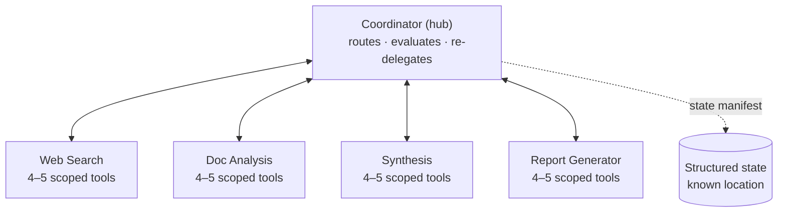

# Cheat sheet: Multi-agent patterns & agentic loop (Q01–Q23)

**Domains:** D1 › 1.2, 1.3, 1.4, 1.7 · D2 › 2.3 · D5 › 5.1, 5.4, 5.6
**Built from:** [Q01](../questions/Q01-source-attribution-multi-agent/question.md) · [Q02](../questions/Q02-context-passing-source-index/question.md) · [Q03](../questions/Q03-crash-recovery-state-manifest/question.md) · [Q04](../questions/Q04-tool-scoping-per-subagent/question.md) · [Q05](../questions/Q05-goals-not-procedures-delegation/question.md) · [Q06](../questions/Q06-coordinator-gap-loop/question.md) · [Q07](../questions/Q07-context-flows-through-coordinator/question.md) · concepts: [claim-source-mapping](../concepts/claim-source-mapping.md), [extract-first-summarize-second](../concepts/extract-first-summarize-second.md), [url-vs-excerpt](../concepts/url-vs-excerpt.md)

## The reference system



## The 3 master rules

| # | Rule | Why |
|---|---|---|
| 1 | **Structure beats instructions** for anything that must be reliable: schemas, scoped tools, gates in code | Prompts are **probabilistic** (~90–95%). Code is **deterministic** (100%) |
| 2 | **Everything goes through the coordinator**, which passes context **explicitly** in the next prompt | Subagents have **isolated context**: *"receives only what the coordinator writes"* |
| 3 | **Be strict about outputs and boundaries, flexible about method** | Reliability where it matters, adaptability where it helps |

## One line per question

| Q | Situation | ✅ Answer | Key idea |
|---|---|---|---|
| **Q01** | Citations lost after summarization | Structured output: content **separate from** source metadata | Free-text summaries drop metadata. Use fields instead |
| **Q02** | What to pass to the report generator | Synthesis draft + **structured source index** (claim → URL + excerpt) | Complete ≠ everything. Pass findings + metadata + links, not 120K raw tokens |
| **Q03** | Pipeline crashed at 12/28 | Agents export structured state → **coordinator loads manifest** → injects into prompts | Exact state, held centrally, handed out selectively |
| **Q04** | Agents call other roles' tools | **18 tools → 4–5 per role** | Fewer, scoped tools = reliable selection. Remove access, don't forbid it |
| **Q05** | Subagent gives up, misses new angles | **Goals + quality criteria**, not steps | Delegate the *what* and *how good*, not the *how* |
| **Q06** | Synthesis flags gaps, coordinator ignores them | Coordinator **evaluates → re-delegates targeted → re-synthesizes** | Closed loop with a cap. After the cap: report gaps / escalate |
| **Q07** | How search → doc analysis info flows | Coordinator **includes findings in the next prompt** | Hub-and-spoke. If it's not in the prompt, the subagent doesn't know it |
| **Q08** | Conflicting estimates: false certainty or vague hedging | Report sections for **established vs contested**, preserving each source's value + method | Annotate conflicts. Don't pick, average or filter |
| **Q09** | Subagents cite correctly, **synthesis** loses links when combining | Structured claim-source mappings that synthesis must **preserve and merge** | Don't reconstruct provenance. Preserve it |
| **Q10** | Synthesis says "no findings were provided" | Coordinator **didn't include** prior outputs in the prompt | API is stateless, subagents isolated. Context exists only if written into the prompt |
| **Q11** | Analysis spots gaps, strict pipeline can't act | Analysis **reports gaps explicitly** → coordinator: targeted search → **re-analysis** → until sufficient | Explicit signal + complete loop (beats inferred signal + half loop) |
| **Q12** | How to give synthesis what it needs | **Complete findings** from both subagents **directly in its prompt** | No inheritance, no callbacks, no shared-store lookups |

### Agentic loop & support agent (single agent)

| Q | Situation | ✅ Answer | Key idea |
|---|---|---|---|
| **Q13** | After `lookup_order`, refund or escalate? | Tool result **appended to the conversation**, and the **model reasons** about the next action | Code runs tools + checks `stop_reason`. The model chooses. Gates in tools enforce must-hold rules |
| **Q14** | Escalate a $847 refund; human can't see the transcript | **Structured summary**: customer ID, root cause, amount, recommended action (+ what was tried) | Self-contained, decision-ready. Conclusions, not raw history |
| **Q15** | Mid-process: promo pricing error needs manager approval | **Compile a structured handoff** (customer, order, issue) **before** `escalate_to_human` | Stop at the authority limit. Package what you already found. Don't try the action anyway |
| **Q16** | Which escalation trigger is most reliable? | **Instruct**: human requested · policy exception/gap · no meaningful progress | The 3 valid triggers (5.2). Judgment calls → model; computable limits → gate |
| **Q17** | One unified order tool → missing / irrelevant params | **Split** into `issue_refund`, `cancel_order`, `request_reshipment`, each with only its required params | Purpose-specific tools (2.1). Make the wrong call impossible to express |
| **Q18** | "Ready to post. Confirm?": 98% approved in 2 s, errors slip through | **Show the details**: full text, account, time, platform | Reviewers can't catch what they can't see. Fix content, not friction |
| **Q19** | `get_neighborhood_info(address)` always needs `get_property_details` first | Tool **accepts `property_id`**, resolves the address internally | Inputs = identifiers the agent has. Deterministic steps go into code |
| **Q20** | Claude omits `user_id` / wrong structure: what helps it *understand*? | **Clear parameter descriptions** (meaning, format, example, required) | Schema = shape, description = meaning, errors = recovery. "Guarantee structure" would flip to schema |
| **Q21** | Agent over- AND under-escalates on confidence scores | Tool returns scores + **`request_review` flag from tested thresholds** + **`review_reasons`** | Don't let the model interpret raw numbers. Decision in code, per field, with reasons |
| **Q22** | Agent retries after 0 results (HTTP 200, `[]`) | **`success: true` + `results: []`**; `isError` only for real execution failures | Empty ≠ error. "Found nothing" vs "could not search" must be distinguishable |
| **Q23** | "Remove old backups" → `delete_file`; descriptions are one-liners | **Expand descriptions**: when to use / NOT use, which tool instead | Descriptions = primary selection mechanism. "Improve selection" → A; "guarantee" → server-side check |

- Loop control: `stop_reason == "tool_use"` → run tool, append `tool_result`, call again · `"end_turn"` → stop. *"The only reliable signal."*
- ❌ Parse "I'm done" text · ❌ iteration cap as **main** stop (OK as a safety limit) · ❌ "has text = finished"
- Policy must hold (e.g. 30-day refunds): **gate inside the tool** or a **PreToolUse hook** → return a **structured error** with "what to do instead" → the model reasons again and self-corrects

## Distractor signals ❌

| If the option says… | It's usually wrong because… | Seen in |
|---|---|---|
| "**Instruct** the agent to…" (for must-have behaviour) | Probabilistic. Look for schema / gate / code | Q01 D, Q05 follow-up |
| "Use a **bigger / better model**" | Exam is model-agnostic. Fix the design | concept: extract-first |
| "Pass the **full / raw / all** context" / **complete transcript** | Floods context. Complete ≠ everything | Q01 C, Q02 A, Q14 D |
| Handoff with **only** diagnosis + amount, or **only** raw excerpts / **only the original message** | Not self-contained: no ID / root cause / recommended action, so the human re-investigates | Q14 B, C · Q15 C |
| "**Persist** full history to a DB, pass a **reference ID**" | Raw, not decision-ready. The human has to dig. Fine for audit **in addition**, not instead | Q15 B (cf. Q12 C) |
| "**Attempt the action anyway**, escalate only if the system **rejects** it" | Acts beyond authority on purpose. A gate is a safety net, not a strategy, and it may not catch this case | Q15 D |
| Escalate on **sentiment / frustration score** or **self-reported confidence** | *"Frustration does not correlate with case complexity."* Confidence is *"poorly calibrated"* | Q16 A |
| Escalate after **N failed attempts** / **rules engine** by category, "removing model judgment" | Arbitrary proxies. Miss policy gaps and explicit human requests. A count is a safety cap, not the trigger | Q16 B, D |
| Fix rubber-stamp approvals with **friction** (type a phrase, waiting period) or **auto-approve** routine cases | Friction ≠ information; auto-approve = less review. Show the decision-relevant details instead | Q18 A, B, C |
| Tool chain problem → add a **helper tool** / **retries** / **merge into one mega-tool** | Same chain (A), symptom fix (B), over-fetching + listed trap (D). Change the dependent tool's **input** instead | Q19 A, B, D |
| For "help Claude **understand**": **schema types only** / **verbose names** (`user_id_string_uuid_format`) / **detailed error responses** | Types = shape not meaning; names aren't docs; errors help only **after** a mistake | Q20 A, B, C |
| **Raw confidence** + few-shot to interpret · **aggregate** quality score · `verified`/`needs_verification` groups without reasons | Model guesses (trap: *"raw… scores without calibration"*); averages hide the bad field; no decision/why | Q21 A, C, D |
| Empty result → **`isError: true`** / **prose** message / **suggestions** field | Flags success as failure → retries (trap); prose re-interpreted; add-on doesn't fix the signal. Opposite trap: failure returned as silent empty success | Q22 A, B, C |
| Misrouting with minimal descriptions → **few-shot** / **routing classifier** / **"type CONFIRM"** / server **rejects after** | Few-shot + classifier are listed traps; confirm = friction; rejection = guarantee, not selection | Q23 B, C, D |
| Keep **one unified tool** + nested object / **if-then-else schema** / **all-optional + few-shot** | Same ambiguity, hidden deeper. Few-shot *"adds token overhead without addressing the root cause"*. Split instead (but don't **merge** similar tools as a first step: also a trap) | Q17 A, B, D |
| "Subagents **directly** call / **callbacks** / **shared** store / **subscribe** / **queue**" | Breaks hub-and-spoke | Q03 B/C, Q07 A/B/D, Q12 B/C |
| "Give the subagent **more tools / access**" | Breaks tool scoping. Route back to the coordinator | Q04, Q06 D |
| "**Remove all detail**: 'research X thoroughly'" | Overcorrection. Loses quality criteria | Q05 C |
| "**Add more fallback rules** to the procedure" | Patches one symptom. Still brittle | Q05 B |
| "**Note the limitation** in the output" / flag for **manual review** | Documents the problem instead of fixing it (OK as a **fallback**) | Q06 A, Q11 D |
| "**Post-process** / re-locate / **reconstruct** sources afterwards (logs, similarity matching)" | Fixes too late. Metadata is already lost, and guessing is approximate | Q01 A, Q02 C, Q09 B/C |
| "Embed source **markers / prefixes / inline citations** in the text" | Still prose. Rewriting drops or misplaces them | Q01 D, Q09 D |
| "Orchestration layer **routes automatically** / tool **sequence planned up front** / pre-configured **decision tree**" (for *how an agentic loop* picks the next tool) | That's a workflow. In an agentic loop the **model reasons** over the appended tool result | Q13 A/C/D |
| "Shared **API connection** / **automatic** context sharing / context **inheritance**" | No such mechanism. The API is stateless and subagents are isolated | Q10 A, Q12 A |
| An option that explains a **different symptom** (e.g. "context window too small" when the agent says "nothing provided") | **Symptom mismatch.** Pick the cause that produces *exactly* the observed behaviour | Q04 B, Q04 D, Q10 D |
| "**Broader** queries / **plan or decompose more** up front" (for depth gaps found later) | Open loop. Guessing instead of feedback | Q06 B, Q11 A |
| A loop where the coordinator **infers** problems from prose, or that **skips a step** (re-search without re-analysis, no stop condition) | Inferred signal + incomplete loop. Prefer an explicit report + full loop | Q11 C |
| "**Semantic / vector search** to restore exact state" | Approximate retrieval ≠ exact state | Q03 B |
| "**Average** / normalize to **one score** / **pick** the best source" (for conflicts) | Destroys information, creates false certainty | Q08 D |
| "**Filter** to high-confidence / require **≥2 sources**" | Drops valid findings before anyone can judge. Corroboration is a **label**, not a filter | Q08 A, B |

## Decision cheats

| Need | Use |
|---|---|
| Must **always** happen (money, compliance) | **Prerequisite gate** in the tool / **hook** / fixed **workflow** in code |
| Confidence threshold for review? (Q21) | **Per field**, **tested** on a validation set (known answers), **stricter where mistakes are costly** (amount > vendor). Never one made-up number for all |
| Tool result types (Q22, 2.2) | 0 matches → `success: true, results: []` · **transient** (timeout) → `isError`, `isRetryable: true`, capped retry · **validation** → fix input · **business** → explain/alternative/escalate · **permission** → escalate. Never report a failure as "no results" |
| Schema vs description vs code check? (Q20) | **Valid ≠ correct.** Schema → valid shape · description → correct meaning (likely) · code check (e.g. ID belongs to session) → guaranteed |
| Is a review / confirmation step working? (Q18) | Measure **outcomes** (incidents, errors caught, rejections/edits), not **behaviour** (approval rate, seconds). High approval is fine if the items are correct |
| Instruct or gate? (Q16) | Condition is **plain data** (`amount > 500`, `days > 30`) → **gate**. Needs **understanding** (policy gap, progress, "wants a human") → **instruct** with clear criteria. ❌ Circular gate: `if escalation_required` |
| Must **adapt** to the unexpected | **Goals + quality criteria** in the delegation prompt |
| Exact facts must survive summaries | **Extract first** → persistent **fact block** owned by code |
| Prove a citation is real | Check against the **retrieval log** (code), not "ask Claude" |
| Prove a citation **supports** the claim | **Excerpt** next to the claim + independent model check |
| Subagent occasionally needs another role's capability | **Narrow, constrained tool** (e.g. `verify_fact`). Complex needs go back to the coordinator |
| Results incomplete | Coordinator gap loop (depth gap) · fix **decomposition** (scope gap) |
| Loop can't converge | **Cap** iterations → structured gap note → escalate if critical |
| Resume after crash | Structured **state manifest**, loaded by the coordinator |
| "Pass complete findings" vs "don't pass everything"? | **Findings** (outputs: claims + sources + excerpts) → pass **all**. **Context** (raw inputs, history) → pass **selectively** (Q02 + Q12) |
| Sources disagree | **Annotate**: both values + source + method + uncertainty, in a **contested** section |
| Next agent could get empty or broken input | **Handoff gate** in the coordinator: validate non-empty + required fields **before** invoking (Q10) |

## Human escalation handoff: the 5 fields (Q14, guide 1.4)

1. **Customer ID** · 2. **Conversation summary** (what they asked + what was tried) · 3. **Root cause** · 4. **Exact amount** · 5. **Recommended action**. Self-contained, because the human has no transcript.

## Handoff prompt template (Q01 + Q02 + Q05 + Q07)

```
Goal: <what to achieve, for which question>
Context (from <previous agent>):
<findings>
  <finding id="F1" source_url="..." excerpt="...">claim</finding>
</findings>
Quality criteria: <coverage, diversity, recency, cite source id per claim, flag conflicts>
Return: structured JSON {claims:[{text, source_id}], conflicts:[...], gaps:[...]}
```

## Key guide quotes

- *"Specify goals, not procedures."* (1.3)
- *"A subagent receives only what the coordinator writes into the subagent's prompt."* (1.3)
- *"All communication routes through the coordinator. Subagents never communicate directly with each other…"* (1.2)
- *"[The coordinator] evaluates the synthesis output for gaps… re-delegates… with targeted queries."* (1.2)
- *"Prompt-based guidance is probabilistic. Programmatic enforcement is deterministic."* (1.4)
- *"When you give a single agent 18 tools, the agent selects tools less reliably."* (2.3)
- *"Subagents emit structured claim-source mappings. These are data rather than prose."* (5.6)

## Revision watch list (if you only have ~1 hour)

| Course | Lectures |
|---|---|
| **Udemy A** (CCAR-F 2026 Exam Prep) | #16 Orchestrator Role · #17 Subagent Design · #19 Message Schemas · #28 Why Prompts Are Not Sufficient · #39 Tool Scoping · #109 Why Summaries Lose Facts · #131 Claim-to-Source Mappings → **Quiz 3** |
| **Udemy B** (Voroniuk) | #49 Prerequisite Gates · #60 Coordinator Pattern · #63 Scoping Tools · #64 Passing Context · #67 Claims Tied to Sources · #69 Research Case → **Quiz 7** |
