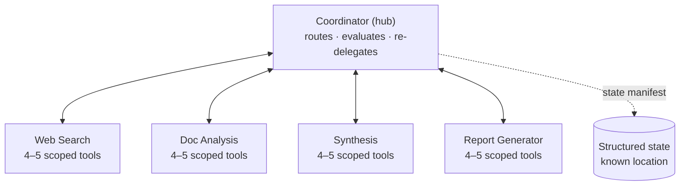

# Cheat sheet: Multi-agent patterns (Q01–Q09)

**Domains:** D1 › 1.2, 1.3, 1.4, 1.7 · D2 › 2.3 · D5 › 5.1, 5.4, 5.6
**Built from:** [Q01](../questions/Q01-source-attribution-multi-agent/question.md) · [Q02](../questions/Q02-context-passing-source-index/question.md) · [Q03](../questions/Q03-crash-recovery-state-manifest/question.md) · [Q04](../questions/Q04-tool-scoping-per-subagent/question.md) · [Q05](../questions/Q05-goals-not-procedures-delegation/question.md) · [Q06](../questions/Q06-coordinator-gap-loop/question.md) · [Q07](../questions/Q07-context-flows-through-coordinator/question.md) · concepts: [claim-source-mapping](../concepts/claim-source-mapping.md), [extract-first-summarize-second](../concepts/extract-first-summarize-second.md), [url-vs-excerpt](../concepts/url-vs-excerpt.md)

## The reference system



## The 3 master rules

| # | Rule | Why |
|---|---|---|
| 1 | **Structure beats instructions** for anything that must be reliable: schemas, scoped tools, gates in code | Prompts are **probabilistic** (~90–95%). Code is **deterministic** (100%) |
| 2 | **Everything goes through the coordinator**, which passes context **explicitly** in the next prompt | Subagents have **isolated context**: *"receives only what the coordinator writes"* |
| 3 | **Be strict about outputs and boundaries, flexible about method** | Reliability where it matters, adaptability where it helps |

## One line per question

| Q | Situation | ✅ Answer | Key idea |
|---|---|---|---|
| **Q01** | Citations lost after summarization | Structured output: content **separate from** source metadata | Free-text summaries drop metadata. Use fields instead |
| **Q02** | What to pass to the report generator | Synthesis draft + **structured source index** (claim → URL + excerpt) | Complete ≠ everything. Pass findings + metadata + links, not 120K raw tokens |
| **Q03** | Pipeline crashed at 12/28 | Agents export structured state → **coordinator loads manifest** → injects into prompts | Exact state, held centrally, handed out selectively |
| **Q04** | Agents call other roles' tools | **18 tools → 4–5 per role** | Fewer, scoped tools = reliable selection. Remove access, don't forbid it |
| **Q05** | Subagent gives up, misses new angles | **Goals + quality criteria**, not steps | Delegate the *what* and *how good*, not the *how* |
| **Q06** | Synthesis flags gaps, coordinator ignores them | Coordinator **evaluates → re-delegates targeted → re-synthesizes** | Closed loop with a cap. After the cap: report gaps / escalate |
| **Q07** | How search → doc analysis info flows | Coordinator **includes findings in the next prompt** | Hub-and-spoke. If it's not in the prompt, the subagent doesn't know it |
| **Q08** | Conflicting estimates: false certainty or vague hedging | Report sections for **established vs contested**, preserving each source's value + method | Annotate conflicts. Don't pick, average or filter |
| **Q09** | Subagents cite correctly, **synthesis** loses links when combining | Structured claim-source mappings that synthesis must **preserve and merge** | Don't reconstruct provenance. Preserve it |

## Distractor signals ❌

| If the option says… | It's usually wrong because… | Seen in |
|---|---|---|
| "**Instruct** the agent to…" (for must-have behaviour) | Probabilistic. Look for schema / gate / code | Q01 D, Q05 follow-up |
| "Use a **bigger / better model**" | Exam is model-agnostic. Fix the design | concept: extract-first |
| "Pass the **full / raw / all** context" | Floods context. Complete ≠ everything | Q01 C, Q02 A |
| "Subagents **directly** call / **shared** store / **subscribe** / **queue**" | Breaks hub-and-spoke | Q03 B/C, Q07 A/B/D |
| "Give the subagent **more tools / access**" | Breaks tool scoping. Route back to the coordinator | Q04, Q06 D |
| "**Remove all detail**: 'research X thoroughly'" | Overcorrection. Loses quality criteria | Q05 C |
| "**Add more fallback rules** to the procedure" | Patches one symptom. Still brittle | Q05 B |
| "**Note the limitation** in the output" | Documents the problem instead of fixing it (OK as a **fallback**) | Q06 A |
| "**Post-process** / re-locate / **reconstruct** sources afterwards (logs, similarity matching)" | Fixes too late. Metadata is already lost, and guessing is approximate | Q01 A, Q02 C, Q09 B/C |
| "Embed source **markers / prefixes / inline citations** in the text" | Still prose. Rewriting drops or misplaces them | Q01 D, Q09 D |
| "**Broader** queries up front" | Open loop. Guessing instead of feedback | Q06 B |
| "**Semantic / vector search** to restore exact state" | Approximate retrieval ≠ exact state | Q03 B |
| "**Average** / normalize to **one score** / **pick** the best source" (for conflicts) | Destroys information, creates false certainty | Q08 D |
| "**Filter** to high-confidence / require **≥2 sources**" | Drops valid findings before anyone can judge. Corroboration is a **label**, not a filter | Q08 A, B |

## Decision cheats

| Need | Use |
|---|---|
| Must **always** happen (money, compliance) | **Prerequisite gate** in the tool / **hook** / fixed **workflow** in code |
| Must **adapt** to the unexpected | **Goals + quality criteria** in the delegation prompt |
| Exact facts must survive summaries | **Extract first** → persistent **fact block** owned by code |
| Prove a citation is real | Check against the **retrieval log** (code), not "ask Claude" |
| Prove a citation **supports** the claim | **Excerpt** next to the claim + independent model check |
| Subagent occasionally needs another role's capability | **Narrow, constrained tool** (e.g. `verify_fact`). Complex needs go back to the coordinator |
| Results incomplete | Coordinator gap loop (depth gap) · fix **decomposition** (scope gap) |
| Loop can't converge | **Cap** iterations → structured gap note → escalate if critical |
| Resume after crash | Structured **state manifest**, loaded by the coordinator |
| Sources disagree | **Annotate**: both values + source + method + uncertainty, in a **contested** section |

## Handoff prompt template (Q01 + Q02 + Q05 + Q07)

```
Goal: <what to achieve, for which question>
Context (from <previous agent>):
<findings>
  <finding id="F1" source_url="..." excerpt="...">claim</finding>
</findings>
Quality criteria: <coverage, diversity, recency, cite source id per claim, flag conflicts>
Return: structured JSON {claims:[{text, source_id}], conflicts:[...], gaps:[...]}
```

## Key guide quotes

- *"Specify goals, not procedures."* (1.3)
- *"A subagent receives only what the coordinator writes into the subagent's prompt."* (1.3)
- *"All communication routes through the coordinator. Subagents never communicate directly with each other…"* (1.2)
- *"[The coordinator] evaluates the synthesis output for gaps… re-delegates… with targeted queries."* (1.2)
- *"Prompt-based guidance is probabilistic. Programmatic enforcement is deterministic."* (1.4)
- *"When you give a single agent 18 tools, the agent selects tools less reliably."* (2.3)
- *"Subagents emit structured claim-source mappings. These are data rather than prose."* (5.6)

## Revision watch list (if you only have ~1 hour)

| Course | Lectures |
|---|---|
| **Udemy A** (CCAR-F 2026 Exam Prep) | #16 Orchestrator Role · #17 Subagent Design · #19 Message Schemas · #28 Why Prompts Are Not Sufficient · #39 Tool Scoping · #109 Why Summaries Lose Facts · #131 Claim-to-Source Mappings → **Quiz 3** |
| **Udemy B** (Voroniuk) | #49 Prerequisite Gates · #60 Coordinator Pattern · #63 Scoping Tools · #64 Passing Context · #67 Claims Tied to Sources · #69 Research Case → **Quiz 7** |
