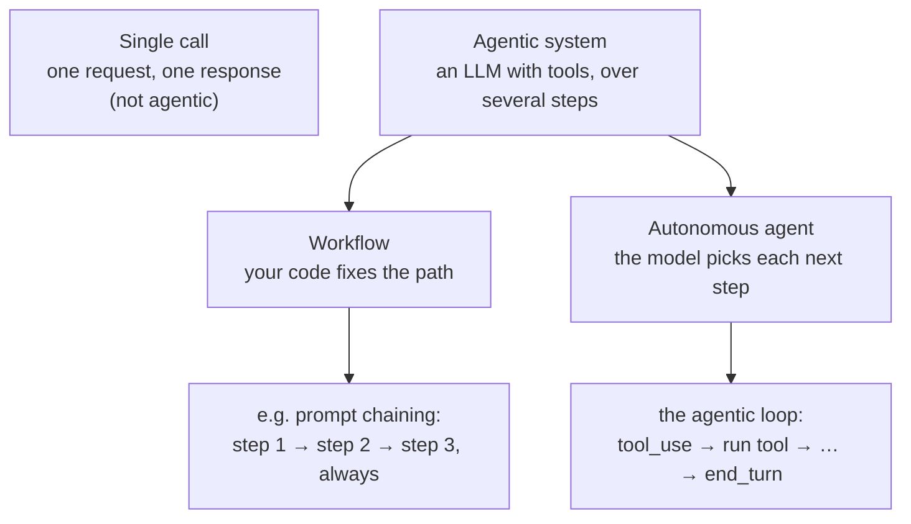

# Agentic system vs autonomous agent

**From:** [Stage 1](../study-map/learning-path.md#stage-1) of the learning path · **Domain / lesson:** D1 › 1.1 Agentic Loops · D1 › 1.6 Task Decomposition

## Short answer

**They aren't two rival designs.** "Agentic system" is the umbrella term. An "autonomous agent" is one kind of agentic system: the kind where **the model decides its own next step**. The other kind is a **workflow**, where **your code decides the steps**.

The pair of terms comes from Anthropic's engineering article [Building effective agents](https://www.anthropic.com/engineering/building-effective-agents) (19 December 2024). *It is not guide wording.*
- *"At Anthropic, we categorize all these variations as agentic systems, but draw an important architectural distinction between workflows and agents"*
- *"Workflows are systems where LLMs and tools are orchestrated through predefined code paths."*
- *"Agents, on the other hand, are systems where LLMs dynamically direct their own processes and tool usage, maintaining control over how they accomplish tasks."*
- The article's diagram of the agent pattern is captioned *"Autonomous agent"*, and it says agents are *"typically just LLMs using tools based on environmental feedback in a loop."*



## The one question that tells them apart: who decides the next step?

| | Single call | Workflow | Autonomous agent |
|---|---|---|---|
| **Who decides the next step** | Nobody: there is no next step | **Your code** (a predefined path) | **The model**, from the tool results so far |
| **Number of steps** | One | Known in advance | Not known in advance. It ends when `stop_reason` is `"end_turn"` |
| **Strength** | Cheapest, simplest | Predictable, consistent, easy to debug | Adapts to cases nobody planned for |
| **Weakness** | Can't act or look things up | Can't react to surprises | Less predictable time and cost, harder to debug, errors can compound |
| **Guide's words (1.1)** | *"Claude answers one request with one response"* | *"pre-configured decision tree or fixed tool sequence"* | *"model-driven decision-making"* |
| **Guide's words (1.6)** | | *"fixed sequential pipeline, also called prompt chaining"* | *"dynamic adaptive decomposition"* |

## How the guide says it

The guide doesn't use "agentic system" and "autonomous agent" as a pair (checked: lessons 1.1 and 1.6). It teaches the same split under other names:
- 1.1: *"An agent is Claude, its tools and the code that continues this exchange."*
- 1.1: *"In an agentic loop, Claude uses the current context to decide which tool to call. This is model-driven decision-making: the model reads the task, compares the available tools and picks one. In a pre-configured decision tree or fixed tool sequence, the developer hard-codes which tool runs at which point."*
- 1.6: *"A fixed sequential pipeline, also called prompt chaining, runs predetermined steps in order. Dynamic adaptive decomposition generates subtasks from what each step discovers."*

## Two things people get wrong

**1. "Autonomous" doesn't mean that no code is in charge.** The loop itself is code. Guide 1.1: *"It is deterministic control flow, defined in code."* The model chooses which tool to call and says when it's finished. Your code runs the tools, appends the results and checks `stop_reason`. The article also adds limits: *"it's also common to include stopping conditions (such as a maximum number of iterations) to maintain control."* Guide 1.1 allows such a cap only *"as a safeguard against runaway agents"*, never as the main way to stop.

**2. More autonomy isn't the better answer on the exam.** Pick the pattern that fits the task. Guide 1.6 exam trap: *"Match the pattern to the task characteristics, not to what sounds more sophisticated."* The article says the same: *"we recommend finding the simplest solution possible, and only increasing complexity when needed."*

| Task | Pattern | Question |
|---|---|---|
| The same three checks on every PR | Workflow (prompt chaining) | [Q73](../questions/Q73-same-steps-every-pr-prompt-chaining/question.md), Stage 9 |
| A bug whose cause and components are unknown | Agent (dynamic decomposition) | [Q75](../questions/Q75-intermittent-500-dynamic-decomposition/question.md), Stage 9 |
| A support request that may need tools in any order | Agent (model-driven tool choice) | [Q13](../questions/Q13-agentic-loop-model-decides-next-tool/question.md), Stage 1 |

*In the questions so far, this distinction appears as a choice of pattern, not as a vocabulary question.*

## The autonomy spectrum (Udemy A #3 slide)

The slide says: *"Autonomy exists on a spectrum, from fully supervised to fully autonomous"*. This is Udemy A's framing. The guide doesn't use the word "spectrum" (checked: lessons 1.1, 1.2, 1.4, 1.5, 1.6, 3.4, 3.6, 5.2 and 5.5).

**What it means:** autonomy isn't on or off. It is **how much the agent does before a human checks it**. The further you move toward "fully autonomous", the fewer human checkpoints there are.

*The five levels are my own arrangement, not guide wording. The examples are guide quotes.*

| Level | What the human does | Example |
|---|---|---|
| **Fully supervised** | Approves each action before it happens | Claude Code asking before it edits a file or runs a command *(practical example, not guide wording)* |
| **Approves the plan** | Approves once, before anything changes | Plan mode, guide 3.4: *"Claude then writes nothing to disk until you approve the plan."* |
| **Takes the exceptions** | Handles only the cases the agent hands over | Support agent, guide 5.2: escalate on *"explicit human request, policy gap, inability to progress"*, otherwise *"resolve autonomously"* |
| **Reviews afterwards** | Checks part of the finished output | Extraction, guide 5.5: reviewers get the most uncertain fields ([Q114](../questions/Q114-calibrated-field-confidence-routes-review/question.md)) |
| **Fully autonomous** | Nobody is there during the run | CI, guide 3.6: with `-p`, Claude Code *"processes the prompt, writes the result to stdout and exits, without waiting for user input."* |

**How far to move along it:** only as far as the risk allows and your measurements support.
- **Trust is measured, not assumed.** Guide 5.5: *"Always validate accuracy by document type and field segment before automating. Never decide what to automate from aggregate metrics alone."* ([Q95](../questions/Q95-accuracy-by-segment-before-automating/question.md))
- The article says the same: *"you must have some level of trust in its decision-making"*, and *"We recommend extensive testing in sandboxed environments, along with the appropriate guardrails."*
- **On the exam:** as with workflow vs agent, the most autonomous option isn't automatically right. Pick the level that fits the risk and the evidence.

## The Udemy A #3 slide "Who Decides What Happens Next", in simple words

**The slide uses the words differently from the article at the top of this note.** The idea is the same. Only the labels change.

| Word | In the article (top of this note) | On the Udemy A slide |
|---|---|---|
| **Agentic system** | Everything: workflows and agents | Only the kind where the model decides |
| **Workflow** | One kind of agentic system | The opposite of an agentic system |
| **Autonomous agent** | The kind where the model decides | An agent that works without a human directing each step |

### A train, a taxi and the passenger

*This picture is my own illustration, not course or guide wording.*

- **Workflow = a train.** The route and the stops were fixed when the line was built. Every train goes the same way, and it can't take a detour.
- **Agentic system = a taxi.** You give the address. The driver chooses each turn while driving, from what they see on the road, and stops on arrival. For Claude, "what they see" is the tool results, and "arrival" is `stop_reason: "end_turn"`.
- **Autonomous = how much the passenger checks.** One passenger wants the driver to ask before every turn (supervised). Another gives the address and falls asleep (fully autonomous). It's the same taxi and the same driver. Only the checking changes.

### Two questions to ask about any system

1. **Who picks the next step?** Code written in advance → workflow. The model, while it runs → agentic system.
2. **How often does a human check?** At every step → supervised. Never during the run → autonomous.

**Two terms from the slide:**
- **Design time:** when the developer writes the code. A workflow's steps are decided then.
- **Inference time:** while the model is running. An agentic system's next step is decided then, in each response.

**The slide's definitions:**
- **Agentic system:** *"An architecture where a language model autonomously pursues a goal by selecting actions, invoking tools, and iterating until a termination condition is met."*
- **Workflow (deterministic):** *"A fixed, developer-authored sequence of steps that executes predictably. Control flow is set at design time, not at inference time."* (Part of "developer-authored" is hidden behind the play button in the screenshot.)
- **Autonomous agent:** *"An agent that operates without step-by-step human direction, making its own planning decisions to hit a high-level goal."*

## Udemy A Quiz 1, Question 1: why "agentic," not routing? (2026-11-05)

> *"Claude receives a customer request, decides which of three internal APIs to call based on the request, executes the call, reads the result, and then decides whether a follow-up call is needed. Which term best describes this system?"*
> Options: deterministic workflow · **agentic system** ✅ · conversational chatbot · prompt chain

**My question:** "Why is this the right answer, and not routing?"

The "decides which of three APIs" part does look like routing. **The difference is what happens after the call.**

- **Routing:** classify once, send the request to one handler, done. Your code fixed the routes in advance, and **nothing loops back**.
- **This system:** Claude calls an API, **reads the result**, and then **decides whether another call is needed**. That's a loop, and **the model** controls when it ends.

> **Routing makes one choice up front. An agentic system keeps choosing, based on what it just learned.**

It's the same test as above: **who decides the next step?** Here the model decides at runtime, so it's agentic. The other options fail the same test. A deterministic workflow and a prompt chain fix the flow at design time, and a chatbot can't call APIs at all.

See also [S01-3-routing-vs-orchestrator-workers](S01-3-routing-vs-orchestrator-workers.md).

- *Check: change one thing: Claude picks one of the three APIs, the code calls it, and the result goes straight to the customer. Routing or agentic, and why?*
  *My answer:* "Workflow, as the agent does the categorization part and then, based on the category, the request goes down one of the predefined paths." ✅ Correct. It's a **routing workflow**. The model makes **one** choice, the category, and after that the path is fixed: your code calls the API and returns the result. **Nothing loops back to the model.** So the model making one decision isn't enough to make a system agentic. The question is whether the model **controls the flow**, meaning it reads results and decides what happens next.

**Follow-up question:** "But isn't 'decides which of three internal APIs to call based on the request' the same as categorization? Except it executes the call."

Yes. **That first part is the same as categorization.** Taken alone, "decides which of three APIs" is routing. **Executing the call isn't what makes it agentic either.** In routing, your code can execute the call too. What makes it agentic is the last part of the sentence: *"reads the result, and then decides whether a follow-up call is needed."*

```text
Routing:  request → model picks API → call → result to customer   (one pass, then done)
Agentic:  request → model picks API → call → model reads result → another call? → …
                                                  ↑______________________________|
```

> **The first choice is the same in both. Only the agentic system loops back to the model after the result.**

- *Check: which part of the quiz sentence would you delete to turn it back into routing?*
  *My answer:* "'reads the result, and then decides whether a follow-up call is needed'" ✅ Exactly. Delete that part and there's no loop: one choice, one call, done. That's routing.

## Related course lessons

### Udemy A (primary): Claude Certified Architect (CCAR-F) - 2026 Exam Prep
| # | Lecture | Part | Why |
|---|---|---|---|
| **3** | **Agents, Workflows, and Chatbots** | 1A | ⭐ Exactly this question: the three levels in the table above |
| **8** | **When Workflows Outperform Agents** | 1A | ⭐ Why more autonomy isn't always better |
| 9 | Choosing the Right Architecture | 1A | Picking the pattern from the task |
| Quiz 1 | 1A quiz | | Self-test |

**▶ Watch in this order (~20 min, est.):** #3 → #8 → #9, then do **Quiz 1**. All three are already in Stage 1's watch list.

### Udemy B: Claude Certified Architect Foundations: Complete Course (Voroniuk)
| # | Lecture | Section | Why |
|---|---|---|---|
| 59 | Workflow or Agent: How Work Is Decomposed | S7 Multi-Agent Systems | The same split, applied to decomposition (Stage 9) |

### CBT Nuggets: CCA-F course
| Skill | Why |
|---|---|
| 36. Design Workflows and Agent Systems | Workflows vs agents (1.2, 1.6), Stage 9 |

## Check question

**Two systems:**
1. **Invoices:** for each invoice, code sends it to Claude to extract the fields, then sends that output to Claude a second time to check the totals, then saves the result.
2. **Support bot:** Claude has `lookup_order`, `check_diary` and `issue_refund`, and the loop keeps running until `stop_reason` is `"end_turn"`. A hook blocks any refund over £500.

**Which one is the workflow and which is the agent? And does the hook in (2) turn it into a workflow?**
