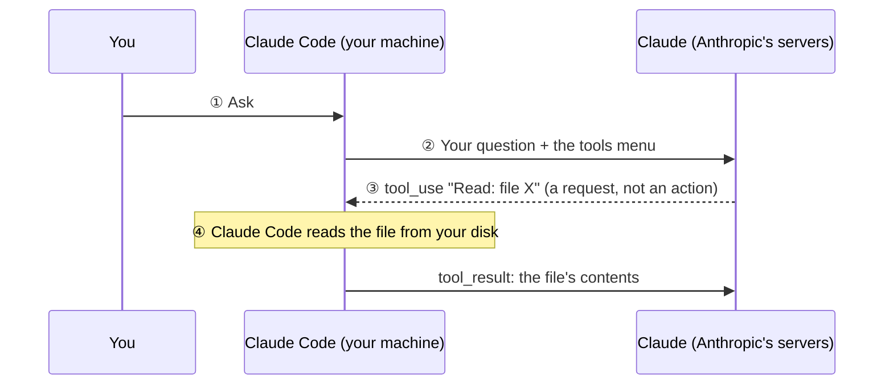

# Claude Code vs Claude: the harness and the model

**Stage 13** of the [learning path](../study-map/learning-path.md) (CBT Lesson 03, "Tool Use Workflow") · **D1 › 1.1 Agentic Loops** · **D2 › 2.5 Built-in Tools**
**Builds on:** [S01-6-agentic-loop-in-code](S01-6-agentic-loop-in-code.md) (the same loop, written by hand in the Udemy B #40 lab)
**Goes with:** [S13-1-init-and-memory-commands](S13-1-init-and-memory-commands.md)

## The questions (2026-11-07)

> In the CBT tool-use diagram: what is the difference between Claude Code and Claude? · Does Claude Code itself have a language model? · So when `tool_use` is requested, it's Claude Code that supplies those tools?

## The whiteboard: Tool Use Workflow (CBT Lesson 03)

## Claude is the brain, Claude Code is the hands

| | Claude (the model) | Claude Code (the app) |
|---|---|---|
| Where it runs | Anthropic's servers | Your machine |
| What it does | Reads the request, then **decides**: writes text or a `tool_use` request | **Sends** requests to Claude, **runs** the tools, sends the results back |
| Can it touch your files? | ❌ No. It only sees what's sent to it | ✅ Yes. Read, Edit, Bash and so on run here |

Docs: *"The agentic loop is powered by two components: models that reason and tools that act. Claude Code is the layer around the model that provides the tools and manages the context the model sees. This surrounding layer is what the term agentic harness refers to."*

> **Claude decides. Claude Code acts.**

## Does Claude Code have its own model? No

Claude Code is an ordinary program on your computer that **calls Claude over the internet** for every step. Docs: *"Claude Code uses Claude models to understand your code and reason about tasks."*

You can see this in two places:
- **`/model`** switches which Claude model it calls (e.g. Sonnet or Opus). The app stays the same; only the brain it talks to changes.
- Every request goes to the same **Messages API** your lab code uses. A resumed session is just one long message list sent to it ([S01-2](S01-2-context-window-across-sessions.md)).

> **Claude Code = the harness on your machine. The model always runs remotely, on Anthropic's servers.**

## Who supplies the tools? Claude Code, twice

| Step | What Claude Code does | In the S01-6 lab |
|---|---|---|
| **1. Offers the menu** | Sends the tool definitions (name, description, `input_schema`) with **every** request, so Claude knows which tools exist | `tools=TOOLS` |
| **2. Runs the tool** | When Claude replies with `tool_use`, runs it on your machine and sends back a `tool_result` | `TOOL_FUNCTIONS[name](**args)` |

Claude can only ask for tools on the menu. It can't invent a new one.

Where Claude Code's tools come from:
- **Built-in**: Read, Edit, Bash, Grep and so on, which ship with Claude Code.
- **MCP servers**: Claude Code connects to them, adds their tools to the menu, and calls the server when Claude picks one.

> **Claude picks from the menu. Claude Code writes the menu and does the cooking.**

## Same job as your lab code

| Claude Code | Your Udemy B #40 lab ([S01-6](S01-6-agentic-loop-in-code.md)) |
|---|---|
| Built-in tool definitions | `TOOLS` |
| Running Read, Edit, Bash… | `TOOL_FUNCTIONS` and `run_tools()` |
| The loop until Claude stops asking for tools | `while True:` … `if response.stop_reason != "tool_use": break` |
| Transcript of the session | `messages` |

Claude Code is a ready-made version of the loop you wrote by hand.

## Sources

- Claude Code docs, [How Claude Code works](https://code.claude.com/docs/en/how-claude-code-works) (checked 2026-11-07): *"The agentic loop is powered by two components: models that reason and tools that act. Claude Code is the layer around the model that provides the tools and manages the context the model sees. This surrounding layer is what the term agentic harness refers to."*; *"Claude Code uses Claude models to understand your code and reason about tasks."*; *"Switch with `/model` during a session"*; *"Without tools, Claude can only respond with text."*
