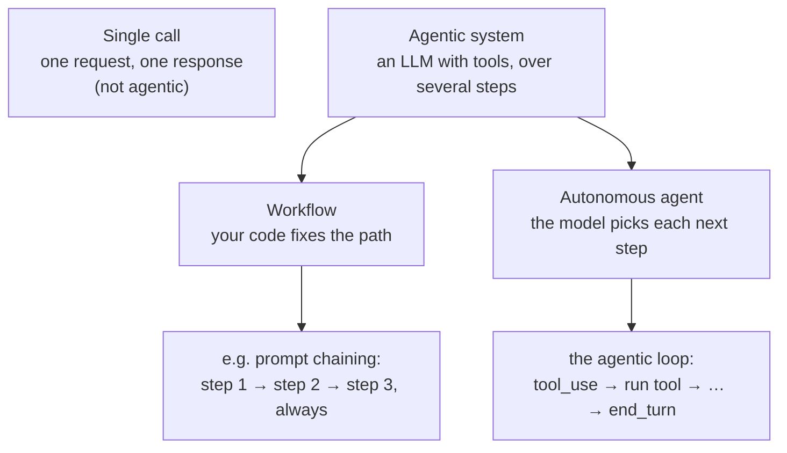

# Agentic system vs autonomous agent

**From:** [Stage 1](../study-map/learning-path.md#stage-1) of the learning path · **Domain / lesson:** D1 › 1.1 Agentic Loops · D1 › 1.6 Task Decomposition

## Short answer

**They aren't two rival designs.** "Agentic system" is the umbrella term. An "autonomous agent" is one kind of agentic system: the kind where **the model decides its own next step**. The other kind is a **workflow**, where **your code decides the steps**.

The pair of terms comes from Anthropic's engineering article [Building effective agents](https://www.anthropic.com/engineering/building-effective-agents) (19 December 2024). *It is not guide wording.*
- *"At Anthropic, we categorize all these variations as agentic systems, but draw an important architectural distinction between workflows and agents"*
- *"Workflows are systems where LLMs and tools are orchestrated through predefined code paths."*
- *"Agents, on the other hand, are systems where LLMs dynamically direct their own processes and tool usage, maintaining control over how they accomplish tasks."*
- The article's diagram of the agent pattern is captioned *"Autonomous agent"*, and it says agents are *"typically just LLMs using tools based on environmental feedback in a loop."*

## The one question that tells them apart: who decides the next step?

| | Single call | Workflow | Autonomous agent |
|---|---|---|---|
| **Who decides the next step** | Nobody: there is no next step | **Your code** (a predefined path) | **The model**, from the tool results so far |
| **Number of steps** | One | Known in advance | Not known in advance. It ends when `stop_reason` is `"end_turn"` |
| **Strength** | Cheapest, simplest | Predictable, consistent, easy to debug | Adapts to cases nobody planned for |
| **Weakness** | Can't act or look things up | Can't react to surprises | Less predictable time and cost, harder to debug, errors can compound |
| **Guide's words (1.1)** | *"Claude answers one request with one response"* | *"pre-configured decision tree or fixed tool sequence"* | *"model-driven decision-making"* |
| **Guide's words (1.6)** | | *"fixed sequential pipeline, also called prompt chaining"* | *"dynamic adaptive decomposition"* |

## How the guide says it

The guide doesn't use "agentic system" and "autonomous agent" as a pair (checked: lessons 1.1 and 1.6). It teaches the same split under other names:
- 1.1: *"An agent is Claude, its tools and the code that continues this exchange."*
- 1.1: *"In an agentic loop, Claude uses the current context to decide which tool to call. This is model-driven decision-making: the model reads the task, compares the available tools and picks one. In a pre-configured decision tree or fixed tool sequence, the developer hard-codes which tool runs at which point."*
- 1.6: *"A fixed sequential pipeline, also called prompt chaining, runs predetermined steps in order. Dynamic adaptive decomposition generates subtasks from what each step discovers."*

## Two things people get wrong

**1. "Autonomous" doesn't mean that no code is in charge.** The loop itself is code. Guide 1.1: *"It is deterministic control flow, defined in code."* The model chooses which tool to call and says when it's finished. Your code runs the tools, appends the results and checks `stop_reason`. The article also adds limits: *"it's also common to include stopping conditions (such as a maximum number of iterations) to maintain control."* Guide 1.1 allows such a cap only *"as a safeguard against runaway agents"*, never as the main way to stop.

**2. More autonomy isn't the better answer on the exam.** Pick the pattern that fits the task. Guide 1.6 exam trap: *"Match the pattern to the task characteristics, not to what sounds more sophisticated."* The article says the same: *"we recommend finding the simplest solution possible, and only increasing complexity when needed."*

| Task | Pattern | Question |
|---|---|---|
| The same three checks on every PR | Workflow (prompt chaining) | [Q73](../questions/Q73-same-steps-every-pr-prompt-chaining/question.md), Stage 9 |
| A bug whose cause and components are unknown | Agent (dynamic decomposition) | [Q75](../questions/Q75-intermittent-500-dynamic-decomposition/question.md), Stage 9 |
| A support request that may need tools in any order | Agent (model-driven tool choice) | [Q13](../questions/Q13-agentic-loop-model-decides-next-tool/question.md), Stage 1 |

*In the questions so far, this distinction appears as a choice of pattern, not as a vocabulary question.*

## Related course lessons

### Udemy A (primary): Claude Certified Architect (CCAR-F) - 2026 Exam Prep
| # | Lecture | Part | Why |
|---|---|---|---|
| **3** | **Agents, Workflows, and Chatbots** | 1A | ⭐ Exactly this question: the three levels in the table above |
| **8** | **When Workflows Outperform Agents** | 1A | ⭐ Why more autonomy isn't always better |
| 9 | Choosing the Right Architecture | 1A | Picking the pattern from the task |
| Quiz 1 | 1A quiz | | Self-test |

**▶ Watch in this order (~20 min, est.):** #3 → #8 → #9, then do **Quiz 1**. All three are already in Stage 1's watch list.

### Udemy B: Claude Certified Architect Foundations: Complete Course (Voroniuk)
| # | Lecture | Section | Why |
|---|---|---|---|
| 59 | Workflow or Agent: How Work Is Decomposed | S7 Multi-Agent Systems | The same split, applied to decomposition (Stage 9) |

### CBT Nuggets: CCA-F course
| Skill | Why |
|---|---|
| 36. Design Workflows and Agent Systems | Workflows vs agents (1.2, 1.6), Stage 9 |

## Check question

**Two systems:**
1. **Invoices:** for each invoice, code sends it to Claude to extract the fields, then sends that output to Claude a second time to check the totals, then saves the result.
2. **Support bot:** Claude has `lookup_order`, `check_diary` and `issue_refund`, and the loop keeps running until `stop_reason` is `"end_turn"`. A hook blocks any refund over £500.

**Which one is the workflow and which is the agent? And does the hook in (2) turn it into a workflow?**
