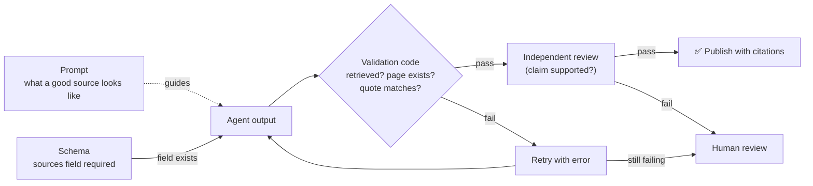

# Concept: Claim-source mapping: agent design or prompt?

**Domain / lessons:** D5 › 5.6 Information Provenance · D4 › 4.3 Structured Output · D4 › 4.4 Validation/Retry · D4 › 4.6 Multi-Pass Review · D5 › 5.5 Human Review
**Related question:** [Q01: Source attribution in a multi-agent pipeline](../questions/Q01-source-attribution-multi-agent/question.md)

## Short answer

**Both.** The **design** does the real work, and the **prompt** supports it. Design is what makes the mapping reliable.

### Think of it as a paper form
- **Design** puts a **required "Source:" field** on the form. You can't submit the form without filling it in.
- **Prompt** is the **instructions printed on the form**: "Enter the exact URL and page number, not a general website name."

If you only have instructions and no field, people forget. If you only have the field and no instructions, people fill it with junk like "the internet." You need both, and the field is what guarantees the source is there at all.

## The three layers, strongest first

| Layer | What you do | Guide lesson | Reliability |
|---|---|---|---|
| **1. Schema (design)** | Define the agent's output as structured data, e.g. through a tool's `input_schema`: `{claim, sources: [{url, doc, page, quote}]}` with `sources` **required** | D4 › 4.3 | Field **always exists** |
| **2. Validation (code)** | Code checks the output and rejects bad mappings, then **retries with the error** | D4 › 4.4 | Bad output is **caught** |
| **3. Prompt (instructions)** | Explain what counts as a valid source, and tell the synthesis agent to **preserve and merge** mappings and flag conflicting sources | D4 › 4.1, D5 › 5.6 | Improves **quality**, but no guarantee |

- **Prompt alone isn't enough:** free-text instructions are **probabilistic** (followed most of the time). Schemas and code are **deterministic**.
- **Schema alone isn't enough:** a schema guarantees the field **exists**, not that it's **correct**. Claude can still put a vague or made-up source in it.
- Guide 5.6: *"The prompt of the synthesis agent must explicitly require every claim … to be traceable."* That instruction is there **in addition to** the structured mapping.

## Validation: checking that sources aren't made up

> **My answer to the check question:** *"You need a check if those sources are valid and not made up."* ✅ This is Layer 2, validation.

| Check | How | Type |
|---|---|---|
| **1. Source was actually retrieved** | Code compares each cited URL or doc ID against the **log of what the search and document tools really returned**. A source that isn't in the log was made up. | Deterministic (code) |
| **2. The location exists** | Does the cited document actually have page 7? | Deterministic (code) |
| **3. The quote is really there** | The schema also requires a short **verbatim quote**. Code checks that the text appears in the source. | Deterministic (code) |
| **4. The source supports the claim** | A **second, independent Claude call** checks whether the quote really backs up the claim. | Probabilistic (model), D4 › 4.6 |

Checks 1–3 are cheap and certain, so always run them. Check 4 catches subtler problems: the source is real, but it says something different from the claim.

### When a check fails
1. **Retry with the error:** send the specific failure back to the agent, e.g. *"Claim 3 cites url X, which was never retrieved"* (D4 › 4.4).
2. **If it still fails, flag it for human review** instead of publishing it (D5 › 5.5).

## Diagram

## Exam tip

> If one answer says "**instruct** the agent to include sources" and another says "**structure** the output to include source fields," pick **structure**. If an option combines schema, validation and instructions, that's the strongest choice.

## Open check question

**Why is check 1 (compare against the retrieval log) more reliable than asking Claude "are these sources real?"**
*My answer:* "Because it ensures the source was actually retrieved and not made up." ✅ Correct on **what** it proves.

**The deeper "why":**
- **The log is ground truth.** It's a record of what the tools really returned, written by the system, not produced by the model. Checking against it is a simple set lookup: `cited_url in retrieved_urls`.
- **Code is deterministic.** The same input always gives the same answer, with no "most of the time."
- **Asking Claude is probabilistic and circular.** The model that may have invented the source is now grading itself. It can't see the internet or the log unless you give them to it, so it can only judge whether a source looks plausible. A made-up URL can look very plausible.

> **Rule:** Where a fact can be checked in **code against system data**, check it in code. Use a model to check only what code can't judge, like "does this quote support this claim?"

## Related course lessons

### Udemy A (primary): Claude Certified Architect (CCAR-F) - 2026 Exam Prep
| # | Lecture | Part | Why |
|---|---|---|---|
| **131** | **Claim-to-Source Mappings — Why Every Sentence Needs a Source** | 5D | ⭐ The mapping itself |
| 98 | Schema Design for Reliable Extraction | 4C | Layer 1: schema |
| **101** | **Validation Loops and Hallucination Prevention** | 4C | ⭐ Layer 2: catching made-up sources |
| 102 | Validation Gates and Retry Strategy | 4C | Layer 2: retry |
| 103 | Multi-Pass Review — When One Pass Is Not Enough | 4C | Check 4: independent model check |
| 129 | Routing Low-Confidence Output Through a Review Queue | 5D | Escalating to human review |
| Quiz 14, Quiz 18 | 4C and 5D quizzes | | Self-test |

**▶ Watch in this order (~47 min):** #131 → #98 → #101 → #102 → #103 → #129, then do **Quiz 14** and **Quiz 18**.
(the mapping → schema → validate → retry → independent review → human review → self-tests)

### Udemy B: Claude Certified Architect Foundations: Complete Course (Voroniuk)
| # | Lecture | Section | Why |
|---|---|---|---|
| **67** | **Keeping Claims Tied to Sources** | S7 Multi-Agent | ⭐ The claim-source mapping itself |
| **70** | **Research Case: Citing Sources** | S7 Multi-Agent | Exam-style case |
| 28 | Practice: Schema-Valid Output from Claude | S4 Structured Output | Layer 1: schema |
| 29 | Practice: Validate, Then Retry with the Error | S4 Structured Output | Layer 2: validation + retry |
| 30 | Retry with the Validation Error | S4 Structured Output | Layer 2: retry pattern |
| 92 | Independent Review | S9 CI | Check 4: independent model check |
| 32 | Confidence Calibration and Human Review | S4 Structured Output | Escalating to human review |

**▶ Watch in this order (~32 min):** #67 → #28 → #29 → #30 → #92 → #32 → #70, then do **Quiz 4** and **Quiz 7**.
(the mapping → schema → validate → retry → independent review → human review → exam case → self-tests)

### CBT Nuggets: CCA-F course
| Skill | Why |
|---|---|
| **19. Explain Tool Use and Tool Schemas** | Layer 1: schemas |
| 15. Evaluate Prompts with Test Datasets | Testing output quality |
| 16. Improve Graders with Model Feedback | Check 4: model-based checks |
| 24. Compare Web Search and RAG | Where retrieved sources come from |
