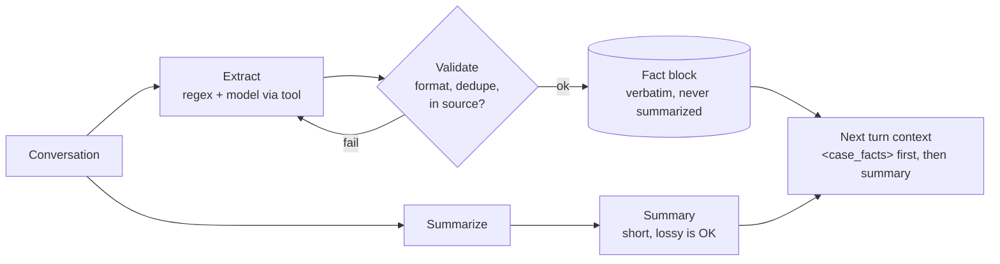

# Concept: Extract first, summarize second (+ verbatim fact store)

**Domain / lessons:** D5 › 5.1 Context Window Management · D5 › 5.6 Information Provenance · D1 › 1.7 Session State & Resumption · D4 › 4.4 Validation
**Related:** [Q01](../questions/Q01-source-attribution-multi-agent/question.md) · [claim-source-mapping](claim-source-mapping.md)

## The principle

When you condense information, do it in two steps:
1. **Extract:** pull out the exact facts (numbers, dates, names, IDs, sources) into **structured fields** or verbatim quotes.
2. **Summarize:** write the summary **from the extracted facts**, not from the raw text.

This way, exact details survive summarization. It's the Q01 problem: summaries lose facts.

## Does Opus 5.5 do this automatically?

**No, not reliably. On the exam, never assume it.**

- A strong model, especially with extended thinking, will **often** pick out key facts first. That's its reasoning style, not a guarantee.
- **The model decides what counts as "important,"** and may drop the exact detail you needed (page number, URL, order ID).
- **Extraction that happens in its thinking isn't kept.** The next agent receives only the summary.

So "extract first" is **your design decision**:
- **Prompt level:** ask for it explicitly. For example: *"First quote the relevant passages in `<quotes>` tags, then answer using only those quotes."*
- **Architecture level (stronger):** extract into a **schema**, save it as a **persistent fact block**, and summarize from that.

> **Exam tip:** the exam is **model-agnostic**. "Use a bigger or better model" is almost always a **distractor** for reliability problems. The correct answer changes the **design**: structure, validation or enforcement.

## Worked example: order IDs dropped from support summaries

> **Check question:** the summarization agent sometimes drops order IDs from long support conversations, and a colleague suggests a bigger model. What would you do instead?
> **My answer:** "Extract order IDs before summarizing the conversation." ✅ Right idea. Made precise below.

1. **How to extract: use code where you can.** Order IDs have a fixed format, so a **regex** finds every one, with nothing missed and nothing made up. Use the model only for facts code can't parse (e.g. *"wants a refund, not an exchange"*).
2. **Where to store them: outside the summary**, in a persistent fact block that is **never summarized** and is **re-injected into every turn**.
3. **How to check:** code verifies that every order ID from the original conversation appears in the fact block. If one is missing, retry or flag it (D4 › 4.4).

```json
{
  "case_facts": {
    "order_ids": ["ORD-123456", "ORD-789012"],
    "customer_id": "C-5521",
    "requested_action": "refund"
  },
  "summary": "Customer reports a damaged item in the second order..."
}
```



A bigger model drops IDs **less often**. Regex + fact block + validation drops them **never**.

## Best practices for a verbatim fact store

**Main idea:** the fact store is **application state owned by your code**, not text the model rewrites. The model **proposes** facts, and code **stores, protects and re-injects** them.

| # | Practice | Details |
|---|---|---|
| 1 | **Keep it in your app** | Database, session store or file linked to the session ID. The conversation gets a copy. It survives compaction, crashes and resumption (D1 › 1.7). |
| 2 | **Model adds, never rewrites** | Give the model a tool like `record_fact(key, value, source_turn)`, and code validates and **merges**. ❌ Never ask the model to "return the updated list." |
| 3 | **Validate on write** | Format check (e.g. `^ORD-\d{6}$`), dedupe, reject values that don't appear in the source text. |
| 4 | **Provenance for each fact** | `{key, value, source: "turn 3", recorded_at}`, so every fact can be traced and verified. |
| 5 | **Small and curated** | Only facts that must be exact: IDs, amounts, dates, names, decisions, promises. Remove resolved items. |
| 6 | **Re-inject at the start, tagged** | `<case_facts>…</case_facts>` at the start of the context. Avoid "lost in the middle." Keep the raw transcript stored **outside** the context and reference it when needed (*Filter, Summarize, **Reference***). |
| 7 | **Pass it explicitly in handoffs** | Structured fact block in the handoff payload, not retold in prose. |

| Do | Don't |
|---|---|
| Code owns the store | The model owns the store |
| Model **adds** facts through a tool | Model **rewrites** the whole block |
| Validate, dedupe, add provenance | Trust whatever the model writes |
| Small and curated | Dump everything |
| Re-inject at the start, tagged | Bury it mid-context |

## Check question

**Why does practice 2 (model *adds* through a tool, code *merges*) prevent the same problem as in Q01?**
*My answer:* "Because this is deterministic." ✅

**More precisely:** stored facts **never go through the model again**. In Q01, facts were lost because at every hop the model **regenerated** text, and each regeneration was a chance to drop something. Here a fact is written once and then only **copied** by code. A copy can't paraphrase or forget anything.

> **Rule:** every time the model regenerates text is a chance to lose information. Put exact facts where only code touches them.

## Related course lessons

### Udemy A (primary): Claude Certified Architect (CCAR-F) - 2026 Exam Prep
| # | Lecture | Part | Why |
|---|---|---|---|
| **109** | **Why Summaries Lose Facts** | 5A | ⭐ The problem |
| **110** | **Designing a Persistent Fact Block** | 5A | ⭐ The solution |
| 113 | Trim Strategies — Filter, Summarize, Reference | 5A | Raw data stays outside the context, referenced |
| 121 | Designing a Healthy Scratchpad — Hygiene and Limits | 5C | Practice 5: small and curated |
| 115 | The Handoff Payload — What the Next Actor Needs | 5B | Practice 7: handoffs |
| 111 | The Memory Tool for Persistence | 5A | Built-in persistence option |
| Quiz 15, Quiz 17 | 5A and 5C quizzes | | Self-test |

**▶ Watch in this order (~38 min):** #109 → #110 → #113 → #121 → #115 → #111, then do **Quiz 15** and **Quiz 17**.
(problem → fact block → trimming → hygiene → handoff → memory tool → self-tests)

### Udemy B: Claude Certified Architect Foundations: Complete Course (Voroniuk)
| # | Lecture | Section | Why |
|---|---|---|---|
| **54** | **Case Facts in Long Conversations** | S6 Support Agent | ⭐ This exact pattern |
| 55 | Trimming Tool Results and Lost in the Middle | S6 Support Agent | Practice 6: placement |
| 51 | Handoffs and Multi-Concern Requests | S6 Support Agent | Practice 7: handoffs |
| 84 | Sessions: Resume or Start Fresh | S8 Claude Code Setup | Practice 1: persistence across sessions |
| Quiz 6 | Support Agent quiz | S6 | Self-test |

**▶ Watch in this order (~16 min):** #54 → #55 → #51 → #84, then do **Quiz 6**.

### CBT Nuggets: CCA-F course
| Skill | Why |
|---|---|
| 10. Send Structured Messages to Claude | How conversation context is assembled each turn |
| 21. Build Multi Turn Tool Conversations | Tool-based `record_fact` pattern in a loop |
| 31. Optimize Prompts with Caching | Where stable vs. changing content goes in the prompt |

*CBT is weak on D5. Use Udemy A or B for this topic.*
