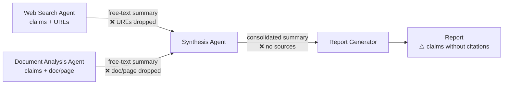
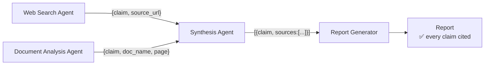

# Q01 — Source attribution lost in a multi-agent pipeline

**Domain / lesson:** D5 › 5.6 Information Provenance & Multi-Source Synthesis
**Also touches:** D1 › 1.3 Subagent Invocation and Context Passing

## Question

The synthesis agent receives summarized findings from the web search and document analysis agents, then passes a consolidated summary to the report generator. During testing, you discover the generated reports make factual claims without proper citations – the report generator cannot attribute statements to their original sources because that metadata was lost during the summarization steps. What's the most effective approach to ensure proper source attribution in the final reports?

- **A.** Have the report generator query the web search agent to re-locate sources for claims in the final report.
- **B.** Have each agent output structured data separating content summaries from source metadata (URLs, document names, page numbers).
- **C.** Skip summarization and pass full raw outputs from web search and document analysis directly to the report generator.
- **D.** Instruct the synthesis agent to embed source references inline within its summary text using a consistent citation format.

## Answer: **B**

## Diagram

### Problem: metadata lost at each summarization hop



### Fix (B): provenance travels as structured fields



Example record passed between agents:

```json
{
  "claim": "Market grew 12% in 2025",
  "sources": [
    { "type": "web", "url": "https://example.com/report", "retrieved": "2026-10-29" },
    { "type": "doc", "doc_name": "Q4-analysis.pdf", "page": 7 }
  ]
}
```

## Concept

Each summarization hop in a pipeline (search → synthesis → report) compresses information, and free text is lossy. Metadata such as URLs and page numbers gets dropped first because the model treats it as noise.

The fix is to make provenance part of the **data contract** between agents. When every finding is a structured record like `{claim, source_url, doc_name, page}`, the source travels with the claim through every hop. Keeping it doesn't depend on the model remembering to.

## Why the others are wrong

| Option | Why not |
|---|---|
| **A** Re-query to re-locate sources | Fixes the problem after the fact instead of preventing it. Adds latency and cost, and matching a summarized claim back to a source invites wrong or made-up citations. |
| **C** Skip summarization, pass raw outputs | Keeps the metadata but floods the report generator's context (a D5 › 5.1 concern). Trades one problem for another. |
| **D** Inline citations in summary text | The most tempting distractor. It still depends on the model following a formatting instruction in free text, so citations can drift, merge, or vanish in later summarization. An instruction is weaker than a structural guarantee. |

## Pattern to remember

> **Instructions alone are probabilistic. For anything that must survive reliably, add structure (schemas/gates), and use instructions to support it.**

### Where this comes from in the guide

**D5 › 5.6 Information Provenance** (specific to this question):
- *"Subagents emit structured claim-source mappings. These are data rather than prose."*
- *"Synthesis compresses and rewrites prose, so source details embedded in it are lost."* This is why **D** fails.
- *"The prompt of the synthesis agent must explicitly require every claim in its output to be traceable to a specific source."* Structure is **paired** with instructions, not a replacement for them.

**D1 › 1.4 Workflow Enforcement and Handoff** (the general principle):
- *"Prompt-based guidance is probabilistic. Programmatic enforcement is deterministic."*
- *"A prompt instruction works most of the time, perhaps in 90-95% of cases. … A gate works every time."*
- Lesson 1.4 uses refunds as its example: a prerequisite gate in code instead of a prompt instruction. Q01 makes the same point with source data: a schema instead of a prompt instruction.

## Glossary

- **Provenance:** where a piece of information came from (its origin and the path it took). The term comes from the art world, where a painting's provenance is its documented history of ownership. In AI systems, it means keeping each claim's source (URL, document, page) attached to it, so the claim can be verified, trusted, and traced when debugging.

## Related course lessons

### Udemy A (primary): Claude Certified Architect (CCAR-F) - 2026 Exam Prep
| # | Lecture | Part | Why |
|---|---|---|---|
| **109** | **Why Summaries Lose Facts** | 5A | ⭐ Exactly this question's problem |
| **131** | **Claim-to-Source Mappings — Why Every Sentence Needs a Source** | 5D | ⭐ Exactly this question's answer |
| 132 | Conflict Annotation — Surfacing Disagreement in Synthesis | 5D | Next step: conflicting sources |
| 19 | Designing Agent-to-Agent Message Schemas | 1C | The structure from answer B |
| 28 | Why Prompts Are Not Sufficient for High-Stakes Paths | 1D | Why D (instructions only) fails |
| 29 | Designing Programmatic Validation and Enforcement Layers | 1D | Deterministic vs probabilistic |
| Quiz 18, Quiz 3 | 5D and 1C quizzes | | Self-test |

**▶ Watch in this order (~44 min):** #109 → #19 → #131 → #132 → #28 → #29, then do **Quiz 18** and **Quiz 3**.
(problem → structure → answer → conflicts → why prompts aren't enough → enforcement → self-tests)

### Udemy B: Claude Certified Architect Foundations: Complete Course (Voroniuk)
| # | Lecture | Section | Why |
|---|---|---|---|
| **67** | **Keeping Claims Tied to Sources** | S7 Multi-Agent | ⭐ Core topic of this question |
| **70** | **Research Case: Citing Sources** | S7 Multi-Agent | Exam-style case on the same scenario |
| 68 | When Sources Disagree | S7 Multi-Agent | Next step after provenance: resolving conflicting sources |
| 64 | Passing Context Between Agents | S7 Multi-Agent | What data moves between agents (D1 › 1.3) |
| 14 | Practice: System Prompt Rules vs Code Rules | S2 API Basics | The "instructions alone are probabilistic" principle |
| 49 | Prerequisite Gates in Code | S6 Support Agent | The same principle applied to enforcement (D1 › 1.4) |
| Quiz 7 | Multi-Agent Systems quiz | S7 | Self-test after the lectures above |

**▶ Watch in this order (~21 min):** #64 → #67 → #68 → #70, then do **Quiz 7**.
(context passing → provenance → conflicting sources → exam-style case → self-test)

### CBT Nuggets: CCA-F course
| Skill | Why |
|---|---|
| **36. Design Workflows and Agent Systems** | Multi-agent pipeline architecture |
| **39–40. Build an Agentic Multimedia Article System** | Hands-on multi-agent build with content passed between agents |
| 19. Explain Tool Use and Tool Schemas | Schemas: the mechanism behind answer B |
| 24. Compare Web Search and RAG | Web search results carry source URLs |
| 26. Explain RAG and Document Chunking | Keeping doc/page metadata with each chunk |
| 30. Apply Image and PDF Inputs | Document analysis, possibly the Citations feature |
