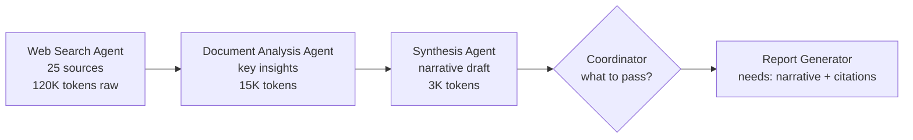
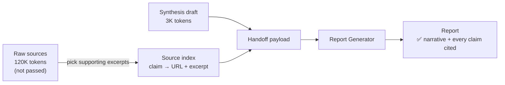

# Q02 — Context passing to the report generator: completeness vs efficiency

**Domain / lesson:** D1 › 1.3 Subagent Invocation and Context Passing
**Also touches:** D5 › 5.6 Information Provenance & Multi-Source Synthesis · D5 › 5.1 Context Window Management

## Question

After the web search agent finds 25 sources (120K tokens of raw content), the document analysis agent extracts key insights (15K tokens), and the synthesis agent produces a coherent narrative draft (3K tokens), the coordinator must pass context to the report generation agent for the final output with proper source citations. What context-passing strategy provides the best balance of completeness and efficiency?

- **A.** Pass the full accumulated context from all prior agents.
- **B.** Pass the synthesis draft along with a structured source index that maps key claims to their source URLs and relevant excerpts.
- **C.** Pass only the synthesis draft and have a separate post-processing pipeline match claims to sources and insert citations after the report is generated.
- **D.** Pass a condensed summary of all prior stages that preserves the main findings and attributes them to sources by name only.

## Answer: **B**

## Diagram

### The pipeline: tokens shrink at each stage



### Fix (B): latest output + structured source index



Example handoff payload (the claim IDs in the draft are an implementation choice that anchors each sentence to its index entry):

```json
{
  "draft": "… The market grew 12% in 2025 [C1], driven mainly by … [C2] …",
  "source_index": [
    {
      "claim_id": "C1",
      "claim": "Market grew 12% in 2025",
      "sources": [
        {
          "url": "https://example.com/annual-report",
          "document_name": "Annual Market Report 2025",
          "excerpt": "Total revenue rose 12% year over year, reaching …",
          "published": "2026-02-14"
        }
      ]
    }
  ]
}
```

### Rough size of each option

| Option | What the report generator receives | Approx. tokens | Citations possible? |
|---|---|---|---|
| A | Everything (raw + insights + draft) | ~138K | Yes, but buried in noise |
| **B** | **Draft + source index** | **~3K + index (a few K)** | **✅ Yes, claim by claim** |
| C | Draft only | ~3K | ❌ Not at write time |
| D | Condensed summary + source names | a few K | ❌ Names only, not proper citations |

*The size of B's index is an estimate. The question doesn't give it, but URLs plus short excerpts for the key claims stay in the low thousands of tokens.*

## Concept

A subagent only knows what the coordinator puts in its prompt. Nothing is inherited automatically. So the coordinator has to decide **what the next agent needs to do its job**. Here the report generator has two jobs:

1. **Write the final report.** For that it needs the **narrative**, and the 3K synthesis draft already is that narrative. Re-sending the 120K raw content and the 15K insights asks it to redo synthesis.
2. **Cite sources properly.** For that it needs, **for each claim**, where the claim came from (URL) and the evidence for it (excerpt). Without both, it can't write a proper citation.

B covers both jobs with the least extra material: the draft for the content and a structured source index for the provenance. This is the same claim-source mapping as in Q01. Here it is packaged as the handoff to the last agent.

**The nuance: complete ≠ everything.** Lesson 1.3's Rule 1 says to pass complete findings ("must pass both in full"). That refers to the **findings**, the outputs that earlier agents produced together with their metadata. It does **not** mean every token those agents read along the way. The 120K of raw content is what the search stage read, not a finding.

## Why the others are wrong

| Option | Why not |
|---|---|
| **A** Pass full accumulated context | Complete but not efficient. About 135K of the ~138K tokens is raw material the report generator doesn't need. A long context costs more, runs slower, and findings in the middle get missed or under-weighted ("lost in the middle", D5 › 5.1). It also invites the report generator to re-synthesize and drift from the approved draft. It fits in a large context window, but that doesn't make it a good handoff. Tempting because 1.3 says "pass both in full", which is about findings, not every raw token. |
| **C** Draft only, add citations in post-processing | The same mistake as Q01 option A: fixing attribution after the fact. The report generator writes claims without their sources, so a later pipeline has to guess which of 25 sources backs each paraphrased sentence. That leads to wrong or missing citations and adds an extra moving part. The guide says *"The synthesis agent cannot cite a source it was not given."* The same applies to the report generator. |
| **D** Condensed summary, sources by name only | Fails on both counts, and it's the most tempting distractor because it *sounds* balanced. (1) It adds **another summarization hop**, and summarization destroys specifics like numbers, dates and identifiers. (2) **"By name only"** (e.g. "according to Gartner") is not a proper citation: there's no URL, no excerpt, and with 25 sources it isn't reliably tied to individual claims. |

## Pattern to remember

> **Pass the latest output plus a structured provenance index, not the whole history. Complete ≠ everything: the next agent needs every finding and its source, not every token the earlier agents read.**

### Same distractors, new costume (Q01 ↔ Q02)

| Distractor shape | Q01 | Q02 | Why it fails |
|---|---|---|---|
| Pass everything raw | C | A | Context bloat, lost in the middle |
| Fix citations after the fact | A | C | Matching claims back to sources is guesswork |
| Attribution kept in prose | D (inline citations in summary text) | D (source names in a summary) | Prose gets compressed, and provenance is lost or too coarse |
| **Structured claim → source data** | **B ✅** | **B ✅** | **Provenance travels as data** |

### Where this comes from in the guide

**D1 › 1.3 Subagent Invocation and Context Passing** (the main lesson):
- *"A subagent receives only what the coordinator writes into the subagent's prompt."*
- *"Every piece of information they need must be explicitly included in their prompt by the coordinator. There is no automatic context inheritance."*
- *"Metadata says where the content came from: source URL, document name, page number."*
- *"A downstream agent can attribute a claim to a source only if the coordinator passes that metadata with the claim."*
- *"The synthesis agent cannot cite a source it was not given."* This is why **C** fails.
- Rule 1, "Include complete findings from prior agents": the coordinator *"must pass both in full."* This means findings, not raw content (see the nuance above).

**D5 › 5.6 Information Provenance** (what goes in the index):
- *"Map every claim to its source URL, document name, excerpt and publication date, and keep the mappings through synthesis."* B's "URLs and relevant excerpts" are the core of this list.
- Each finding must include a relevant excerpt: *"The specific passage that supports the claim."*
- *"The final output includes inline citations or a structured reference section that traces each claim to its source."*

**D5 › 5.1 Context Window Management** (why A and D fail):
- *"Trim verbose tool outputs to only the relevant fields before they accumulate in context."* This is against **A**.
- *"A model may miss findings in the middle of a long context, or may give them less weight."* This is against **A**.
- *"Summarisation systematically destroys numerical values, dates, and specific identifiers."* This is against **D**.

## Glossary

- **Source index:** a structured lookup table that maps each claim (often by an ID) to its sources: URL, document name, the supporting excerpt, and publication date. It's Q01's claim-source mapping, packaged as part of a handoff.
- **Excerpt:** the exact passage from a source that supports a claim. It lets the report generator, and later a reader, check the claim without re-reading the whole source.
- **Lost in the middle:** models attend most reliably to the start and end of a long context, so content in the middle is more likely to be missed or under-weighted. This is why "just pass everything" can lower quality even when it fits in the window.
- **Post-hoc:** Latin for "after this". Here it means adding citations after the text is written, instead of carrying the sources along while it's written.

## Related course lessons

*Lecture lengths aren't recorded in the study-map files, so the watch times below are estimates from each course's average lecture length.*

### Udemy A (primary): Claude Certified Architect (CCAR-F) - 2026 Exam Prep
| # | Lecture | Part | Why |
|---|---|---|---|
| **115** | **The Handoff Payload — What the Next Actor Needs** | 5B | ⭐ Exactly this question: deciding what goes in the handoff |
| **19** | **Designing Agent-to-Agent Message Schemas** | 1C | ⭐ The structured source index from answer B *(also in Q01)* |
| 17 | Subagent Design — Scope, Authority, and Isolation | 1C | Isolation: a subagent sees only what you pass |
| 20 | Handoff Protocols and Continuity Across Agents | 1C | Continuity from stage to stage |
| 112 | The Tool-Output Bloat Problem | 5A | Why A (pass everything) fails |
| 113 | Trim Strategies — Filter, Summarize, Reference | 5A | Filter/reference = B's index; summarize = D's risk |
| 131 | Claim-to-Source Mappings — Why Every Sentence Needs a Source | 5D | The fields in the index *(also in Q01)* |
| Quiz 3, Quiz 15 | 1C and 5A quizzes | | Self-test |

**▶ Watch in this order (~45 min, est.):** #17 → #19 → #20 → #115 → #112 → #113 → #131, then do **Quiz 3** and **Quiz 15**.
(isolation → message schema → handoff → handoff payload → bloat → trimming → claim-source mapping → self-tests)
If you've just watched Q01's list, you can skip #19 and #131 (~30 min).

### Udemy B: Claude Certified Architect Foundations: Complete Course (Voroniuk)
| # | Lecture | Section | Why |
|---|---|---|---|
| **64** | **Passing Context Between Agents** | S7 Multi-Agent | ⭐ Core topic of this question *(also in Q01)* |
| **55** | **Trimming Tool Results and Lost in the Middle** | S6 Support Agent | ⭐ Why A fails |
| 62 | Spawning Subagents with Task | S7 Multi-Agent | How a subagent gets its context |
| 67 | Keeping Claims Tied to Sources | S7 Multi-Agent | The claim-source index *(also in Q01)* |
| 69 | Research Case: Coordinator Calls | S7 Multi-Agent | Exam-style case on the same research pipeline |
| 70 | Research Case: Citing Sources | S7 Multi-Agent | Exam-style case on citations *(also in Q01)* |
| Quiz 7 | Multi-Agent Systems quiz | S7 | Self-test |

**▶ Watch in this order (~30 min, est.):** #62 → #64 → #55 → #67 → #69 → #70, then do **Quiz 7**.
(how subagents get context → what to pass → why not everything → provenance → exam cases → self-test)

### CBT Nuggets: CCA-F course
| Skill | Why |
|---|---|
| **39–40. Build an Agentic Multimedia Article System** | Hands-on multi-agent pipeline where content moves between agents |
| 38. Build a Skill-Aware Agent | Passing context to an agent (1.3, partial) |
| 36. Design Workflows and Agent Systems | Pipeline architecture and stage boundaries |
| 26. Explain RAG and Document Chunking | Keeping source metadata with each chunk, the same idea as the excerpt index |

*CBT is only partial on 1.3 (🟡). Use Udemy A or B first.*
