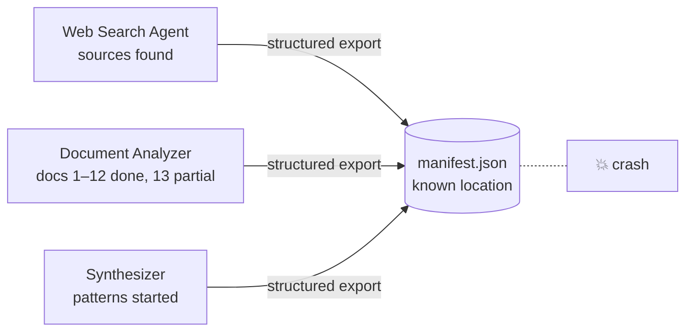
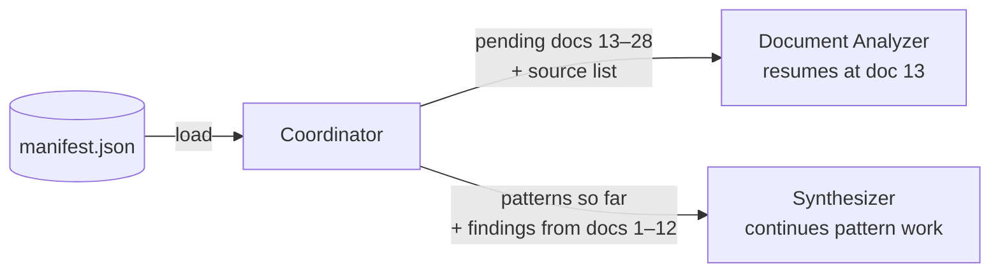

# Q03 — Crash recovery: restoring multi-agent state

**Domain / lesson:** D5 › 5.4 Codebase Exploration & Context Degradation (crash recovery with state manifests)
**Also touches:** D1 › 1.7 Session State and Resumption · D1 › 1.3 Subagent Invocation and Context Passing

## Question

Your multi-agent research pipeline crashed after processing 12 of 28 documents. The web search agent had identified relevant sources, the document analyzer had partially completed extraction, and the synthesizer had begun pattern identification. You need to resume processing without repeating work or losing fidelity of prior findings. What state management approach best balances information fidelity with context efficiency when restoring agent state?

- **A.** Have each agent persist a structured export to a known location. On resume, the coordinator loads the manifest and injects relevant state into agent prompts.
- **B.** Index all agent outputs in a shared vector store. When resuming, each agent queries the store using semantic search to retrieve relevant prior findings.
- **C.** Have each agent maintain its own persistent state file and reload it independently at the start of each session.
- **D.** Persist the coordinator's conversation log containing all task delegations and responses, providing this to agents when resuming.

## Answer: **A**

## Diagram

### Before the crash: each agent exports its state



### On resume: the coordinator loads the manifest and injects what each agent needs



Example manifest (the field names are an illustration; the guide only requires a structured export at a known location):

```json
{
  "pipeline_id": "research-2026-10-29",
  "updated": "2026-10-29T14:32:10Z",
  "documents": {
    "total": 28,
    "completed": ["doc-01", "…", "doc-12"],
    "in_progress": "doc-13",
    "pending": ["doc-14", "…", "doc-28"]
  },
  "agents": {
    "web_search": {
      "status": "done",
      "sources": [{ "url": "https://example.com/a", "relevance": "high" }]
    },
    "document_analyzer": {
      "status": "partial",
      "last_completed": "doc-12",
      "findings": [
        { "claim_id": "C3", "claim": "…", "source_url": "https://example.com/a", "excerpt": "…" }
      ]
    },
    "synthesizer": {
      "status": "started",
      "patterns": [{ "pattern": "…", "supporting_claims": ["C3", "C7"] }],
      "next_step": "add findings from docs 13–28"
    }
  }
}
```

The findings keep their claim-source mapping (Q01, Q02), so provenance survives the crash too.

## Concept

The question asks for three things at once. A is the only option that delivers all three:

| Requirement in the question | How A meets it |
|---|---|
| **"without repeating work"** | The manifest records **progress**: docs 1–12 done, doc 13 in progress, docs 14–28 pending, and each agent's next step. |
| **"without losing fidelity of prior findings"** | Each agent writes its **own state as structured data**. It's saved exactly, not summarized, paraphrased or found again by search. |
| **"context efficiency"** | The **coordinator selects** what each agent needs and injects only that. The analyzer gets the pending docs, and the synthesizer gets the findings and patterns so far. |

Two smaller details in A also matter:
- **"Known location":** the coordinator knows exactly where to look. Nothing has to be searched for or guessed.
- **"The coordinator … injects":** this is the coordinator pattern from Q02. Subagents have isolated context and get only what the coordinator writes into their prompts. After a crash, the coordinator rebuilds each agent's prompt from the manifest.

## Why the others are wrong

| Option | Why not |
|---|---|
| **B** Shared vector store + semantic search | Semantic search returns what is **similar** to a query, not **everything relevant**, so top-k results can miss findings and fidelity is lost. It also can't answer the main question on resume, "which 12 of 28 documents are done?", because progress isn't something you can search for by meaning. Each agent also decides for itself what to retrieve, so nothing is coordinated. Neither lesson 1.7 nor 5.4 mentions vector stores, and Udemy B labels RAG "Not on the Exam" (#104). |
| **C** Each agent reloads its own state file | Persistence and structure are fine, but **nothing is coordinated**. (1) The agents depend on each other's state: the synthesizer needs the analyzer's findings, which sit in the analyzer's file. (2) Nobody has the overall picture of what's done, what's in progress and what's next, so the coordinator can't hand out doc 13 or prevent duplicate work. This is the most tempting distractor because it's **half of A**: it has the exports but no manifest and no coordinator. |
| **D** Give every agent the coordinator's conversation log | **Inefficient:** every agent receives every delegation and response from 12 documents' worth of work, and the guide lists *"handing each the full transcript"* as an exam trap (5.4). **Fidelity isn't guaranteed either:** the analyzer's partial extraction and the synthesizer's in-progress patterns were never returned to the coordinator, so they aren't in its log. This is Q02's option A (pass everything) again. |

## Pattern to remember

> **Crash recovery = each agent exports structured state to a known location → the coordinator loads the manifest → it injects only what each agent needs. The state is exact, it's held centrally, and it's handed out selectively.**

### Same distractors, new costume (Q01 → Q02 → Q03)

| Distractor shape | Q01 | Q02 | Q03 | Why it fails |
|---|---|---|---|---|
| Pass everything | C (raw outputs) | A (full context) | D (full conversation log) | Context bloat, lost in the middle, the "full transcript" trap |
| Reconstruct by searching instead of carrying it as data | A (re-query to re-locate sources) | C (post-hoc citation matching) | B (semantic search over a vector store) | Search and matching are approximate, so things get missed or mismatched |
| **Structured data, routed by the coordinator** | **B ✅** | **B ✅** | **A ✅** | **Exact, complete and selective** |
| *New in Q03:* each agent manages itself | | | C (independent state files) | No overall view and no sharing between agents |

### Where this comes from in the guide

**D5 › 5.4 Codebase Exploration & Context Degradation** (the main lesson, crash recovery):
- *"Extended sessions can fail because of session crashes, network interruptions or context exhaustion."*
- *"Without a recovery mechanism, all exploration progress is lost."*
- *"The fix is structured state persistence."*
- *"Each agent exports its current state to a manifest at a known file location."*
- *"When the work resumes, the coordinator loads the manifest and injects it into agent prompts."* This is **A**, almost word for word.
- *"The agent continues from the point where it stopped, without repeating earlier exploration."*
- *"On the exam, answer with the state manifest."*
- Exam trap: *"Expecting next-phase subagents to inherit phase-one history, or handing each the full transcript."* This is why **D** fails.
- Exam trap: *"Restarting a session to fix context degradation without saving state"*, because *"Restarting loses all accumulated knowledge."*

**D1 › 1.7 Session State and Resumption** (structured state beats replayed history):
- *"Starting a new session with a structured summary is more reliable than resuming with stale tool results."* This argues against replaying the log (**D**).
- *"Full re-exploration is wasteful."* This is why "without repeating work" matters.

**D1 › 1.3 Subagent Invocation and Context Passing** (why the coordinator injects):
- *"A subagent receives only what the coordinator writes into the subagent's prompt."*
- *"There is no automatic context inheritance."*

## Glossary

- **Manifest:** a structured file that records the state of a job: what's done, what's in progress, what's next, and each agent's exported state (or pointers to it). The word comes from shipping, where a ship's manifest lists its cargo.
- **Known location:** a fixed, agreed file path where state is written and read. Because everyone knows it in advance, recovery needs no searching.
- **Vector store / semantic search:** a database that stores text as embeddings (numeric vectors) and returns the top-k items whose meaning is most *similar* to a query. It's useful for finding related content, but it's approximate and can't tell you "what's done".
- **Scratchpad file** (related, also 5.4): a file an agent writes key findings to *during* a long session so they survive context degradation. A scratchpad protects findings within a session, and a manifest protects progress across a crash or restart.
- **Stale context** (1.7): an old conversation history, including old tool results, that may no longer match reality. Resuming from it makes the agent reason from outdated information.

## Related course lessons

*Lecture lengths aren't recorded in the study-map files, so the watch times below are estimates from each course's average lecture length.*

### Udemy A (primary): Claude Certified Architect (CCAR-F) - 2026 Exam Prep
| # | Lecture | Part | Why |
|---|---|---|---|
| **22** | **Session Continuity Across Turns and Failures** | 1C | ⭐ Exactly this question: surviving a failure mid-pipeline |
| **21** | **In-Context State vs. External Memory** | 1C | ⭐ Why state goes into a file, not the conversation |
| 20 | Handoff Protocols and Continuity Across Agents | 1C | The coordinator passing state between agents *(also in Q02)* |
| 120 | The Scratchpad Pattern — Persisting Findings Outside the Context | 5C | Lesson 5.4's sibling technique |
| 124 | Long-Conversation Coherence, Compaction, and Session Memory | 5C | Lessons 1.7 and 5.4: keeping state across long or broken sessions |
| 81 | The Claude Agent SDK — Session Control | 3D | Resume vs. fork vs. start fresh (1.7) |
| Quiz 3, Quiz 17 | 1C and 5C quizzes | | Self-test |

**▶ Watch in this order (~40 min, est.):** #21 → #22 → #20 → #120 → #124 → #81, then do **Quiz 3** and **Quiz 17**.
(state in a file → surviving failures → handing state between agents → scratchpad → long sessions → SDK session controls → self-tests)

### Udemy B: Claude Certified Architect Foundations: Complete Course (Voroniuk)
| # | Lecture | Section | Why |
|---|---|---|---|
| **87** | **Phases, Subagents and Manifests** | S8 Claude Code Setup | ⭐ The manifest pattern itself |
| **86** | **Keeping Long Explorations Sharp** | S8 Claude Code Setup | ⭐ Lesson 5.4: scratchpads and state persistence |
| 84 | Sessions: Resume or Start Fresh | S8 Claude Code Setup | Lesson 1.7: structured summary vs. stale history (why D fails) |
| 85 | Forking a Session | S8 Claude Code Setup | Lesson 1.7: the third session option |
| 64 | Passing Context Between Agents | S7 Multi-Agent | The coordinator injecting state *(also in Q01, Q02)* |
| Quiz 8 | Claude Code Setup quiz | S8 | Self-test |

**▶ Watch in this order (~25 min, est.):** #87 → #86 → #84 → #85 → #64, then do **Quiz 8**.
(manifests → long explorations → resume vs. fresh → fork → context passing → self-test)

### CBT Nuggets: CCA-F course
| Skill | Why |
|---|---|
| 39–40. Build an Agentic Multimedia Article System | A hands-on multi-agent pipeline, the kind of system that needs crash recovery |
| 36. Design Workflows and Agent Systems | Pipeline stages and coordination |
| 32. Use Code Execution and File Storage | Persisting files outside the conversation |
| 26. Explain RAG and Document Chunking | Background on why semantic retrieval is approximate (option B) |

*CBT has no coverage of 1.7 or 5.4 (❌ in the mapping). Use Udemy A or B for this topic.*
