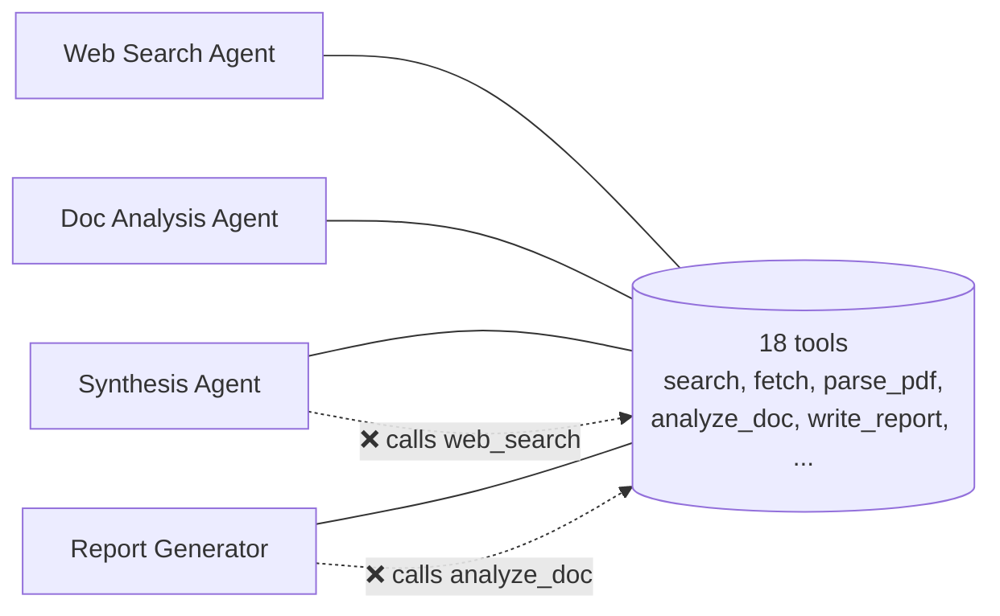
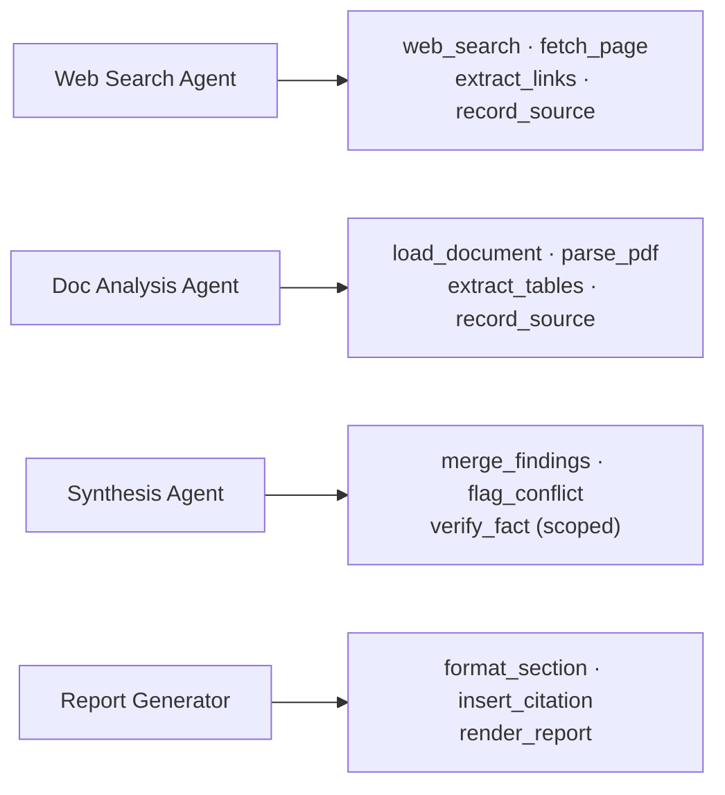

# Q04 — Subagents call tools outside their specialization

**Domain / lesson:** D2 › 2.3 Tool Distribution & Tool Choice
**Also touches:** D1 › 1.3 Subagent Invocation and Context Passing · D2 › 2.1 Tool Interface Design
**Same system as:** [Q01](../Q01-source-attribution-multi-agent/question.md) (web search → document analysis → synthesis → report generator)

## Question

You've configured the system so that all four subagents have access to the complete set of 18 tools. During testing, agents frequently call tools outside their specialization – the synthesis agent attempts web searches, and the report generator tries to analyze documents. What is the primary cause of this poor tool selection behavior?

- **A.** Choosing from 18 tools instead of 4-5 relevant ones increases decision complexity beyond reliable selection thresholds.
- **B.** The tool definitions consume too much context window space, leaving insufficient room for task content.
- **C.** The agents' role descriptions in their system prompts conflict with having access to tools outside that role.
- **D.** The coordinator cannot track which capabilities each subagent has, leading to misrouted tasks.

## Answer: **A**

## Diagram

### Problem: every agent sees all 18 tools

### Fix: each agent gets only the 4–5 tools its role needs

## Concept

**Tool selection gets less reliable as the toolset grows.** Each extra tool adds another option the model has to rule out, so error rates rise as the toolkit grows.

When a synthesis agent can see `web_search`, it sometimes uses it, because nothing structurally stops it. Wrong-domain tool calls are the typical symptom of an over-broad toolset.

**The fix is structural:** scope tools **per agent, by role** (least privilege). The guide says *"Each agent gets only the tools that its defined role needs."*

Related techniques from the lesson:
- **Scoped cross-role tool:** if the synthesis agent often needs a quick fact check, give it a **constrained** `verify_fact`, not full `web_search`. Complex cases still go back through the coordinator.
- **Consolidate near-duplicates:** one parameterised tool is easier to select than three similar ones.
- **Constrain, don't generalise:** `load_document` instead of `fetch_url`, so each tool *"does exactly what the agent needs and nothing more."*

## Why the others are wrong

| Option | Why not |
|---|---|
| **B** Tool definitions use too much context | A real but **secondary** cost. Eighteen tool definitions are small compared with the context window. Too little room would degrade the *quality* of the work, but it wouldn't make agents choose tools from *other roles*. The symptom doesn't match. |
| **C** Role descriptions conflict with tool access | This describes the mismatch, not the cause, and it points to a **prompt fix** ("only use your own tools"). That's probabilistic: the tools are still available, so the model still uses them sometimes. The exam prefers the structural fix of removing the tools. |
| **D** Coordinator can't track capabilities | That would cause **tasks routed to the wrong agent**. Here the agents receive the right tasks and then pick the wrong **tools** themselves. It's a different failure. |

## Pattern to remember

> **Fewer, role-scoped tools mean more reliable selection.** Don't tell an agent not to use a tool. Don't give it the tool in the first place.

This is the same structural-beats-instructions theme as Q01: removing access is **deterministic**, and an instruction not to use something is **probabilistic**.

### Where this comes from in the guide

**D2 › 2.3 Tool Distribution & Tool Choice:**
- *"When you give a single agent 18 tools, the agent selects tools less reliably."*
- *"Every additional tool makes the decision more complex, so error rates increase as the toolkit grows."*
- *"Each agent gets only the tools that its defined role needs."*
- The 18 vs 4–5 figure is *"an illustration, not a hard limit."* The lesson notes that current docs place the degradation point at **30–50 tools**. For the exam, use the guide's 18 vs 4–5 framing.

## Check question

**The synthesis agent genuinely needs to confirm a fact about once per report. Which design is better?**
1. Full `web_search` tool + system prompt "only search to verify facts."
2. Narrow `verify_fact(claim)` tool, and route anything more complex back to the coordinator.

*My answer:* "Give it a narrow `verify_fact(claim)` tool, and route anything more complex back to the coordinator." ✅

**Why option 2 wins:**

| | Option 1: full `web_search` + prompt | Option 2: narrow `verify_fact` + route to coordinator |
|---|---|---|
| **What limits misuse** | An instruction, which is **probabilistic** | The tool's design, which is **deterministic** |
| **What the agent can do** | Any search, any time | Only check one claim |
| **Selection reliability** | Broad tool, easy to over-use | Narrow purpose, hard to misuse |
| **Complex cases** | Synthesis agent goes off researching | **Coordinator** decides; roles stay clean |

Three principles in one answer:
1. **Least privilege:** the tool *"does exactly what the agent needs and nothing more"* (D2 › 2.3).
2. **Structure beats instructions:** the limit is in the tool, not the prompt (Q01, D1 › 1.4).
3. **The coordinator owns the routing:** anything outside the agent's role goes back up (D1 › 1.2).

## Exam-adjacent: `tool_choice` (same lesson)

| Value | Behaviour | Use for |
|---|---|---|
| `auto` (default) | Model decides: call a tool or reply in text | Normal agents |
| `any` | Must call **a** tool, model picks which | Extraction pipelines that need structured output |
| `{"type": "tool", "name": "..."}` | Must call **this** tool | Mandatory first step; later turns switch back to `auto` |

## Glossary

- **Tool scoping:** giving each agent only the subset of tools its role needs.
- **Least privilege:** a security principle. Every component gets the minimum access needed to do its job, and nothing more. Here it applies to tools: fewer tools means fewer chances for misuse and fewer wrong choices.
- **Scoped cross-role tool:** a narrow, constrained version of another role's capability (e.g. `verify_fact` instead of full `web_search`) for frequent simple needs.

## Related course lessons

### Udemy A (primary): Claude Certified Architect (CCAR-F) - 2026 Exam Prep
| # | Lecture | Part | Why |
|---|---|---|---|
| **39** | **Tool Scoping per Agent — Why Less Is More** | 2A | ⭐ Exactly this question |
| **40** | **Selection Heuristics and Tool-Selection Failures** | 2A | ⭐ Why selection fails with many tools |
| 32 | How Claude Selects Tools — The Role of Descriptions | 2A | How selection works |
| 17 | Subagent Design — Scope, Authority, and Isolation | 1C | Scoping as part of subagent design |
| 54 | Tool Boundaries, Access Scoping, and Least Privilege | 2C | Least privilege |
| 42 | Tool Search for Large Catalogs | 2A | What to do when you really need many tools |
| Quiz 5 | 2A quiz | | Self-test |

**▶ Watch in this order (~37 min):** #32 → #39 → #40 → #17 → #54 → #42, then do **Quiz 5**.
(how selection works → scoping → failures → subagent design → least privilege → large catalogs → self-test)

### Udemy B: Claude Certified Architect Foundations: Complete Course (Voroniuk)
| # | Lecture | Section | Why |
|---|---|---|---|
| **63** | **Scoping Each Agent's Tools** | S7 Multi-Agent | ⭐ Exactly this question |
| 41 | How Claude Chooses a Tool | S5 Tools & MCP | How selection works |
| 42 | Renaming, Splitting and Keyword Triggers | S5 Tools & MCP | Making tools easier to tell apart |
| 27 | tool_choice: auto, any and Forced | S4 Structured Output | `tool_choice` options |
| Quiz 5, Quiz 7 | Tools & MCP, Multi-Agent quizzes | | Self-test |

**▶ Watch in this order (~20 min):** #41 → #63 → #42 → #27, then do **Quiz 5** and **Quiz 7**.

### CBT Nuggets: CCA-F course
| Skill | Why |
|---|---|
| **22. Route Requests Across Multiple Tools** | ⭐ Tool selection across a toolset |
| 19. Explain Tool Use and Tool Schemas | How tool definitions drive selection |
| 36. Design Workflows and Agent Systems | Splitting roles across agents |
