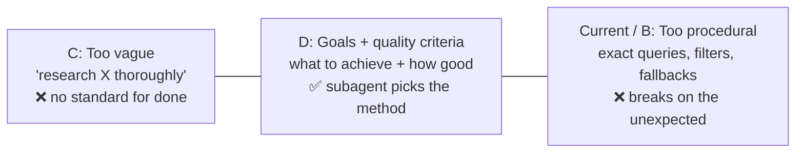
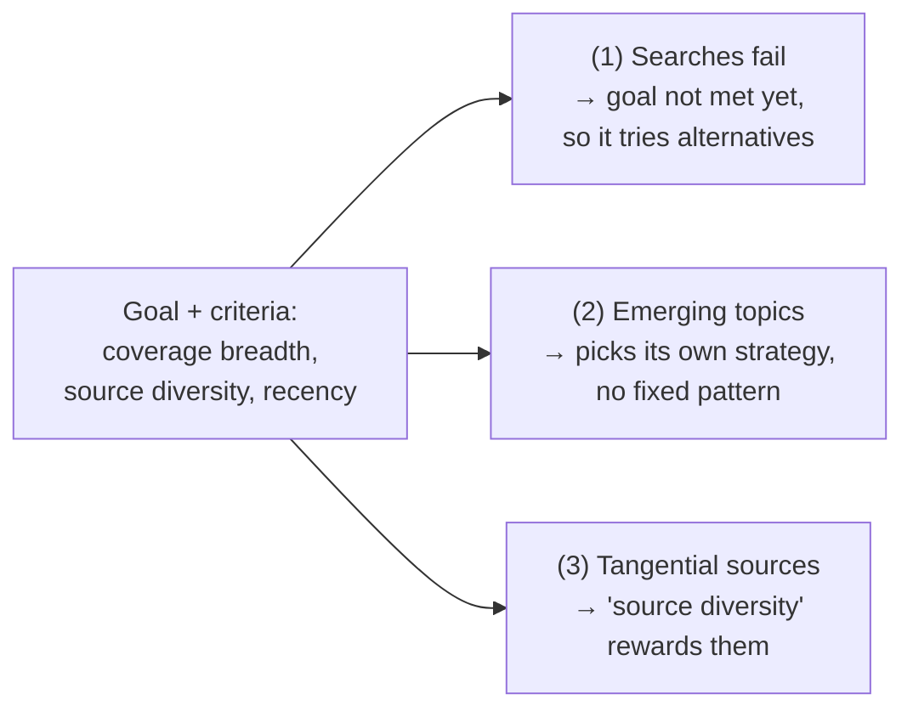

# Q05 — Over-specified subagent instructions kill adaptability

**Domain / lesson:** D1 › 1.3 Subagent Invocation and Context Passing
**Also touches:** D1 › 1.2 Multi-Agent Orchestration · D4 › 4.1 System Prompts with Explicit Criteria
**Same system as:** [Q01](../Q01-source-attribution-multi-agent/question.md), [Q04](../Q04-tool-scoping-per-subagent/question.md)

## Question

The coordinator provides detailed step-by-step instructions to the web search subagent, specifying exact search queries, source priorities, and date filters. Production monitoring reveals three issues: (1) the subagent reports "insufficient results" rather than trying alternative approaches when pre-specified searches fail, (2) research quality drops for emerging topics that don't match expected patterns, and (3) the subagent rarely surfaces valuable tangential sources. What's the most effective way to improve subagent adaptability?

- **A.** Implement a topic classification step where the coordinator categorizes requests as "well-defined" or "exploratory" and uses different instruction styles for each category.
- **B.** Add explicit fallback directives to the detailed instructions: "If specified searches yield fewer than N results, attempt alternative query formulations before reporting failure."
- **C.** Remove procedural details entirely, delegating with simple goals like "research X thoroughly" and relying on the subagent's general capabilities.
- **D.** Specify research goals and quality criteria (coverage breadth, source diversity, recency) rather than procedural steps, letting the subagent determine its search strategy.

## Answer: **D**

## Diagram

### The delegation spectrum



### How D fixes each observed issue



## Concept

A procedure only works for situations its author **anticipated**. When reality differs (a search fails, a topic is new, a valuable source sits off to the side), the subagent has no permission to deviate, so it stops ("insufficient results") or follows the script into weak results.

**Goals + quality criteria** tell the subagent:
- **What** to achieve: the research goal.
- **How good** the result must be: coverage breadth, source diversity, recency.
- **Not how** to do it. The subagent picks queries and strategies itself, and can change them when something fails.

Think of it as delegating to a senior colleague. You don't dictate their keystrokes, and you don't just say "look into it." You say what you need and what "good" looks like.

### Example: the same delegation, three ways

| Style | Coordinator prompt |
|---|---|
| ❌ Procedural (current) | "Search Google for 'X market size 2026'. Use only Gartner and IDC. Filter to the last 6 months. Return the top 5 results." |
| ❌ Vague (C) | "Research X thoroughly." |
| ✅ Goals + criteria (D) | "Find evidence on X's market size and growth drivers. **Criteria:** at least 3 independent source types (analyst, academic, industry news); prefer sources from the last 12 months and flag anything older; include adjacent findings if relevant to growth drivers; record the source for every claim. If evidence is thin, say what you tried and what's missing." |

## Why the others are wrong

| Option | Why not |
|---|---|
| **A** Classify as well-defined vs exploratory | Adds a step and a new failure point (misclassification), and **keeps procedural instructions** for the "well-defined" category, where issues (1) and (3) still happen. It works around the root cause instead of fixing it. |
| **B** Add fallback directives | **Patches symptom (1) only.** It's still a procedure, just a longer one, and you can never list a fallback for every failure. Issues (2) and (3) remain. The exam signal: "more instructions on top of a procedure." |
| **C** Remove everything: "research X thoroughly" | **Overcorrects.** It removes the procedure *and* the quality criteria. The subagent has **isolated context** and receives only what the coordinator writes, so with no criteria it has no standard for "done" or "good." Quality becomes inconsistent. |

## Pattern to remember

> **Delegate the *what* and the *how good*, not the *how*.** Goals + quality criteria give the subagent room to adapt. Procedures break on anything their author didn't foresee. Vague goals give it no standard.

**Tell-tale exam signal:** when the symptoms are "doesn't adapt / gives up / misses the unexpected," the answer replaces procedures with **goals + criteria**. Watch out for the overcorrection option that also drops the criteria.

### Where this comes from in the guide

**D1 › 1.3 Subagent Invocation and Context Passing:**
- **Rule 3:** *"Specify goals, not procedures."* *"A coordinator prompt should tell a subagent what to achieve and which quality criteria to meet."*
- Exam trap: a fixed procedure *"breaks when the input differs from what its author expected."*
- Example: the coordinator asks for suppliers with URLs but *"names no sites, so the subagent can search other sites when one site has nothing useful."*
- Why C fails: *"A subagent receives only what the coordinator writes into the subagent's prompt."*

## How this connects to earlier questions

This might look like it contradicts the "structure beats instructions" rule from Q01 and Q04. It doesn't, because they control different things:

| Q01 / Q04: enforce with structure | Q05: leave freedom |
|---|---|
| **Outputs and boundaries:** source fields (Q01), which tools an agent has (Q04) | **Method and strategy:** which queries to run, which sources to explore |
| Must be **reliable** → schema, scoping, code | Must be **adaptable** → goals + criteria |

> **Rule:** be strict about **what comes out** and **what's allowed**, and flexible about **how the agent gets there**.

## Check question

**In what situation would procedural steps still be the right choice for a subagent?**
*My answer:* "Some scheduled task?" 🟡 Partly right. **When** a task runs doesn't decide it. **Whether the steps themselves are a requirement** does. A scheduled task fits when its output must be **comparable** over time (the reproducibility row).

| Situation | Example | Why fixed steps |
|---|---|---|
| **Compliance / regulation** | KYC check: verify ID → sanctions list → risk score, in that order | Auditors require the exact steps |
| **High-stakes actions** | Refund: verify order → check eligibility → then issue refund | A skipped step costs money (D1 › 1.4) |
| **Reproducibility** | Monthly report with the same queries, so numbers are comparable month to month | Different methods give incomparable results |
| **Known, stable path** | Format → validate → upload, the same every time | Nothing to adapt to, so freedom only adds risk |

**Twist from Q01/Q04:** if the steps **must** happen, don't put them only in a prompt. Enforce them in **code**: a fixed **workflow** (D1 › 1.6, *When Workflows Outperform Agents*, Udemy A #8) or **prerequisite gates** (D1 › 1.4, Udemy B #49).

> **Goals + criteria** when you want **adaptability**. **Code-enforced steps** when you need **guarantees**. A procedure written only in a prompt gives you neither.

### Follow-up check

**A refund agent must always verify eligibility before refunding. Prompt instruction, or something else?**
*My answer:* "Always verify eligibility before proceeding with refunding." ❌ That's the prompt approach, which is the trap.

Guide D1 › 1.4 uses this exact example: *"The prompt works 92% of the time and fails 8% of the time."* … *"A gate works every time. It is code, not a prompt instruction, so it is deterministic."*

**Right answer: a prerequisite gate in code.** The refund tool itself refuses unless eligibility already passed:

```python
def issue_refund(order_id, amount):
    if not session.eligibility_verified.get(order_id):      # gate
        return {"error": "ELIGIBILITY_NOT_VERIFIED",
                "action": "call check_eligibility(order_id) first"}
    return payments.refund(order_id, amount)
```

- The model **can't** skip the step. If it tries, it gets a structured error telling it what to do (D2 › 2.2).
- **Keep** the prompt instruction too. It helps the model get it right the first time, but the **gate is the guarantee**.
- Alternatives: a **hook** that blocks `issue_refund` (D1 › 1.5), or a fixed **workflow** where code calls check → refund in order.

> **Exam signal:** "must **always**" / money / compliance → look for **code: a gate, a hook or a workflow**, not a prompt.

## Glossary

- **Procedural instruction:** a prompt that specifies the steps (exact queries, filters, order). It's brittle outside the expected cases.
- **Quality criteria:** measurable properties of a good result (coverage breadth, source diversity, recency). They define "done" and "good" without dictating the method.
- **Isolated context:** a subagent doesn't see the coordinator's conversation. It knows only what's in its prompt.

## Related course lessons

### Udemy A (primary): Claude Certified Architect (CCAR-F) - 2026 Exam Prep
| # | Lecture | Part | Why |
|---|---|---|---|
| **76** | **Designing Subagents for Delegation** | 3C | ⭐ How to delegate to a subagent |
| **123** | **Delegation Mechanics — Prompts, Returns, and Failure Modes** | 5C | ⭐ Delegation prompts and failure modes like "insufficient results" |
| 16 | The Orchestrator Role — Directing, Delegating, and Aggregating | 1C | The coordinator's job |
| 17 | Subagent Design — Scope, Authority, and Isolation | 1C | Isolated context: why C fails |
| 14 | Adaptive Planning — Updating the Plan Mid-Execution | 1B | Adaptability itself |
| 83 | Clarity, Specificity, and the Cost of Ambiguity | 4A | The vague end of the spectrum (C) |
| Quiz 3, Quiz 17 | 1C and 5C quizzes | | Self-test |

**▶ Watch in this order (~39 min):** #16 → #17 → #76 → #123 → #14 → #83, then do **Quiz 3** and **Quiz 17**.
(coordinator role → isolation → delegation → failure modes → adaptive planning → cost of vagueness → self-tests)

### Udemy B: Claude Certified Architect Foundations: Complete Course (Voroniuk)
| # | Lecture | Section | Why |
|---|---|---|---|
| **60** | **The Coordinator Pattern** | S7 Multi-Agent | ⭐ The coordinator → subagent setup |
| 62 | Spawning Subagents with Task | S7 Multi-Agent | How the delegation prompt is passed |
| 64 | Passing Context Between Agents | S7 Multi-Agent | What the subagent receives |
| 61 | Decomposing Research Without Gaps | S7 Multi-Agent | Research goals that cover everything |
| 69 | Research Case: Coordinator Calls | S7 Multi-Agent | Exam-style case on coordinator decisions |
| Quiz 7 | Multi-Agent quiz | S7 | Self-test |

**▶ Watch in this order (~28 min):** #60 → #62 → #64 → #61 → #69, then do **Quiz 7**.

### CBT Nuggets: CCA-F course
| Skill | Why |
|---|---|
| **36. Design Workflows and Agent Systems** | ⭐ Workflows (procedural) vs agents (goal-driven) |
| 39–40. Build an Agentic Multimedia Article System | Hands-on coordinator → subagent delegation |
| 17. Design Clear Prompts with Examples | Writing clear goals and criteria |
