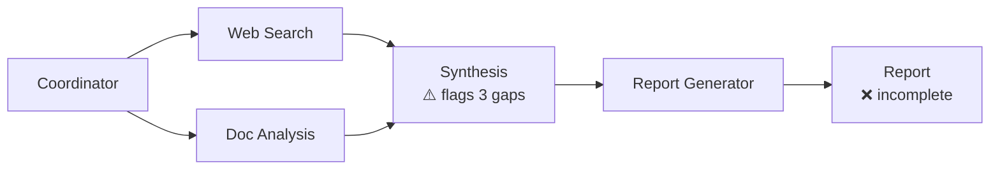
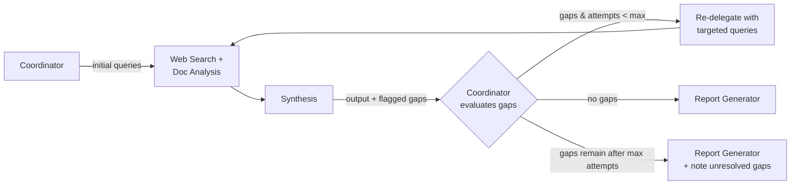

# Q06 — Coordinator skips gaps and ships incomplete reports

**Domain / lesson:** D1 › 1.2 Multi-Agent Orchestration
**Also touches:** D1 › 1.6 Task Decomposition · D2 › 2.3 Tool Distribution (why D fails) · D5 › 5.2 Escalation
**Same system as:** [Q01](../Q01-source-attribution-multi-agent/question.md), [Q04](../Q04-tool-scoping-per-subagent/question.md), [Q05](../Q05-goals-not-procedures-delegation/question.md)

## Question

The synthesis agent completes its initial pass but flags that three key research questions remain unanswered because the web search and document analysis agents didn't find relevant information on those specific subtopics. The coordinator currently proceeds directly to report generation, producing reports with incomplete coverage. What change would most effectively improve research completeness?

- **A.** Have the report generation agent note which research questions couldn't be answered, so users understand the limitations of the final output.
- **B.** Increase the initial breadth of queries sent to web search and document analysis to reduce the probability of missing relevant information.
- **C.** Have the coordinator evaluate synthesis output for gaps, then re-delegate to web search and document analysis with targeted queries before invoking synthesis again.
- **D.** Give the synthesis agent direct access to web search tools so it can autonomously fill knowledge gaps without returning control to the coordinator.

## Answer: **C**

## Diagram

### Current: straight-through pipeline (no feedback)



### Fix (C): coordinator-driven gap loop



## Concept

The coordinator isn't just a dispatcher that starts agents in a fixed order. It **owns the quality of the overall result**. Its job includes **evaluating** what came back and **deciding the next step**.

Here the synthesis agent **already flags** the three gaps, and the coordinator ignores that signal. The fix is a **feedback loop**:
1. The coordinator **evaluates** the synthesis output for gaps.
2. It **re-delegates** to the specialist agents with **targeted** queries for exactly those subtopics.
3. It runs **synthesis again** on the combined results.
4. It moves to report generation only when coverage is complete, or when a stop condition is reached.

This keeps every agent in its role. Search agents search, synthesis synthesizes, and the coordinator decides.

### Production detail: cap the loop
A loop needs a **stop condition**, e.g. max 2 re-delegation rounds. If gaps remain after that, report them openly (option A's idea, used as a **fallback**, not the main fix) or escalate to a human (D5 › 5.2).

## Why the others are wrong

| Option | Why not |
|---|---|
| **A** Note unanswered questions in the report | Honest, but it **documents** the gap instead of **closing** it. Completeness doesn't improve. It's useful only as the **fallback** after the loop has tried. |
| **B** Broader initial queries | **Open loop:** you guess up front, with no feedback afterwards. Gaps are hard to predict, so wider queries still miss some, and they add cost and noise for synthesis. Targeted follow-up is cheaper and more precise. |
| **D** Give synthesis direct web search | **Breaks two rules:** (1) **hub-and-spoke**: *"All communication routes through the coordinator"*; (2) **tool scoping** from [Q04](../Q04-tool-scoping-per-subagent/question.md): synthesis with `web_search` is exactly the misuse problem from Q04. Researching 3 whole questions is a *complex* need, so it goes back to the coordinator. |

## Pattern to remember

> **The coordinator closes the loop: evaluate → re-delegate (targeted) → re-synthesize → stop at a limit.** When a subagent flags a problem, the fix is in the **coordinator's control flow**, not in giving the subagent more power.

### Where this comes from in the guide

**D1 › 1.2 Multi-Agent Orchestration:**
- *"[The coordinator] evaluates the synthesis output for gaps. If it is incomplete, the coordinator re-delegates to the search and analysis subagents with targeted queries."* This is option C almost word for word.
- *"The coordinator must evaluate whether the combined results cover the full breadth of the original topic."*
- *"All communication routes through the coordinator. Subagents never communicate directly with each other, whether for efficiency, convenience or any other reason."* This is why D fails.
- *"If output is incomplete in scope (not depth), the decomposition is almost always the root cause."* This is a related trap: if whole **topics** are missing (not just details), fix the **decomposition** (D1 › 1.6).

## How this connects to earlier questions

| Question | Lesson | Link to Q06 |
|---|---|---|
| [Q04](../Q04-tool-scoping-per-subagent/question.md) | Narrow `verify_fact` OK, **complex needs route back to the coordinator** | 3 unanswered research questions = complex, so they go to the coordinator (C), not a broad tool for synthesis (D) |
| [Q05](../Q05-goals-not-procedures-delegation/question.md) | Delegate goals + criteria | The **targeted** re-delegation should state the gap as a goal: "find evidence on subtopic X; criteria …" |
| [Q01](../Q01-source-attribution-multi-agent/question.md) | Structured data between agents | Gaps are easiest to evaluate when synthesis returns them as a **structured field** (`unanswered_questions: [...]`), not buried in prose |

## Check question

**After 2 re-delegation rounds, one research question still has no answer. What should the system do, and why not keep looping?**
*My answer:* "Report generator should mark the gaps after those attempts." ✅ This is option A used correctly: as the **fallback after the loop**, not instead of it.

**Why not keep looping:**
1. **Cost and latency:** every round means more agent calls and tokens, and the user waits.
2. **Diminishing returns:** if two targeted searches found nothing, a third rarely will.
3. **"Nothing found" can be the real answer:** the information may not exist publicly. That's a finding, not a failure.
4. **Infinite-loop risk:** every agent loop needs a stop condition (D1 › 1.1 loop control).

**Two refinements for full marks:**
1. **Make the gap note specific, and structured.** It separates "searched, nothing exists" from "search tool failed" (D5 › 5.3; Udemy A #118 *The Silent Bug*, Udemy B #44 *Customer Messages and Empty Results*):
   ```json
   { "question": "Market share in APAC 2026",
     "status": "unanswered",
     "attempts": ["web: 'APAC X market share 2026'", "docs: Q3-report.pdf, Q4-report.pdf"],
     "reason": "no_sources_found" }
   ```
2. **Escalate if the gap is critical.** If the report can't make its recommendation without the answer, flag it for a human instead of only noting it (D5 › 5.2).

## Glossary

- **Hub-and-spoke:** a topology where every message goes through a central coordinator (hub) and subagents (spokes) never talk directly.
- **Iterative refinement loop:** evaluate the output → re-delegate to fix specific gaps → evaluate again, until done or a limit is reached.
- **Open loop vs closed loop:** open loop acts without checking results (B). Closed loop checks the result and corrects (C).
- **Scope vs depth gap:** a *scope* gap means a whole subtopic is missing (fix the decomposition). A *depth* gap means a subtopic is covered thinly (targeted re-queries).

## Related course lessons

### Udemy A (primary): Claude Certified Architect (CCAR-F) - 2026 Exam Prep
| # | Lecture | Part | Why |
|---|---|---|---|
| **16** | **The Orchestrator Role — Directing, Delegating, and Aggregating** | 1C | ⭐ The coordinator evaluates and re-delegates |
| **14** | **Adaptive Planning — Updating the Plan Mid-Execution** | 1B | ⭐ Changing the plan when gaps appear |
| 18 | Multi Agent Topology and Selection | 1C | Hub-and-spoke: why D fails |
| 6 | Loop Control — Stopping, Iterating, and Escalating | 1A | Capping the loop and escalating |
| 26 | Retry Logic — When to Retry, When to Abort | 1D | When to stop re-delegating |
| Quiz 2, Quiz 3 | 1B and 1C quizzes | | Self-test |

**▶ Watch in this order (~36 min):** #16 → #18 → #14 → #6 → #26, then do **Quiz 3** and **Quiz 2**.
(coordinator role → topology → adaptive planning → loop control → when to stop → self-tests)

### Udemy B: Claude Certified Architect Foundations: Complete Course (Voroniuk)
| # | Lecture | Section | Why |
|---|---|---|---|
| **61** | **Decomposing Research Without Gaps** | S7 Multi-Agent | ⭐ Gaps and decomposition |
| **69** | **Research Case: Coordinator Calls** | S7 Multi-Agent | ⭐ Exam-style coordinator decisions |
| 60 | The Coordinator Pattern | S7 Multi-Agent | Hub-and-spoke basics |
| 63 | Scoping Each Agent's Tools | S7 Multi-Agent | Why D fails |
| 66 | Failure Handling Across Agents | S7 Multi-Agent | Handling "didn't find anything" |
| Quiz 7 | Multi-Agent quiz | S7 | Self-test |

**▶ Watch in this order (~27 min):** #60 → #61 → #69 → #63 → #66, then do **Quiz 7**.

### CBT Nuggets: CCA-F course
| Skill | Why |
|---|---|
| **36. Design Workflows and Agent Systems** | ⭐ Orchestrator patterns and feedback loops |
| 39–40. Build an Agentic Multimedia Article System | Hands-on coordinator with multiple agents |
