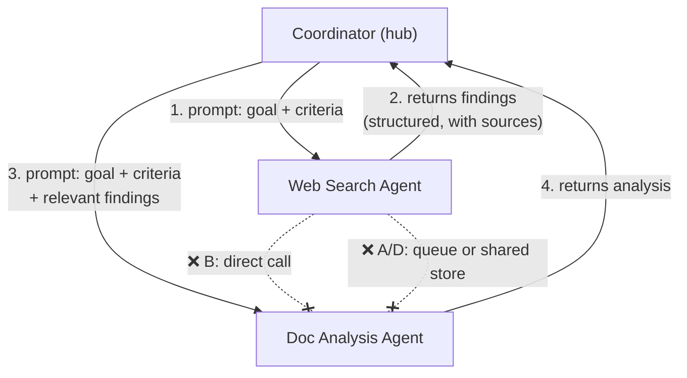

# Q07 — How information flows between subagents

**Domain / lesson:** D1 › 1.3 Subagent Invocation and Context Passing
**Also touches:** D1 › 1.2 Multi-Agent Orchestration (hub-and-spoke)
**Same system as:** [Q01](../Q01-source-attribution-multi-agent/question.md), [Q04](../Q04-tool-scoping-per-subagent/question.md), [Q05](../Q05-goals-not-procedures-delegation/question.md), [Q06](../Q06-coordinator-gap-loop/question.md)

## Question

The web search agent has gathered several relevant sources for a research topic. The document analysis agent now needs to examine these sources. How does information typically flow between these two specialized subagents?

- **A.** The agents communicate through an event-driven message queue, with the document analysis agent subscribing to web search completion events.
- **B.** The web search agent directly invokes the document analysis agent, passing the discovered sources as parameters.
- **C.** The coordinator agent receives the web search agent's output and includes relevant findings in the prompt when invoking the document analysis agent.
- **D.** Both agents access a shared memory store where the web search agent writes findings and the document analysis agent reads them.

## Answer: **C**

## Diagram



## Concept

Two facts explain the answer:

1. **Hub-and-spoke:** all communication goes through the coordinator. Subagents don't call, message or subscribe to each other.
2. **Isolated context:** a subagent starts with a **fresh context**. It knows **only what the coordinator writes into its prompt**. It can't see the coordinator's conversation or other subagents' work.

So the flow is: the web search agent **returns** its output to the coordinator, and the coordinator **selects the relevant findings** and **writes them into the prompt** when it invokes the document analysis agent.

### Why route through the coordinator?
- **Control:** the coordinator decides what happens next. It can evaluate, filter, re-delegate (Q06) or stop.
- **Filtering:** it passes only **relevant** findings, keeping the next agent's context small and focused.
- **Observability:** one place to log, debug and trace the whole flow.
- **Isolation:** subagents stay simple and interchangeable, because none depends on another.

### What a good handoff prompt contains
Combining Q01 and Q05:
- **Goal + quality criteria** (Q05), not procedural steps.
- **Complete findings with source metadata** (Q01). The subagent can't look anything up from earlier, so whatever is left out is missing for it.

## Why the others are wrong

| Option | Why not |
|---|---|
| **A** Event-driven message queue | A general distributed-systems pattern, not how Claude subagents work. Subagents are **invoked by the coordinator** and **return** results to it. A queue also bypasses the coordinator's control. |
| **B** Web search directly invokes doc analysis | Breaks **hub-and-spoke**: *"Subagents never communicate directly with each other, whether for efficiency, convenience or any other reason."* The coordinator would lose control of the flow (no gap loop as in Q06, no filtering). |
| **D** Shared memory store | Bypasses the coordinator as the **router**: no one decides what's relevant, and there's no control point. It also isn't the "typical" flow the exam expects. *Nuance:* storing **large artifacts** externally and passing a **reference** (ID/path) **through the coordinator's prompt** is fine. The coordinator still routes. |

## Pattern to remember

> **Subagents talk only to the coordinator. The coordinator passes context explicitly in the next subagent's prompt.** If it isn't in the prompt, the subagent doesn't know it.

**Exam signal:** answers with "directly," "shared," "subscribe" or "message queue" between subagents are distractors. Look for the coordinator **including findings in the prompt**.

### Where this comes from in the guide

- **D1 › 1.3:** *"A subagent receives only what the coordinator writes into the subagent's prompt."* Prompts must include what the subagent needs, *"such as complete findings from prior agents."*
- **D1 › 1.2:** *"All communication routes through the coordinator. Subagents never communicate directly with each other, whether for efficiency, convenience or any other reason."*

## How this connects to earlier questions

| Question | Link |
|---|---|
| [Q01](../Q01-source-attribution-multi-agent/question.md) | **What** goes into the handoff: structured findings with source metadata |
| [Q05](../Q05-goals-not-procedures-delegation/question.md) | **How** the handoff prompt is phrased: goals + criteria |
| [Q06](../Q06-coordinator-gap-loop/question.md) | **Why** routing through the coordinator matters: it can evaluate and re-delegate |
| **Q07** | **Where** information flows: always through the coordinator |

## Check question

**The coordinator invokes doc analysis with "Analyze the sources the search agent found earlier." What goes wrong, and how would you fix the prompt?**
*My answer:* "Document analysis agent is not aware of search agent findings. The coordinator must supply the context." ✅ The subagent has **isolated context**, so "found earlier" refers to something it has never seen.

**What actually goes wrong in practice:** the subagent won't simply stop. It usually:
- **Makes up sources** that sound plausible. Worst case, and the Q01 problem again.
- **Searches on its own**, if it has tools for that. Q04's role confusion.
- **Returns "no sources provided."** A wasted round trip that the coordinator may misread as "nothing found" (Q06 ambiguity).

**The fixed prompt:**
```
Goal: Assess the reliability and key claims of the sources below
for the question "What drives X's market growth in 2026?"

Sources (from web search):
<sources>
  <source id="S1" url="https://example.com/report" retrieved="2026-10-29">
    excerpt: "..."
  </source>
  <source id="S2" doc="Q4-analysis.pdf" page="7">
    excerpt: "..."
  </source>
</sources>

Quality criteria: for each source, list its main claims with the source id;
flag conflicts between sources; note anything outdated (> 12 months).
Return: structured JSON {claims: [{text, source_id}], conflicts: [...]}
```

It brings together Q01–Q07: **the context itself**, sources with metadata (Q07 + Q01) · **goal + criteria** (Q05) · **structured return** with `source_id` (Q01), easy to check for gaps (Q06).

## Glossary

- **Hub-and-spoke:** the coordinator (hub) is the only connection point. Subagents (spokes) never talk directly.
- **Isolated context:** each subagent starts fresh and sees only its own prompt.
- **Context passing:** the coordinator explicitly writes the needed information into the next subagent's prompt.

## Related course lessons

### Udemy A (primary): Claude Certified Architect (CCAR-F) - 2026 Exam Prep
| # | Lecture | Part | Why |
|---|---|---|---|
| **19** | **Designing Agent-to-Agent Message Schemas** | 1C | ⭐ What the handoff contains |
| **17** | **Subagent Design — Scope, Authority, and Isolation** | 1C | ⭐ Isolated context |
| 16 | The Orchestrator Role — Directing, Delegating, and Aggregating | 1C | The coordinator as router |
| 18 | Multi Agent Topology and Selection | 1C | Hub-and-spoke vs other topologies |
| 21 | In-Context State vs. External Memory | 1C | Why D (shared store) isn't the typical flow |
| Quiz 3 | 1C quiz | | Self-test |

**▶ Watch in this order (~38 min):** #16 → #18 → #17 → #19 → #21, then do **Quiz 3**.
(coordinator → topology → isolation → message schemas → in-context vs external → self-test)

### Udemy B: Claude Certified Architect Foundations: Complete Course (Voroniuk)
| # | Lecture | Section | Why |
|---|---|---|---|
| **64** | **Passing Context Between Agents** | S7 Multi-Agent | ⭐ Exactly this question |
| 60 | The Coordinator Pattern | S7 Multi-Agent | Hub-and-spoke |
| 62 | Spawning Subagents with Task | S7 Multi-Agent | How the coordinator invokes a subagent with a prompt |
| 65 | Practice: Coordinator and Subagents in Code | S7 Multi-Agent | Seeing the flow in code |
| Quiz 7 | Multi-Agent quiz | S7 | Self-test |

**▶ Watch in this order (~26 min):** #60 → #62 → #64 → #65, then do **Quiz 7**.

### CBT Nuggets: CCA-F course
| Skill | Why |
|---|---|
| **36. Design Workflows and Agent Systems** | ⭐ Orchestrator patterns |
| 38. Build a Skill-Aware Agent | Agents invoking capabilities with context |
| 39–40. Build an Agentic Multimedia Article System | Hands-on: content passed between agents via a coordinator |
