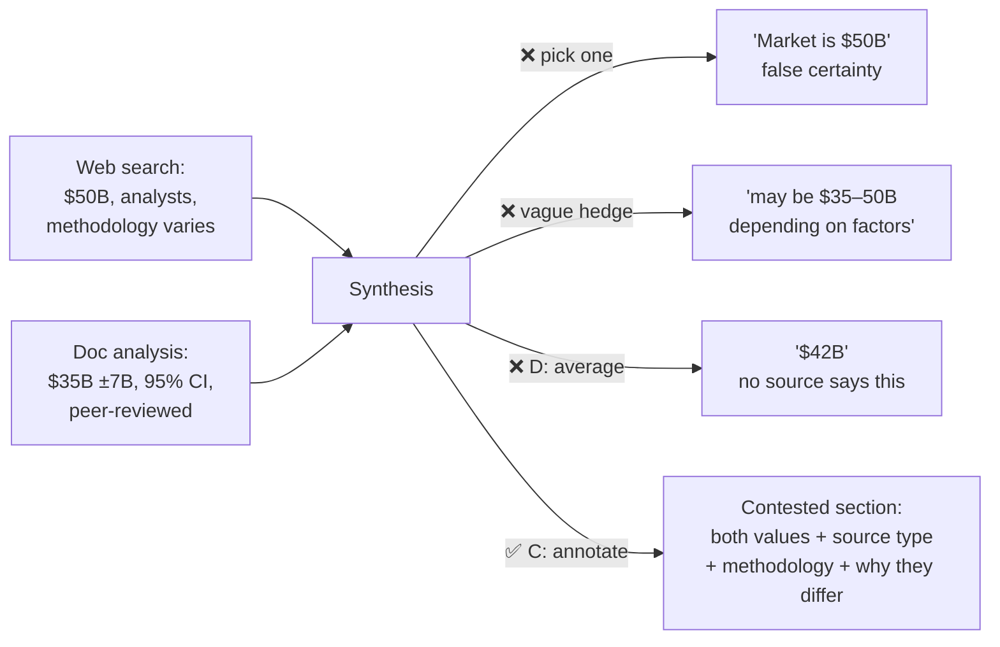

# Q08 — Conflicting findings: false certainty vs over-hedging

**Domain / lesson:** D5 › 5.6 Information Provenance & Multi-Source Synthesis
**Also touches:** D5 › 5.5 Human Review & Confidence Calibration (why D is wrong) · D4 › 4.1 System Prompts with Explicit Criteria
**Same system as:** [Q01](../Q01-source-attribution-multi-agent/question.md) – [Q07](../Q07-context-flows-through-coordinator/question.md)

## Question

Production reviews reveal inconsistent handling of uncertainty in final reports. Sometimes conflicting subagent findings are synthesized into a single confident statement (losing nuance), while other times reports over-hedge with excessive qualifications (becoming unhelpful). When the web search agent returns "industry analysts estimate $50B market size (methodology varies)" and the document analysis agent returns "peer-reviewed study estimates $35B (±$7B, 95% CI)," the coordinator either picks one arbitrarily or produces vague statements like "the market may be $35B-$50B depending on factors." What systematic approach best addresses this?

- **A.** Configure subagents to only report findings meeting a high-confidence threshold, filtering uncertain information before it reaches the coordinator.
- **B.** Add a verification subagent that cross-references findings across sources, only passing claims to synthesis that are corroborated by at least two independent sources.
- **C.** Instruct the synthesis agent to structure reports with explicit sections distinguishing well-established findings from contested ones, preserving original source characterizations and methodological context.
- **D.** Implement a confidence calibration layer that normalizes subagent uncertainty expressions to standardized probability scores (0.0-1.0), then weight-average findings by their calibrated confidence.

## Answer: **C**

## Diagram



## Concept

When sources **disagree**, the disagreement is **itself a finding**. Both failure modes in the question destroy it:
- **Picking one** → false certainty. The reader never learns there's a dispute.
- **Vague hedging** → the reader learns there's a dispute but **not why** or **how much to trust each side**.

**The fix:** structure the report so it separates **well-established** findings from **contested** ones, and for contested ones **keep each source's own characterization**: the value, who says it, the method, and the uncertainty.

### Example: what C produces

> **Well-established findings**
> - Market grew year-over-year in 2025 (3 independent sources: S1, S4, S7).
>
> **Contested findings**
> - **Market size:** estimates differ by source and method.
>   - **$35B (±$7B, 95% CI):** peer-reviewed study [S2]. Explicit methodology and confidence interval.
>   - **$50B:** industry analyst estimate [S5]. Methodology varies and isn't fully disclosed.
>   - *Possible reasons:* different market definitions or reporting periods. The analyst figure sits above the study's 95% interval ($28–42B).

This is neither overconfident nor vague. The reader gets **both values, their basis, and enough context to judge**.

### Structured version (connects to Q01 / Q07)
```json
{ "contested": [
    { "topic": "market_size_2026",
      "positions": [
        { "value": "$35B", "uncertainty": "±$7B, 95% CI", "source_id": "S2", "source_type": "peer-reviewed", "method": "documented" },
        { "value": "$50B", "uncertainty": null, "source_id": "S5", "source_type": "industry analyst", "method": "varies" } ],
      "possible_reasons": ["market definition", "reporting period"] } ] }
```

## Why the others are wrong

| Option | Why not |
|---|---|
| **A** Filter to high-confidence findings only | **Destroys information before anyone can judge it.** The $50B ("methodology varies") might be dropped and the reader never learns the analysts disagree. It produces *more* false certainty, which is one of the two problems we're fixing. |
| **B** Pass only claims corroborated by ≥2 sources | Corroboration is useful **as a label** (established vs contested), but harmful **as a filter**. Both figures here are single-source, so both would be dropped, including a peer-reviewed study. It also doesn't say how to present a **conflict**. |
| **D** Normalize to 0.0–1.0 and weight-average | Sounds rigorous but **averaging creates a number no source supports** (~$42B), which is false certainty with extra steps. Squeezing "methodology varies" and "±$7B, 95% CI" into one scalar **loses the methodological context** the reader needs. The guide lists averaging among the approaches that *"destroy information and present a false certainty."* |

## Pattern to remember

> **Annotate conflicts, don't resolve them artificially.** Keep both values with their source, method and uncertainty, and separate *established* from *contested*. Filtering, picking and averaging all destroy information.

**Exam signal:** options that **filter**, **pick**, **average** or **normalize to one score** conflicting evidence are distractors. Look for **preserving + structuring** the disagreement.

### "But C says 'instruct'. Doesn't structure beat instructions?"
Good catch. The rule from Q01/Q04/Q05 is about **guarantees**. Here the problem is **judgment and presentation**: how to represent uncertainty honestly. Also:
- C **is** structural: it prescribes a report **structure** (established vs contested sections).
- You can strengthen it with a schema (`contested[]` field above) so conflicts can't silently disappear between agents.
- The other options are "structural" too, but they structurally **destroy** information. Structure that loses meaning isn't the goal.

### Where this comes from in the guide

**D5 › 5.6 Information Provenance & Multi-Source Synthesis:**
- *"The correct approach is to annotate the conflict with both values and full source attribution."* The judgment is left to the reader.
- Wrong approaches: selecting one value by recency, **averaging**, or by publisher authority. *"Each of these choices destroys information and presents a false certainty."*
- Reports should include *"explicit sections separating well-established findings from contested ones"* and preserve *"methodological context."*
- *"The difference may reflect different reporting periods and methodological approaches."*
- *"A finding that three independent sources support differs from a finding that is based on a single report."* So corroboration is a **label**, not a filter.

## Glossary

- **Conflict annotation:** keeping disagreeing findings side by side, each with its source, value, method and uncertainty, instead of resolving them into one statement.
- **False certainty:** presenting a contested or uncertain claim as settled.
- **Methodological context:** how a number was produced (sample, definition, period, confidence interval), which is often the reason sources disagree.
- **Corroboration:** independent sources supporting the same finding. Use it to **label** strength (established vs contested), not to filter.
- **Confidence interval (95% CI):** a range expected to contain the true value with 95% confidence. "$35B ±$7B" means roughly $28–42B.

## Related course lessons

### Udemy A (primary): Claude Certified Architect (CCAR-F) - 2026 Exam Prep
| # | Lecture | Part | Why |
|---|---|---|---|
| **132** | **Conflict Annotation — Surfacing Disagreement in Synthesis** | 5D | ⭐ Exactly this question |
| 131 | Claim-to-Source Mappings — Why Every Sentence Needs a Source | 5D | Keeping each value tied to its source |
| 126 | Per-Field Confidence — Beyond a Single Score | 5D | Why one score per finding (D) loses information |
| 127 | Calibrating with a Validation Set | 5D | What real calibration is (vs D's normalization) |
| Quiz 18 | 5D quiz | | Self-test |

**▶ Watch in this order (~27 min):** #131 → #132 → #126 → #127, then do **Quiz 18**.
(source mapping → conflict annotation → why single scores fail → real calibration → self-test)

### Udemy B: Claude Certified Architect Foundations: Complete Course (Voroniuk)
| # | Lecture | Section | Why |
|---|---|---|---|
| **68** | **When Sources Disagree** | S7 Multi-Agent | ⭐ Exactly this question |
| 67 | Keeping Claims Tied to Sources | S7 Multi-Agent | Source attribution for each value |
| 70 | Research Case: Citing Sources | S7 Multi-Agent | Exam-style case |
| 32 | Confidence Calibration and Human Review | S4 Structured Output | Proper use of confidence (vs D) |
| Quiz 7 | Multi-Agent quiz | S7 | Self-test |

**▶ Watch in this order (~21 min):** #67 → #68 → #70 → #32, then do **Quiz 7**.

### CBT Nuggets: CCA-F course
| Skill | Why |
|---|---|
| 24. Compare Web Search and RAG | Different source types and their reliability |
| 26. Explain RAG and Document Chunking | Keeping source context with each chunk |

*CBT has no dedicated lesson on conflict handling. Use Udemy A #132 or Udemy B #68.*
