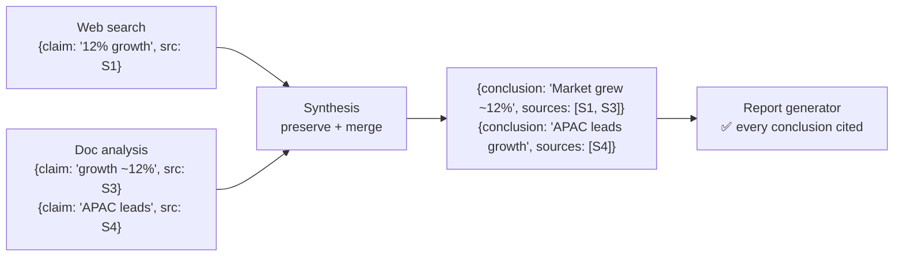

# Q09 — Synthesis loses which sources support which conclusions

**Domain / lesson:** D5 › 5.6 Information Provenance & Multi-Source Synthesis
**Also touches:** D1 › 1.3 Subagent Invocation and Context Passing · D4 › 4.3 Structured Output
**Close cousin of:** [Q01](../Q01-source-attribution-multi-agent/question.md) (same fix, different point of loss)

## Question

In production, final reports frequently contain claims without proper source attribution. Investigation shows that while the web search and document analysis agents correctly attach citations to their outputs, the synthesis agent loses track of which sources support which conclusions when combining findings. What's the most effective architectural change?

- **A.** Require all subagents to output structured claim-source mappings that the synthesis agent must preserve and merge when combining findings from multiple sources.
- **B.** Maintain complete transcripts of all subagent interactions and add a citation-resolution agent to analyze logs and determine attributions before report generation.
- **C.** Add a verification step where the report generator uses semantic similarity matching against original sources to reconstruct which claims came from which documents.
- **D.** Have the coordinator inject source identifier prefixes into text before each handoff, then parse these prefixes at report generation to reconstruct citations.

## Answer: **A**

## Q01 vs Q09: where the source link breaks

| | Q01 | Q09 |
|---|---|---|
| Subagents attach citations? | ❌ Lost when they **summarize** | ✅ Correct |
| Where the link breaks | Search/analysis → synthesis | **Inside synthesis**, when **combining** findings |
| Fix | Structured output: content separate from metadata | Same, **plus** synthesis must **preserve and merge** the mappings |

## Diagram

## Concept

Synthesis does something new: it **combines** several findings into one conclusion. That's exactly where free text loses the link. When the model rewrites "12% (S1)" and "~12% (S3)" into one sentence, nothing forces it to carry both sources along.

**The fix has two parts:**
1. **Structured claim-source mappings as the data format** between all agents (as in Q01).
2. **Synthesis must preserve and merge them:**
   - **Preserve:** every input source ID survives into the output.
   - **Merge:** when several findings support one conclusion, the conclusion gets the **union** of their sources (`[S1, S3]`). When they conflict, annotate both (Q08).

Because the mapping is **data**, you can also **validate** it in code: every conclusion has at least one source, and every cited ID exists in the inputs (see [claim-source-mapping](../../concepts/claim-source-mapping.md), Layer 2).

## Why the others are wrong

| Option | Why not |
|---|---|
| **B** Transcripts + citation-resolution agent | **Reconstructs after the fact** instead of preserving. It's expensive (huge logs in context), and another model **guessing** attributions is probabilistic. Same family as Q01 A. |
| **C** Semantic similarity matching | **Approximate.** Similar wording ≠ "this source supports this claim." Synthesized conclusions combine several sources, so they may not closely match any single one, and the wrong source can get attached. Same family as Q03 B (vector search for exact state). |
| **D** Source ID prefixes in the text | **Still free text.** The synthesis agent rewrites and combines prose, so prefixes get dropped, merged or attached to the wrong sentence, and parsing them is brittle. Same family as Q01 D (inline citations). The guide: *"Synthesis compresses and rewrites prose, so source details embedded in it are lost."* |

## Pattern to remember

> **Don't reconstruct provenance. Preserve it.** Keep claim-source mappings as **data** through every hop, and make the step that **combines** findings responsible for **merging** them.

**Exam signal:** "reconstruct," "re-locate," "similarity matching," "analyze logs to determine," "parse markers from text" → all try to **recover** a link that a structured design would never have **lost**.

### Where this comes from in the guide

**D5 › 5.6 Information Provenance:**
- *"Subagents emit structured claim-source mappings. These are data rather than prose."*
- *"Downstream agents must explicitly preserve and merge claim-source mappings through synthesis."* This is option A almost word for word.
- *"Synthesis compresses and rewrites prose, so source details embedded in it are lost."* This is why D fails.
- *"Every finding must contain its provenance."*

## Glossary

- **Preserve (mappings):** carry every input's source ID through a processing step unchanged.
- **Merge (mappings):** when several findings support one conclusion, attach the union of their source IDs. When they conflict, annotate both (Q08).
- **Post-hoc reconstruction:** trying to work out sources *after* they were lost (B, C). It's unreliable by design.

## Related course lessons

### Udemy A (primary): Claude Certified Architect (CCAR-F) - 2026 Exam Prep
| # | Lecture | Part | Why |
|---|---|---|---|
| **131** | **Claim-to-Source Mappings — Why Every Sentence Needs a Source** | 5D | ⭐ Exactly this question |
| 109 | Why Summaries Lose Facts | 5A | Why rewriting prose loses source links |
| 19 | Designing Agent-to-Agent Message Schemas | 1C | The mapping as the data contract between agents |
| 132 | Conflict Annotation — Surfacing Disagreement in Synthesis | 5D | Merging when findings conflict |
| Quiz 18 | 5D quiz | | Self-test |

**▶ Watch in this order (~28 min):** #109 → #19 → #131 → #132, then do **Quiz 18**.
(why prose loses links → schemas → claim-source mappings → merging conflicts → self-test)

### Udemy B: Claude Certified Architect Foundations: Complete Course (Voroniuk)
| # | Lecture | Section | Why |
|---|---|---|---|
| **67** | **Keeping Claims Tied to Sources** | S7 Multi-Agent | ⭐ Exactly this question |
| 70 | Research Case: Citing Sources | S7 Multi-Agent | Exam-style case |
| 64 | Passing Context Between Agents | S7 Multi-Agent | Mappings passed through the coordinator |
| Quiz 7 | Multi-Agent quiz | S7 | Self-test |

**▶ Watch in this order (~16 min):** #64 → #67 → #70, then do **Quiz 7**.

### CBT Nuggets: CCA-F course
| Skill | Why |
|---|---|
| **19. Explain Tool Use and Tool Schemas** | ⭐ Schemas for structured mappings |
| 36. Design Workflows and Agent Systems | Multi-agent pipeline |
| 39–40. Build an Agentic Multimedia Article System | Hands-on content passed between agents |
