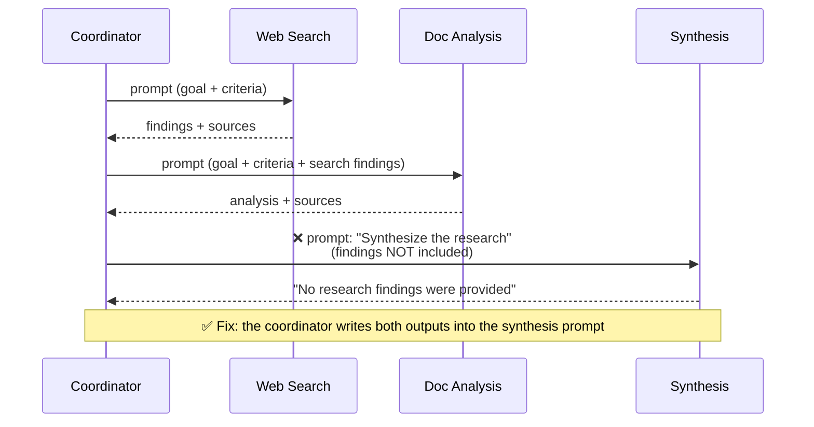

# Q10 — "No research findings were provided"

**Domain / lesson:** D1 › 1.3 Subagent Invocation and Context Passing
**Also touches:** D1 › 1.2 Multi-Agent Orchestration (hub-and-spoke)
**Close cousin of:** [Q07](../Q07-context-flows-through-coordinator/question.md) (its check question is this exact scenario)

## Question

After the web search agent and document analysis agent complete their tasks, the coordinator invokes the synthesis agent. However, the synthesis agent responds that it cannot complete the task because no research findings were provided. What is the most likely cause of this issue?

- **A.** The subagents need to share a single API connection to enable automatic context sharing between invocations.
- **B.** The synthesis agent needs tools that can fetch results directly from the other agents' conversation histories.
- **C.** The coordinator did not include the outputs from the previous agents in the synthesis agent's prompt.
- **D.** The synthesis agent's context window is not large enough to hold the combined outputs from both previous agents.

## Answer: **C**

## Diagram

## Concept

**Each subagent invocation is a fresh, isolated context.** The synthesis agent sees **only** what's in its own prompt. It has no access to the coordinator's conversation or to the other agents' work.

Underneath, the Claude **Messages API is stateless**: every request must contain everything the model needs. There's no hidden shared memory between calls. "Memory" exists only because **your code** puts earlier content into the next request.

So when synthesis says "no findings were provided," it's **telling the truth**: the coordinator invoked it without writing the findings into its prompt.

**Fix:** the coordinator includes both agents' outputs (structured, with sources, as in Q01/Q02/Q09) in the synthesis prompt.

## Why the others are wrong

| Option | Why not |
|---|---|
| **A** Share a single API connection | **No such mechanism.** A connection doesn't carry context between requests, because the API is stateless. Context sharing is never "automatic"; the coordinator does it explicitly. |
| **B** Tools to fetch other agents' histories | Breaks **hub-and-spoke** and **isolation**: subagents don't reach into each other's work (Q07 B/D, Q06 D). It also treats the symptom: the coordinator already has the outputs and simply needs to pass them on. |
| **D** Context window too small | **Symptom mismatch.** A full context window gives a **"prompt too long" error** or truncation. It doesn't make the agent report that **nothing** was provided. (Even if size were an issue, the fix would be to pass condensed, structured findings, as in Q02.) |

## Pattern to remember

> **The API is stateless and subagents are isolated: context exists only if the coordinator writes it into the prompt.** "No findings provided" means the coordinator didn't pass them.

**Exam technique: match the symptom.** Ask which option would produce **exactly** the observed behaviour. A full context window wouldn't produce "nothing was provided," and neither would too many tools (Q04 B). Options that explain a **different** symptom are distractors.

### Where this comes from in the guide

**D1 › 1.3 Subagent Invocation and Context Passing:**
- *"A subagent receives only what the coordinator writes into the subagent's prompt."*
- Prompts must include what the subagent needs, *"such as complete findings from prior agents."*

**D1 › 1.2:** *"All communication routes through the coordinator. Subagents never communicate directly with each other…"* This is why B fails.

## Glossary

- **Stateless API:** the server keeps no memory between requests. Each request must carry the full context (conversation history, findings, instructions).
- **Isolated context:** each subagent starts fresh and sees only its own prompt.
- **Symptom matching:** an exam technique. Pick the cause that would produce *exactly* the observed behaviour.

## Related course lessons

### Udemy A (primary): Claude Certified Architect (CCAR-F) - 2026 Exam Prep
| # | Lecture | Part | Why |
|---|---|---|---|
| **17** | **Subagent Design — Scope, Authority, and Isolation** | 1C | ⭐ Isolated context |
| **21** | **In-Context State vs. External Memory** | 1C | ⭐ What the agent can and can't see |
| 19 | Designing Agent-to-Agent Message Schemas | 1C | What the handoff should contain |
| 16 | The Orchestrator Role — Directing, Delegating, and Aggregating | 1C | The coordinator passes context |
| Quiz 3 | 1C quiz | | Self-test |

**▶ Watch in this order (~29 min):** #16 → #17 → #21 → #19, then do **Quiz 3**.
(coordinator role → isolation → in-context vs external state → handoff contents → self-test)

### Udemy B: Claude Certified Architect Foundations: Complete Course (Voroniuk)
| # | Lecture | Section | Why |
|---|---|---|---|
| **12** | **Practice: The Conversation Lives in Your Code** | S2 API Basics | ⭐ Stateless API: your code carries the context |
| **64** | **Passing Context Between Agents** | S7 Multi-Agent | ⭐ Exactly this question |
| 62 | Spawning Subagents with Task | S7 Multi-Agent | What goes into a subagent's prompt |
| Quiz 2, Quiz 7 | API Basics and Multi-Agent quizzes | | Self-test |

**▶ Watch in this order (~16 min):** #12 → #62 → #64, then do **Quiz 2** and **Quiz 7**.

### CBT Nuggets: CCA-F course
| Skill | Why |
|---|---|
| **10. Send Structured Messages to Claude** | ⭐ How each request carries its own context (stateless) |
| 21. Build Multi Turn Tool Conversations | Your code rebuilds history every turn |
| 36. Design Workflows and Agent Systems | Coordinator → subagent handoffs |
