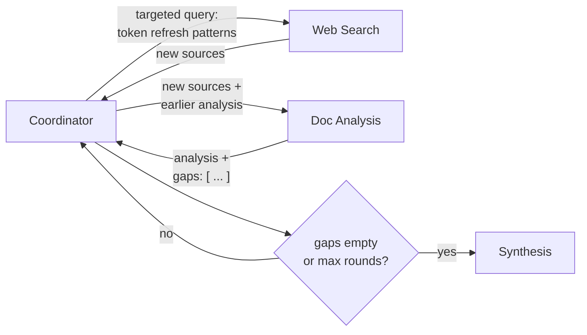

# Q11 — Analysis finds gaps, but the strict pipeline can't act on them

**Domain / lesson:** D1 › 1.2 Multi-Agent Orchestration (iterative refinement loops)
**Also touches:** D1 › 1.6 Task Decomposition (why A isn't enough) · D1 › 1.3 Context Passing
**Close cousin of:** [Q06](../Q06-coordinator-gap-loop/question.md) (same loop, earlier in the pipeline, and B vs C is subtler)

## Question

Users report that final reports sometimes lack depth on specific subtopics. Investigation shows that the document analysis agent frequently identifies gaps – for instance, noting "the retrieved sources discuss API authentication but lack details on token refresh patterns" – but under the current strict pipeline, this insight isn't actionable since search has already completed. What's the most effective architectural change?

- **A.** Add a research planning agent before the search phase that decomposes topics into specific sub-questions.
- **B.** Have the analysis agent report specific gaps to the coordinator, which triggers targeted searches and re-invokes analysis until sufficient.
- **C.** Have the coordinator review analysis output for gap indicators and re-invoke search with gap-informed queries when gaps are detected.
- **D.** Have the synthesis agent attach confidence scores to each section and flag areas with insufficient coverage for manual review.

## Answer: **B**

## Diagram

## Concept

The analysis agent **already knows** what's missing. It's the agent that read the sources. The strict, one-way pipeline throws that knowledge away. The fix turns it into a **closed feedback loop**:

1. Analysis **explicitly reports** specific gaps to the coordinator (ideally as a structured `gaps` field).
2. The coordinator **triggers targeted searches** for exactly those gaps.
3. The coordinator **re-invokes analysis** on the new sources.
4. **Repeat until sufficient**, with a cap (Q06).

Everything still goes through the coordinator (hub-and-spoke, Q07). Analysis doesn't call search directly.

## B vs C: the subtle difference

Both are coordinator-driven loops, so both respect hub-and-spoke. B wins on **two** points:

| | **B ✅** | **C** |
|---|---|---|
| **Who identifies the gap** | The analysis agent **reports it explicitly**. It's the agent with the knowledge. | The coordinator **scans the output for "gap indicators"**, inferring gaps from prose |
| **Reliability of detection** | Explicit signal, which can be a structured field (`gaps: [...]`) | Inference. Gaps can be missed or misread, the same "reconstruct instead of preserve" problem as Q09 |
| **Is the loop complete?** | Search → **re-invoke analysis** → **until sufficient** | Re-invokes **search only**. New sources are never analysed, and there's no stop condition |

> In short: **B = explicit signal + complete loop. C = inferred signal + half a loop.**

## Why the others are wrong

| Option | Why not |
|---|---|
| **A** Planning agent decomposes topics up front | Good practice for **scope** (whole subtopics missing, D1 › 1.6), but this is a **depth** gap that only appears **after reading the sources**. Nobody can plan for "the sources lack token refresh details" in advance. It's **open loop**, the same family as Q06 B. |
| **C** Coordinator scans for gap indicators, re-searches | Close, but **inferred** detection and an **incomplete** loop (see above). |
| **D** Confidence scores + manual review | **Documents** the gap instead of **closing** it, the same family as Q06 A. Useful only as a **fallback** after the loop hits its cap. |

## Pattern to remember

> **When an agent discovers a gap, let it report the gap explicitly to the coordinator, which closes the loop: targeted search → re-analysis → until sufficient (with a cap).**

**Exam technique for close options:** compare them on (1) **who** produces the signal (explicit from the agent that knows vs inferred), and (2) whether the **loop is complete** (does every step re-run, is there a stop condition?).

### Scope vs depth (from Q06)
| Gap type | Example | Fix |
|---|---|---|
| **Scope:** whole subtopic missing | Report never mentions authentication at all | Better **decomposition** up front (A's idea) |
| **Depth:** subtopic covered thinly | Authentication covered, token refresh details missing | **Feedback loop** after analysis (B) |

### Where this comes from in the guide

**D1 › 1.2 Multi-Agent Orchestration:**
- Iterative refinement: the coordinator evaluates output for gaps and *"re-delegates to the search and analysis subagents with targeted queries."* Note **both** search **and** analysis, which is why C's search-only loop falls short.
- *"If output is incomplete in scope (not depth), the decomposition is almost always the root cause."* This question is a **depth** problem, so A isn't the fix.

## How this connects to earlier questions

| Question | Link |
|---|---|
| [Q06](../Q06-coordinator-gap-loop/question.md) | Same loop, with gaps flagged by **synthesis**. Q11 = gaps flagged by **analysis**, one step earlier |
| [Q07](../Q07-context-flows-through-coordinator/question.md) | The loop still routes everything through the coordinator |
| [Q09](../Q09-synthesis-preserve-merge-mappings/question.md) | Explicit, structured signal beats reconstructing it later (C infers gaps from prose) |
| [Q10](../Q10-missing-context-in-subagent-prompt/question.md) | Re-invoked analysis must get the **new sources + earlier analysis** in its prompt |

## Glossary

- **Strict (linear) pipeline:** each agent runs once, in a fixed order, with no way back. Fast and simple, but it can't act on what later agents discover.
- **Feedback loop:** later agents' findings feed back into earlier steps via the coordinator.
- **Explicit vs inferred signal:** an agent **states** the gap (explicit) vs another component **guesses** it from text (inferred).

## Related course lessons

### Udemy A (primary): Claude Certified Architect (CCAR-F) - 2026 Exam Prep
| # | Lecture | Part | Why |
|---|---|---|---|
| **14** | **Adaptive Planning — Updating the Plan Mid-Execution** | 1B | ⭐ Acting on what's discovered mid-run |
| 16 | The Orchestrator Role — Directing, Delegating, and Aggregating | 1C | Coordinator drives the loop |
| 6 | Loop Control — Stopping, Iterating, and Escalating | 1A | "Until sufficient" plus a cap |
| 11 | Decomposition Patterns — Hierarchical, Sequential, and Parallel | 1B | Why up-front decomposition (A) has limits |
| Quiz 2, Quiz 3 | 1B and 1C quizzes | | Self-test |

**▶ Watch in this order (~28 min):** #16 → #14 → #6 → #11, then do **Quiz 2** and **Quiz 3**.
(coordinator → adaptive planning → loop control → decomposition limits → self-tests)

### Udemy B: Claude Certified Architect Foundations: Complete Course (Voroniuk)
| # | Lecture | Section | Why |
|---|---|---|---|
| **61** | **Decomposing Research Without Gaps** | S7 Multi-Agent | ⭐ Gaps: decomposition vs feedback |
| **69** | **Research Case: Coordinator Calls** | S7 Multi-Agent | ⭐ Exam-style coordinator decisions |
| 59 | Workflow or Agent: How Work Is Decomposed | S7 Multi-Agent | Strict pipeline (workflow) vs adaptive |
| 66 | Failure Handling Across Agents | S7 Multi-Agent | Reporting problems up to the coordinator |
| Quiz 7 | Multi-Agent quiz | S7 | Self-test |

**▶ Watch in this order (~22 min):** #59 → #61 → #69 → #66, then do **Quiz 7**.

### CBT Nuggets: CCA-F course
| Skill | Why |
|---|---|
| **36. Design Workflows and Agent Systems** | ⭐ Fixed workflows vs adaptive agent loops |
| 39–40. Build an Agentic Multimedia Article System | Hands-on multi-agent loop |
