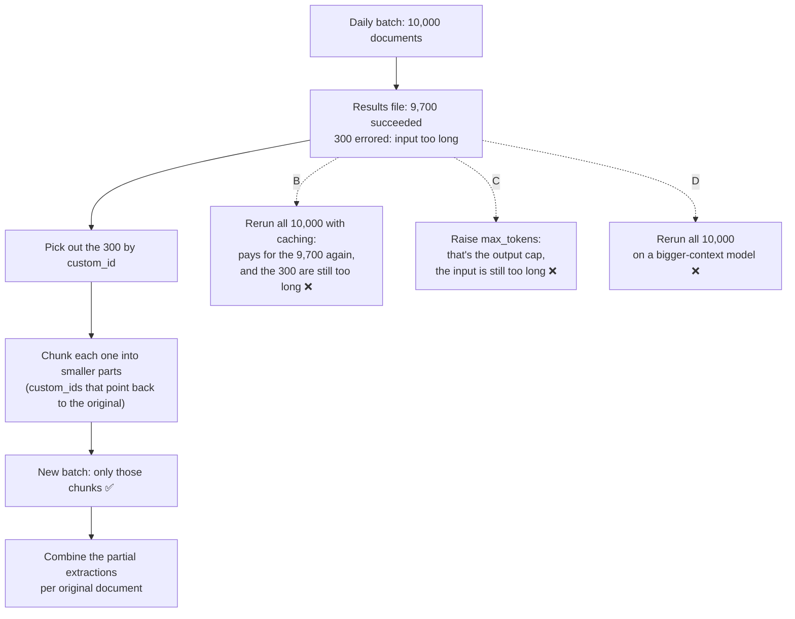

# Q110 — 300 of 10,000 batch documents too long for the context: resubmit only those, chunked

**Domain / lesson:** D4 › 4.5 Batch Processing (Batch Failure Handling)
**Scenario:** Structured data extraction system (same as [Q95](../Q95-accuracy-by-segment-before-automating/question.md), [Q98](../Q98-few-shot-for-informal-measurements/question.md))
**Follows:** [Q51](../Q51-stop-reason-controls-loop/question.md) (its check: `max_tokens` is the output cap, so raise it when the *output* was cut off. Here the *input* doesn't fit)

## Question

You are building a structured data extraction system using Claude. The system extracts information from unstructured documents, validates the output using JavaScript Object Notation (JSON) schemas, and maintains high accuracy. It must handle edge cases gracefully and integrate with downstream systems.

After your daily batch of 10,000 documents completes, 300 documents (3%) failed with "context_length_exceeded" errors. The results file identifies each failure by custom_id.

What's the most cost-effective approach to process these failures?

- **A.** Resubmit only the 300 failed documents after chunking them into smaller pieces, then combine the partial extractions
- **B.** Reprocess the entire batch with prompt caching enabled to reduce the cost of retrying requests with identical system prompts
- **C.** Increase the max_tokens parameter for the 300 failed documents and resubmit them in a new batch
- **D.** Resubmit the entire 10,000 document batch using a model tier with a larger context window

## Answer: **A**

## Diagram



## Concept

**Handling batch failures comes down to two questions: what to resend, and what to change.**

**1. What to resend: only the 300.** The other 9,700 have results already. Guide 4.5: *"If you resubmit the entire batch, you pay again for documents that already succeeded."* The `custom_id` makes this possible, because it's how you know which documents failed: *"each request in a batch gets a unique identifier used to match it with its response"*. The guide's first step: *"Identify failures by custom_id. Each request has a unique identifier. Parse the batch results to find which custom_id values failed."*

**2. What to change: whatever caused the failure.** These 300 failed because the document doesn't fit in the context window. Resending them unchanged fails the same way. The change has to make each request smaller, and the guide names it: *"Chunking (splitting into smaller parts) oversized documents that exceeded context limits"*.

**The cost difference** *(my arithmetic)*: A pays for about 300 documents' worth of tokens, plus the instructions repeated on each chunk. B and D pay for all 10,000 again, roughly 33 times as many documents, to fix 3% of them.

**What chunking and recombining look like** (illustrative):

```text
original:  doc-04217                    → errored: prompt too long
retry:     doc-04217-retry-1-part-1     ┐
           doc-04217-retry-1-part-2     ├ one request each, in a new batch
           doc-04217-retry-1-part-3     ┘
combine:   group results by "doc-04217" → one extraction, validated against the schema
```

The guide's retry code names the retries `` `${id}-retry-1` ``. The `-part-n` suffix is my addition, so the combine step can group each document's chunks.

*Practical tip, not guide wording:* decide per field how to combine. A list (line items) is joined across chunks, without duplicates where chunks overlap. A document-level field (the total) may appear in only one chunk. Then validate the combined result against the same JSON schema as everything else.

**About the error name.** The Claude API's own wording for this case is: *"If the input alone already exceeds the model's context window, the API returns a 400 invalid_request_error ("prompt is too long") on every model."* "context_length_exceeded" in the question is a generic label for the same failure.

## Why the others are wrong

| Option | Why not |
|---|---|
| **B** Rerun the whole batch with prompt caching | **It pays for the 9,700 successes again, and the 300 still fail.** Guide: *"If you resubmit the entire batch, you pay again for documents that already succeeded."* Caching discounts a repeated prefix such as the system prompt. It doesn't make a document shorter, so the 300 are still too long for the context window. *(The caching point is my reasoning.)* |
| **C** Raise `max_tokens` and resubmit the 300 | **It changes the wrong limit.** `max_tokens` caps the *output*. These requests failed because the *input* doesn't fit, and the docs say that fails *"on every model"*. On older models, input plus `max_tokens` over the window is itself an error, so raising `max_tokens` can make it worse. The guide's retry code does raise `max_tokens` (*"increased for oversized docs"*), but *alongside* chunking. Chunking is what makes the request fit. |
| **D** Rerun all 10,000 on a model with a larger context window | **A full rerun plus a model change.** It pays again for the 9,700, and every model's window has a limit, so a long enough document fails again. The exam is model-agnostic: a bigger model is a distractor when the fix is in the design. *(Current docs list many Claude models with a 1M-token window already, so a document that overflows may not fit on any model.)* |

## Pattern to remember

> **Batch failures → find them by `custom_id`, resubmit only those, with a change that fixes the cause.** Too long for the context window → chunk them, then combine the partial results. Never rerun the whole batch to fix a few documents.

**Exam signals:**
- *"The results file identifies each failure by custom_id"* → resubmit only the failures.
- *"context_length_exceeded"*, "prompt is too long" → the input doesn't fit → chunk.
- *"Reprocess the entire batch"*, *"Resubmit the entire 10,000 document batch"* → pays for the successes again.
- *"Increase the max_tokens parameter"* for an input-size error → the wrong limit (output, not input).
- *"Prompt caching"* → discounts repeated prefixes; doesn't shrink documents.
- *"A model tier with a larger context window"* → a model change, not a design fix.

### Where this comes from

**Guide D4 › 4.5 Batch Processing:**
- *"custom_id fields for correlating request/response pairs: each request in a batch gets a unique identifier used to match it with its response"* (**A**)
- *"Identify failures by custom_id. Each request has a unique identifier. Parse the batch results to find which custom_id values failed."* (**A**)
- *"Resubmit only failures with modifications. If you resubmit the entire batch, you pay again for documents that already succeeded."* (**A**, **B**, **D**)
- *"Chunking (splitting into smaller parts) oversized documents that exceeded context limits, such as the broker's longest commercial policy schedules"* (**A**)
- Retry code: *"increased for oversized docs"* (`max_tokens: 8192`), with *"chunkIfNeeded(originalDoc)"* as the content. (**C**)
- Build exercise: *"Resubmitting only failures with targeted modifications is the correct batch failure pattern. Resubmitting the entire batch wastes cost on already-successful documents."* (**A**, **B**, **D**)

**Claude API docs, Context windows (current docs, not the guide):**
- *"If the input alone already exceeds the model's context window, the API returns a 400 invalid_request_error ("prompt is too long") on every model."* (**C**)
- *"On Claude 4.5 models and newer, if input tokens plus `max_tokens` exceeds the context window size, the API accepts the request."* *"On earlier models, the API returns a validation error instead."* (**C**)

## How this connects to earlier questions

| Question | Link |
|---|---|
| [Q51](../Q51-stop-reason-controls-loop/question.md) | Its check: `stop_reason: "max_tokens"` means the output was cut off, so raise `max_tokens`. Here the input doesn't fit, so `max_tokens` is the wrong setting (C) |
| [Q98](../Q98-few-shot-for-informal-measurements/question.md) | Same system: fix the cause of a failure pattern, not the symptom. There, examples for the misread case. Here, chunks for the oversized case |
| [Q95](../Q95-accuracy-by-segment-before-automating/question.md) | Same system: act on the slice that fails (a segment, 300 documents), not on everything |

## Check question

**The same results file also shows 40 requests with result type `expired`. Do they go into the retry batch, and do you chunk them like the 300?**

## Glossary

- **Message Batches API:** sends many requests in one submission and returns the results later, at half the cost of synchronous calls.
- **`custom_id`:** the unique ID you give each request in a batch, so you can match it to its result.
- **Context window:** the most tokens a model can take in one request.
- **`max_tokens`:** the limit on how many tokens the model may *generate* in its reply (the output).
- **Chunking:** splitting an oversized document into smaller parts that each fit, then combining the results.
- **Prompt caching:** reusing a repeated prompt prefix (such as the system prompt) at a lower cost. It doesn't shorten the prompt.
- **`errored` result:** a batch request that failed, for example because the input was too long.

## Related course lessons

*Lecture lengths aren't recorded in the study-map files, so the watch times below are estimates from each course's average lecture length.*

### Udemy A (primary): Claude Certified Architect (CCAR-F) - 2026 Exam Prep
| # | Lecture | Part | Why |
|---|---|---|---|
| **106** | **Batch Processing at Scale** | 4C | ⭐ The only Udemy A lecture mapped to 4.5: batches and their failures |
| Quiz 14 | 4C quiz | | Self-test |

**▶ Watch in this order (~5 min, est.):** #106, then do **Quiz 14**.

### Udemy B: Claude Certified Architect Foundations: Complete Course (Voroniuk)
| # | Lecture | Section | Why |
|---|---|---|---|
| **34** | **Running a Batch: custom_id, Failures and Samples** | S4 Structured Output | ⭐ Exactly this question: `custom_id` and resubmitting failures |
| 33 | Batch Processing: When It Fits | S4 Structured Output | When to use a batch at all (latency-tolerant work) |
| Quiz 4 | Structured Output quiz | S4 | Self-test |

**▶ Watch in this order (~10 min, est.):** #33 → #34, then do **Quiz 4**.

### CBT Nuggets: CCA-F course

*CBT doesn't cover 4.5 (see the study map). Use the guide's Batch Failure Handling section and Udemy B #34.*
