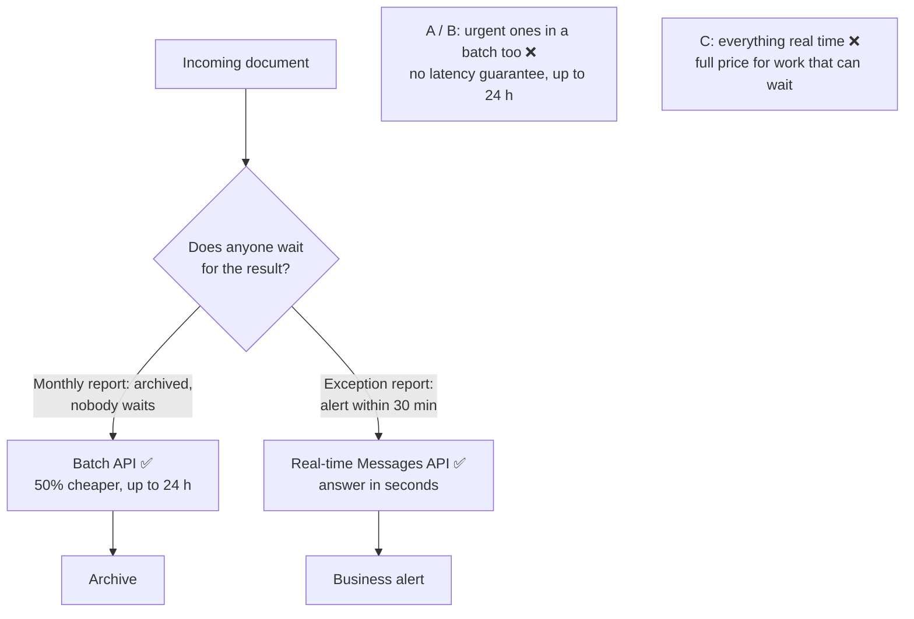

# Q111

**Scenario:** Structured data extraction system (same as [Q95](../Q95-accuracy-by-segment-before-automating/question.md), [Q98](../Q98-few-shot-for-informal-measurements/question.md), [Q110](../Q110-resubmit-only-failures-chunked/question.md))

## Question

You are building a structured data extraction system using Claude. The system extracts information from unstructured documents, validates the output using JavaScript Object Notation (JSON) schemas, and maintains high accuracy. It must handle edge cases gracefully and integrate with downstream systems.

Your extraction system processes two document types: standard monthly reports (archived after processing) and urgent exception reports (must trigger business alerts within 30 minutes of receipt). Both use the same JSON schema. You want to minimize API costs while meeting latency requirements.

How should you architect the processing pipeline?

- **A.** Submit all documents to the Batch API with custom_ids for tracking. When results arrive, immediately process urgent documents and trigger delayed alerts for exceptions.
- **B.** Queue all documents and submit hourly batches, flagging urgent documents for expedited handling when batch results return.
- **C.** Submit all documents to the real-time Messages API to ensure consistent processing latency across document types.
- **D.** Route standard reports to the Batch API for 50% cost savings, and route urgent exception reports to the real-time Messages API.

<details>
<summary><b>Show answer and explanation</b></summary>

**Topic:** Monthly reports can wait, exception alerts can't: batch the first, send the second in real time
**Domain / lesson:** D4 › 4.5 Batch Processing (The Matching Rule)
**Follows:** [Q110](../Q110-resubmit-only-failures-chunked/question.md) (same lesson: what to do when batch requests fail)

## Answer: **D**

## Diagram



## Concept

**One question decides which API each document goes to: does anyone wait for the result?** Guide 4.5: *"Use the synchronous API for blocking workflows and the batch API for latency-tolerant ones."*

| Document | Who waits? | Kind of workflow | API |
|---|---|---|---|
| Standard monthly report | Nobody: it's archived | Latency-tolerant | **Batch**: 50% cheaper |
| Urgent exception report | The business, for an alert within 30 minutes | Blocking | **Real-time** |

**Why 30 minutes rules out the batch.** A batch is cheap because you give up any promise about when it finishes:
- *"Up to 24-hour processing window: results may arrive in minutes or take up to 24 hours"*
- *"No guaranteed latency SLA: you cannot rely on results arriving within any specific timeframe"*

A batch *often* finishes in minutes, but a 30-minute requirement has to hold every time. Guide exam trap: *"Results often arrive faster than 24 hours, but you cannot design blocking workflows around best-case timing. Design around the 24-hour maximum."*

**Same schema, two paths.** The schema and the extraction prompt are the same on both paths. Only the way the request is sent differs. A router at the front picks the path *(illustrative)*:

```typescript
async function route(doc) {
  const params = extractionParams(doc);   // same prompt, same JSON schema for both types

  if (doc.type === "urgent_exception") {
    const result = await client.messages.create(params);   // seconds → alert well inside 30 min
    return triggerAlert(result);
  }

  pendingBatch.push({ custom_id: doc.id, params });          // goes in the next batch, at half price
}
```

**Cost: most of the saving stays.** The batch saving applies to every standard report, and you pay full price only for the urgent ones. If urgent reports are a small share of the volume (likely for *exception* reports, but the question doesn't say), that's close to the full 50%. *(My reasoning.)*

**This is the exam's most tested 4.5 idea.** *"The matching rule is the single most tested concept in this task statement."* In the official sample question, *"a manager proposes to switch everything to batch to get the saving. The correct answer keeps blocking workflows synchronous and batches only latency-tolerant ones."*

## Why the others are wrong

| Option | Why not |
|---|---|
| **A** Everything to the Batch API, alerts when results arrive | **The alert can be up to 24 hours late.** Handling urgent results "immediately" once they arrive doesn't help, because nobody controls when they arrive. The option even says "delayed alerts". Guide exam trap: *"Switching all workflows to batch processing for cost savings"*. |
| **B** Hourly batches, urgent documents flagged for expedited handling | **The delay is inside the batch, where a flag can't reach it.** The urgent document waits up to an hour in the queue, then up to 24 hours in the batch. "Expedited handling" starts only after the results come back, which is too late. Guide exam trap: *"Assuming batch results arrive quickly because they often do"*. |
| **C** Everything to the real-time API | **It meets the deadline and wastes the saving.** The monthly reports don't need consistent latency, because nobody waits for them. Guide: *"An overnight job loses nothing when it waits, and it costs half as much."* C pays full price for all of them. |

## Pattern to remember

> **Split by latency, not by document schema. Work someone waits for (an alert, a pre-merge check) → real-time API. Work nobody waits for (archiving, overnight reports) → Batch API at half price.** A batch has no latency guarantee, so it can never carry a deadline, however fast it usually is.

**Exam signals:**
- *"Must trigger business alerts within 30 minutes"*, pre-merge checks, "a developer is waiting" → blocking → real-time.
- *"Archived after processing"*, overnight, weekly reports → latency-tolerant → batch.
- *"Submit all documents to the Batch API"* → the "everything to batch" trap.
- *"Hourly batches"*, *"expedited handling when batch results return"* → you can't speed up a batch from outside.
- *"Submit all documents to the real-time Messages API"* → pays full price for work that can wait.
- *"Minimize API costs while meeting latency requirements"* → route each type by its latency need.
- "Results within N hours" for batched work → submission interval + 24 h ≤ N, with margin (check question).

### Where this comes from

**Guide D4 › 4.5 Batch Processing:**
- *"50% cost savings compared to synchronous API calls"* (**D**, **C**)
- *"Up to 24-hour processing window: results may arrive in minutes or take up to 24 hours"* (**A**, **B**)
- *"No guaranteed latency SLA: you cannot rely on results arriving within any specific timeframe"* (**A**, **B**)
- *"Use the synchronous API for blocking workflows and the batch API for latency-tolerant ones. A batch has no latency guarantee and can take 24 hours. So anyone who waits for a batch could wait up to 24 hours. An overnight job loses nothing when it waits, and it costs half as much."* (**D**, **C**)
- Blocking: *"Any workflow where developers are blocked pending completion"*. Latency-tolerant: *"Batch document extraction"*.
- *"The broker keeps phone summaries synchronous, because a client is waiting. The broker batches the renewal extraction."* (**D**)
- Exam trap: *"Switching all workflows to batch processing for cost savings"*. *"Only latency-tolerant workflows should use batch."* (**A**)
- Exam trap: *"Assuming batch results arrive quickly because they often do"*. *"Results often arrive faster than 24 hours, but you cannot design blocking workflows around best-case timing. Design around the 24-hour maximum."* (**B**)
- *"The matching rule is the single most tested concept in this task statement."*
- SLA calculation: *"Plan batch schedules for the full 24 hours. The 24 hours is a maximum window, not a delivery guarantee."* (check question)
- *"30 hours total SLA minus the 24-hour worst case = 6 hours of buffer for collecting requests, validating inputs, or absorbing operational delays"*, *"Submit batches every 4 hours within that buffer window, so that a new batch is always running"*, *"Submitting every 6 hours leaves no margin at all"* (check question)
- *"A scheduling question may work backwards from an SLA to a submission frequency."* (check question)

## How this connects to earlier questions

| Question | Link |
|---|---|
| [Q110](../Q110-resubmit-only-failures-chunked/question.md) | Same lesson, the other half: once you batch, resubmit only the failures, with the change their cause needs |
| [Q95](../Q95-accuracy-by-segment-before-automating/question.md) | Same system, same move: treat each segment by what it needs. There, automate the segments that hold up and keep review on the rest. Here, batch the reports that can wait and send the urgent ones in real time |
| [Q83](../Q83-coordinator-selects-subagents-per-query/question.md) | Route each item by what it needs, not one path for everything: there, only the subagents a query needs |

## Check question

**The monthly reports now come with a promise: each one must be archived within 36 hours of arriving. They still go through the Batch API. What's the longest you can wait between batch submissions and still keep that promise every time, and why?**

*My answer:* "so as batch will be done within 24 hours, you have 12 hours to submit" ✅ **The arithmetic is right: 36 − 24 = 12 hours. One refinement: 12 hours is the limit with zero margin, so in practice you submit more often than that, as the guide does.**

**Why the interval is what counts.** The worst case is a report that arrives just after a batch was submitted. It waits the whole interval for the next batch, and then that batch can take the full 24 hours. So the interval plus 24 hours must fit inside 36 hours:

```text
00:00  batch submitted
00:01  a report arrives (it just missed that batch)
12:00  next batch submitted, the report included    ← waited 12 h
36:00  that batch's 24-hour window ends             ← archived exactly at the promise, if nothing else takes any time
```

Guide 4.5 makes the same point with a 30-hour promise: *"A document that arrives just after a submission waits for the next batch. If you submit every 6 hours, it can wait 6 hours and then take 24 hours to process. That uses all 30 hours."*

**Why not exactly 12.** The buffer also has to cover the work around the batch: collecting the requests, checking the inputs, archiving the results, and delays. The guide's 30-hour example leaves room: *"30 hours total SLA minus the 24-hour worst case = 6 hours of buffer for collecting requests, validating inputs, or absorbing operational delays"*, then *"Submit batches every 4 hours within that buffer window"*, because *"Submitting every 6 hours leaves no margin at all"*. Scaled to 36 hours *(my numbers)*: submitting every 8 hours gives a worst case of 8 + 24 = 32 hours and leaves 4 hours of margin.

**What still breaks the promise** *(my reasoning, linking to Q110's check)*: an `expired` request has already used the full 24 hours, so a retry in another batch can't finish in time. Send expired reports through the real-time API instead, at full price, to keep the promise.

> **Batch schedule from an SLA: the interval between submissions + 24 hours must fit inside the promise, with room to spare. 36 h − 24 h = 12 h is the zero-margin limit; choose a shorter interval (e.g. every 8 h).**

## Glossary

- **Message Batches API:** sends many requests in one submission and returns the results later, at half the cost, within up to 24 hours.
- **Real-time (synchronous) Messages API:** one request, one answer straight away.
- **Blocking workflow:** someone or something waits for the result (an alert, a pre-merge check).
- **Latency-tolerant workflow:** the result is used later, so waiting costs nothing (archiving, overnight reports).
- **SLA (service level agreement):** a promise about how fast something will happen, such as "alert within 30 minutes".
- **Router:** code at the front of the pipeline that sends each document down the right path.

## Related course lessons

*Lecture lengths aren't recorded in the study-map files, so the watch times below are estimates from each course's average lecture length.*

### Udemy A (primary): Claude Certified Architect (CCAR-F) - 2026 Exam Prep
| # | Lecture | Part | Why |
|---|---|---|---|
| **106** | **Batch Processing at Scale** | 4C | ⭐ The only Udemy A lecture mapped to 4.5 *(also in Q110)* |
| Quiz 14 | 4C quiz | | Self-test |

**▶ Watch in this order (~5 min, est.):** #106, then do **Quiz 14**.

### Udemy B: Claude Certified Architect Foundations: Complete Course (Voroniuk)
| # | Lecture | Section | Why |
|---|---|---|---|
| **33** | **Batch Processing: When It Fits** | S4 Structured Output | ⭐ Exactly this question: which work fits a batch *(also in Q110)* |
| 34 | Running a Batch: custom_id, Failures and Samples | S4 Structured Output | The mechanics once you batch *(also in Q110)* |
| Quiz 4 | Structured Output quiz | S4 | Self-test |

**▶ Watch in this order (~10 min, est.):** #33 → #34, then do **Quiz 4**.

### CBT Nuggets: CCA-F course

*CBT doesn't cover 4.5 (see the study map). Use the guide's Matching Rule section and Udemy B #33.*

</details>
