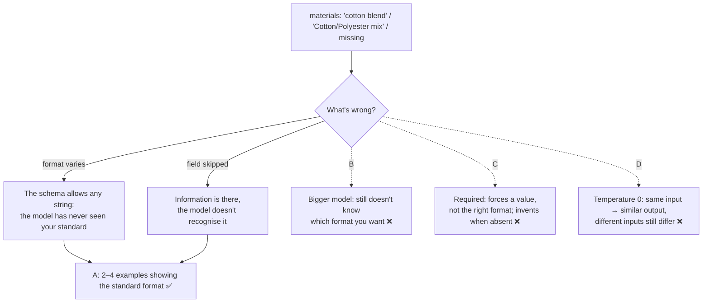

# Q112

**Scenario:** Structured data extraction system (same as [Q95](../Q95-accuracy-by-segment-before-automating/question.md), [Q98](../Q98-few-shot-for-informal-measurements/question.md), [Q110](../Q110-resubmit-only-failures-chunked/question.md), [Q111](../Q111-batch-standard-realtime-urgent/question.md))

## Question

You are building a structured data extraction system using Claude. The system extracts information from unstructured documents, validates the output using JavaScript Object Notation (JSON) schemas, and maintains high accuracy. It must handle edge cases gracefully and integrate with downstream systems.

Your extraction system parses e-commerce product descriptions to extract specifications like dimensions, weight, and materials into JSON. Despite having a well-defined schema, the model inconsistently extracts the "materials" field – sometimes returning "cotton blend", other times "Cotton/Polyester mix", and occasionally omitting the field when material information is clearly present in the source.

What's the most effective way to improve extraction consistency?

- **A.** Add few-shot examples showing 2-3 complete input-output pairs with standardized material description formats
- **B.** Switch to a more capable model tier since inconsistent extraction indicates insufficient model capability
- **C.** Make the "materials" field required instead of optional in the schema to force the model to always extract a value
- **D.** Set temperature to 0 to eliminate randomness and ensure deterministic outputs

<details>
<summary><b>Show answer and explanation</b></summary>

**Topic:** "cotton blend", "Cotton/Polyester mix", or nothing: show the standard format with few-shot examples
**Domain / lesson:** D4 › 4.2 Few-Shot Prompting (when to deploy few-shot examples)
**Also touches:** D4 › 4.3 Structured Output (what a schema does and doesn't fix: C)
**Follows:** [Q98](../Q98-few-shot-for-informal-measurements/question.md) (few-shot for a judgement call; its check: nullable fields when the information is absent)

## Answer: **A**

## Diagram



## Concept

**Both symptoms are on guide 4.2's list of when to use few-shot examples:**
- **The format varies.** "cotton blend" and "Cotton/Polyester mix" describe similar fabrics in two different ways. Guide: *"Few-shot examples are the most effective technique for consistent, well-formatted output from Claude."*
- **The field is skipped when the information is there.** Guide: *"Extraction tasks return empty or null fields for information the document contains."*

**Why the "well-defined schema" doesn't help.** If `materials` is a string, then "cotton blend", "Cotton/Polyester mix" and "COTTON 65% POLY 35%" are all valid. The schema checks the shape of the output, not the wording inside it. Guide 4.3: *"the schema guarantees structure, not correctness."* The standard format exists only in your head until you show it to the model.

**What A looks like.** First decide the standard, then show it. An illustrative standard is a list of plain material names, each with a percentage when the description gives one:

```text
Input:     "Soft, breathable tee in a 60/40 cotton-poly blend."
Output:    {"materials": [{"name": "cotton", "percent": 60},
                          {"name": "polyester", "percent": 40}]}
Reasoning: "60/40 cotton-poly" names two materials with their shares.
           Write each as its plain name ("poly" → "polyester") with
           its percentage, in the standard list format.
```

Guide: *"Use 2 to 4 targeted examples. Fewer than 2 examples do not establish a pattern. More than 4 examples waste tokens without proportional benefit."* A's "2-3 complete input-output pairs" fits that.

**One thing to add to A: the reasoning line.** A says "input-output pairs". The guide wants more: *"Each example must show reasoning."* The reasoning is what carries over to phrasings your examples don't show, such as "poly-cotton" or "50% organic cotton": *"The reasoning teaches the model to generalise its judgement to novel patterns, instead of only matching the cases in your examples."*

The Claude docs say the same about consistency in general: *"Provide examples of the output you want. This is more effective than abstract instructions."*

## Why the others are wrong

| Option | Why not |
|---|---|
| **B** A more capable model | **The problem isn't capability. The model was never shown the standard.** "cotton blend" is a perfectly reasonable answer. Nothing tells any model that you wanted `[{"name": "cotton", …}]` instead. The exam is model-agnostic: "use a bigger model" is a distractor when the fix is in the design. Guide: *"When output is inconsistent, use few-shot examples first."* |
| **C** Make `materials` required | **It forces *a* value, not the right one, and it invents values where there are none.** A required field doesn't standardise the format. Every phrasing is still allowed. For products whose description says nothing about materials (a USB cable), it pushes the model to make something up. Guide 4.3 (Q98's check): *"A required field pressures the model to produce a value even when the source has none."* The skipped cases here are ones where the material *is* in the text. That's a reading problem for examples to fix, not a schema problem. |
| **D** Temperature 0 | **Temperature controls randomness on one input. The variation here is across inputs.** Different products describe materials differently, and the model's most likely output mirrors each description. At temperature 0, "cotton blend" stays "cotton blend". Guide: *"More instructions, confidence thresholds and temperature adjustments all do less."* And it isn't even fully deterministic. Claude docs: *"Even with temperature set to 0, the results will not be fully deterministic, and identical inputs might produce different outputs across API calls."* |

## Pattern to remember

> **A field comes back in varying formats, or gets skipped although the information is there, despite a schema → 2–4 few-shot examples, each with reasoning, showing the standard format.** The schema fixes the shape, not the wording. A bigger model, a required field and temperature 0 don't show the model what "consistent" means.

**Exam signals:**
- *"Inconsistently extracts"*, "sometimes X, other times Y" → few-shot examples of the standard format.
- *"Omitting the field when material information is clearly present"* → few-shot (information that's there but not recognised).
- *"Despite having a well-defined schema"* → the schema checks shape, not wording.
- *"Set temperature to 0"* → the guide says temperature does less than examples, and 0 isn't fully deterministic.
- *"More capable model tier"* → the exam is model-agnostic.
- *"Required instead of optional in the schema to force the model to always extract a value"* → pressures fabrication where the information is absent (Q98 check).
- "Which examples?" → one per failure type (vague, notation, skipped), not variations of one (check question).

### Where this comes from

**Guide D4 › 4.2 Few-Shot Prompting:**
- *"Few-shot examples are the most effective technique for consistent, well-formatted output from Claude. More instructions, confidence thresholds and temperature adjustments all do less. When output is inconsistent, use few-shot examples first."* (**A**, **B**, **D**)
- *"Extraction tasks return empty or null fields for information the document contains."* (**A**)
- *"Use 2 to 4 targeted examples. Fewer than 2 examples do not establish a pattern. More than 4 examples waste tokens without proportional benefit."* (**A**)
- *"Each example must show reasoning."* *"The reasoning teaches the model to generalise its judgement to novel patterns, instead of only matching the cases in your examples."* (**A**)
- The technique table: *"Inconsistent output formatting"* → *"Few-shot examples"*. (**A**)
- *"Choose examples that cover the specific ambiguous cases that cause problems."* (check question)
- *"Cover the failing cases. If extraction works on tables but fails on narrative text, show correct extraction from narrative text."* (check question)
- *"The information is in the document, but in an unexpected format: inside narrative text instead of a structured table, or split across several paragraphs. Few-shot examples that show extraction from varied document structures address this problem."* (check question)
- Build exercise: *"Create 3 few-shot examples targeting the failing patterns — each must include reasoning explaining why the extraction was done that way"* (check question)

**Guide D4 › 4.3 Structured Output with Tool Use:**
- *"All three kinds of error pass the schema and appear in the firm's ledger, because the schema guarantees structure, not correctness."* (why the schema alone doesn't help)
- *"A required field pressures the model to produce a value even when the source has none. A nullable field lets the model honestly return null."* (**C**)

**Claude docs (current docs, not the guide):**
- Glossary, Temperature: *"Even with temperature set to 0, the results will not be fully deterministic, and identical inputs might produce different outputs across API calls."* (**D**)
- Increase output consistency: *"Provide examples of the output you want. This is more effective than abstract instructions."* (**A**)

## How this connects to earlier questions

| Question | Link |
|---|---|
| [Q98](../Q98-few-shot-for-informal-measurements/question.md) | Same lesson. There, examples fixed a judgement call ("a handful": copy it). Here, they fix a format. Its check, nullable fields when the information is absent, is why C fails |
| [Q95](../Q95-accuracy-by-segment-before-automating/question.md) · [Q110](../Q110-resubmit-only-failures-chunked/question.md) | Same system: find what's actually wrong (a segment, an oversized document, a format nobody showed the model), then fix that |

## Check question

**You have room for three examples in the prompt. Which three product descriptions do you pick, and why those three?**

*My answer:* "spaces, dashes and slashes - must be most-often" 🟡 **Basing the choice on real data is a good instinct. But three separator variants are all the same kind of case: a composition written with different punctuation. The guide picks examples by *what fails*, and the question shows three different failures. One example each.**

**The rule:** *"Choose examples that cover the specific ambiguous cases that cause problems."* And: *"Cover the failing cases. If extraction works on tables but fails on narrative text, show correct extraction from narrative text."*

**The three failures in the question, and an example for each** (illustrative):

| Failure | Example to pick |
|---|---|
| A vague blend: "cotton blend" | A description that names a material without shares |
| A mix written another way: "Cotton/Polyester mix" | A composition with an unusual separator or abbreviation |
| **Skipped**, although the material is in the text | A description that mentions the material only in running text |

```text
Example 1: a vague blend
Input:     "Our classic hoodie in a cosy cotton blend."
Output:    {"materials": [{"name": "cotton", "percent": null}]}
Reasoning: Only cotton is named, with no shares. List what's named, in the
           standard format. Don't invent the other fibre or a percentage.

Example 2: a mix written another way
Input:     "Fabric: Cotton/Polyester mix (65/35)."
Output:    {"materials": [{"name": "cotton", "percent": 65},
                          {"name": "polyester", "percent": 35}]}
Reasoning: Two materials and their shares. Whatever joins them (a slash, a
           dash, a space, "and"), write each as its plain name with its share.

Example 3: the material only in running text
Input:     "40 × 30 cm, 0.4 kg. Hand-stitched from full-grain leather in our
            Florence workshop."
Output:    {"materials": [{"name": "leather", "percent": null}]}
Reasoning: There's no "Material:" line, but the sentence names the material.
           Extract it from the running text. An empty field would lose
           information the description contains.
```

**Where your separators fit: in the reasoning of example 2.** One line, "whatever joins them, a slash, a dash, a space", covers all three separators. That leaves the other two slots for the failures that separators don't explain. Three separator examples would leave the *skipped* case with no example, and that's the worst of the three, because the data is lost. Guide 4.2 on that failure: *"The information is in the document, but in an unexpected format: inside narrative text instead of a structured table, or split across several paragraphs. Few-shot examples that show extraction from varied document structures address this problem."*

**"Most often", but among the failures** *(my tip)*: the common formats probably already work, since that's why they're common in the good results. Count frequency in the failed extractions instead, and use it to choose *which* phrasing to show within each failure type. That's your instinct pointed at the right data.

**If there's room for a fourth** (the guide allows 2–4): a product with no material at all ("USB-C cable, 1 m") → `"materials": null`. It shows the model when *not* to fill the field (Q98's check).

> **Pick examples by failure type, not by surface variety: one per kind of mistake, with the reasoning covering the small variations (separators, abbreviations). The case where information is lost (the skipped field) must have an example.**

## Glossary

- **Few-shot example:** a worked example in the prompt: an input, the output you want, and the reasoning for it.
- **Standardised format:** the one way you want a value written (here: plain material names, each with a percentage when given).
- **Temperature:** a sampling setting for randomness. Lower values give more predictable wording for the same input, but not fully deterministic output.
- **Required field:** a schema field that must have a value.
- **Model-agnostic:** the exam's answers don't depend on choosing a bigger or different model.

## Related course lessons

*Lecture lengths aren't recorded in the study-map files, so the watch times below are estimates from each course's average lecture length.*

### Udemy A (primary): Claude Certified Architect (CCAR-F) - 2026 Exam Prep
| # | Lecture | Part | Why |
|---|---|---|---|
| **90** | **Designing High-Quality Few-Shot Examples** | 4B | ⭐ Building the 2–4 examples for A *(also in Q98)* |
| 89 | Why Examples Work | 4B | Why examples beat temperature and a bigger model for consistency *(also in Q98)* |
| Quiz 13 | 4B quiz | | Self-test |

**▶ Watch in this order (~10 min, est.):** #89 → #90, then do **Quiz 13**.

### Udemy B: Claude Certified Architect Foundations: Complete Course (Voroniuk)
| # | Lecture | Section | Why |
|---|---|---|---|
| **21** | **Few-Shot for Format and Judgment** | S3 Prompt Engineering | ⭐ The format half of this question *(also in Q98)* |
| **22** | **Few-Shot Examples for Extraction** | S3 Prompt Engineering | ⭐ The skipped-field half *(also in Q98)* |
| 24 | Exam Lens: Example Decisions | S3 Prompt Engineering | Examples vs temperature, schema or model changes *(also in Q98)* |
| Quiz 3 | Prompt Engineering quiz | S3 | Self-test |

**▶ Watch in this order (~15 min, est.):** #21 → #22 → #24, then do **Quiz 3**.

### CBT Nuggets: CCA-F course
| Skill | Why |
|---|---|
| **17. Design Clear Prompts with Examples** | ⭐ Writing examples that show the target format *(also in Q05, Q31, Q37, Q86, Q98)* |

</details>
