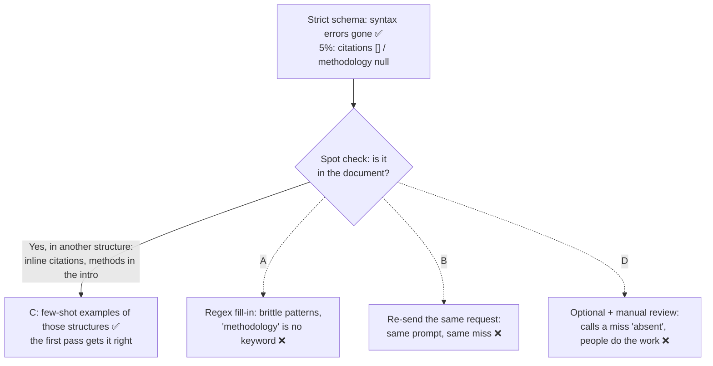

# Q113 — Valid JSON, empty citations and methodology although the paper has them: few-shot examples of the varied structures

**Domain / lesson:** D4 › 4.2 Few-Shot Prompting (empty fields for information the document contains; The Hallucination Reduction Effect)
**Also touches:** D4 › 4.3 Structured Output (what strict schemas fix: syntax, not content) · D4 › 4.4 Validation, Retry & Feedback (B)
**Scenario:** Structured data extraction system (same as [Q95](../Q95-accuracy-by-segment-before-automating/question.md), [Q98](../Q98-few-shot-for-informal-measurements/question.md), [Q110](../Q110-resubmit-only-failures-chunked/question.md)–[Q112](../Q112-few-shot-standard-materials-format/question.md))
**Follows:** [Q112](../Q112-few-shot-standard-materials-format/question.md) (a field skipped although it's in the text → examples) · [Q98](../Q98-few-shot-for-informal-measurements/question.md) (its check: optional/nullable only when the information can be absent)

## Question

You are building a structured data extraction system using Claude. The system extracts information from unstructured documents, validates the output using JavaScript Object Notation (JSON) schemas, and maintains high accuracy. It must handle edge cases gracefully and integrate with downstream systems.

After implementing tool use with strict schema definitions, JSON syntax errors are eliminated, but 5% of extractions still have valid JSON with empty arrays or null values for required fields like citations and methodology. Spot-checking reveals that source documents contain this information, but in varied formats – inline citations vs. bibliographies, methodology sections vs. details embedded in introductions.

What's the most effective way to address these failures?

- **A.** Build a regex-based post-processing layer that scans source documents for citation patterns and methodology keywords, populating empty fields when the model fails to extract.
- **B.** Implement retry logic that re-sends requests when validation detects empty required fields.
- **C.** Add few-shot examples demonstrating extractions from documents with varied structures – showing how to identify citations in different formats and locate methodology details across section types.
- **D.** Modify your schema to make citations and methodology optional, and flag incomplete records for manual review rather than failing validation.

## Answer: **C**

## Diagram



## Concept

**The strict schema did its job, and its job is only the shape.** `tool_use` with a strict schema guarantees valid JSON with the right fields and types. An empty array is still a valid array, and `null` is valid if the type allows it. Guide 4.3: *"the schema guarantees structure, not correctness."* Whether `citations` holds what the paper actually cites is a question about content.

**The spot check is the diagnosis.** The information is in the documents, but in a structure the model doesn't recognise. That's the guide's third trigger for few-shot examples, almost word for word: *"Extraction tasks return empty or null fields for information the document contains."* And guide 4.2's section on reducing hallucination names this very pair: *"The model sees correct extraction from varied structures: inline citations and bibliographies, narrative descriptions and structured tables, headers and embedded text. From those examples, it learns to handle structural variety without inventing data."*

**What it does without examples:** *"Without examples, the model often extracts the table correctly but returns empty fields for the narrative section, or fabricates values."* Here the "table" is a References list or a Methods heading, and the "narrative" is citations in brackets or methods described in the introduction.

**What C looks like** (illustrative, each example with its reasoning):

```text
Example 1: citations inline, no reference list
Input (excerpt):  "…as earlier trials showed (Okafor et al., 2021; Lind, 2019)…"
Output:           "citations": ["Okafor et al., 2021", "Lind, 2019"]
Reasoning:        There's no References section. The citations are the
                  bracketed author–year notes in the text: collect each one.

Example 2: methodology inside the introduction
Input (excerpt):  "Introduction … We surveyed 1,200 nurses in 14 hospitals with a
                   structured questionnaire between March and June 2024 …"
Output:           "methodology": "Structured questionnaire survey of 1,200 nurses
                                  in 14 hospitals, March–June 2024"
Reasoning:        There's no Methods heading. These sentences say how the study
                  was done (who, how many, which instrument, when), so they are
                  the methodology, wherever they appear.
```

The reasoning says *how to recognise* a citation or a methodology in any structure, so it carries over to formats the examples don't show, such as numbered references `[3]` or methods described in a footnote.

**Why C beats the patch options: it fixes the first pass.** A, B and D all act after the model has missed the field. C stops the miss. With 5% failing for the same structural reason, fixing the cause removes most of the follow-up work in one change. *(My reasoning.)*

## Why the others are wrong

| Option | Why not |
|---|---|
| **A** Regex fills the empty fields | **Patterns can't recognise what a methodology is.** Citation formats vary (author–year, `[3]`, footnotes), and a methodology embedded in an introduction has no keyword to match: "we surveyed 1,200 nurses" contains neither "method" nor "methodology". Regex finds only the text it was written for (like Grep in Q93), so it fills some fields, misses others and adds false matches. The examples' reasoning carries over to new formats; a regex doesn't. *(My reasoning.)* |
| **B** Re-send the request when a required field is empty | **The same request fails the same way.** The miss comes from the prompt (no examples of these structures), not from chance, so re-sending it repeats the miss and pays twice. The guide's 4.2 practice scenario has the same setup, *"Re-running a document returns the same empty fields"*, and its wrong option is *"Add a post-processing retry that re-extracts any empty fields"*. Its answer is the examples. |
| **D** Make the fields optional, send incomplete records to manual review | **It records a miss as "not in the document".** Optional or nullable fields are for information that may be absent. Guide 4.3: *"When a source document may lack some information, make the fields for that information optional or nullable."* Here the spot check shows the information *is* there. D passes the empty fields through as if that were the honest answer, and reviewers do by hand what the model should have done. It's Q98's check the wrong way round. |

## Pattern to remember

> **Valid JSON but empty fields, and the information is in the document in another structure → few-shot examples that show extraction from those structures, with reasoning.** The strict schema already fixed syntax. Content is the prompt's job. Regex fill-ins, plain retries and making the fields optional all act after the miss.

**Exam signals:**
- *"JSON syntax errors are eliminated, but"* … *"empty arrays or null values"* → the schema did its part; the problem is content.
- *"Source documents contain this information, but in varied formats"* → few-shot examples of those structures.
- *"Inline citations vs. bibliographies"*, *"embedded in introductions"* → the guide's own hallucination-reduction example.
- *"Regex-based post-processing layer"* → brittle, and can't recognise meaning.
- *"Re-sends requests when validation detects empty"* fields → the same prompt gives the same miss.
- *"Make citations and methodology optional"* when the information is present → hides the miss as "absent".

### Where this comes from

**Guide D4 › 4.2 Few-Shot Prompting:**
- *"Extraction tasks return empty or null fields for information the document contains."* *"Few-shot examples that show extraction from varied document structures address this problem."* (**C**)
- *"Few-shot examples also reduce hallucination in extraction tasks. The model sees correct extraction from varied structures: inline citations and bibliographies, narrative descriptions and structured tables, headers and embedded text. From those examples, it learns to handle structural variety without inventing data."* (**C**)
- *"Without examples, the model often extracts the table correctly but returns empty fields for the narrative section, or fabricates values. If you show the model both structures, extraction quality improves."* (**C**)
- *"Each example must show reasoning."* *"The reasoning teaches the model to generalise its judgement to novel patterns, instead of only matching the cases in your examples."* (**C**, **A**)
- Practice scenario: *"Re-running a document returns the same empty fields"*. Wrong option: *"Add a post-processing retry that re-extracts any empty fields"*. Right option: *"Add few-shot examples showing correct extraction from both structured tables and narrative paragraphs"*. (**B**, **C**)
- The technique table: *"Model misses information in narrative text"* → *"Few-shot examples showing narrative extraction"*. (**C**)

**Guide D4 › 4.3 Structured Output with Tool Use:**
- *"the schema guarantees structure, not correctness."* (why the strict schema didn't help)
- *"When a source document may lack some information, make the fields for that information optional or nullable."* (**D**: the information here isn't lacking)

## How this connects to earlier questions

| Question | Link |
|---|---|
| [Q112](../Q112-few-shot-standard-materials-format/question.md) | Same lesson: a field skipped although it's in the text → examples. Its check: pick examples by failure type (here: inline citations, methods in the introduction) |
| [Q98](../Q98-few-shot-for-informal-measurements/question.md) | Its check: nullable when the information *can be absent*. D applies that to information that's present |
| [Q93](../Q93-collect-every-exposed-name-then-grep-each/question.md) | Text patterns find only what they were written for: a Grep for one name, a regex for one citation style (A) |

## Check question

**After C, the empty-field rate drops from 5% to 0.8%. You add a retry for those 0.8%. What must the retry message contain to have a real chance of working, and for which of the remaining documents would no retry ever help?**

## Glossary

- **Strict schema (`strict: true`):** a tool schema the API enforces, so the output is always valid JSON with the right fields and types.
- **Syntax error vs content error:** malformed JSON vs valid JSON with wrong or missing content.
- **Inline citation:** a reference written inside the text, such as "(Lind, 2019)" or "[3]".
- **Bibliography / References section:** a list of sources at the end of a document.
- **Embedded methodology:** a description of how a study was done that sits in another section (here, the introduction) instead of under a "Methods" heading.
- **Post-processing layer:** code that changes the model's output after extraction.

## Related course lessons

*Lecture lengths aren't recorded in the study-map files, so the watch times below are estimates from each course's average lecture length.*

### Udemy A (primary): Claude Certified Architect (CCAR-F) - 2026 Exam Prep
| # | Lecture | Part | Why |
|---|---|---|---|
| **90** | **Designing High-Quality Few-Shot Examples** | 4B | ⭐ Examples for each document structure, with reasoning *(also in Q98, Q112)* |
| 89 | Why Examples Work | 4B | Why examples fix what a schema and a retry can't *(also in Q98, Q112)* |
| Quiz 13 | 4B quiz | | Self-test |

**▶ Watch in this order (~10 min, est.):** #89 → #90, then do **Quiz 13**.

### Udemy B: Claude Certified Architect Foundations: Complete Course (Voroniuk)
| # | Lecture | Section | Why |
|---|---|---|---|
| **22** | **Few-Shot Examples for Extraction** | S3 Prompt Engineering | ⭐ Exactly this: extraction from varied structures *(also in Q98, Q112)* |
| 24 | Exam Lens: Example Decisions | S3 Prompt Engineering | Examples vs post-processing, retries or schema changes *(also in Q98, Q112)* |
| Quiz 3 | Prompt Engineering quiz | S3 | Self-test |

**▶ Watch in this order (~10 min, est.):** #22 → #24, then do **Quiz 3**.

### CBT Nuggets: CCA-F course
| Skill | Why |
|---|---|
| **17. Design Clear Prompts with Examples** | ⭐ Examples that show the target behaviour *(also in Q05, Q31, Q37, Q86, Q98, Q112)* |
