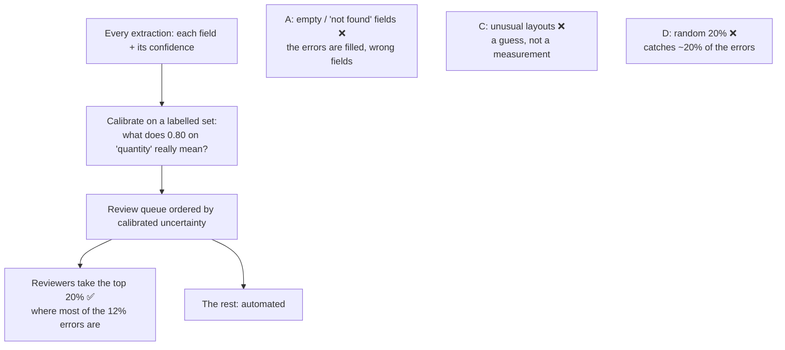

# Q114 — 12% semantic errors, reviewers for 20%: calibrated field-level confidence decides what they check

**Domain / lesson:** D5 › 5.5 Human Review & Confidence Calibration (Field-Level Confidence Calibration; Reviewer Capacity Prioritisation)
**Also touches:** D4 › 4.4 Validation, Retry & Feedback (semantic errors pass the schema)
**Scenario:** Structured data extraction system (same as [Q95](../Q95-accuracy-by-segment-before-automating/question.md), [Q98](../Q98-few-shot-for-informal-measurements/question.md), [Q110](../Q110-resubmit-only-failures-chunked/question.md)–[Q113](../Q113-few-shot-varied-document-structures/question.md))
**Follows:** [Q21](../Q21-review-flag-from-calibrated-thresholds/question.md) (per-field thresholds tested on known answers) · [Q95](../Q95-accuracy-by-segment-before-automating/question.md) (validate by segment before automating)

## Question

You are building a structured data extraction system using Claude. The system extracts information from unstructured documents, validates the output using JavaScript Object Notation (JSON) schemas, and maintains high accuracy. It must handle edge cases gracefully and integrate with downstream systems.

After deployment, you find that 12% of extractions contain semantic errors that pass JSON schema validation (e.g., a duration like "30 minutes" incorrectly placed in an ingredient quantity field). Human reviewers have capacity to check only 20% of extractions.

Which approach most effectively allocates reviewer attention?

- **A.** Prioritize review of all extractions where required fields are empty or explicitly marked as not found.
- **B.** Have the model output field-level confidence scores, then calibrate review thresholds using a labeled validation set.
- **C.** Review all extractions from documents with formatting anomalies such as unusual layouts or mixed content types.
- **D.** Randomly sample 20% of extractions for review, using corrections to track accuracy and identify error patterns.

## Answer: **B**

## Diagram



## Concept

**The job is to point limited reviewers at the likely errors.** Guide 5.5: *"The core challenge is to use the limited capacity of the reviewers to get the highest accuracy at the lowest cost."* And: *"Route the highest-uncertainty items to reviewers first."* Twenty percent capacity against 12% errors is enough to catch most of them, but only if the 20% is chosen well.

**Why the schema didn't catch these.** "30 minutes" is a valid string in a `quantity` field. A schema checks types and structure, not meaning. Guide 4.4 calls these *"Semantic validation errors"*: *"correct structure but incorrect values: line items that do not sum, dates in the wrong order, values in wrong fields."*

**Why field-level.** The error sits in one field of an otherwise fine extraction. A field-level score can flag `quantity: "30 minutes"` on its own. A single score for the whole document would average it away (Q21's option C). The guide's example output:

```json
{
  "vendorName":  {"value": "Acme Corp",  "confidence": 0.98},
  "invoiceDate": {"value": "2024-03-15", "confidence": 0.95},
  "totalAmount": {"value": "$1,247.83",  "confidence": 0.72},
  "lineItems":   {"value": [...],        "confidence": 0.61}
}
```

**Why calibrate.** The model's own numbers aren't reliable on their own: *"The raw confidence scores from the model are not calibrated. A reported 0.95 might be correct 88% of the time on certain field types and 99% on others."* A labelled validation set turns each score into a real accuracy per field: *"Run the model on documents with known correct extractions. Compare its confidence scores with real accuracy. Build a calibration curve."* Then the thresholds come from data, as in Q21.

**Then fill the 20% from the top of the queue.** *"Fields below the calibrated threshold: human review"*, *"Fields in the ambiguous zone: prioritised human review"*. The queue keeps that order as work arrives: *"When a reviewer finishes one item, the next item is the highest-uncertainty item that remains, not the next item in chronological order."*

**What the choice is worth** (illustrative numbers):

| How the 20% is chosen | Errors caught (of the 12%) | Errors left unreviewed |
|---|---|---|
| Random 20% (D) | about 2.4 points (20% of them) | about 9.6 points |
| Lowest calibrated confidence first (B), if three quarters of the errors fall in the least certain 20% | about 9 points | about 3 points |

*(The "three quarters" is an assumption for the illustration. Calibration tells you the real figure for your system.)*

*Practical tip, not guide wording:* add a semantic check for errors you can describe in code, such as a `quantity` containing a time unit. That's guide 4.4's validation layer. It catches that pattern every time, and the confidence ranking handles the errors nobody predicted.

## Why the others are wrong

| Option | Why not |
|---|---|
| **A** Prioritise extractions with empty or "not found" fields | **It looks for the wrong kind of error.** The 12% are *filled* fields with wrong values ("30 minutes" as a quantity). An empty field is easy to spot, and a misplaced value isn't. A reviews the obvious cases and misses the errors the question is about. *(My reasoning.)* |
| **C** Review everything from documents with formatting anomalies | **A guess about where errors are, not a measurement.** Unusual layouts *may* cause errors, but nothing says these do, or that the 12% sit there. "All" such documents could also be more or less than 20%. The guide's prioritisation list includes *"Document types with historically poor accuracy"*, which means measured accuracy, not appearance. *(Partly my reasoning.)* |
| **D** Random 20% | **It spreads reviewers evenly, so it catches errors only at the rate they occur.** A random 20% contains about 20% of the errors, and the other 80% go through. Guide exam trap: *"Spreading reviewer capacity evenly across all extractions"*. *"Even distribution wastes time on high-confidence items. Prioritise limited reviewer capacity on the highest-uncertainty items where human judgement adds the most value."* |

## Pattern to remember

> **Limited reviewers → rank fields by calibrated confidence and review from the most uncertain down.** Field-level, because errors sit in single fields. Calibrated on a labelled set, because raw scores don't mean the same thing on every field. Not empty fields only, not a guess about layouts, not an even random spread.

**Exam signals:**
- *"Capacity to check only 20%"* → prioritise by uncertainty; don't spread evenly.
- *"Semantic errors that pass JSON schema validation"* → the schema can't help; you need a ranking (or a semantic validator).
- *"Field-level confidence scores"* + *"calibrate … using a labeled validation set"* → the guide's answer.
- *"Randomly sample 20% of extractions for review"* as the allocation → the even-spread trap.
- *"Required fields are empty or explicitly marked as not found"* when the errors are wrong values → the wrong error type.
- Raw confidence without calibration → trap (*"Using raw model confidence scores without calibration"*).

### Where this comes from

**Guide D5 › 5.5 Human Review & Confidence Calibration:**
- *"The core challenge is to use the limited capacity of the reviewers to get the highest accuracy at the lowest cost."*
- *"The model can output confidence scores per field."* (**B**)
- *"The raw confidence scores from the model are not calibrated. A reported 0.95 might be correct 88% of the time on certain field types and 99% on others. The score is relative, not absolute, so equal scores on different fields do not promise equal accuracy."* (**B**)
- *"Calibration requires labelled validation sets (ground truth data). Run the model on documents with known correct extractions. Compare its confidence scores with real accuracy. Build a calibration curve."* (**B**)
- Routing: *"Fields below the calibrated threshold: human review"*, *"Fields in the ambiguous zone: prioritised human review"*. (**B**)
- *"Human reviewers are expensive and limited. Route the highest-uncertainty items to reviewers first."* The list includes *"Low model confidence fields"* and *"Document types with historically poor accuracy"*. (**B**, **C**)
- *"Do not spread reviewer capacity evenly. An even split wastes time on high-confidence items that the model handles well."* (**D**)
- *"When a reviewer finishes one item, the next item is the highest-uncertainty item that remains, not the next item in chronological order."* (**B**)
- Exam trap: *"Spreading reviewer capacity evenly across all extractions"*. *"Prioritise limited reviewer capacity on the highest-uncertainty items where human judgement adds the most value."* (**D**)
- Exam trap: *"Using raw model confidence scores without calibration"*. *"Calibrate using labelled validation sets."* (**B**)

**Guide D4 › 4.4 Validation, Retry & Feedback:**
- *"Semantic validation errors have correct structure but incorrect values: line items that do not sum, dates in the wrong order, values in wrong fields."* (why the schema passes them)

## How this connects to earlier questions

| Question | Link |
|---|---|
| [Q21](../Q21-review-flag-from-calibrated-thresholds/question.md) | The same calibrated per-field thresholds, turned into a `request_review` flag in code |
| [Q95](../Q95-accuracy-by-segment-before-automating/question.md) | Same lesson, the step before: check accuracy per segment before you automate |
| [Q16](../Q16-escalation-triggers/question.md) | Self-reported confidence is poorly calibrated. That's why B calibrates the scores instead of trusting them |
| [Q113](../Q113-few-shot-varied-document-structures/question.md) | Valid JSON, wrong content: the schema checks shape, not meaning |

## Check question

**B needs a labelled validation set, and you don't have one yet. Where do you get it? And why can't you simply use the corrections your reviewers make on the low-confidence items they check?**

## Glossary

- **Semantic error:** valid JSON with a wrong value, such as a duration in a quantity field.
- **Field-level confidence:** a confidence score for each extracted field, not one for the whole document.
- **Calibration:** checking what each score really means by comparing it with known right answers.
- **Labelled validation set (ground truth):** documents whose correct extractions are known.
- **Calibration curve:** reported confidence plotted against real accuracy, per field.
- **Reviewer capacity prioritisation:** giving limited reviewers the most uncertain items first.

## Related course lessons

*Lecture lengths aren't recorded in the study-map files, so the watch times below are estimates from each course's average lecture length.*

### Udemy A (primary): Claude Certified Architect (CCAR-F) - 2026 Exam Prep
| # | Lecture | Part | Why |
|---|---|---|---|
| **126** | **Per-Field Confidence** | 5D | ⭐ The field-level scores in B *(also in Q08, Q21, Q95)* |
| **127** | **Calibrating with a Validation Set** | 5D | ⭐ The calibration in B *(also in Q08, Q21, Q95)* |
| **129** | **Routing Low-Confidence Output Through a Review Queue** | 5D | ⭐ Filling the 20% from the most uncertain down *(also in Q18, Q21)* |
| Quiz 18 | 5D quiz | | Self-test |

**▶ Watch in this order (~20 min, est.):** #126 → #127 → #129, then do **Quiz 18**.

### Udemy B: Claude Certified Architect Foundations: Complete Course (Voroniuk)
| # | Lecture | Section | Why |
|---|---|---|---|
| **32** | **Confidence Calibration and Human Review** | S4 Structured Output | ⭐ Exactly this question *(also in Q08, Q18, Q21, Q95)* |
| 36 | Extraction Case: Types and Review | S4 Structured Output | Review in an extraction pipeline *(also in Q21, Q95)* |
| Quiz 4 | Structured Output quiz | S4 | Self-test |

**▶ Watch in this order (~10 min, est.):** #32 → #36, then do **Quiz 4**.

### CBT Nuggets: CCA-F course
| Skill | Why |
|---|---|
| 16. Improve Graders with Model Feedback | Review quality and confidence (5.5) *(also in Q18, Q21, Q95)* |

*CBT is thin on 5.5. Use the guide's 5.5 lesson and Udemy A #126–#129.*
