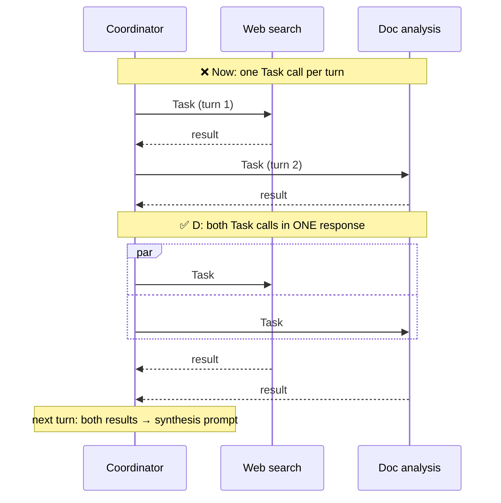

# Q115 — Web search and document analysis run one after the other: emit both Task calls in one response

**Domain / lesson:** D1 › 1.3 Subagent Invocation & Context Passing (parallel spawning)
**Also touches:** D1 › 1.2 Multi-Agent Orchestration (the coordinator stays the hub) · D1 › 1.1 Agentic Loops (one response = one turn)
**Scenario:** Multi-agent research system (same system as [Q01](../Q01-source-attribution-multi-agent/question.md)–[Q12](../Q12-include-complete-findings-in-prompt/question.md), [Q36](../Q36-coordinator-missing-task-tool/question.md), [Q84](../Q84-parallel-subagents-from-the-coordinator/question.md))
**Follows:** [Q36](../Q36-coordinator-missing-task-tool/question.md) (its follow-up check asked exactly this: *"one at a time… what's the fix?"*) · [Q84](../Q84-parallel-subagents-from-the-coordinator/question.md) (parallel subagents for 12 precedents)

## Question

You are building a multi-agent research system using the Claude Agent SDK. A coordinator agent delegates to specialized subagents: one searches the web, one analyzes documents, one synthesizes findings, and one generates reports. The system researches topics and produces comprehensive, cited reports.

Production monitoring shows the research phase takes longer than expected. Analysis reveals the coordinator invokes the web search subagent, waits for its response, then invokes the document analysis subagent and waits again. These tasks are independent – neither requires the other's output.

How should you modify the system to run these subagents concurrently?

- **A.** Create an async orchestration layer outside the agent that spawns parallel threads, each running a separate coordinator-subagent pair, then aggregates results.
- **B.** Add detailed instructions to the coordinator's system prompt explaining the performance benefits of parallel execution and requesting it invoke both subagents at the same time.
- **C.** Switch both subagents to use a Haiku-tier model instead of Sonnet to reduce their individual execution time.
- **D.** Structure the coordinator to emit both Task tool calls (for web search and document analysis) in a single response message rather than across separate conversation turns.

## Answer: **D**

## Diagram

## Concept

**How the SDK runs subagents:** each subagent starts from a **Task tool call** in the coordinator's response. The SDK runs all the tool calls in **one** response, then returns all the results together in the next turn.

| | One Task call per response (now) | Both Task calls in one response (D) |
|---|---|---|
| Turns | 2 turns, each waits for its subagent | 1 turn, both subagents run together |
| Time | web search **+** doc analysis | ≈ the **slower** of the two |
| Coordinator still the hub? | ✅ | ✅ |

Guide 1.3: *"When a coordinator needs several subagents for independent tasks, it should emit multiple Task tool calls in a single response."* And: *"Sequential spawning means one subagent per coordinator turn. The second subagent cannot start until the first has returned and the coordinator takes another turn."*

**The condition is in the stem:** *"neither requires the other's output."* That's what makes parallel safe. A **dependent** step (synthesis needs both results) still waits for the next turn, and gets both outputs in its prompt (Q10, Q12).

## Why the others are wrong

| Option | Why not |
|---|---|
| **A** External async layer, parallel coordinator-subagent pairs | **Breaks hub-and-spoke.** Several coordinators, each with one subagent, then aggregation **outside** any agent: there's no single hub that sees everything (*"Observability: you can log and monitor every message in one place"*, 1.2). Heavy new infrastructure for what the SDK already does natively. Same family as Q84 D (queue + worker pool). |
| **B** Prompt explaining the benefits, asking for "at the same time" | **Motivation without the mechanism.** "Invoke both at the same time" doesn't say *how*. The model may still call one per turn. Explaining performance benefits doesn't change how tool calls are executed. See the check question for the subtle part. |
| **C** Switch to a Haiku-tier model | **Model-swap distractor.** The exam is model-agnostic. A faster model shortens each step, but the steps are **still sequential**. It doesn't address the cause (waiting), and it risks quality. |

## Pattern to remember

> **Independent subagents → several Task calls in a single coordinator response.** One response = they run in parallel; one call per turn = they run in sequence.

**Exam signals:**
- "invokes X, **waits**, then invokes Y" + "**independent**" → multiple Task calls **in one response**.
- Reject: external orchestration / threads / queues (outside the hub, A), "explain/ask in the prompt" (B), "smaller/faster/bigger model" (C).

### Where this comes from

**Guide D1 › 1.3 Subagent Invocation & Context Passing:**
- *"When a coordinator needs several subagents for independent tasks, it should emit multiple Task tool calls in a single response."*
- *"Sequential spawning means one subagent per coordinator turn. The second subagent cannot start until the first has returned and the coordinator takes another turn."*
- *"When the tasks are independent, that wait adds latency with no benefit."*
- *"Spawn independent subagents in parallel by emitting multiple Task tool calls in a single coordinator response. Parallel spawning reduces latency compared to sequential invocation across separate turns."*

**Guide D1 › 1.2 Multi-Agent Orchestration:** *"Observability: you can log and monitor every message in one place."* (why A is wrong)

*(Quotes as recorded in [Q36](../Q36-coordinator-missing-task-tool/question.md) and [Q84](../Q84-parallel-subagents-from-the-coordinator/question.md).)*

## How this connects to earlier questions

| Question | Link |
|---|---|
| [Q36](../Q36-coordinator-missing-task-tool/question.md) | Its follow-up check is this exact symptom: one Task per turn → several in one response |
| [Q84](../Q84-parallel-subagents-from-the-coordinator/question.md) | Same mechanism, applied to 12 precedents; same rejection of outside-the-hub infrastructure |
| [Q07](../Q07-context-flows-through-coordinator/question.md) / [Q12](../Q12-include-complete-findings-in-prompt/question.md) | After the parallel step, the coordinator passes **both** findings into the synthesis prompt |
| [Q05](../Q05-goals-not-procedures-delegation/question.md) | Prompt guidance alone is probabilistic (B) |

## Check question

**D says "structure the coordinator to emit both Task calls in one response". In practice you'd achieve that partly through the coordinator's prompt too. So what's the real difference between B and D?**

*(Your answer and feedback will be recorded here.)*

## Glossary

- **Task tool:** the Agent SDK tool a coordinator calls to spawn a subagent. Each call = one subagent.
- **Single response / one turn:** one model reply. All tool calls in it run before the next turn.
- **Parallel spawning:** several Task calls in one response, so subagents run concurrently.
- **Sequential spawning:** one Task call per turn, so each subagent waits for the previous one.

## Related course lessons

*Lecture lengths aren't recorded in the study-map files, so the watch times below are estimates.*

### Udemy A (primary): Claude Certified Architect (CCAR-F) - 2026 Exam Prep
| # | Lecture | Part | Why |
|---|---|---|---|
| **13** | **Parallel Execution — Fan-Out, Fan-In** | 1B | ⭐ Exactly this: fan out independent work *(also in Q73, Q75, Q84)* |
| **16** | **The Orchestrator Role** | 1C | ⭐ The coordinator stays the hub (vs A) *(also in Q36, Q84)* |
| 18 | Multi Agent Topology and Selection | 1C | Why external orchestration breaks the topology *(also in Q84)* |
| Quiz 2, Quiz 3 | 1B and 1C quizzes | | Self-test |

**▶ Watch in this order (~20 min, est.):** #13 → #16 → #18, then do **Quiz 2** and **Quiz 3**.

### Udemy B: Claude Certified Architect Foundations: Complete Course (Voroniuk)
| # | Lecture | Section | Why |
|---|---|---|---|
| **62** | **Spawning Subagents with Task** | S7 Multi-Agent | ⭐ Several Task calls in one response *(also in Q36, Q84)* |
| 65 | Practice: Coordinator and Subagents in Code | S7 Multi-Agent | Parallel spawning in code *(also in Q36, Q84)* |
| 60 | The Coordinator Pattern | S7 Multi-Agent | Hub and spokes *(also in Q84)* |
| Quiz 7 | Multi-Agent quiz | S7 | Self-test |

**▶ Watch in this order (~15 min, est.):** #62 → #65 → #60, then do **Quiz 7**.

### CBT Nuggets: CCA-F course
| Skill | Why |
|---|---|
| **39. Build an Agentic Multimedia Article System: Part 1** | ⭐ A coordinator spawning and collecting subagents *(also in Q36, Q84)* |
| 36. Design Workflows and Agent Systems | Parallel vs sequential work *(also in Q84)* |
