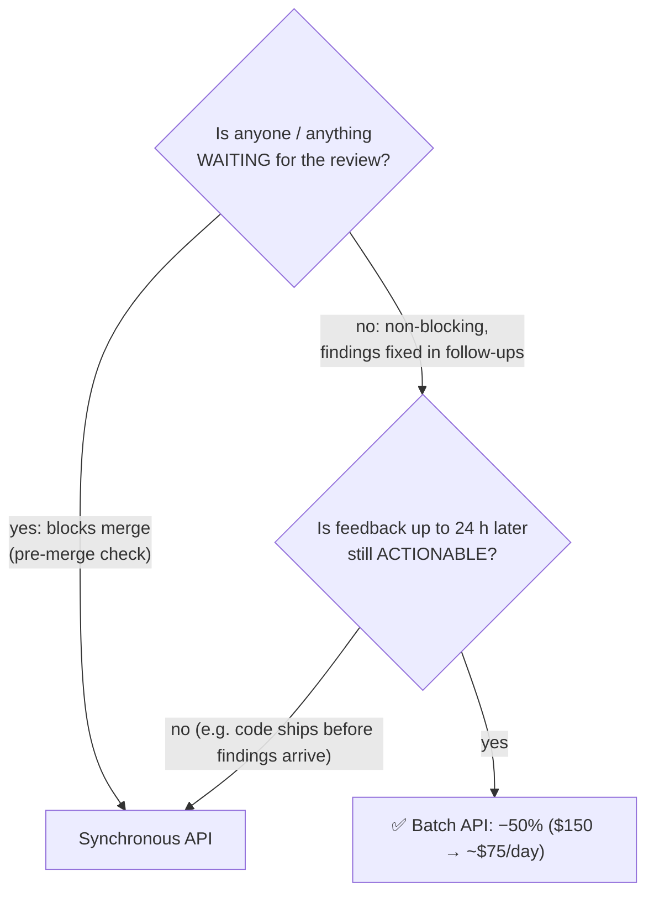

# Q116 — Batch for non-blocking PR security reviews? Decide on the 24-hour window

**Domain / lesson:** D4 › 4.5 Batch Processing (The Matching Rule)
**Also touches:** D3 › 3.6 CI/CD Integration (blocking vs non-blocking checks)
**Scenario:** Claude Code in CI/CD (automated reviews, tests, PR feedback)
**Follows:** [Q111](../Q111-batch-standard-realtime-urgent/question.md) (route by latency need: batch for standard, real-time for urgent) · [Q110](../Q110-resubmit-only-failures-chunked/question.md) (`custom_id`)

## Question

You are integrating Claude Code into your Continuous Integration/Continuous Deployment (CI/CD) pipeline. The system runs automated code reviews, generates test cases, and provides feedback on pull requests. You need to design prompts that provide actionable feedback and minimize false positives.

Your CI pipeline performs security-focused code reviews on approximately 50 PRs daily, currently costing $150/day using the synchronous API. Reviews are non-blocking – developers merge after tests pass and address findings in follow-up commits. You're evaluating the Message Batches API for its 50% cost reduction.

What factor most determines whether batch processing is appropriate for this use case?

- **A.** Whether review feedback arriving up to 24 hours after PR creation remains actionable.
- **B.** Whether your result processing can handle reviews arriving in a different order than submitted.
- **C.** Whether you can structure each review as a single request without multi-turn refinement.
- **D.** Whether reducing per-review latency from 30-60 seconds to near-instant matters for your workflow.

## Answer: **A**

## Diagram

## Concept

**The matching rule (4.5):** *"Use the synchronous API for blocking workflows and the batch API for latency-tolerant ones."*

The price of batch is **time**: *"Up to 24-hour processing window"* and *"No guaranteed latency SLA: you cannot rely on results arriving within any specific timeframe."* So the deciding question is always: **can this workflow live with results up to 24 hours later?**

Here the stem already says reviews are **non-blocking** (nobody waits to merge). That makes batch a **candidate**. The remaining question is A: is a security finding still **useful** when it arrives up to a day later? If developers really do fix findings in follow-up commits, yes → batch it, save ~$75/day. If the code would already be **deployed** and exposed by then, no → keep it synchronous.

Design for the **worst case**: *"Results often arrive faster than 24 hours, but you cannot design blocking workflows around best-case timing. Design around the 24-hour maximum."*

## Why the others are wrong

| Option | Why not |
|---|---|
| **B** Results arriving out of order | **Already solved by design.** Each request has a `custom_id`: *"each request in a batch gets a unique identifier used to match it with its response."* You match by ID, not by order. An implementation detail, not the deciding factor. |
| **C** Single request, no multi-turn refinement | **A real constraint, but not the deciding one here.** The guide does say *"No multi-turn tool calling within a single batch request."* But a security review of a PR diff fits naturally in one request, so it's easy to satisfy. It's a feasibility check; the stem's details (non-blocking, follow-up commits) point at **timing**. |
| **D** Cutting latency from 30–60 s to near-instant | **Backwards.** Batch doesn't make anything faster; it makes it **slower** (up to 24 h) in exchange for cost. And the stem says reviews are non-blocking, so latency of seconds isn't the issue. |

## Pattern to remember

> **Batch or not = can the workflow tolerate results up to 24 hours later?** Blocking (someone waits) → synchronous. Latency-tolerant (results consumed later, still useful) → batch, 50% off.

**Exam signals:**
- "Should we use batch?" → look for the option about **tolerating the 24-hour window** / whether results are still **actionable** later.
- Reject: ordering (solved by `custom_id`), "faster with batch" (backwards), secondary constraints when the stem stresses timing.

**Traps listed in the guide (4.5):**
- *"Switching all workflows to batch processing for cost savings"*
- *"Assuming batch results arrive quickly because they often do"*
- *"Using batch for a workflow where your own tool must run mid-request and the request continues from its result"*

### Where this comes from

**Guide D4 › 4.5 Batch Processing:**
- *"Use the synchronous API for blocking workflows and the batch API for latency-tolerant ones."*
- *"Up to 24-hour processing window: results may arrive in minutes or take up to 24 hours"*
- *"No guaranteed latency SLA: you cannot rely on results arriving within any specific timeframe"*
- *"Results often arrive faster than 24 hours, but you cannot design blocking workflows around best-case timing. Design around the 24-hour maximum."*
- *"custom_id fields for correlating request/response pairs: each request in a batch gets a unique identifier used to match it with its response"*
- *"No multi-turn tool calling within a single batch request."*
- Examples: blocking = *"Pre-merge checks in CI/CD"*, *"Real-time code review feedback"*; latency-tolerant = *"Overnight technical debt reports"*, *"Weekly code audit summaries"*.

(Verified on the guide's 4.5 page, 2026-11-03.)

## How this connects to earlier questions

| Question | Link |
|---|---|
| [Q111](../Q111-batch-standard-realtime-urgent/question.md) | Same rule applied per document type: urgent → real-time, standard → batch |
| [Q110](../Q110-resubmit-only-failures-chunked/question.md) | `custom_id` identifies results and failures (why B is a non-issue) |
| [Q18](../Q18-meaningful-confirmation/question.md) / [Q21](../Q21-review-flag-from-calibrated-thresholds/question.md) | Judge by **outcome** (is the feedback still useful?), not by a proxy |

## Check question

**The guide lists "Real-time code review feedback" as a *blocking* workflow. Here it's a code review, yet batch may be fine. Why? And describe one change to this team's process that would make you keep security reviews synchronous.**

*(Your answer and feedback will be recorded here.)*

## Glossary

- **Message Batches API:** submit many requests at once; processed asynchronously within up to 24 hours at 50% of the cost.
- **Blocking workflow:** someone or something waits for the result before continuing (e.g. a merge gate).
- **Latency-tolerant workflow:** results are consumed later; waiting costs nothing.
- **`custom_id`:** your identifier on each batch request, used to match results regardless of order.
- **Actionable:** the feedback can still lead to a useful fix when it arrives.

## Related course lessons

*Lecture lengths aren't recorded in the study-map files, so the watch times below are estimates.*

### Udemy A (primary): Claude Certified Architect (CCAR-F) - 2026 Exam Prep
| # | Lecture | Part | Why |
|---|---|---|---|
| **106** | **Batch Processing at Scale** | 4C | ⭐ The only Udemy A lecture mapped to 4.5 *(also in Q110, Q111)* |
| 82 | Claude Code in CI/CD Pipelines | 3D | Blocking vs non-blocking checks in CI |
| Quiz 14, Quiz 11 | 4C and 3D quizzes | | Self-test |

**▶ Watch in this order (~10 min, est.):** #106 → #82, then do **Quiz 14** and **Quiz 11**.

### Udemy B: Claude Certified Architect Foundations: Complete Course (Voroniuk)
| # | Lecture | Section | Why |
|---|---|---|---|
| **33** | **Batch Processing: When It Fits** | S4 Structured Output | ⭐ Exactly this question: which work fits a batch *(also in Q110, Q111)* |
| 34 | Running a Batch: custom_id, Failures and Samples | S4 Structured Output | Why ordering (B) is a non-issue *(also in Q110, Q111)* |
| 19 | CI Checks on Pull Requests | S3 | Which PR checks block a merge |
| Quiz 4, Quiz 3 | Structured Output and Prompt Engineering quizzes | S4, S3 | Self-test |

**▶ Watch in this order (~15 min, est.):** #33 → #34 → #19, then do **Quiz 4** and **Quiz 3**.

### CBT Nuggets: CCA-F course

*CBT doesn't cover 4.5 (see the study map). Use the guide's Matching Rule section and Udemy B #33.*
