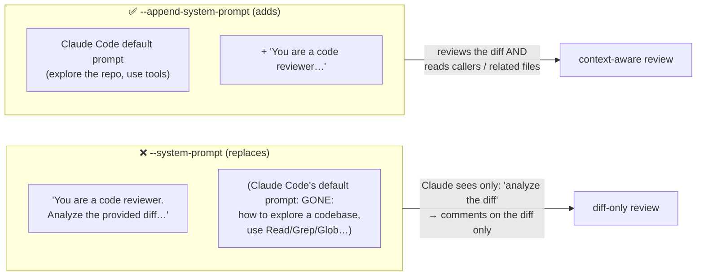

# Q117 — CI review never reads the repo: `--system-prompt` replaced Claude Code's own instructions

**Domain / lesson:** D3 › 3.6 CI/CD Integration (system prompt flags)
**Also touches:** D2 › 2.5 Built-in Tools (Read, Glob, Grep) · D3 › 3.1 CLAUDE.md (how CI gets project context)
**Scenario:** Claude Code in CI/CD (same as [Q116](../Q116-batch-if-24h-feedback-still-actionable/question.md))

## Question

You are integrating Claude Code into your Continuous Integration/Continuous Deployment (CI/CD) pipeline. The system runs automated code reviews, generates test cases, and provides feedback on pull requests. You need to design prompts that provide actionable feedback and minimize false positives.

Your pipeline runs:

```bash
PROMPT="You are a code reviewer."
PROMPT="$PROMPT Analyze the provided diff"
PROMPT="$PROMPT for bugs, security issues,"
PROMPT="$PROMPT and style violations."
claude -p \
  --dangerously-skip-permissions \
  --system-prompt "$PROMPT" \
  < diff.txt
```

The reviews complete and return feedback, but Claude only comments on the piped diff text – it never reads surrounding files in the checked-out repository to understand broader context, even when the diff modifies a function called by many other modules.

Which change to the invocation will cause Claude to read related files in the repository while still applying your custom review instructions?

- **A.** Replace `--system-prompt` with `--append-system-prompt` so your review instructions are added to Claude Code's default prompt instead of overwriting the built-in guidance for using file-reading and code navigation tools.
- **B.** Stop piping the diff via stdin and instead embed the diff contents inside the prompt string, so Claude Code treats the invocation as an agentic session rather than a stream-processing one.
- **C.** Remove `--system-prompt` entirely and place the review instructions in a `CLAUDE.md` file at the repo root, since `--system-prompt` is incompatible with tool use under `-p`.
- **D.** Keep `--system-prompt` and add `--allowedTools "Read,Glob,Grep"` so that the non-interactive `-p` mode permits file system tools that it otherwise disables.

## Answer: **A**

## Diagram



## Concept

**Two flags, one big difference** (guide 3.6 and Claude Code CLI reference):

| Flag | What it does |
|---|---|
| `--system-prompt` | *"Replaces the entire default system prompt"* |
| `--append-system-prompt` | *"Appends text to the default prompt"* |

Claude Code's **default system prompt** is what makes it a coding agent: how to explore a repository, when to read files, how to use Read / Grep / Glob, how to work step by step. With `--system-prompt`, all of that is **thrown away** and replaced by four sentences that say *"Analyze the provided diff."* Claude does exactly that: it reviews the piped text and never thinks to open other files.

The tools are **still available**. `--dangerously-skip-permissions` means nothing is blocked. What's missing is the **guidance to use them**.

With `--append-system-prompt`, Claude keeps its full default behaviour **and** gets your review instructions on top. Guide 3.6: *"Appending keeps all of that content, so you only supply what differs."*

**Symptom → cause:** the tools *could* run (no permission issue), the instructions *were* followed (the review happened) → the agent **lost its agentic guidance** → a **replaced** system prompt.

## Why the others are wrong

| Option | Why not |
|---|---|
| **B** Embed the diff in the prompt instead of stdin | **Invented distinction.** There is no "stream-processing vs agentic" mode based on stdin. The CLI reference lists `cat file \| claude -p "query"` as a normal way to *"Process piped content"*. The system prompt would still be replaced. |
| **C** Move instructions to CLAUDE.md because `--system-prompt` is *"incompatible with tool use under -p"* | **False premise.** `--system-prompt` doesn't disable tools. (CLAUDE.md is a real way to give CI project context, guide 3.6: *"CLAUDE.md is how you give a CI run project-specific context"*, but the stated reason is wrong, and it's not the minimal change to the invocation.) |
| **D** Add `--allowedTools "Read,Glob,Grep"` because `-p` *"disables"* file tools | **False premise + wrong diagnosis.** `-p` doesn't disable tools, and `--dangerously-skip-permissions` already skips permission prompts. `--allowedTools` means *"Tools that run without a permission prompt"*: it's about **permission**, not about whether Claude **decides** to use them. The real problem (replaced guidance) remains. |

## Pattern to remember

> **`--system-prompt` replaces Claude Code's built-in instructions; `--append-system-prompt` adds to them.** If a CI run "follows your instructions but stops behaving like Claude Code" (no file exploration, no tool use), the default prompt was replaced → switch to append.

**Exam signals:**
- Custom instructions work, but agentic behaviour (reading files, navigating code) disappeared → `--append-system-prompt`.
- Reject options built on **false claims about the CLI**: "-p disables tools", "stdin makes it non-agentic", "--system-prompt is incompatible with tools".

**Diagnose by elimination:**

| Symptom | Likely cause | Fix |
|---|---|---|
| CI job hangs waiting for input | `-p` missing | Add `-p` (guide 3.6) |
| Tool calls **blocked** / permission errors | Permissions | `--allowedTools` / permission mode |
| Tools allowed, but Claude **never uses** them; follows your custom prompt | Default prompt **replaced** | `--append-system-prompt` (Q117) |
| Generic, low-value output | No project context | CLAUDE.md (guide 3.6) |

### Where this comes from

**Guide D3 › 3.6 CI/CD Integration** (checked 2026-11-03):
- `--system-prompt`: *"Replaces the entire default system prompt"* · `--append-system-prompt`: *"Appends text to the default prompt"*
- *"Appending keeps all of that content, so you only supply what differs."*
- `--allowedTools`: *"Tools that run without a permission prompt."*
- *"In CI, Claude Code reads the project's CLAUDE.md files exactly as it does interactively."* *"So CLAUDE.md is how you give a CI run project-specific context."*
- *"For CLI calls in CI, use `claude -p`."*

**Claude Code CLI reference** (code.claude.com/docs/en/cli-reference):
- `--system-prompt`: *"Replace the entire system prompt with custom text"*
- `--append-system-prompt`: *"Append custom text to the end of the default system prompt"*
- `--dangerously-skip-permissions`: *"Skip permission prompts. Equivalent to `--permission-mode bypassPermissions`."*
- `cat file | claude -p "query"`: *"Process piped content"*

## How this connects to earlier questions

| Question | Link |
|---|---|
| [Q116](../Q116-batch-if-24h-feedback-still-actionable/question.md) | Same CI pipeline: when to batch reviews |
| [Q36](../Q36-coordinator-missing-task-tool/question.md) | Contrast: there the tool was **not allowed** (config); here it's allowed but **never chosen** (lost guidance) |
| [Q23](../Q23-expand-minimal-tool-descriptions/question.md) / [Q20](../Q20-parameter-descriptions/question.md) | Tool use depends on what the model is **told**: descriptions, and here the system prompt |

## Check question

**Q36: a subagent never ran because `Task` wasn't in `allowedTools`. Q117: Read/Grep/Glob never ran either. Why is the fix in Q117 not `--allowedTools`? What clue in the question rules it out?**

*(Your answer and feedback will be recorded here.)*

## Glossary

- **`-p` (print mode):** non-interactive: run the prompt, print the result, exit. Used in CI.
- **Default system prompt:** Claude Code's built-in instructions that make it behave as a coding agent (explore, read files, use tools).
- **`--system-prompt`:** replaces that default entirely with your text.
- **`--append-system-prompt`:** adds your text after the default.
- **`--dangerously-skip-permissions`:** runs without permission prompts (`bypassPermissions` mode).
- **`--allowedTools`:** tools that run without a permission prompt.

## Related course lessons

*Lecture lengths aren't recorded in the study-map files, so the watch times below are estimates.*

### Udemy A (primary): Claude Certified Architect (CCAR-F) - 2026 Exam Prep
| # | Lecture | Part | Why |
|---|---|---|---|
| **82** | **Claude Code in CI/CD Pipelines** | 3D | ⭐ CLI flags in CI *(also in Q116)* |
| 81 | The Claude Agent SDK — Session Control | 3D | Non-interactive runs and their configuration |
| Quiz 11 | 3D quiz | | Self-test |

**▶ Watch in this order (~10 min, est.):** #82 → #81, then do **Quiz 11**.

### Udemy B: Claude Certified Architect Foundations: Complete Course (Voroniuk)
| # | Lecture | Section | Why |
|---|---|---|---|
| **94** | **Claude Code in CI: -p and JSON** | S9 Claude Code in CI | ⭐ The CI invocation |
| **96** | **Practice: Claude Code in CI - -p and JSON Output** | S9 Claude Code in CI | ⭐ Building the command |
| 95 | Context for CI Reviews and Tests | S9 Claude Code in CI | Giving CI runs repository context (CLAUDE.md) |
| 97 | CI Case: Pipeline and Context | S9 Claude Code in CI | Exam-style CI case |
| Quiz 9 | Claude Code in CI quiz | S9 | Self-test |

**▶ Watch in this order (~20 min, est.):** #94 → #95 → #96 → #97, then do **Quiz 9**.

### CBT Nuggets: CCA-F course
| Skill | Why |
|---|---|
| **8. Apply Useful Hooks and Claude Code SDK Basics** | ⭐ Headless / SDK runs (3.6) |
