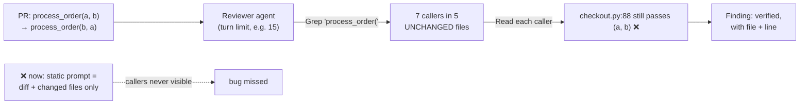

# Q118 — Reviews miss cross-file bugs: let the reviewer explore the codebase

**Domain / lesson:** D2 › 2.5 Built-in Tools (Incremental Codebase Understanding)
**Also touches:** D3 › 3.6 CI/CD Integration · D1 › 1.1 Agentic Loops (turn limit = safety cap) · D5 › 5.4 Codebase Exploration & Context Degradation
**Scenario:** Claude Code in CI/CD (same as [Q116](../Q116-batch-if-24h-feedback-still-actionable/question.md), [Q117](../Q117-append-system-prompt-keeps-tool-guidance/question.md))
**Follows:** [Q68](../Q68-trace-from-base-class-incremental-reading/question.md) (incremental reading, not everything upfront) · [Q93](../Q93-collect-every-exposed-name-then-grep-each/question.md) (Grep for every name to find all callers)

## Question

You are integrating Claude Code into your Continuous Integration/Continuous Deployment (CI/CD) pipeline. The system runs automated code reviews, generates test cases, and provides feedback on pull requests. You need to design prompts that provide actionable feedback and minimize false positives.

Your pipeline reviews every PR using a single API call with a static prompt containing the diff and full text of each changed file – unchanged files are not included. Reviews are posted asynchronously and don't block PR creation. Developers report that reviews consistently miss bugs involving cross-file interactions – for example, a PR renames a function's parameters but the review doesn't flag callers in unchanged files that still use the old argument order. Evaluation shows cross-file bugs account for 35% of production incidents from reviewed PRs.

What is the most effective change to your review design?

- **A.** Redesign the review as a turn-limited agentic task where the model can read files and search the codebase via tools, following references to verify cross-file findings.
- **B.** Run parallel review passes per changed file with direct dependents included in each pass, then aggregate and deduplicate findings using a final summarization call.
- **C.** Add chain-of-thought instructions asking the model to list all external references in the diff, then reason step-by-step about how each change might affect callers in other files.
- **D.** Use static analysis to build a dependency graph of changed code, then expand the prompt to include all files within two dependency hops of any changed file.

## Answer: **A**

## Diagram

## Concept

**Diagnose: the information isn't there.** The bug lives in **unchanged** files (the callers), and the static prompt contains only the diff + changed files. No prompt technique can make the model review code it **can't see**.

**Fix: let the reviewer go and look.** An agentic review with tools does what a human reviewer does:
1. See that `process_order`'s parameters changed.
2. **Grep** for `process_order(` across the repo → find every caller, including unchanged files.
3. **Read** those callers → check the argument order.
4. Report **verified** findings with file and line (fewer false positives too, which the scenario asks for).

Guide 2.5: *"Grep to find entry points."* *"Read to follow imports and trace flows."* *"Read only what you need. Justify each file you read by what you found in the previous step."* The model follows **only the references that matter for this specific change**: no more, no less.

**Why "turn-limited":** an agentic loop needs a **safety cap** so a review can't run forever or cost a fortune (Q13: an iteration cap is fine as a **safety** limit, not the main stop condition).

**Why it's affordable here:** reviews are **asynchronous and don't block PRs**, so a few extra minutes of exploration cost nothing in developer waiting time (Q116 logic).

## Why the others are wrong

| Option | Why not |
|---|---|
| **B** Parallel per-file passes + direct dependents + summarization merge | **Fixed, precomputed context and fragmented review.** "Direct dependents" must be computed statically, and each pass sees only one file's neighbourhood, so interactions **between** changed files are split across passes. The final summarization can drop or blur findings (Q01/Q09: summaries lose detail). More complex, still not able to follow a reference wherever it leads. |
| **C** Chain-of-thought about external references | **Reasoning can't replace missing data.** The model can list *"callers might be affected"*, but it can't see them, so it can only **guess**, which means vague warnings or false positives. Same as Q05/Q16: instructions don't fix a missing capability. |
| **D** Static dependency graph, include everything within 2 hops | **Reads everything upfront, before knowing what matters.** Guide 2.5: *"Reading every file upfront, before you know what you need, is the most costly mistake in exploring a codebase."* Two hops in a real codebase can be hundreds of files → context floods and attention degrades (5.4). And a fixed hop count can still miss references (dynamic calls, re-exports: Q93). |

## Pattern to remember

> **If the bug is in code the reviewer can't see, give the reviewer tools to find it**, not more prompt text or a bigger static bundle. Agentic + Grep/Read + a turn limit.

**Exam signals:**
- "misses issues in **other/unchanged** files", "**cross-file**", "callers" → agentic exploration with tools.
- Reject: CoT/instructions (can't see the code), "include all files within N hops" (upfront flood), parallel static passes + summary (fragmented, lossy).
- "Turn-limited" is a **good** sign: bounded cost, safety cap.

### Where this comes from

**Guide D2 › 2.5 Built-in Tools › Incremental Codebase Understanding** (as recorded in [Q68](../Q68-trace-from-base-class-incremental-reading/question.md)):
- *"Reading every file upfront, before you know what you need, is the most costly mistake in exploring a codebase."*
- *"Incremental discovery reads a few files first and reads more only when it needs them."*
- *"Grep to find entry points."* *"Read to follow imports and trace flows."*
- *"Read only what you need. Justify each file you read by what you found in the previous step."*
- Trap: *"Reading all source files upfront before understanding what is relevant."*

**Guide D5 › 5.4 Codebase Exploration & Context Degradation:**
- *"Exploring a large codebase is one of the most context-intensive tasks that a Claude-based agent performs."*
- *"The model loses its grip on earlier findings as the context fills with verbose discovery output."*

## How this connects to earlier questions

| Question | Link |
|---|---|
| [Q68](../Q68-trace-from-base-class-incremental-reading/question.md) | Incremental reading beats reading everything upfront (vs D) |
| [Q93](../Q93-collect-every-exposed-name-then-grep-each/question.md) | Grep for every exposed name to find **all** callers |
| [Q117](../Q117-append-system-prompt-keeps-tool-guidance/question.md) | Same pipeline: once reviews are agentic, keep Claude Code's tool guidance (`--append-system-prompt`) |
| [Q116](../Q116-batch-if-24h-feedback-still-actionable/question.md) | Non-blocking → extra minutes of exploration are fine |
| [Q13](../Q13-agentic-loop-model-decides-next-tool/question.md) | Turn limit = safety cap, not the main stop condition |

## Check question

**Option A says "turn-limited". (1) Why add a turn limit at all, and what should happen when it's reached? (2) What fact in the question makes this slower, agentic review acceptable?**

*(Your answer and feedback will be recorded here.)*

## Glossary

- **Cross-file bug:** a defect caused by how a change interacts with code in **other** files (e.g. callers using an old signature).
- **Static prompt:** all context is assembled before the call; the model can't fetch anything else.
- **Agentic review:** the model works in a loop with tools (Grep, Read, Glob) and decides what to look at next.
- **Turn limit:** a maximum number of loop iterations: a safety cap on time and cost.
- **Dependency hop:** one step in "file A imports file B". Two hops = dependencies of dependencies.

## Related course lessons

*Lecture lengths aren't recorded in the study-map files, so the watch times below are estimates.*

### Udemy A (primary): Claude Certified Architect (CCAR-F) - 2026 Exam Prep
| # | Lecture | Part | Why |
|---|---|---|---|
| **82** | **Claude Code in CI/CD Pipelines** | 3D | ⭐ Agentic Claude Code runs in CI *(also in Q116, Q117)* |
| **6** | **Loop Control — Stopping, Iterating, and Escalating** | 1A | ⭐ The turn limit as a safety cap *(also in Q13)* |
| 4 | Tool Use as the Foundation of Agency | 1A | Why tools beat a bigger static prompt *(also in Q13)* |
| Quiz 11, Quiz 1 | 3D and 1A quizzes | | Self-test |

**▶ Watch in this order (~20 min, est.):** #4 → #6 → #82, then do **Quiz 1** and **Quiz 11**.

### Udemy B: Claude Certified Architect Foundations: Complete Course (Voroniuk)
| # | Lecture | Section | Why |
|---|---|---|---|
| **95** | **Context for CI Reviews and Tests** | S9 Claude Code in CI | ⭐ Giving CI reviews the context they need *(also in Q117)* |
| **97** | **CI Case: Pipeline and Context** | S9 Claude Code in CI | ⭐ Exam-style CI case *(also in Q117)* |
| 39 | When the Agentic Loop Stops | S5 Tools & MCP | Turn limits as a safety stop *(also in Q13)* |
| Quiz 9 | Claude Code in CI quiz | S9 | Self-test |

**▶ Watch in this order (~15 min, est.):** #95 → #97 → #39, then do **Quiz 9**.

### CBT Nuggets: CCA-F course
| Skill | Why |
|---|---|
| **8. Apply Useful Hooks and Claude Code SDK Basics** | ⭐ Headless Claude Code runs in CI *(also in Q117)* |
| 21. Build Multi Turn Tool Conversations | Agentic loop with tools |
