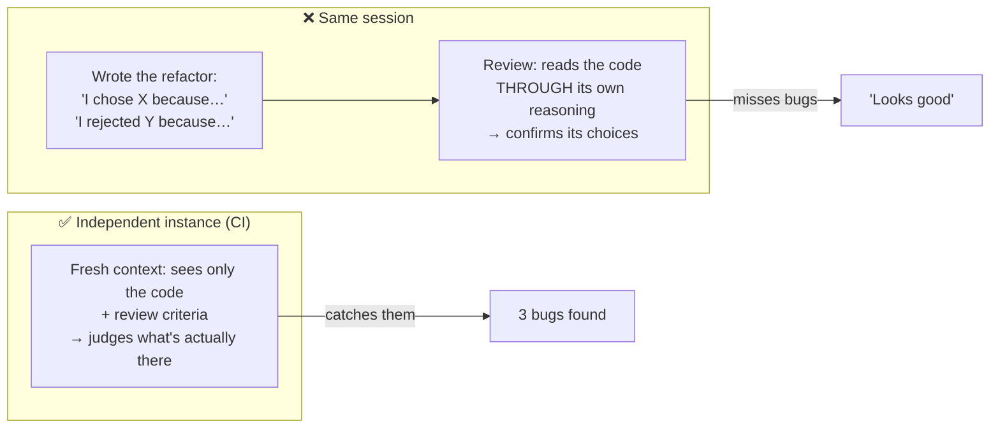

# Q119 — Same-session review missed bugs that CI caught: the reviewer kept its own reasoning

**Domain / lesson:** D4 › 4.6 Multi-Instance & Multi-Pass Review (self-review limitation)
**Also touches:** D3 › 3.6 CI/CD Integration (Session Context Isolation)
**Scenario:** Claude Code in CI/CD (same as [Q116](../Q116-batch-if-24h-feedback-still-actionable/question.md)–[Q118](../Q118-agentic-review-follows-cross-file-references/question.md))
**Related:** [Q77](../Q77-fork-session-compare-two-approaches/question.md) (fork copies the session history)

## Question

You are integrating Claude Code into your Continuous Integration/Continuous Deployment (CI/CD) pipeline. The system runs automated code reviews, generates test cases, and provides feedback on pull requests. You need to design prompts that provide actionable feedback and minimize false positives.

A developer uses Claude Code to refactor a function during their development session. Before committing, they ask the same Claude session to review the code for issues. Later, a separate automated CI review catches several bugs that the same-session review missed.

What best explains this discrepancy?

- **A.** The CI review uses a more specific prompt tailored for catching bugs, while the developer's request was too general.
- **B.** The extended session length caused the context window to fill with conversation history, leaving less room for thorough analysis.
- **C.** The CI environment has access to the full codebase context while the local session only sees the current file.
- **D.** Claude retains context about its prior reasoning in the session, making it less likely to question its own decisions.

## Answer: **D**

## Diagram

## Concept

**The same session remembers *why* it wrote the code.** Its context still holds the generator's reasoning: *"I chose this approach because…"*, *"I handled that edge case by…"*. When asked to review, it reads the code **through that reasoning** and tends to **confirm** its decisions rather than challenge them.

Guide 4.6: *"In self-review, the model retains its original reasoning chain."* It *"tends to confirm those decisions rather than challenge them."*

**The CI review is a fresh instance.** It has no memory of the reasoning, so it judges **only what's on the page**. Guide 4.6: *"An independent instance judges the output on what it sees alone, without the bias of 'I chose this because...'."* *"This lack of bias makes the independent instance much better at finding subtle issues."*

Human analogy: proof-reading your own essay vs a colleague reading it. You see what you **meant** to write; they see what you **actually** wrote.

## Why the others are wrong

| Option | Why not |
|---|---|
| **A** CI prompt is more specific | **Possible, but not what the scenario points to.** The stem stresses *"the **same** Claude session"* vs *"a **separate** automated CI review"*. That contrast (same vs separate), not the prompt wording, is the explanation. Even with an identical prompt, the same session would still be biased. |
| **B** Long session filled the context window | **Wrong mechanism.** Nothing says the context was full. A refactor of one function is not an extreme session. The problem is **what** is in the context (its own reasoning), not **how much**. Also related to the guide trap *"Switching to a larger context window model to fix attention dilution."* |
| **C** CI sees the full codebase, local session only the current file | **False premise.** A local Claude Code session runs in the repository and can read any file with its tools. Nothing in the stem limits it to one file. |

## Pattern to remember

> **Never let the session that wrote the code be its only reviewer.** Same-session review keeps the generator's reasoning and confirms its own choices. Use an **independent instance** (fresh session / separate call / subagent) with only the code and the review criteria.

**Exam signals:**
- "the **same** session reviewed it" + "a **separate** review caught more" → **reasoning-context bias** → independent instance.
- Reject: "context window full" (amount, not content), "prompt too general" (secondary), "local session can't see files" (false).

**Traps listed in the guide:**
- 4.6: *"Choosing self-review in the same session as a viable review strategy"*
- 3.6: *"Assuming self-review in the same session is as effective as independent review"*: *"The same session retains reasoning context from code generation, making it less likely to question its own decisions."*

### Where this comes from

**Guide D4 › 4.6 Multi-Instance & Multi-Pass Review** (checked 2026-11-03):
- *"In self-review, the model retains its original reasoning chain."* It *"tends to confirm those decisions rather than challenge them."*
- *"Use independent instances for review, because same-session review keeps its reasoning."*
- *"An independent instance judges the output on what it sees alone, without the bias of 'I chose this because...'."*
- *"This lack of bias makes the independent instance much better at finding subtle issues."*

**Guide D3 › 3.6 CI/CD Integration:**
- *"The same session retains reasoning context from code generation, making it less likely to question its own decisions."*
- *"An independent review instance without that context is more effective at finding issues."*
- *"That makes the generating session less effective at reviewing its own changes, and the effect is measurable."*

## How this connects to earlier questions

| Question | Link |
|---|---|
| [Q118](../Q118-agentic-review-follows-cross-file-references/question.md) | Same CI review pipeline: a separate, agentic reviewer |
| [Q77](../Q77-fork-session-compare-two-approaches/question.md) | Fork **copies** the history, including the reasoning (see the check question) |
| [Q10](../Q10-missing-context-in-subagent-prompt/question.md) / [Q12](../Q12-include-complete-findings-in-prompt/question.md) | Subagents start with fresh context: usually a problem to solve, here it's the **benefit** |

## Check question

**The developer wants to catch these bugs locally, before committing. Which should they use for the review, and why: (a) `--resume` the same session, (b) fork the session, or (c) a fresh session / subagent given only the diff and review criteria?**

*My answer:* "(c)" ✅ **Correct choice.** The "why" was left out; here it is, because (b) is the trap:

| Option | What its context contains | Biased? |
|---|---|---|
| **(a)** `--resume` | The **same** session: all the generation reasoning | ❌ Yes: it *is* self-review |
| **(b)** Fork | A **copy** of the history, so the reasoning comes along too (Q77: fork starts *"from a copy of the history"*) | ❌ Yes: a separate session, but the **same** reasoning. Separate ≠ independent |
| **(c)** Fresh session / subagent with only the diff + criteria | Only what the review needs | ✅ No: an **independent instance** |

**The test isn't "is it a different session?" but "does its context contain the generator's reasoning?"** Fork passes the first test and fails the second.

**In practice (c) looks like:** a new `claude` session (or `claude -p` with the diff piped in), or a review subagent whose prompt contains only the diff, the relevant files to read, and the review criteria.

> **Independent = no generator reasoning in the context.** Resume and fork both carry it; only a fresh instance doesn't.

## Glossary

- **Self-review:** the same session (same context) that produced the work reviews it.
- **Independent instance:** a fresh invocation with none of the generator's reasoning in its context.
- **Reasoning-context bias:** the tendency to confirm earlier decisions because the reasons for them are still in context.
- **Session context isolation:** keeping the review's context separate from the generation context.

## Related course lessons

*Lecture lengths aren't recorded in the study-map files, so the watch times below are estimates.*

### Udemy A (primary): Claude Certified Architect (CCAR-F) - 2026 Exam Prep
| # | Lecture | Part | Why |
|---|---|---|---|
| **103** | **Multi-Pass Review** | 4C | ⭐ Independent review instances and passes |
| **82** | **Claude Code in CI/CD Pipelines** | 3D | ⭐ The separate CI review *(also in Q116–Q118)* |
| Quiz 14, Quiz 11 | 4C and 3D quizzes | | Self-test |

**▶ Watch in this order (~10 min, est.):** #103 → #82, then do **Quiz 14** and **Quiz 11**.

### Udemy B: Claude Certified Architect Foundations: Complete Course (Voroniuk)
| # | Lecture | Section | Why |
|---|---|---|---|
| **92** | **Independent Review** | S9 Claude Code in CI | ⭐ Exactly this question |
| 93 | Multi-Pass Review | S9 Claude Code in CI | Per-file + cross-file passes |
| 98 | CI Case: Review Quality | S9 Claude Code in CI | Exam-style review case |
| Quiz 9 | Claude Code in CI quiz | S9 | Self-test |

**▶ Watch in this order (~15 min, est.):** #92 → #93 → #98, then do **Quiz 9**.

### CBT Nuggets: CCA-F course
| Skill | Why |
|---|---|
| 15. Evaluate Prompts with Test Datasets | Evaluating outputs with separate checks |
| 16. Improve Graders with Model Feedback | Independent grading of outputs |
