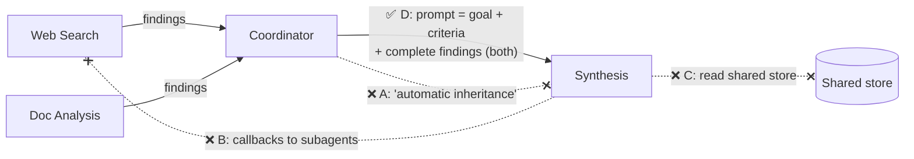

# Q12 — How to give the synthesis subagent what it needs

**Domain / lesson:** D1 › 1.3 Subagent Invocation and Context Passing
**Also touches:** D1 › 1.2 Multi-Agent Orchestration (hub-and-spoke)
**Same principle as:** [Q07](../Q07-context-flows-through-coordinator/question.md) (where info flows) · [Q10](../Q10-missing-context-in-subagent-prompt/question.md) (what happens when it's missing)

## Question

After the web search and document analysis subagents complete their tasks, the coordinator needs to spawn the synthesis subagent to synthesize the findings. What is the correct approach for providing the synthesis subagent with the information it needs?

- **A.** Spawn the subagent with only a brief task description, relying on automatic context inheritance from the coordinator.
- **B.** Provide the subagent with tool definitions that allow it to request outputs from other subagents via callbacks.
- **C.** Pass reference identifiers and configure the subagent with read access to a shared memory store where other subagents deposited their results.
- **D.** Include the complete findings from both subagents directly in the synthesis subagent's prompt.

## Answer: **D**

## Diagram

## Concept

Three facts you already know, asked directly:
1. **No automatic inheritance:** a subagent starts with a fresh, isolated context (Q10).
2. **Hub-and-spoke:** subagents don't fetch from each other (Q07).
3. So the coordinator must put **the complete findings directly in the prompt**.

The guide uses almost the same words: prompts must include what the subagent needs, *"such as complete findings from prior agents."*

## Why the others are wrong

| Option | Why not |
|---|---|
| **A** Brief task + "automatic context inheritance" | **There is no automatic inheritance.** The subagent sees only its own prompt. This produces exactly Q10's "no findings were provided." |
| **B** Callbacks to request outputs from other subagents | Subagents communicating with each other breaks **hub-and-spoke** (*"Subagents never communicate directly with each other…"*). It adds complexity and the coordinator loses control. |
| **C** Reference IDs + read access to a shared store | Bypasses the coordinator as the **curator** of context. The subagent has to work out what to read, and you add access configuration and failure points. *Nuance from Q07:* passing a **reference to a large artifact** can be fine, but "configure read access to a shared store" as **the** way to pass findings isn't the expected answer. |

## Pattern to remember

> **The coordinator writes the complete findings directly into the next subagent's prompt.** No inheritance, no callbacks, no shared-store lookups.

**Exam signal (D1 › 1.3):** "automatic inheritance," "callbacks," "shared store," "subscribe," "directly invokes" are all distractors. The answer is the coordinator **including** findings **in the prompt**.

### "Complete findings" vs Q02's "don't pass everything"
These don't conflict:
- **Complete findings** = every **output** the earlier agents produced: claims, sources, gaps, conflicts.
- **Not** = every raw token they read (Q02's 120K raw content) or their whole conversation.

> **Complete = all findings with their metadata. It doesn't mean everything anyone saw.** (Q02, [url-vs-excerpt](../../concepts/url-vs-excerpt.md))

### Where this comes from in the guide

**D1 › 1.3:** *"A subagent receives only what the coordinator writes into the subagent's prompt."* Prompts must include *"complete findings from prior agents."*
**D1 › 1.2:** *"All communication routes through the coordinator. Subagents never communicate directly with each other…"*

## Glossary

- **Context inheritance:** the (incorrect) idea that a subagent automatically sees its parent's context. In this architecture it doesn't. It sees only its prompt.
- **Callback:** a function one component calls to get data from another. Between subagents, it breaks hub-and-spoke.

## Related course lessons

### Udemy A (primary): Claude Certified Architect (CCAR-F) - 2026 Exam Prep
| # | Lecture | Part | Why |
|---|---|---|---|
| **17** | **Subagent Design — Scope, Authority, and Isolation** | 1C | ⭐ Why there's no inheritance |
| **19** | **Designing Agent-to-Agent Message Schemas** | 1C | ⭐ What "complete findings" look like |
| 21 | In-Context State vs. External Memory | 1C | Why C (shared store) isn't the default |
| 18 | Multi Agent Topology and Selection | 1C | Hub-and-spoke: why B fails |
| Quiz 3 | 1C quiz | | Self-test |

**▶ Watch in this order (~31 min):** #17 → #18 → #19 → #21, then do **Quiz 3**.

### Udemy B: Claude Certified Architect Foundations: Complete Course (Voroniuk)
| # | Lecture | Section | Why |
|---|---|---|---|
| **64** | **Passing Context Between Agents** | S7 Multi-Agent | ⭐ Exactly this question |
| 62 | Spawning Subagents with Task | S7 Multi-Agent | What goes into the spawn prompt |
| 12 | Practice: The Conversation Lives in Your Code | S2 API Basics | Stateless: why A fails |
| Quiz 7 | Multi-Agent quiz | S7 | Self-test |

**▶ Watch in this order (~16 min):** #12 → #62 → #64, then do **Quiz 7**.

### CBT Nuggets: CCA-F course
| Skill | Why |
|---|---|
| **36. Design Workflows and Agent Systems** | ⭐ Coordinator → subagent handoffs |
| 10. Send Structured Messages to Claude | Each request carries its own context |
