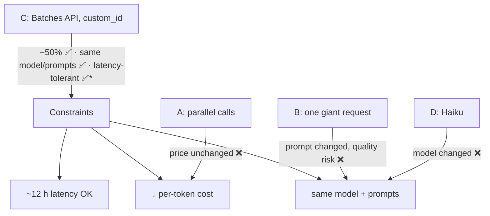

# Q120 — 200 commits, needed tomorrow morning, same model: Message Batches API

**Domain / lesson:** D4 › 4.5 Batch Processing
**Also touches:** D3 › 3.6 CI/CD Integration
**Scenario:** Claude Code in CI/CD (same as [Q116](../Q116-batch-if-24h-feedback-still-actionable/question.md)–[Q119](../Q119-same-session-self-review-bias/question.md))
**Follows:** [Q116](../Q116-batch-if-24h-feedback-still-actionable/question.md) (batch if the workflow tolerates the wait) · [Q111](../Q111-batch-standard-realtime-urgent/question.md) (SLA buffer) · [Q110](../Q110-resubmit-only-failures-chunked/question.md) (`custom_id`, resubmit failures)

## Question

You are integrating Claude Code into your Continuous Integration/Continuous Deployment (CI/CD) pipeline. The system runs automated code reviews, generates test cases, and provides feedback on pull requests. You need to design prompts that provide actionable feedback and minimize false positives.

Your pipeline includes a release notes generation step that classifies and summarizes approximately 200 commits at the end of each weekly release cycle. Each commit is currently sent as a separate Messages API call using a Sonnet-tier Claude model. The release notes aren't needed until the following morning (results have ~12 hours of acceptable latency). Your team needs to reduce per-token API cost for this step while keeping the same model and prompts (no change to model tier or output quality).

Which approach satisfies all of these constraints?

- **A.** Issue the 200 Messages API requests in parallel using concurrent connections, since concurrency lowers the per-token price charged by the API.
- **B.** Concatenate all 200 commit messages into a single Messages API request and have the model return all summaries in one response, since fewer requests always reduces total token cost.
- **C.** Submit the 200 requests to the Message Batches API with unique `custom_id`s and retrieve results once the batch ends, which applies a 50% discount to all input and output tokens.
- **D.** Switch the summarization calls from the Sonnet-tier model to a Haiku-tier model to take advantage of Haiku's lower per-token rates.

## Answer: **C**

## Diagram

`*` see the check question: 12 h < the 24 h maximum.

## Concept

**Check each option against all three constraints:**

| Constraint | A parallel | B one request | **C batch** | D Haiku |
|---|---|---|---|---|
| Lower **per-token** cost | ❌ Concurrency doesn't change the price | ❌ Same tokens (plus a bigger output) | ✅ **50% off input and output** | ✅ |
| **Same model + prompts** | ✅ | ❌ New prompt shape (200 in one) | ✅ Same requests, same model | ❌ Different model tier |
| Latency OK | ✅ | ✅ | ✅ (latency-tolerant job) | ✅ |

Only **C** passes all three. The Message Batches API runs the **same requests** with the **same model** asynchronously, at half price. Each request carries a **`custom_id`** so you can match the 200 summaries back to their commits (*"each request in a batch gets a unique identifier used to match it with its response"*).

**Why it fits:** release notes are a classic **latency-tolerant** job: nobody waits for them in real time. Guide 4.5: *"Use the synchronous API for blocking workflows and the batch API for latency-tolerant ones."* Like the guide's own examples, *"Overnight technical debt reports"* and *"Weekly code audit summaries."*

## Why the others are wrong

| Option | Why not |
|---|---|
| **A** Parallel requests | **False premise.** Concurrency makes the job finish **faster**; it doesn't make tokens **cheaper**. Per-token price is the same however many connections you open. |
| **B** All 200 commits in one request | **False premise + breaks a constraint.** Tokens are billed per token, not per request, so the 200 commits cost the same in one request as in 200 (*"fewer requests always reduces total token cost"* is wrong). It also **changes the prompt** and risks **quality**: 200 summaries in one output invites dropped or shallow items (attention dilution, 4.6), and may hit output limits. |
| **D** Switch to Haiku | **Directly violates the constraint** *"keeping the same model… no change to model tier."* The exam's model-swap distractor again. |

## Pattern to remember

> **Cut cost without changing model or prompts, and the job can wait → Message Batches API (50% off), with `custom_id` per request.**

**Exam signals:**
- "reduce cost" + "same model / same prompts" + "not needed until later" → **Batches API**.
- Reject: "concurrency lowers price" (false), "one big request saves tokens" (false + changes the prompt), "cheaper model" (violates the constraint).
- **Read every constraint** and check each option against all of them: D is cheaper, but fails "same model".

### Where this comes from

**Guide D4 › 4.5 Batch Processing:**
- *"Use the synchronous API for blocking workflows and the batch API for latency-tolerant ones."*
- *"Up to 24-hour processing window: results may arrive in minutes or take up to 24 hours"*
- *"No guaranteed latency SLA: you cannot rely on results arriving within any specific timeframe"*
- *"custom_id fields for correlating request/response pairs: each request in a batch gets a unique identifier used to match it with its response"*
- Latency-tolerant examples: *"Overnight technical debt reports"*, *"Weekly code audit summaries."*
- Trap: *"Assuming batch results arrive quickly because they often do"*

## How this connects to earlier questions

| Question | Link |
|---|---|
| [Q116](../Q116-batch-if-24h-feedback-still-actionable/question.md) | Same rule: who waits, and can the result arrive later? |
| [Q111](../Q111-batch-standard-realtime-urgent/question.md) | SLA math: 24 h worst case + buffer (relevant to the check question) |
| [Q110](../Q110-resubmit-only-failures-chunked/question.md) | `custom_id` to find and resubmit only the failures |
| [Q115](../Q115-parallel-task-calls-one-response/question.md) | Parallelism reduces **time**, not **price** (vs A) |

## Check question

**The guide says to design around the 24-hour maximum, but here only ~12 hours are acceptable. Is C still safe? What would you add so the release notes are ready in the morning even if the batch is slow?**

*My answer:* "C does not guarantee 12 hours every time, but will deliver most of the time if submitted early." 🟡 **Honest diagnosis: no guarantee.** But "most of the time" is exactly the reasoning the guide warns about: trap *"Assuming batch results arrive quickly because they often do."* The second part (**what to add**) needs a mechanism that makes the morning deadline **certain**:

**Fallback with a cutoff, using `custom_id`:**
1. Submit the batch **as soon as** the release cycle ends (your "submit early": maximises the window).
2. Set a **cutoff** with buffer before the deadline, e.g. 05:00 for a 08:00 deadline.
3. At the cutoff, check the batch: collect results that arrived; find the **`custom_id`s with no result** yet.
4. Send **only those** through the **synchronous** Messages API (same model, same prompt), then cancel the batch (or ignore its late results).
5. Generate the release notes. Deadline met **every** time.

| Case | Cost |
|---|---|
| Batch finishes before cutoff (usual) | Full 50% saving |
| Batch slow | Saving on what finished + normal price for the rest. Never late |

Same shape as Q111 (budget the worst case, keep a buffer) and Q110 (`custom_id` → act only on the missing/failed items). Alternative: **move submission earlier** so the window is ≥ 24 h (e.g. run the batch when the cycle closes on Friday for notes needed Monday).

> **"Usually fast" is not a plan.** Batch for the saving + a synchronous fallback at a cutoff for whatever hasn't arrived = cheap **and** guaranteed.

## Glossary

- **Message Batches API:** asynchronous bulk processing; up to 24 h; 50% discount on input and output tokens.
- **Per-token cost:** price per input/output token, the same regardless of concurrency or request count.
- **`custom_id`:** your identifier on each batch request, used to match results to inputs.
- **Latency-tolerant:** results are consumed later; waiting costs nothing.

## Related course lessons

*Lecture lengths aren't recorded in the study-map files, so the watch times below are estimates.*

### Udemy A (primary): Claude Certified Architect (CCAR-F) - 2026 Exam Prep
| # | Lecture | Part | Why |
|---|---|---|---|
| **106** | **Batch Processing at Scale** | 4C | ⭐ Exactly this question *(also in Q110, Q111, Q116)* |
| Quiz 14 | 4C quiz | | Self-test |

**▶ Watch in this order (~5 min, est.):** #106, then do **Quiz 14**.

### Udemy B: Claude Certified Architect Foundations: Complete Course (Voroniuk)
| # | Lecture | Section | Why |
|---|---|---|---|
| **33** | **Batch Processing: When It Fits** | S4 Structured Output | ⭐ Which work fits a batch *(also in Q110, Q111, Q116)* |
| **34** | **Running a Batch: custom_id, Failures and Samples** | S4 Structured Output | ⭐ `custom_id` and handling failures *(also in Q110, Q111, Q116)* |
| Quiz 4 | Structured Output quiz | S4 | Self-test |

**▶ Watch in this order (~10 min, est.):** #33 → #34, then do **Quiz 4**.

### CBT Nuggets: CCA-F course

*CBT doesn't cover 4.5 (see the study map). Use the guide's Matching Rule section and Udemy B #33.*
