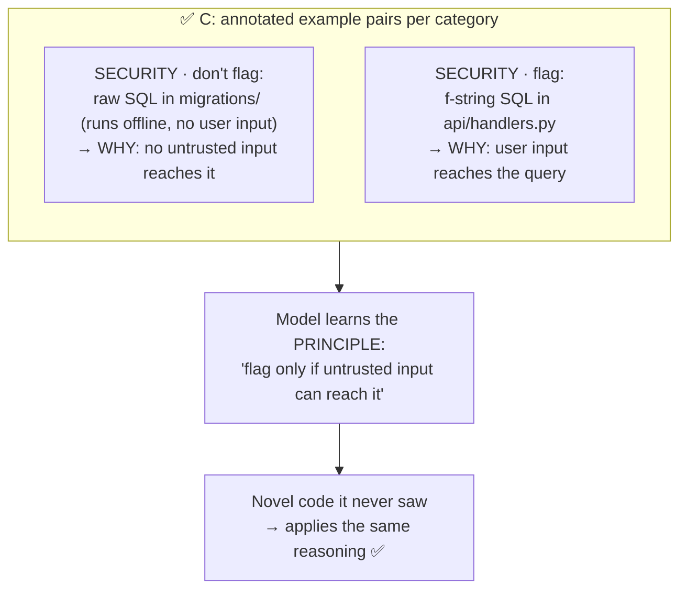

# Q121

**Scenario:** Claude Code in CI/CD (same as [Q116](../Q116-batch-if-24h-feedback-still-actionable/question.md)–[Q120](../Q120-batch-api-same-model-half-price/question.md))

## Question

You are integrating Claude Code into your Continuous Integration/Continuous Deployment (CI/CD) pipeline. The system runs automated code reviews, generates test cases, and provides feedback on pull requests. You need to design prompts that provide actionable feedback and minimize false positives.

After deploying automated code review, developers report that approximately 35% of flagged findings are false positives falling into consistent patterns: style suggestions contradicting team conventions, security warnings for patterns safe in your deployment context, and performance suggestions that would degrade your specific use case. You want to reduce false positives while maintaining the ability to catch genuine issues.

Which approach best enables the model to generalize its judgment to novel code patterns it hasn't seen before?

- **A.** Create a comprehensive written specification of all patterns that should not be flagged, then include this full documentation in the system prompt.
- **B.** Implement post-processing that uses keyword matching to filter out findings containing terms like "convention," "context-dependent," or "trade-off."
- **C.** Include few-shot examples in your prompt showing annotated code snippets that distinguish acceptable patterns from genuine issues in each category.
- **D.** Add instructions to your system prompt to "be conservative," "only flag definite issues," and "consider that some patterns may be intentional."

<b>Show answer and explanation</b>

**Topic:** 35% false positives in consistent patterns: few-shot examples that teach the judgment
**Domain / lesson:** D4 › 4.2 Few-Shot Prompting (reasoning teaches generalisation; code review: what to flag and what to ignore)
**Also touches:** D4 › 4.1 System Prompts with Explicit Criteria (why "be conservative" fails)
**Follows:** [Q112](../Q112-few-shot-standard-materials-format/question.md), [Q113](../Q113-few-shot-varied-document-structures/question.md) (few-shot for consistent output)

## Answer: **C**

## Diagram

## Concept

**The key phrase is "generalize its judgment to novel code patterns."** A list of rules covers only the cases you wrote down. The goal is a reviewer that makes the **right call on code nobody anticipated**.

**Few-shot examples with reasoning teach the principle, not just the case.** Guide 4.2: *"In code review and analysis, few-shot examples show what to flag and what to ignore."* *"Examples that separate acceptable patterns from genuine issues reduce false positives and still catch real problems."*

What makes them generalise is the **annotation** (the *why*): *"Each example must show reasoning."* *"The reasoning teaches the model to generalise its judgement to novel patterns."*

**For each false-positive category, show a contrasting pair:**

| Category | ✅ Acceptable (don't flag), and why | ❌ Genuine issue (flag), and why |
|---|---|---|
| Style | `snake_case` for DB columns: **team convention** (CLAUDE.md) | Inconsistent naming inside one module: hurts readability |
| Security | Raw SQL in an offline migration: **no untrusted input** reaches it | String-built SQL in a request handler: **user input** reaches it |
| Performance | No caching on a once-a-day batch job: caching adds complexity for no gain | N+1 queries in a per-request endpoint: runs thousands of times |

From pairs like these the model learns *"flag only when untrusted input can reach it"*, and applies that to code it has **never seen**. And because the examples also show **genuine** issues, it keeps catching real problems (the second requirement).

## Why the others are wrong

| Option | Why not |
|---|---|
| **A** Comprehensive spec of everything not to flag | **Covers only what you listed.** A long list of rules doesn't teach the reasoning behind them, so novel patterns fall through. Long, dense documentation also dilutes attention. Guide trap: *"Choosing 'add more detailed instructions'…"* (*"More instructions rarely fix inconsistent output"*). |
| **B** Keyword filter on "convention", "trade-off"… | **Blunt and dangerous.** A genuine security finding that mentions "trade-off" gets deleted; a false positive phrased differently survives. Post-processing can't judge code; it just matches words. Loses real issues (fails *"maintaining the ability to catch genuine issues"*). |
| **D** "Be conservative", "only flag definite issues" | **Vague, and it suppresses everything.** The model doesn't learn *which* patterns are fine, so it simply flags less, including real bugs. Guide 4.1: *"Explicit categorical criteria always outperform vague instructions and confidence-based filtering."* |

## Pattern to remember

> **To teach judgment that generalises → few-shot examples with reasoning, contrasting acceptable vs genuine for each category.** The *why* in each example is what transfers to novel cases.

**Exam signals:**
- "**generalize** to novel patterns" + "consistent false-positive patterns" → **annotated few-shot examples** (acceptable vs genuine).
- Reject: exhaustive rule lists (A), keyword filters (B), vague "be conservative / high confidence" (D).

**Traps listed in the guide (4.2):**
- *"Choosing 'add more detailed instructions' when output formatting is inconsistent."*
- *"Adding many examples to cover every case and variant."* (Quality and reasoning, not quantity.)
- *"Using confidence thresholds to fix inconsistent judgement calls."*

### Where this comes from

**Guide D4 › 4.2 Few-Shot Prompting** (checked 2026-11-03):
- *"In code review and analysis, few-shot examples show what to flag and what to ignore."*
- *"Examples that separate acceptable patterns from genuine issues reduce false positives and still catch real problems."*
- *"Each example must show reasoning."* *"Beyond the input and output, it says why one action was chosen over plausible alternatives."*
- *"The reasoning teaches the model to generalise its judgement to novel patterns."*
- *"These ambiguous cases need examples that show the correct judgement, with reasoning."*

**Guide D4 › 4.1 System Prompts with Explicit Criteria** (as recorded in [Q37](../Q37-state-assumptions-not-interrogate/question.md)):
- *"Explicit categorical criteria always outperform vague instructions and confidence-based filtering."*

## How this connects to earlier questions

| Question | Link |
|---|---|
| [Q112](../Q112-few-shot-standard-materials-format/question.md) / [Q113](../Q113-few-shot-varied-document-structures/question.md) | Few-shot for consistent **format**; here few-shot for consistent **judgment** |
| [Q23](../Q23-expand-minimal-tool-descriptions/question.md) / [Q30](../Q30-split-generic-analyze-document/question.md) | Where few-shot is the **wrong** fix: misrouting caused by minimal descriptions / generic tools |
| [Q16](../Q16-escalation-triggers/question.md) | Judgment calls → model with clear criteria; here the criteria are taught by example |
| [Q117](../Q117-append-system-prompt-keeps-tool-guidance/question.md) | Put these examples via `--append-system-prompt` (or CLAUDE.md) so tool guidance stays |

## Check question

**Q23 said few-shot examples were the *wrong* fix (a listed trap). Here they're the *right* one. What's different about the problem in each question?**

*My answer:* "Q23 was a misrouting issue - better description of tools that exist for those cases would solve that. In Q121 however there was no situations like that seen before and we have to teach it to generalize." ✅ **Right distinction.** To make it precise, ask: **what is missing?**

| | Q23 (few-shot = wrong) | Q121 (few-shot = right) |
|---|---|---|
| **Root cause** | **Missing information**: the tool descriptions were too thin to tell `archive_file` from `delete_file` | **Missing judgment**: the model has all the facts but draws the line between acceptable and genuine in the wrong place |
| **Fix at the source** | Write the information where it belongs: **expand the descriptions** | Show where the line is, and why: **annotated contrasting examples** |
| **What few-shot would do** | Patch the **symptom** for the examples shown; the descriptions stay thin and new requests still misroute | Teach the **principle** ("flag only if untrusted input reaches it"), which transfers to novel code |

> **Few-shot is the fix when the problem is a judgment call that has to generalise. It's the trap when the problem is missing information that belongs somewhere else** (a tool description, a schema, a code check).

One nuance: the false positives in Q121 were **consistent patterns**, so they *had* been seen. The examples are built from those known patterns. Generalisation is the goal for the **next**, unseen ones.

## Glossary

- **False positive:** a finding flagged as a problem that isn't one in your context.
- **Few-shot examples:** a small set of worked input → output examples in the prompt.
- **Annotated example:** an example that also states **why** the decision was made.
- **Generalise:** apply the learned principle correctly to cases not shown in the examples.
- **Contrasting pair:** one acceptable and one genuine example in the same category, so the boundary is clear.

## Related course lessons

*Lecture lengths aren't recorded in the study-map files, so the watch times below are estimates.*

### Udemy A (primary): Claude Certified Architect (CCAR-F) - 2026 Exam Prep
| # | Lecture | Part | Why |
|---|---|---|---|
| **90** | **Designing High-Quality Few-Shot Examples** | 4B | ⭐ Contrasting, annotated examples *(also in Q98, Q112)* |
| **89** | **Why Examples Work** | 4B | ⭐ Why examples generalise better than rules *(also in Q98, Q112)* |
| 83 | Clarity, Specificity, and the Cost of Ambiguity | 4A | Why "be conservative" (D) fails |
| Quiz 13, Quiz 12 | 4B and 4A quizzes | | Self-test |

**▶ Watch in this order (~15 min, est.):** #83 → #89 → #90, then do **Quiz 12** and **Quiz 13**.

### Udemy B: Claude Certified Architect Foundations: Complete Course (Voroniuk)
| # | Lecture | Section | Why |
|---|---|---|---|
| **20** | **Explicit Criteria That Reduce False Positives** | S3 Prompt Engineering | ⭐ False positives in review: exactly this scenario |
| **21** | **Few-Shot for Format and Judgment** | S3 Prompt Engineering | ⭐ The judgment half: what to flag vs ignore *(also in Q98, Q112)* |
| 24 | Exam Lens: Example Decisions | S3 Prompt Engineering | When examples are (and aren't) the fix *(also in Q98, Q112)* |
| Quiz 3 | Prompt Engineering quiz | S3 | Self-test |

**▶ Watch in this order (~15 min, est.):** #20 → #21 → #24, then do **Quiz 3**.

### CBT Nuggets: CCA-F course
| Skill | Why |
|---|---|
| **17. Design Clear Prompts with Examples** | ⭐ Writing annotated examples *(also in Q98, Q112)* |

