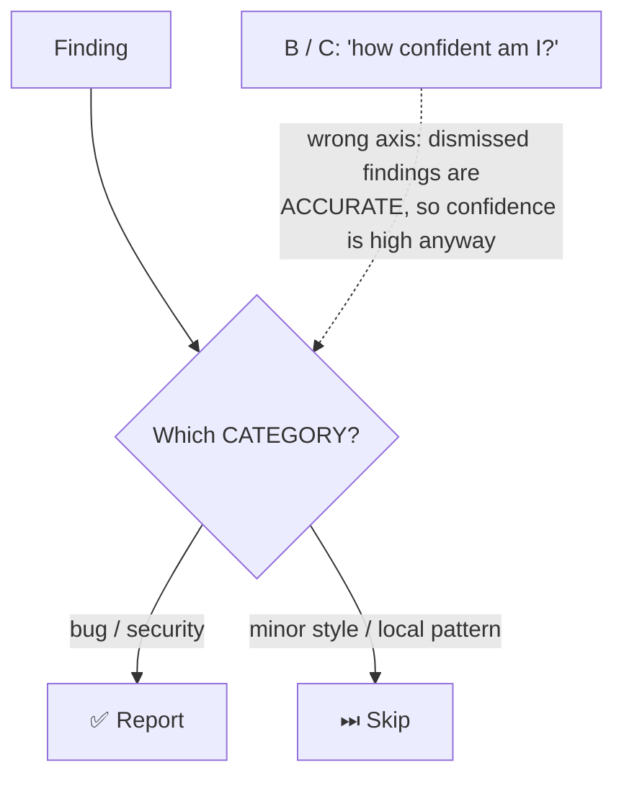

# Q122 — Half the findings dismissed as "not worth addressing": explicit report-vs-skip criteria

**Domain / lesson:** D4 › 4.1 System Prompts with Explicit Criteria
**Also touches:** D5 › 5.5 Human Review & Confidence Calibration (why self-rated confidence fails)
**Scenario:** Claude Code in CI/CD (same as [Q116](../Q116-batch-if-24h-feedback-still-actionable/question.md)–[Q121](../Q121-few-shot-acceptable-vs-genuine-findings/question.md))
**Follows:** [Q121](../Q121-few-shot-acceptable-vs-genuine-findings/question.md) (few-shot when judgment must generalise)

## Question

You are integrating Claude Code into your Continuous Integration/Continuous Deployment (CI/CD) pipeline. The system runs automated code reviews, generates test cases, and provides feedback on pull requests. You need to design prompts that provide actionable feedback and minimize false positives.

Your automated review generates many findings per PR, but developer feedback shows roughly half are dismissed as "not worth addressing." Analysis reveals dismissed findings are often technically accurate but involve minor style preferences or patterns acceptable in your codebase.

Before adding infrastructure complexity, what prompt design change would most effectively reduce dismissals while maintaining detection of genuine issues?

- **A.** Add explicit criteria defining which issues to report (bugs, security) versus skip (minor style, local patterns)
- **B.** Add instructions asking Claude to rate each finding's confidence (1-10) and only include findings rated 8 or higher
- **C.** Append instructions to "only report findings you are highly confident are genuine problems"
- **D.** Implement a secondary classification model that filters Claude's findings based on predicted developer acceptance

## Answer: **A**

## Diagram



## Concept

**Read the diagnosis carefully:** the dismissed findings are *"technically accurate"*. The model isn't **wrong**; it's reporting things that **aren't worth reporting**. So the problem is **scope** (what belongs in the review), not **certainty** (is it right).

**The fix: say which categories to report and which to skip.** Guide 4.1, almost word for word the correct option: *"Report bugs and security vulnerabilities."* *"Skip minor style preferences and local patterns."* *"Explicit categorical criteria"* settle both what to flag and what to skip.

It also keeps genuine issues: bugs and security are **explicitly in scope**, so nothing real gets suppressed.

## Why the others are wrong

| Option | Why not |
|---|---|
| **B** Self-rate confidence 1–10, keep ≥ 8 | **Wrong axis + uncalibrated.** The dismissed findings are *accurate*, so the model would rate them highly and they'd pass the filter. And: *"LLM self-reported confidence is poorly calibrated."* Confidence routing comes *"only after criteria are defined."* |
| **C** "Only report findings you are highly confident are genuine" | **Vague.** "Highly confident" is *"a subjective threshold that the model cannot calibrate."* Same wrong axis as B: a style nit can be 100% certain. Trap: *"Vague instructions do not improve precision."* |
| **D** Secondary classifier predicting developer acceptance | **Infrastructure**, which the stem rules out (*"Before adding infrastructure complexity"*, *"prompt design change"*). It also filters **after** the fact instead of fixing the cause, and "predicted acceptance" could drop real bugs that developers tend to dismiss. |

## Pattern to remember

> **Accurate but not worth reporting → a scope problem → explicit categorical criteria (report X, skip Y).** Confidence ≠ relevance.

**Exam signals:**
- "technically accurate but dismissed" / "minor style, local patterns" → **explicit report-vs-skip criteria**.
- "Before adding infrastructure" → reject classifiers and post-filters.
- Reject: self-rated confidence thresholds, "only if highly confident", "be conservative".

**Q121 vs Q122 (same scenario, different fix):**

| | Q121 | Q122 |
|---|---|---|
| The flagged items are… | **Wrong in your context** (safe-in-context security, perf that would hurt) | **Right, but not worth it** (style nits) |
| Boundary | Subtle, needs judgment on novel code | Clear, can be stated as categories |
| Fix | Annotated **few-shot** examples (4.2) | Explicit **criteria** (4.1) |

### Where this comes from

**Guide D4 › 4.1 System Prompts with Explicit Criteria** (checked 2026-11-03):
- *"Report bugs and security vulnerabilities."* *"Skip minor style preferences and local patterns."*
- *"Relying on vague instructions is the single biggest mistake in production prompt engineering."*
- *"Explicit categorical criteria always outperform vague instructions and confidence-based filtering."*
- *"LLM self-reported confidence is poorly calibrated."* "High-confidence" is *"a subjective threshold that the model cannot calibrate."*
- *"The order is explicit criteria first, confidence-based routing second."*
- *"High false positive rates in one category destroy developer trust in every category, including accurate ones."*
- Trap: *"Vague instructions do not improve precision."*

## How this connects to earlier questions

| Question | Link |
|---|---|
| [Q121](../Q121-few-shot-acceptable-vs-genuine-findings/question.md) | Same pipeline; few-shot when the line needs judgment, criteria when it can be stated |
| [Q114](../Q114-calibrated-field-confidence-routes-review/question.md) / [Q21](../Q21-review-flag-from-calibrated-thresholds/question.md) | Confidence works only when **calibrated** on labelled data, not self-rated (vs B) |
| [Q16](../Q16-escalation-triggers/question.md) | Self-reported confidence is not a valid trigger there either |

## Check question

**The team adds criteria A and dismissals drop. Later they want to add confidence scores too. Where do confidence scores fit after the criteria, and what must happen before a score threshold can be trusted?**

*My answer:* "criteria must be clearly defined first only then can calibration happen" 🟡 **Order correct:** *"The order is explicit criteria first, confidence-based routing second."* Two pieces are missing:

**1. Where scores fit: routing, not filtering.** Scores don't decide what gets **posted**; the criteria do. Scores decide **who looks** at a finding: *"Confidence scores are useful for routing low-confidence findings to human review."* A low-confidence finding goes to a human, not to the bin (deleting it could drop a real bug).

**2. What makes a threshold trustworthy: calibration on labelled data** (Q21/Q114). "Calibration happens" is the name; the mechanism is:
1. Take a **labelled validation set**: past findings where developers marked each one genuine or dismissed.
2. Compare the model's scores with those labels: what share of findings scored ≥ X were actually genuine?
3. Set the threshold where that share meets your target, **per category** (security can need a different cut from performance).
4. Re-check over time as code and conventions change.

```text
Finding → criteria (report? skip?) → score → ≥ calibrated threshold → post
                                          → < threshold            → human review
```

> **Criteria decide *what* is reported; calibrated confidence decides *who checks it*.** A threshold is only trusted once it has been measured against labelled outcomes, never just because the model said "8/10".

## Glossary

- **Explicit categorical criteria:** named categories of what to report and what to skip.
- **Dismissal:** a developer marks a finding as not worth addressing.
- **Self-reported confidence:** a score the model gives its own output; poorly calibrated.
- **Confidence-based routing:** sending low-confidence items to human review, after criteria are defined.

## Related course lessons

*Lecture lengths aren't recorded in the study-map files, so the watch times below are estimates.*

### Udemy A (primary): Claude Certified Architect (CCAR-F) - 2026 Exam Prep
| # | Lecture | Part | Why |
|---|---|---|---|
| **83** | **Clarity, Specificity, and the Cost of Ambiguity** | 4A | ⭐ Why "highly confident" (C) is vague *(also in Q121)* |
| **84** | **Instruction Decomposition and Constraint Design** | 4A | ⭐ Writing report-vs-skip constraints |
| 85 | The System Prompt | 4A | Where the criteria live |
| Quiz 12 | 4A quiz | | Self-test |

**▶ Watch in this order (~15 min, est.):** #83 → #84 → #85, then do **Quiz 12**.

### Udemy B: Claude Certified Architect Foundations: Complete Course (Voroniuk)
| # | Lecture | Section | Why |
|---|---|---|---|
| **20** | **Explicit Criteria That Reduce False Positives** | S3 Prompt Engineering | ⭐ Exactly this question *(also in Q121)* |
| **23** | **Exam Lens: Criteria Decisions** | S3 Prompt Engineering | ⭐ Criteria vs confidence distractors |
| 17 | Practice: Evaluate a Prompt Change on a Test Set | S3 Prompt Engineering | Measure dismissals before/after |
| Quiz 3 | Prompt Engineering quiz | S3 | Self-test |

**▶ Watch in this order (~15 min, est.):** #20 → #23 → #17, then do **Quiz 3**.

### CBT Nuggets: CCA-F course
| Skill | Why |
|---|---|
| **14. Apply System Prompts and Temperature** | ⭐ Criteria in the system prompt |
| 13. Control Outputs with Prompts and Stops | Controlling what gets output |
