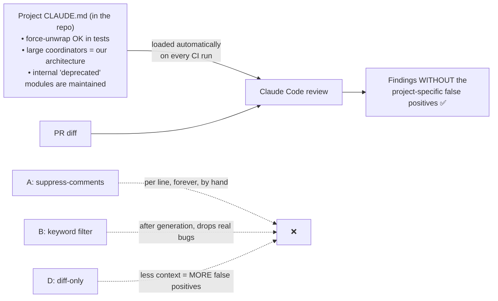

# Q123 — Review flags the team's intentional patterns: put the conventions in CLAUDE.md

**Domain / lesson:** D3 › 3.6 CI/CD Integration (CLAUDE.md gives a CI run its project context)
**Also touches:** D3 › 3.1 CLAUDE.md Hierarchy (project-level = shared, version-controlled team conventions) · D4 › 4.1 (review criteria)
**Scenario:** Claude Code in CI/CD (same as [Q116](../Q116-batch-if-24h-feedback-still-actionable/question.md)–[Q122](../Q122-explicit-report-vs-skip-criteria/question.md))
**Follows:** [Q121](../Q121-few-shot-acceptable-vs-genuine-findings/question.md), [Q122](../Q122-explicit-report-vs-skip-criteria/question.md) (reducing review false positives) · [Q54](../Q54-path-scoped-rules-load-by-file-type/question.md) (path-scoped rules)

## Question

You are integrating Claude Code into your Continuous Integration/Continuous Deployment (CI/CD) pipeline. The system runs automated code reviews, generates test cases, and provides feedback on pull requests. You need to design prompts that provide actionable feedback and minimize false positives.

The automated review consistently flags patterns your team uses intentionally – force-unwrapping optionals in test files, using large coordinator classes that follow your established architecture, and importing internally-maintained modules marked as deprecated in the public SDK. Developers are dismissing roughly 30% of all findings as project-specific false positives.

Which approach prevents the model from generating these findings in the first place by supplying the project's conventions as persistent context on every review?

- **A.** Have developers add inline suppress-comments at flagged lines and preprocess diffs to exclude suppressed lines before sending code to the model.
- **B.** Build post-processing keyword filters that suppress findings containing terms like "force unwrap," "large class," or "deprecated import" before results reach developers.
- **C.** Document the team's accepted patterns and intentional conventions in the project's CLAUDE.md file so the model receives this context during every review.
- **D.** Configure the review to analyze only the changed lines in the diff without surrounding file context, reducing the amount of code the model evaluates per review.

## Answer: **C**

## Diagram



## Concept

**The question gives you three clues, and they all point to CLAUDE.md:**

| Clue in the stem | What it means |
|---|---|
| *"in the first place"* | Fix it **before** generation (the model's context), not after (filters) |
| *"the project's conventions"* | Team-wide knowledge: exactly what **project CLAUDE.md** is for |
| *"persistent context on every review"* | Loaded **automatically** every time, not added per PR or per line |

**Why it works:** the model flagged these patterns because, **without context**, they look like problems: force-unwrap is risky, huge classes are a smell, deprecated imports are a warning sign. It simply didn't know your team chose them on purpose. Tell it once, in the file it always reads.

Guide 3.6: *"In CI, Claude Code reads the project's CLAUDE.md files exactly as it does interactively."* *"So CLAUDE.md is how you give a CI run project-specific context."* It lists *"Review criteria: what constitutes a critical finding vs a minor style issue."*

Guide 3.1: project CLAUDE.md is where *"Team-wide standards belong"*; *"It is in the repository and is version-controlled."*

**Example entry:**

```markdown
## Review conventions (intentional, do not flag)
- Force-unwrapping optionals is accepted in test files (tests should crash loudly).
- Large *Coordinator classes are our architecture; don't suggest splitting them.
- `internal/legacy-sdk/*` is maintained in-house; its public "deprecated" marking doesn't apply.
```

## Why the others are wrong

| Option | Why not |
|---|---|
| **A** Inline suppress-comments + strip those lines from the diff | **Not persistent, not "conventions".** Developers must tag every occurrence by hand, in every new PR, forever. And it **hides code** from the reviewer: a real bug on a suppressed line is never seen. |
| **B** Keyword filters on findings | **After the fact** (fails *"in the first place"*). And blunt: a genuine finding like *"this force unwrap in production code will crash"* gets deleted too. Same trap as Q121 B. |
| **D** Diff-only, no surrounding file context | **Backwards.** Less context means the model knows **less** about why code is the way it is, so it makes **more** context-dependent false positives (and misses cross-file bugs, Q118). It doesn't supply the conventions at all. |

## Pattern to remember

> **Project-specific false positives → teach the project's conventions in the project CLAUDE.md.** CI reads it on every run, so the fix is written once and applies everywhere.

**Exam signals:**
- "intentional team patterns" + "persistent context on every review" / "in the first place" → **project CLAUDE.md**.
- Reject: per-line suppression (manual, hides code), output keyword filters (after the fact), shrinking context (makes it worse).
- `--bare` skips CLAUDE.md, so a review that needs project context must **not** use it (guide 3.6).

**Q121 / Q122 / Q123: three fixes for review noise (same pipeline):**

| Q | The noise | Fix |
|---|---|---|
| Q121 | Findings wrong in your context; must generalise to novel code | Annotated **few-shot** examples (4.2) |
| Q122 | Findings accurate but not worth reporting (style nits) | Explicit **report-vs-skip criteria** (4.1) |
| Q123 | Findings about **your team's intentional conventions** | Conventions in **project CLAUDE.md**, loaded on every run (3.6 / 3.1) |

They combine: the criteria and examples can themselves live in CLAUDE.md.

### Where this comes from

**Guide D3 › 3.6 CI/CD Integration** (checked 2026-11-03):
- *"In CI, Claude Code reads the project's CLAUDE.md files exactly as it does interactively."*
- *"So CLAUDE.md is how you give a CI run project-specific context."*
- Review criteria: *"what constitutes a critical finding vs a minor style issue"*
- *"Without this context, test generation in CI produces low-value boilerplate."*
- `--bare`: *"It skips auto-discovery of hooks, skills, plugins, MCP servers, auto memory and CLAUDE.md"*; a review that needs its CLAUDE.md *"skips `--bare`."*

**Guide D3 › 3.1 CLAUDE.md Hierarchy:**
- *"Team-wide standards belong here: naming conventions, error handling patterns, testing requirements"*
- *"It is in the repository and is version-controlled."* *"Every developer who clones or pulls the repo gets these instructions automatically."*
- Trap: user-level CLAUDE.md *"is not version-controlled or shared via git"*.

## How this connects to earlier questions

| Question | Link |
|---|---|
| [Q121](../Q121-few-shot-acceptable-vs-genuine-findings/question.md) / [Q122](../Q122-explicit-report-vs-skip-criteria/question.md) | Other fixes for review noise (see table above) |
| [Q54](../Q54-path-scoped-rules-load-by-file-type/question.md) | Path-scoped rules: conventions that apply only to some files (see the check question) |
| [Q117](../Q117-append-system-prompt-keeps-tool-guidance/question.md) | Another way to add CI instructions (`--append-system-prompt`); CLAUDE.md is the persistent, versioned one |
| [Q118](../Q118-agentic-review-follows-cross-file-references/question.md) | Why cutting context (D) hurts review quality |

## Check question

**One of the three conventions applies only to *some* files: force-unwrapping is fine in test files, not in production code. If you write it in the root CLAUDE.md, what could go wrong? Where else could it go so it applies only to tests? (Hint: Q54.)**

*(Your answer and feedback will be recorded here.)*

## Glossary

- **Project CLAUDE.md:** the repo's `CLAUDE.md` or `.claude/CLAUDE.md`; version-controlled, shared by everyone and by CI.
- **Persistent context:** instructions loaded automatically on every run, without anyone adding them.
- **Project-specific false positive:** a finding that would be valid in general but not under your team's deliberate conventions.
- **Suppress-comment:** an inline marker telling a tool to ignore a line.
- **`--bare`:** a CLI mode that skips auto-discovery, including CLAUDE.md.

## Related course lessons

*Lecture lengths aren't recorded in the study-map files, so the watch times below are estimates.*

### Udemy A (primary): Claude Certified Architect (CCAR-F) - 2026 Exam Prep
| # | Lecture | Part | Why |
|---|---|---|---|
| **63** | **The Three-Level CLAUDE.md Hierarchy** | 3B | ⭐ Project level = shared team conventions |
| **69** | **Common CLAUDE.md Patterns for Real Teams** | 3B | ⭐ Writing conventions like these |
| 67 | Path-Scoped Rules for Conventions | 3B | For the check question *(also in Q54)* |
| **82** | **Claude Code in CI/CD Pipelines** | 3D | ⭐ CI reads CLAUDE.md *(also in Q116–Q119)* |
| Quiz 9, Quiz 11 | 3B and 3D quizzes | | Self-test |

**▶ Watch in this order (~20 min, est.):** #63 → #69 → #67 → #82, then do **Quiz 9** and **Quiz 11**.

### Udemy B: Claude Certified Architect Foundations: Complete Course (Voroniuk)
| # | Lecture | Section | Why |
|---|---|---|---|
| **95** | **Context for CI Reviews and Tests** | S9 Claude Code in CI | ⭐ Exactly this question |
| **71** | **CLAUDE.md Levels: Who Gets What** | S8 Claude Code Setup | ⭐ Project vs user level |
| 73 | Path-Scoped Rules with Globs | S8 Claude Code Setup | For the check question |
| Quiz 9, Quiz 8 | CI and Claude Code Setup quizzes | S9, S8 | Self-test |

**▶ Watch in this order (~15 min, est.):** #71 → #73 → #95, then do **Quiz 8** and **Quiz 9**.

### CBT Nuggets: CCA-F course
| Skill | Why |
|---|---|
| **1. Set Up Claude Code and Configure Projects** | ⭐ CLAUDE.md setup |
| 8. Apply Useful Hooks and Claude Code SDK Basics | Headless / CI runs |
