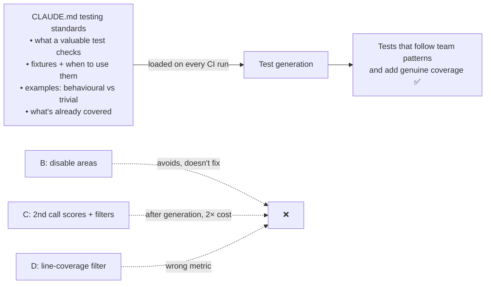

# Q124 — 55% low-value generated tests: testing standards, fixtures and examples in CLAUDE.md

**Domain / lesson:** D3 › 3.6 CI/CD Integration (CLAUDE.md context for CI test generation)
**Also touches:** D4 › 4.1 (explicit criteria for a "valuable test") · D4 › 4.2 (examples: meaningful vs trivial)
**Scenario:** Claude Code in CI/CD (same as [Q116](../Q116-batch-if-24h-feedback-still-actionable/question.md)–[Q123](../Q123-claude-md-project-conventions-for-ci-review/question.md))
**Follows:** [Q123](../Q123-claude-md-project-conventions-for-ci-review/question.md) (same fix for review: conventions in CLAUDE.md)

## Question

You are integrating Claude Code into your Continuous Integration/Continuous Deployment (CI/CD) pipeline. The system runs automated code reviews, generates test cases, and provides feedback on pull requests. You need to design prompts that provide actionable feedback and minimize false positives.

Your test generation produces unit tests for new code, but reviews show 55% are low-value: trivial assertions that only verify functions don't throw exceptions, tests duplicating existing coverage, or tests ignoring your team's fixture conventions.

How do you reduce the rate of low-value tests being generated in the first place?

- **A.** Document testing standards in CLAUDE.md including valuable test criteria, available fixtures with intended use cases, and examples distinguishing meaningful behavioral tests from trivial assertions.
- **B.** Restrict test generation to directories where historical quality metrics show higher acceptance rates, disabling it for areas where generated tests consistently require heavy editing.
- **C.** Implement a two-phase generation where a second Claude call scores each test against quality criteria, filtering out low-scoring tests before presenting results to developers.
- **D.** Add post-generation coverage analysis that automatically filters out any generated test that doesn't increase line coverage beyond what existing tests provide.

## Answer: **A**

## Diagram



## Concept

**Same idea as Q123, applied to test generation.** The model writes trivial, duplicate or fixture-ignoring tests because it **doesn't know** your standards, your fixtures or what's already covered. Tell it in the file CI always reads.

Guide 3.6 lists almost exactly the contents of A:
- Testing standards: *"what makes a good test, what patterns to follow, what to avoid"*
- Available fixtures: *"which test fixtures exist, how to use them, what data they contain"*
- Existing test coverage: *"what is already covered, to avoid suggesting duplicate tests"*
- *"Without this context, test generation in CI produces low-value boilerplate."*
- *"With this context, generated tests follow the team's patterns and add genuine coverage."*

**Each part of A targets one failure:**

| Low-value type | Part of A that fixes it |
|---|---|
| Trivial "doesn't throw" assertions | **Valuable-test criteria** (4.1) + **examples**: behavioural vs trivial (4.2) |
| Ignoring fixture conventions | **Available fixtures with intended use cases** |
| Duplicating existing coverage | Standards stating **what's already covered** (guide's 4th item) |

**Example entry:**

```markdown
## Testing standards
- A test must assert a specific behaviour (returned value, state change, emitted event).
  Never only "does not throw".
- Fixtures: use `factories.order(status=...)` for orders; `fake_clock` for anything time-based.
- Already covered: input validation in `tests/validation/`. Don't re-test it in unit tests.

❌ assert calculate_total(cart) is not None
✅ assert calculate_total(cart_with_10pct_discount) == Decimal("90.00")
```

## Why the others are wrong

| Option | Why not |
|---|---|
| **B** Only generate where acceptance is historically high | **Avoids the problem instead of fixing it.** Areas with poor tests lose test generation entirely, often exactly the code that needs tests most. It doesn't make any generated test better. |
| **C** Second Claude call scores and filters | **After the fact** (fails *"in the first place"*): the bad tests are still generated, you pay twice, and the quality criteria are applied in the wrong place. Put them where the generator can **use** them. Also no fixture/coverage knowledge, so the scorer can't judge those either. |
| **D** Filter tests that don't raise line coverage | **Wrong metric.** A trivial "doesn't throw" test **can** increase line coverage (it executes the lines, asserts nothing), so it survives. A valuable test checking a new edge case on already-executed lines **doesn't**, so it's deleted. Line coverage ≠ behaviour checked. Also after the fact. |

## Pattern to remember

> **Low-value generated tests → put testing standards, fixtures, coverage notes and good-vs-trivial examples in CLAUDE.md.** Prevent at generation; don't filter afterwards.

**Exam signals:**
- "in the first place" + "team's fixture conventions" / "duplicating existing coverage" → **CLAUDE.md testing context**.
- Reject: disabling generation in weak areas (avoidance), scoring/filtering passes (after the fact), line-coverage filters (wrong metric).

**Q123 / Q124: same fix, two CI jobs:**

| | Q123 review | Q124 test generation |
|---|---|---|
| Noise | Flags intentional conventions | Trivial, duplicate, fixture-ignoring tests |
| CLAUDE.md holds | Accepted patterns, review criteria | Test standards, fixtures, existing coverage, examples |

### Where this comes from

**Guide D3 › 3.6 CI/CD Integration** (checked 2026-11-03):
- *"In CI, Claude Code reads the project's CLAUDE.md files exactly as it does interactively."*
- Testing standards: *"what makes a good test, what patterns to follow, what to avoid"*
- Available fixtures: *"which test fixtures exist, how to use them, what data they contain"*
- Existing test coverage: *"what is already covered, to avoid suggesting duplicate tests"*
- *"Without this context, test generation in CI produces low-value boilerplate."*
- *"With this context, generated tests follow the team's patterns and add genuine coverage."*
- *"If the off-licence's CLAUDE.md names its test factories, CI runs use them."*

## How this connects to earlier questions

| Question | Link |
|---|---|
| [Q123](../Q123-claude-md-project-conventions-for-ci-review/question.md) | Same mechanism for review false positives |
| [Q121](../Q121-few-shot-acceptable-vs-genuine-findings/question.md) | Contrasting examples (here: behavioural vs trivial test) |
| [Q122](../Q122-explicit-report-vs-skip-criteria/question.md) | Explicit criteria (here: what makes a test valuable) |
| [Q119](../Q119-same-session-self-review-bias/question.md) | If you do add a checking pass, it's a second line, not the fix |

## Check question

**Option D filters out any generated test that doesn't increase line coverage. Give one example of a test D would wrongly *delete*, and one it would wrongly *keep*.**

*My answer:* "it might prevent testing of edge cases" 🟡 **The "delete" half is right**, in general terms. The "keep" half is missing, and it's the half that shows D fails **both ways**.

**Wrongly deleted: a valuable edge-case test.**

```python
def discount(total):
    return total * 0.9 if total >= 100 else total

# Existing test already runs both lines:
assert discount(200) == 180
assert discount(50) == 50

# New test: the boundary. Same lines → coverage +0% → D deletes it.
assert discount(100) == 90      # catches a `>` vs `>=` bug
```

**Wrongly kept: a trivial test on new code.**

```python
def refund(order): ...          # new, 20 lines, not yet covered

def test_refund():
    refund(make_order())        # no assertion, just "doesn't throw"
# Runs all 20 lines → coverage +20 lines → D keeps it. It checks nothing.
```

> **Line coverage measures which lines *ran*, not what was *checked*.** So D deletes tests that check new behaviour on old lines, and keeps tests that run new lines while checking nothing: exactly the "trivial assertions" from the question.

## Glossary

- **Low-value test:** a test that passes but checks nothing meaningful, repeats existing coverage, or ignores team conventions.
- **Trivial assertion:** e.g. "doesn't throw" or "is not None": runs the code, verifies nothing about its behaviour.
- **Behavioural test:** asserts a specific outcome for a specific input.
- **Fixture:** shared, reusable test setup or data (factories, fake clocks, seeded databases).
- **Line coverage:** % of code lines executed by tests; says nothing about what was asserted.

## Related course lessons

*Lecture lengths aren't recorded in the study-map files, so the watch times below are estimates.*

### Udemy A (primary): Claude Certified Architect (CCAR-F) - 2026 Exam Prep
| # | Lecture | Part | Why |
|---|---|---|---|
| **82** | **Claude Code in CI/CD Pipelines** | 3D | ⭐ CLAUDE.md context for CI test generation *(also in Q116–Q119, Q123)* |
| **69** | **Common CLAUDE.md Patterns for Real Teams** | 3B | ⭐ Writing testing standards *(also in Q123)* |
| 90 | Designing High-Quality Few-Shot Examples | 4B | Behavioural vs trivial examples *(also in Q121)* |
| Quiz 11, Quiz 9 | 3D and 3B quizzes | | Self-test |

**▶ Watch in this order (~15 min, est.):** #69 → #82 → #90, then do **Quiz 9** and **Quiz 11**.

### Udemy B: Claude Certified Architect Foundations: Complete Course (Voroniuk)
| # | Lecture | Section | Why |
|---|---|---|---|
| **95** | **Context for CI Reviews and Tests** | S9 Claude Code in CI | ⭐ Exactly this question *(also in Q123)* |
| 97 | CI Case: Pipeline and Context | S9 Claude Code in CI | Exam-style CI context case |
| 21 | Few-Shot for Format and Judgment | S3 Prompt Engineering | Examples of meaningful vs trivial *(also in Q121)* |
| Quiz 9 | Claude Code in CI quiz | S9 | Self-test |

**▶ Watch in this order (~15 min, est.):** #95 → #97 → #21, then do **Quiz 9**.

### CBT Nuggets: CCA-F course
| Skill | Why |
|---|---|
| **1. Set Up Claude Code and Configure Projects** | ⭐ CLAUDE.md setup *(also in Q123)* |
| 17. Design Clear Prompts with Examples | Good-vs-trivial examples |
