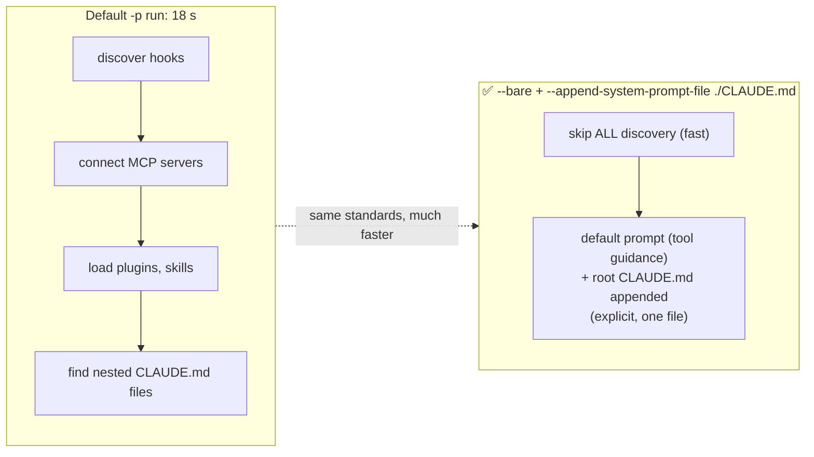

# Q125 — 18 s CI startup from auto-discovery: `--bare` + `--append-system-prompt-file ./CLAUDE.md`

**Domain / lesson:** D3 › 3.6 CI/CD Integration (`--bare` mode, system prompt flags)
**Also touches:** D3 › 3.1 CLAUDE.md Hierarchy (what auto-discovery loads)
**Scenario:** Claude Code in CI/CD (same as [Q116](../Q116-batch-if-24h-feedback-still-actionable/question.md)–[Q124](../Q124-claude-md-testing-standards-fixtures/question.md))
**Follows:** [Q117](../Q117-append-system-prompt-keeps-tool-guidance/question.md) (append keeps the default prompt; replace drops it) · [Q123](../Q123-claude-md-project-conventions-for-ci-review/question.md) (CI needs CLAUDE.md for standards)

## Question

You are integrating Claude Code into your Continuous Integration/Continuous Deployment (CI/CD) pipeline. The system runs automated code reviews, generates test cases, and provides feedback on pull requests. You need to design prompts that provide actionable feedback and minimize false positives.

Your automated review CI jobs take 18 seconds to initialize before Claude begins analyzing code. Profiling reveals the delay comes from auto-discovery of hooks, MCP servers, plugins, skills, and multiple nested CLAUDE.md files throughout your monorepo. You need to cut startup time while ensuring reviews still enforce your team's coding standards, which are documented in your root-level CLAUDE.md file.

What is the most effective approach?

- **A.** Replace the default prompt entirely using `--system-prompt-file ./CLAUDE.md`, which bypasses default prompt assembly and loads only your project rules.
- **B.** Run with `--bare` mode and pass `--append-system-prompt-file ./CLAUDE.md` to explicitly load your project standards while skipping all auto-discovery.
- **C.** Run with `--bare` mode and specify all review criteria directly in the `-p` prompt argument for each CI invocation, without referencing any external files.
- **D.** Keep the default initialization and add `--exclude-dynamic-system-prompt-sections` to reduce per-machine prompt variability and improve prompt cache hit rates across runners.

## Answer: **B**

## Diagram



## Concept

**Two requirements pull in opposite directions:**
1. **Faster startup** → stop auto-discovery → **`--bare`**.
2. **Still enforce the standards in root CLAUDE.md** → but `--bare` **skips CLAUDE.md** too!

**B resolves it:** skip *all* discovery, then load the **one file you need explicitly** with `--append-system-prompt-file`. The standards come back; the 18 s of discovery doesn't.

Guide 3.6: *"`--bare` is minimal mode."* *"It skips auto-discovery of hooks, skills, plugins, MCP servers, auto memory and CLAUDE.md, so scripted calls start faster."*

Claude Code docs (headless, "Start faster with bare mode"): *"Pass any context you need with a flag"*: system prompt additions → *"`--append-system-prompt`, `--append-system-prompt-file`"*. And: *"`--bare` is the recommended mode for scripted and SDK calls."*

**Why append, not replace (Q117 again):** guide 3.6: *"Appending keeps all of that content, so you only supply what differs."* The reviewer *"stays a coding assistant, so it appends."*

```bash
gh pr diff "$PR" | claude --bare -p "Review this diff against our standards" \
  --append-system-prompt-file ./CLAUDE.md \
  --output-format json
```

## Why the others are wrong

| Option | Why not |
|---|---|
| **A** `--system-prompt-file ./CLAUDE.md` (replace) | **Two failures.** (1) **Replacing drops the default prompt**: Claude Code's tool guidance, safety instructions and coding conventions (Q117). Guide: *"Replacing drops the entire default prompt, so you are responsible for everything that the task still needs."* (2) It **doesn't stop auto-discovery**: hooks, MCP servers, plugins and skills are still discovered, so startup stays slow. "Bypasses default prompt assembly" ≠ skips discovery. |
| **C** `--bare` + criteria typed into `-p` each run | Fast, but **duplicates the standards** outside the versioned CLAUDE.md. Two copies drift: when the team updates CLAUDE.md, CI keeps enforcing the old rules. B uses the **single source of truth**. |
| **D** Keep defaults + `--exclude-dynamic-system-prompt-sections` | **Solves a different problem.** That flag moves per-user context out of the system prompt to improve **prompt-cache reuse** across machines (docs). It does nothing about the **18 s discovery**. A real flag used for the wrong goal. |

## Pattern to remember

> **Fast CI startup + still need project standards → `--bare` (skip all discovery) + `--append-system-prompt-file ./CLAUDE.md` (load exactly what you need, keep the default prompt).**

**Exam signals:**
- "startup slow from auto-discovery" → **`--bare`**.
- "but must still follow CLAUDE.md standards" → **load it explicitly**, with **append** (not replace).
- Reject: replace flags (lose tool guidance, still discover), inline criteria (drift from CLAUDE.md), cache flags (wrong problem).

**When to skip `--bare` instead:** the guide's own example review *"needs its CLAUDE.md, so it skips `--bare`."* That's the right call when you rely on **many** discovered pieces (nested CLAUDE.md files, hooks, MCP servers). Here the stem says the standards are in **one root file**, so loading it explicitly is cheaper.

### Where this comes from

**Guide D3 › 3.6 CI/CD Integration** (checked 2026-11-03):
- *"`--bare` is minimal mode."* *"It skips auto-discovery of hooks, skills, plugins, MCP servers, auto memory and CLAUDE.md, so scripted calls start faster."*
- *"Use it for a fast, predictable scripted run that needs no project configuration."*
- *"Appending keeps all of that content, so you only supply what differs."*
- *"Replacing drops the entire default prompt, so you are responsible for everything that the task still needs."*
- `--append-system-prompt-file <path>`: *"Appends a file's contents to the default prompt"*

**Claude Code docs** ([headless](https://code.claude.com/docs/en/headless), [CLI reference](https://code.claude.com/docs/en/cli-reference)), checked 2026-11-03:
- Bare mode: *"Pass any context you need with a flag"*; system prompt additions: *"`--append-system-prompt`, `--append-system-prompt-file`"*.
- *"`--bare` is the recommended mode for scripted and SDK calls, and will become the default for `-p` in a future release."*
- `--exclude-dynamic-system-prompt-sections`: *"Move per-user context, such as the auto memory location, out of the system prompt and into the first user message. Improves prompt-cache reuse across different users and machines running the same task."*

## How this connects to earlier questions

| Question | Link |
|---|---|
| [Q117](../Q117-append-system-prompt-keeps-tool-guidance/question.md) | Replace vs append: why A loses tool guidance |
| [Q123](../Q123-claude-md-project-conventions-for-ci-review/question.md) / [Q124](../Q124-claude-md-testing-standards-fixtures/question.md) | CI needs CLAUDE.md for standards; here it's loaded explicitly |
| [Q54](../Q54-path-scoped-rules-load-by-file-type/question.md) | Nested / path-scoped rules are discovered automatically; `--bare` skips them (check question) |

## Check question

**`--bare` also skips the *nested* CLAUDE.md files in the monorepo, and B loads only the root one. (1) What could the review lose because of that? (2) Give one way to keep those rules while still using `--bare`.**

*My answer:* "directory-specific settings might be lost. Route-based rules might help" 🟡 Both parts answered (good). Part 1 ✅; part 2 hits the same wall.

**(1) ✅ Directory-specific conventions are lost.** Concretely, in both directions:
- **Missed findings:** `packages/payments/CLAUDE.md` says "every money amount must be `Decimal`". The review never sees it, so a `float` in payments passes.
- **New false positives:** `packages/legacy/CLAUDE.md` says "callbacks are accepted here". The review only knows the root rule "use async/await", so it flags them again (the Q123 problem, back).

**(2) Path-scoped rules (`.claude/rules/` with `paths:`) don't escape it.** They're loaded by the **same memory system** that `--bare` turns off: `--bare` *"skips auto-discovery of … CLAUDE.md"*, and `.claude/rules/` files are part of that CLAUDE.md loading (docs: they load at launch or on demand, just like nested CLAUDE.md files). In bare mode, **nothing is discovered**; anything you need must be **passed explicitly**. (The docs don't name `.claude/rules/` in the `--bare` list word for word; this follows from rules being part of the CLAUDE.md system.)

**Ways that do work with `--bare`:**

| Option | How | Trade-off |
|---|---|---|
| ✅ **Build the context in the CI script** | Find the changed directories in the diff, concatenate root `CLAUDE.md` + their nested `CLAUDE.md` / matching rules files into one file, pass it with `--append-system-prompt-file` | Fast, deterministic, still one source of truth (the files themselves) |
| Tell Claude to read them | Prompt: "before reviewing a file, Read the `CLAUDE.md` in its directory" (bare mode keeps the Read tool) | Simple, but relies on the model doing it every time ("instruct" not "guarantee") |
| **Skip `--bare`** | Accept the 18 s; full discovery | The guide's own choice when the review *"needs its CLAUDE.md"* |

```bash
CTX=$(mktemp)
cat CLAUDE.md > "$CTX"
for d in $(git diff --name-only origin/main | xargs -n1 dirname | sort -u); do
  [ -f "$d/CLAUDE.md" ] && cat "$d/CLAUDE.md" >> "$CTX"
done
gh pr diff "$PR" | claude --bare -p "Review against our standards" --append-system-prompt-file "$CTX"
```

> **In `--bare`, nothing is discovered: not nested CLAUDE.md, not rules, not hooks. If you need it, pass it explicitly.** Choose deterministic (the script assembles the files) over hoping the model reads them.

## Glossary

- **Auto-discovery:** at startup, Claude Code finds and loads hooks, skills, plugins, MCP servers, auto memory and CLAUDE.md files.
- **`--bare`:** minimal mode; skips all auto-discovery; recommended for scripted / CI calls.
- **`--append-system-prompt-file`:** adds a file's contents after the default system prompt.
- **`--system-prompt-file`:** replaces the default system prompt with a file's contents.
- **`--exclude-dynamic-system-prompt-sections`:** moves per-user context out of the system prompt to improve prompt-cache reuse.
- **Single source of truth:** one versioned place for a rule, so copies can't drift.

## Related course lessons

*Lecture lengths aren't recorded in the study-map files, so the watch times below are estimates.*

### Udemy A (primary): Claude Certified Architect (CCAR-F) - 2026 Exam Prep
| # | Lecture | Part | Why |
|---|---|---|---|
| **82** | **Claude Code in CI/CD Pipelines** | 3D | ⭐ `-p`, `--bare`, system prompt flags *(also in Q116–Q119, Q123, Q124)* |
| 64 | Load Order and Conflict Resolution | 3B | What auto-discovery loads (root + nested CLAUDE.md) |
| 81 | The Claude Agent SDK — Session Control | 3D | Scripted / SDK runs |
| Quiz 11, Quiz 9 | 3D and 3B quizzes | | Self-test |

**▶ Watch in this order (~15 min, est.):** #64 → #82 → #81, then do **Quiz 11** and **Quiz 9**.

### Udemy B: Claude Certified Architect Foundations: Complete Course (Voroniuk)
| # | Lecture | Section | Why |
|---|---|---|---|
| **94** | **Claude Code in CI: -p and JSON** | S9 Claude Code in CI | ⭐ CLI flags for CI runs |
| **95** | **Context for CI Reviews and Tests** | S9 Claude Code in CI | ⭐ Getting CLAUDE.md into a CI run *(also in Q123, Q124)* |
| 97 | CI Case: Pipeline and Context | S9 Claude Code in CI | Exam-style case *(also in Q124)* |
| Quiz 9 | Claude Code in CI quiz | S9 | Self-test |

**▶ Watch in this order (~15 min, est.):** #94 → #95 → #97, then do **Quiz 9**.

### CBT Nuggets: CCA-F course
| Skill | Why |
|---|---|
| **8. Apply Useful Hooks and Claude Code SDK Basics** | ⭐ Headless / SDK runs |
| 1. Set Up Claude Code and Configure Projects | CLAUDE.md loading *(also in Q123, Q124)* |
