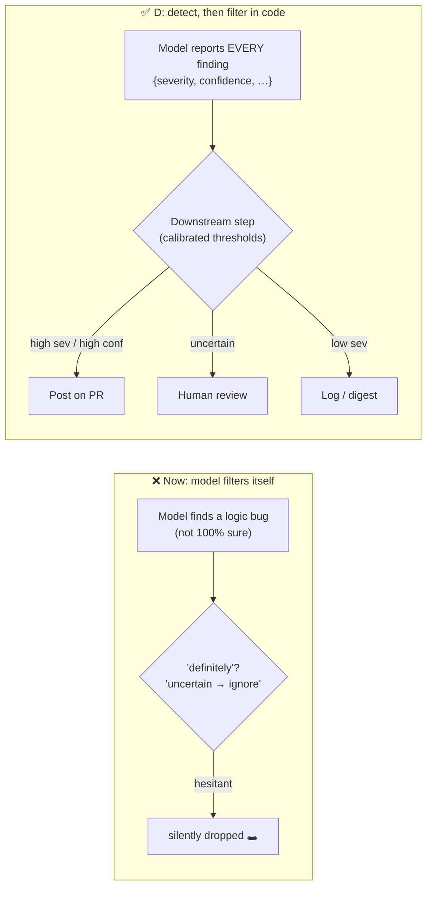

# Q126 — "Ignore anything you're uncertain about" hides real bugs: report all, tagged, filter downstream

**Domain / lesson:** D4 › 4.1 System Prompts with Explicit Criteria (vague confidence instructions suppress real findings)
**Also touches:** D4 › 4.6 Multi-Instance & Multi-Pass Review (confidence scores for routing) · D5 › 5.5 Human Review & Confidence Calibration
**Scenario:** Claude Code in CI/CD (same as [Q116](../Q116-batch-if-24h-feedback-still-actionable/question.md)–[Q125](../Q125-bare-mode-append-claude-md/question.md))
**Follows:** [Q122](../Q122-explicit-report-vs-skip-criteria/question.md) (criteria first, confidence routing second) · [Q121](../Q121-few-shot-acceptable-vs-genuine-findings/question.md) D ("be conservative" suppresses real bugs)

## Question

You are integrating Claude Code into your Continuous Integration/Continuous Deployment (CI/CD) pipeline. The system runs automated code reviews, generates test cases, and provides feedback on pull requests. You need to design prompts that provide actionable feedback and minimize false positives.

Your automated code review is missing genuine bugs in pull requests. Investigation reveals that your review prompt includes the instruction: "Only flag critical issues that would definitely cause production failures. Ignore minor concerns and anything you're uncertain about." Developers confirm that some missed bugs are real logic errors the model investigated but chose not to report. The team requires that review output remain structured (each finding tagged with metadata) and actionable.

Which prompt change both removes the cause of the suppressed findings and preserves structured, tagged output for downstream filtering?

- **A.** Add a second review pass that re-reads the diff using the same prompt, looking for anything the first pass may have missed.
- **B.** Enable extended thinking and instruct the model to reason step-by-step about each code change before producing its review.
- **C.** Remove all severity-related instructions from the prompt and let the model use its default judgment about what to report.
- **D.** Instruct the model to report all findings with a confidence level and severity tag, deferring filtering to a downstream step.

## Answer: **D**

## Diagram



## Concept

**Find the cause in the stem:** the model **investigated** the bugs and **chose not to report** them. Why? Because the prompt told it to: *"definitely cause production failures"*, *"ignore … anything you're uncertain about."* Detection worked; the **prompt's self-filtering** threw the findings away.

**And self-filtering on certainty is unreliable.** Guide 4.1: *"LLM self-reported confidence is poorly calibrated."* *"The model is often sure about wrong findings and hesitant about right ones."* So "drop what you're unsure about" drops exactly some of the **right** ones.

**D separates the two jobs:**

| Job | Who does it |
|---|---|
| **Detect** and describe each finding | The model: report **everything**, tagged with `severity` + `confidence` |
| **Decide** what to post, route or drop | A **downstream step** in code, with thresholds you can calibrate, change and audit |

Nothing gets lost silently, and the output stays **structured and tagged** (the stem's second requirement). Guide 4.6: *"The score allows routing, which decides where each finding goes."* Guide 4.1: *"Confidence scores are useful for routing low-confidence findings to human review."*

```json
{"file": "billing.py", "line": 88, "issue": "off-by-one in proration loop",
 "severity": "high", "confidence": 0.55, "category": "logic"}
```

→ high severity, uncertain → **human review**, not the bin.

## Why the others are wrong

| Option | Why not |
|---|---|
| **A** Second pass with the **same prompt** | **Keeps the cause.** The same instruction ("ignore anything uncertain") suppresses the same findings again. Re-running a broken filter doesn't fix it. |
| **B** Extended thinking, step-by-step | **The model already reasoned about the bugs**: it *"investigated but chose not to report."* More reasoning finds nothing new; the instruction still drops the uncertain ones. Doesn't remove the cause. (Guide 4.6 also warns against relying on extended thinking in the generating session.) |
| **C** Remove all severity instructions; default judgment | **Removes the cause but breaks the second requirement**: no severity/metadata tags, so nothing for downstream filtering to work with. And "default judgment" is vague: no explicit rule for what to report. |

## Pattern to remember

> **Don't let the prompt filter on uncertainty. Detect everything, tag it (severity + confidence), and filter downstream in code.** The model is *"often sure about wrong findings and hesitant about right ones."*

**Exam signals:**
- "model investigated but chose not to report" + prompt says "only definite / ignore uncertain" → the **prompt** is the cause → **report all with tags, filter downstream**.
- "preserve structured / tagged output for downstream filtering" → reject C (drops tags).
- Reject: same-prompt re-run (same cause), "think harder" (detection wasn't the problem).

**Q122 vs Q126: both "skip" rules, opposite verdicts:**

| | Q122 ✅ skip by **category** | Q126 ❌ skip by **uncertainty** |
|---|---|---|
| Rule | "Skip minor style and local patterns" | "Ignore anything you're uncertain about" |
| Based on | **What** the finding is (objective) | **How sure** the model feels (uncalibrated) |
| Risk | Low: real bugs are explicitly in scope | High: drops real bugs the model was hesitant about |

Downstream thresholds still need **calibration on labelled data** before they're trusted (Q21, Q114, Q122).

### Where this comes from

**Guide D4 › 4.1 System Prompts with Explicit Criteria** (checked 2026-11-03):
- *"LLM self-reported confidence is poorly calibrated."* *"The model is often sure about wrong findings and hesitant about right ones."*
- *"Vague instructions give the model no clear rule that it can act on to decide what to flag."*
- *"Confidence scores are useful for routing low-confidence findings to human review (Task Statement 4.6)."*
- *"The order is explicit criteria first, confidence-based routing second."*
- Trap: the exam offers *"only report high-confidence findings,"* *"because keeping only high-confidence findings sounds like good engineering."*

**Guide D4 › 4.6 Multi-Instance & Multi-Pass Review:**
- *"The score allows routing, which decides where each finding goes."*
- *"A raw score is uncalibrated, so it is unreliable for automated decisions."*
- *"Calibrate thresholds using labelled validation sets before relying on confidence for routing decisions."*
- *"It is also wrong to depend on extended thinking within the generating session."*

## How this connects to earlier questions

| Question | Link |
|---|---|
| [Q122](../Q122-explicit-report-vs-skip-criteria/question.md) | Category skip rules (good) vs uncertainty skip rules (bad); confidence routes, doesn't filter |
| [Q121](../Q121-few-shot-acceptable-vs-genuine-findings/question.md) | Option D there ("be conservative, only definite issues"): the same suppression, predicted |
| [Q21](../Q21-review-flag-from-calibrated-thresholds/question.md) / [Q114](../Q114-calibrated-field-confidence-routes-review/question.md) | Calibrated thresholds for the downstream step |
| [Q16](../Q16-escalation-triggers/question.md) | "Instruct the judgment, gate the numbers": model tags, code decides |
| [Q118](../Q118-agentic-review-follows-cross-file-references/question.md) | Never drop silently; say what wasn't covered |

## Check question

**In Q122 the right fix was to tell the model what to *skip*. Here the right fix is to report *everything*. Isn't that a contradiction? What's the difference between the two skip rules?**

*My answer:* "No, as opposite issues are to be resolved: Q122 is about too much output, which has to be filtered, while Q126 about too little." 🟡 **"Not a contradiction" is right, and the symptoms are right** (too much vs too little). But the symptom alone doesn't tell you the fix:

- If "too little output" were the whole story, **C** (remove all severity instructions) would also fix it, and it's wrong.
- And Q126's fix **still filters**: just downstream, in code.

**The real difference is what each skip rule is *based on*:**

| | Q122 ✅ | Q126 ❌ |
|---|---|---|
| Skip rule | "Skip minor style, local patterns" | "Ignore anything you're uncertain about" |
| Based on | **Category**: what the finding *is* | **Self-confidence**: how sure the model *feels* |
| Reliable? | Yes: objective, real bugs explicitly in scope | No: *"often sure about wrong findings and hesitant about right ones"* |
| Where filtering belongs | In the prompt, as explicit criteria | **Downstream**, in code, on calibrated thresholds |

> **Filter by category in the prompt; never by self-confidence in the prompt.** Confidence is a tag for downstream routing, not a reason to stay silent.

So both questions can be true at once: a good review prompt says *"report bugs and security, skip minor style"* (Q122) **and** *"report every finding in scope, tagged with severity + confidence"* (Q126).

**Follow-up:** *"Skip findings in generated code under `/gen/`": category or confidence rule? OK in the prompt?*
*My answer:* "category, OK for prompt" ✅ The *why*: it's based on **where the code is** (an objective fact anyone can check), not on how sure the model feels. Bugs in generated code are fixed in the **generator or its input**, not in the output, so a finding there isn't actionable for the PR author. Test for any skip rule: **could two people disagree about whether it applies?** Path, category → no → fine in the prompt. "Uncertain", "not definite" → yes → tag it and filter downstream.

## Glossary

- **Self-filtering:** the prompt asks the model to decide what to leave out of its own output.
- **Severity tag:** how bad a finding would be if real (e.g. critical / high / low).
- **Confidence tag:** how sure the model is that the finding is real; uncalibrated until measured.
- **Downstream filtering / routing:** code after the model that posts, routes to humans, or logs findings by their tags.
- **Silent suppression:** a real finding dropped with no trace.

## Related course lessons

*Lecture lengths aren't recorded in the study-map files, so the watch times below are estimates.*

### Udemy A (primary): Claude Certified Architect (CCAR-F) - 2026 Exam Prep
| # | Lecture | Part | Why |
|---|---|---|---|
| **83** | **Clarity, Specificity, and the Cost of Ambiguity** | 4A | ⭐ Why "definitely / uncertain" is vague *(also in Q121, Q122)* |
| **103** | **Multi-Pass Review** | 4C | ⭐ Confidence per finding → routing *(also in Q119)* |
| 97 | JSON Mode and Schema-Constrained Output | 4C | Tagged JSON findings |
| Quiz 12, Quiz 14 | 4A and 4C quizzes | | Self-test |

**▶ Watch in this order (~15 min, est.):** #83 → #97 → #103, then do **Quiz 12** and **Quiz 14**.

### Udemy B: Claude Certified Architect Foundations: Complete Course (Voroniuk)
| # | Lecture | Section | Why |
|---|---|---|---|
| **20** | **Explicit Criteria That Reduce False Positives** | S3 Prompt Engineering | ⭐ Criteria vs confidence filtering *(also in Q121, Q122)* |
| **23** | **Exam Lens: Criteria Decisions** | S3 Prompt Engineering | ⭐ "Only high-confidence" distractor *(also in Q122)* |
| 93 | Multi-Pass Review | S9 Claude Code in CI | Confidence-based routing of findings *(also in Q119)* |
| Quiz 3, Quiz 9 | Prompt Engineering and CI quizzes | S3, S9 | Self-test |

**▶ Watch in this order (~15 min, est.):** #20 → #23 → #93, then do **Quiz 3** and **Quiz 9**.

### CBT Nuggets: CCA-F course
| Skill | Why |
|---|---|
| **14. Apply System Prompts and Temperature** | ⭐ Prompt instructions that shape output *(also in Q122)* |
| 13. Control Outputs with Prompts and Stops | Structured, tagged output *(also in Q122)* |
