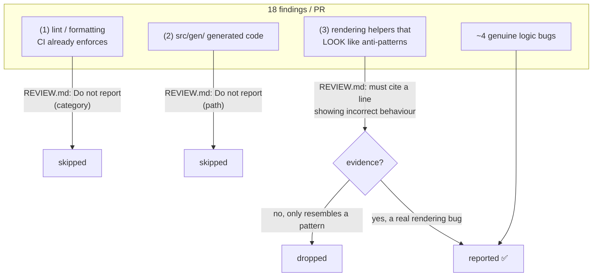

# Q128

**Scenario:** Claude Code in CI/CD (same as [Q116](../Q116-batch-if-24h-feedback-still-actionable/question.md)–[Q126](../Q126-report-all-tagged-filter-downstream/question.md))

## Question

You are integrating Claude Code into your Continuous Integration/Continuous Deployment (CI/CD) pipeline. The system runs automated code reviews, generates test cases, and provides feedback on pull requests. You need to design prompts that provide actionable feedback and minimize false positives.

In addition to your CI pipeline, your organization has enabled Claude's managed Code Review (via the Claude GitHub App) on this repository, and reviews run automatically on each PR. Reviews average 18 findings per PR. Developer feedback reveals three categories of unwanted noise: (1) style and formatting issues already enforced by your linter in CI, (2) findings on auto-generated template code under `src/gen/`, and (3) rendering helper patterns that are intentional project conventions but get flagged because they resemble common anti-patterns. Only about 4 findings per PR are genuine logic bugs.

What is the most effective way to reduce this noise while preserving detection of real issues?

- **A.** Create a REVIEW.md at the repository root with skip rules for CI-enforced checks and generated files, and a verification requirement that rendering-related findings must cite a specific line demonstrating incorrect behavior.
- **B.** Add custom review instructions to a GitHub Actions workflow file, using the action's prompt parameter to suppress lint-duplicate findings, ignore generated template code, and apply stricter evidence requirements for rendering-related issues.
- **C.** Add detailed explanations to the project's CLAUDE.md describing which patterns are intentional, that linting is handled separately by CI, and that the src/gen/ directory contains autogenerated template code.
- **D.** Configure separate GitHub Action workflow files for each code area, one for generated code with findings suppressed, one for rendering code with custom review instructions, and a general workflow for everything else.

<details>
<summary><b>Show answer and explanation</b></summary>

**Topic:** Managed Code Review noise: REVIEW.md with skip rules and an evidence requirement
**Domain / lesson:** D3 › 3.6 CI/CD Integration (closest guide lesson; the guide has no REVIEW.md section, so this question relies on the Claude Code docs)
**Also touches:** D3 › 3.1 CLAUDE.md Hierarchy (CLAUDE.md = project context; REVIEW.md = review-only rules) · D4 › 4.1 (explicit report/skip criteria)
**Follows:** [Q122](../Q122-explicit-report-vs-skip-criteria/question.md) (category skip rules) · [Q123](../Q123-claude-md-project-conventions-for-ci-review/question.md) (conventions in CLAUDE.md) · [Q126](../Q126-report-all-tagged-filter-downstream/question.md) (skip by category, not by confidence)

## Answer: **A**

## Diagram



## Concept

**The key detail: this is the *managed* Code Review service** (Claude GitHub App, running on Anthropic infrastructure), not your own CI job. So you configure it with **the files it reads from the repo**, not with workflow files.

Claude Code docs: Code Review reads two files:
- **`CLAUDE.md`**: *"project instructions that Claude Code reads for every task, reviews included."*
- **`REVIEW.md`**: *"instructions for reviews alone. Use it to say what your team wants flagged, at what severity, and what to skip."*

**A matches each type of noise with the right tool:**

| Noise | Rule type in REVIEW.md | Why this type |
|---|---|---|
| (1) Lint / formatting | **Skip** a category | CI already enforces it: a finding there is never needed |
| (2) `src/gen/` | **Skip** a path | Generated code: fixes go in the generator, not the output |
| (3) Rendering helpers | **Evidence requirement**, not a skip | Rendering bugs **can be real**. Skipping the whole area would lose them; requiring a cited line removes the "looks like an anti-pattern" findings and keeps the proven ones |

The docs list exactly these remedies: *"Comments on generated files or on what CI already checks: list paths and finding categories where Claude should skip findings."* And: *"Findings that turn out to be wrong: require evidence before a class of finding is posted. For example, 'behavior claims need a `file:line` citation in the source, not an inference from naming'."*

**Example (from the docs, adapted):**

```markdown
# Review instructions

## Do not report
- Anything CI already enforces: lint, formatting, type errors
- Generated files under `src/gen/`

## Rendering helpers
- Only report a rendering-helper finding if you cite the specific `file:line`
  where it produces incorrect behaviour. Resembling a known anti-pattern is not enough.
```

## Why the others are wrong

| Option | Why not |
|---|---|
| **B** GitHub Actions workflow prompt parameter | **Wrong system.** The managed Code Review runs on Anthropic's infrastructure through the GitHub App; it reads `REVIEW.md` and `CLAUDE.md` from the repo, not your workflow's prompt. A workflow's prompt configures a **separate** Claude-in-Actions job (docs: "Claude in your own CI, with GitHub Actions", a different option). The noisy managed reviews stay as they are. |
| **C** Explain it all in CLAUDE.md | **Context, not review rules.** CLAUDE.md is general project context for **every** task; Code Review reads it to flag **violations** of its rules. Describing patterns doesn't say "don't report this" or set an evidence bar. Docs: *"Keep `REVIEW.md` to instructions that change review behavior, and leave general project context in `CLAUDE.md`."* (See the check question.) |
| **D** Separate workflows per code area | **Wrong system** (same as B) **plus complexity**: three workflows to maintain, splitting one PR across reviewers. Suppressing everything in generated code is fine, but this still doesn't touch the managed review. |

## Pattern to remember

> **Managed Code Review (GitHub App) → tune it with `REVIEW.md`:** skip **categories** CI enforces and **paths** that are generated; for patterns that only *look* wrong, set an **evidence bar** (cite the line) instead of skipping them.

**Exam signals:**
- "managed Code Review" / "Claude GitHub App" → **REVIEW.md**, not GitHub Actions workflow files.
- "already enforced by linter" / "auto-generated" → **skip rules** (categories, paths).
- "resemble anti-patterns but are intentional" + "preserve detection" → **evidence requirement**, not a blanket skip.
- Reject: workflow prompts (different system), CLAUDE.md descriptions (context, not review rules), many workflows (complexity).

**Which file for which instruction:**

| File | Read by | Put in it |
|---|---|---|
| `CLAUDE.md` | Every Claude Code task, `/code-review`, managed Code Review | Project context and rules that apply everywhere |
| `REVIEW.md` | **Managed Code Review only** | What to flag, at what severity, what to skip, evidence bars, nit caps |
| Workflow prompt (`claude-code-action`) | Your own GitHub Actions job | Instructions for **that** job only |

Note: Code Review reads `REVIEW.md` from the **base / default branch**, never from the PR's own changes (so a PR can't weaken its own review). Protect that branch, or skip rules may not be honoured.

### Where this comes from

**Claude Code docs: [Customize Code Review](https://code.claude.com/docs/en/code-review-customize)** (checked 2026-11-03):
- *"This is how you cut nit volume, stop comments on generated files, or add a rule your team cares about."*
- `CLAUDE.md`: *"project instructions that Claude Code reads for every task, reviews included. Code Review reads them as project context and flags changes that violate them."*
- `REVIEW.md`: *"instructions for reviews alone. Use it to say what your team wants flagged, at what severity, and what to skip."*
- *"Comments on generated files or on what CI already checks: list paths and finding categories where Claude should skip findings."*
- *"Findings that turn out to be wrong: require evidence before a class of finding is posted. For example, 'behavior claims need a `file:line` citation in the source, not an inference from naming'."*
- *"Keep `REVIEW.md` to instructions that change review behavior, and leave general project context in `CLAUDE.md`."*
- Example `REVIEW.md`: *"Do not report: Anything CI already enforces: lint, formatting, type errors · Generated files under `src/gen/`…"*
- *"Code Review reads `REVIEW.md` from the pull request's base branch or from the default branch, never from the pull request's own changes."*

**Claude Code docs: [Code Review](https://code.claude.com/docs/en/code-review):**
- Runs *"on Anthropic infrastructure, in a managed environment"*; compare: *"Claude in your own CI, with GitHub Actions"* runs on *"Your own CI runners"*.
- *"By default, Code Review focuses on correctness: bugs that would break production, not formatting preferences or missing test coverage. To change what it flags, add guidance files to your repository."*

**Guide D3 › 3.6** (for the CI side): *"So CLAUDE.md is how you give a CI run project-specific context."*

## How this connects to earlier questions

| Question | Link |
|---|---|
| [Q122](../Q122-explicit-report-vs-skip-criteria/question.md) / [Q126](../Q126-report-all-tagged-filter-downstream/question.md) | Skip by category / path ✅, never by self-confidence; here (3) uses **evidence**, which is objective |
| [Q123](../Q123-claude-md-project-conventions-for-ci-review/question.md) | Same "intentional conventions" problem in **your own** CI review → CLAUDE.md. Managed Code Review adds REVIEW.md for review-only rules |
| [Q124](../Q124-claude-md-testing-standards-fixtures/question.md) / [Q125](../Q125-bare-mode-append-claude-md/question.md) | Other ways to feed context to a CI run |
| [Q28](../Q28-tamper-proof-threshold-in-tool/question.md) | REVIEW.md read from the protected base branch: a PR can't edit its own rules (tamper-proofing) |

## Check question

**Code Review *does* read CLAUDE.md, so why is C weaker than A? Give two reasons.**

*My answer:* "Because REVIEW.md holds specialised instructions used by reviews alone, so it is worth putting review specifics there so that other tasks do not get distracted by them." 🟡 **Reason 1 ✅**, and it's the docs' own rule: *"Keep `REVIEW.md` to instructions that change review behavior, and leave general project context in `CLAUDE.md`."* CLAUDE.md loads for **every** task (coding, test generation, refactoring); review-only rules there are noise for all of them.

**Reason 2 (missing): C *describes*, A *instructs*.** Look at what C actually writes: *"describing which patterns are intentional, that linting is handled separately, that `src/gen/` is autogenerated."* Those are **facts**, not review rules:

| Noise | C (facts in CLAUDE.md) | A (rules in REVIEW.md) |
|---|---|---|
| Lint | "Linting is handled by CI" → model must *infer* "so don't report it" | **"Do not report** anything CI enforces" |
| `src/gen/` | "This is generated code" → still might flag it | **"Do not report** findings under `src/gen/`" |
| Rendering | "These patterns are intentional" → no way to tell intentional from a real bug | **"Must cite a line showing incorrect behaviour"**: an objective test that keeps real bugs |

The rendering row is the big one: C has **no evidence bar**, so it either keeps flagging look-alikes or starts ignoring real rendering bugs. Code Review reads CLAUDE.md to *"flag changes that violate"* its rules, not as a list of things to suppress. (Same lesson as Q122: **explicit** criteria beat descriptions the model has to interpret.)

Bonus reason: skip rules and severity changes are honoured from **REVIEW.md on the protected base branch**, so a PR can't weaken its own review.

> **CLAUDE.md = what the project *is* (all tasks). REVIEW.md = what the review should *do* (flag, skip, prove).**

## Glossary

- **Managed Code Review:** Anthropic's hosted PR review service, installed via the Claude GitHub App (Team/Enterprise); runs on Anthropic infrastructure.
- **REVIEW.md:** a repo-root file with review-only instructions: what to flag, severity, what to skip, evidence requirements, nit caps.
- **Skip rule:** "do not report" a category (e.g. lint) or a path (e.g. `src/gen/`).
- **Evidence requirement / verification bar:** a finding of a given class is posted only with proof, e.g. a cited `file:line` showing the incorrect behaviour.
- **claude-code-action:** the GitHub Action for running Claude in **your own** workflows; separate from managed Code Review.

## Related course lessons

*Lecture lengths aren't recorded in the study-map files, so the watch times below are estimates. The courses predate REVIEW.md, so these cover the underlying ideas: CI review context and skip criteria.*

### Udemy A (primary): Claude Certified Architect (CCAR-F) - 2026 Exam Prep
| # | Lecture | Part | Why |
|---|---|---|---|
| **82** | **Claude Code in CI/CD Pipelines** | 3D | ⭐ CI review setups *(also in Q116–Q119, Q123–Q125)* |
| **69** | **Common CLAUDE.md Patterns for Real Teams** | 3B | ⭐ What belongs in CLAUDE.md vs elsewhere *(also in Q123, Q124)* |
| 84 | Instruction Decomposition and Constraint Design | 4A | Skip rules and evidence constraints *(also in Q122)* |
| Quiz 11, Quiz 9 | 3D and 3B quizzes | | Self-test |

**▶ Watch in this order (~15 min, est.):** #69 → #82 → #84, then do **Quiz 9** and **Quiz 11**.

### Udemy B: Claude Certified Architect Foundations: Complete Course (Voroniuk)
| # | Lecture | Section | Why |
|---|---|---|---|
| **95** | **Context for CI Reviews and Tests** | S9 Claude Code in CI | ⭐ Review context in CI *(also in Q123–Q125)* |
| **20** | **Explicit Criteria That Reduce False Positives** | S3 Prompt Engineering | ⭐ Skip rules / criteria *(also in Q121, Q122, Q126)* |
| 98 | CI Case: Review Quality | S9 Claude Code in CI | Exam-style review-noise case *(also in Q119)* |
| Quiz 9, Quiz 3 | CI and Prompt Engineering quizzes | S9, S3 | Self-test |

**▶ Watch in this order (~15 min, est.):** #20 → #95 → #98, then do **Quiz 3** and **Quiz 9**.

### CBT Nuggets: CCA-F course
| Skill | Why |
|---|---|
| **8. Apply Useful Hooks and Claude Code SDK Basics** | ⭐ Claude in CI / GitHub *(also in Q125)* |
| 1. Set Up Claude Code and Configure Projects | CLAUDE.md vs other config files *(also in Q123–Q125)* |

</details>
