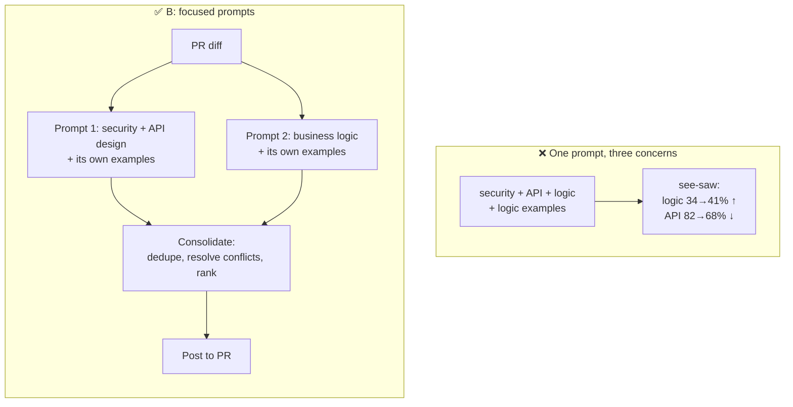

# Q129

**Scenario:** Claude Code in CI/CD (same as [Q116](../Q116-batch-if-24h-feedback-still-actionable/question.md)–[Q128](../Q128-review-md-skip-rules-evidence-bar/question.md))

## Question

You are integrating Claude Code into your Continuous Integration/Continuous Deployment (CI/CD) pipeline. The system runs automated code reviews, generates test cases, and provides feedback on pull requests. You need to design prompts that provide actionable feedback and minimize false positives.

Your automated reviewer uses a single prompt covering security issues, API design, and business logic correctness. Your evaluation suite shows strong recall for API design findings (82%) but poor recall for business logic edge cases in quiz scoring (34%). When you add few-shot examples of logic bugs to the prompt, logic recall improves to 41% but API design recall drops to 68%.

How should you address this trade-off to improve detection across both categories?

- **A.** Provide the full repository as context instead of just the changed files and surrounding code, giving the model deeper visibility into business logic patterns.
- **B.** Split the review into separate focused prompts – one for security and API design, another for business logic – each with dedicated examples, then consolidate findings before posting.
- **C.** Upgrade to a more capable model tier, since its stronger reasoning will handle both concern types in a single prompt and eliminate the recall tradeoff.
- **D.** Replace the few-shot examples with a detailed checklist of specific logic edge cases to verify, such as division-by-zero in score calculations and boundary conditions in grading thresholds.

<b>Show answer and explanation</b>

**Topic:** Logic examples help logic recall but hurt API recall: split the review into focused prompts
**Domain / lesson:** D4 › 4.6 Multi-Instance & Multi-Pass Review (focused passes per concern; attention dilution)
**Also touches:** D4 › 4.2 Few-Shot Prompting (examples for one category in a shared prompt) · D1 › 1.6 Task Decomposition
**Follows:** [Q121](../Q121-few-shot-acceptable-vs-genuine-findings/question.md) (few-shot for review judgment) · [Q118](../Q118-agentic-review-follows-cross-file-references/question.md) (review passes) · [Q119](../Q119-same-session-self-review-bias/question.md) (independent instances)

## Answer: **B**

## Diagram

## Concept

**Read the numbers as a symptom.** Improving one category **costs** another: logic recall 34% → 41%, API recall 82% → 68%. That's a **see-saw**: the concerns are **competing for the same prompt's attention**. Adding logic examples shifts the model's focus toward logic and away from API design.

Guide 4.6 calls this **attention dilution**: *"uneven attention when one pass reviews too much at once."* Symptom: *"Obvious bugs missed."*

**The fix is structural: give each concern its own pass.**
- Each prompt has **one focus** and **its own examples**, so tuning one doesn't affect the other. You can now improve logic recall **without** touching API recall.
- Guide 4.6: *"Each invocation reviews one file with a focused prompt, so that file gets full attention."* The same principle applies per **concern**.
- Then **consolidate**: merge, dedupe, resolve contradictions, rank. Guide: *"Separate passes stop contradictory findings from appearing in the same output."*

Bonus: each prompt can now be **evaluated and tuned independently** on its own part of the eval suite.

## Why the others are wrong

| Option | Why not |
|---|---|
| **A** Full repository as context | **More context ≠ better attention.** It makes dilution **worse**: more to look at in the same pass. Guide trap: *"Larger context windows do not solve attention quality issues."* *"The problem is attention quality, not context size."* |
| **C** Bigger model tier | **The model-swap distractor.** The exam is model-agnostic; a trade-off caused by the **prompt's structure** is fixed by restructuring, not by a stronger model. "Eliminate the trade-off" is an unsupported promise. |
| **D** Replace examples with a logic checklist | **Still one prompt**: a long logic checklist pulls attention from API design just like the examples did (the see-saw remains). And it covers **only the listed** cases (division-by-zero, thresholds), while examples with reasoning **generalise** (Q121). Guide 4.2 trap: *"Choosing 'add more detailed instructions'…"* |

## Pattern to remember

> **Improving one category lowers another → the concerns compete in one prompt → split into focused passes (each with its own examples), then consolidate.**

**Exam signals:**
- A **see-saw** in eval metrics (fix X, Y drops) across categories in one prompt → **separate focused prompts**.
- "single prompt covering security, API, logic" → attention dilution.
- Reject: more context (A), bigger model (C), swapping examples for checklists in the same prompt (D).

**Splitting axes for review (guide 4.6):**

| Split by | Fixes | Example |
|---|---|---|
| **File** | Uneven depth across many files | One focused pass per file + an integration pass for cross-file issues |
| **Concern** (this question) | Categories competing for attention | Security/API pass + business-logic pass |
| **Instance** | Self-review bias (Q119) | A fresh session reviews, not the one that wrote the code |

### Where this comes from

**Guide D4 › 4.6 Multi-Instance & Multi-Pass Review** (checked 2026-11-03):
- *"Attention dilution is uneven attention when one pass reviews too much at once."*
- *"Each invocation reviews one file with a focused prompt, so that file gets full attention"*
- Integration pass: *"This pass checks data flow between modules, consistent API usage across services, dependency conflicts"*
- *"Separate passes stop contradictory findings from appearing in the same output."*
- *"The problem is attention quality, not context size."*
- Traps: *"Using a single pass for large multi-file reviews"*; *"Switching to a larger context window model to fix attention dilution"*; *"Larger context windows do not solve attention quality issues."*

**Guide D4 › 4.2 Few-Shot Prompting:**
- *"More than 4 examples waste tokens without proportional benefit."* (Piling examples for every category into one prompt isn't the answer.)
- Trap: *"Adding many examples to cover every case and variant."*

## How this connects to earlier questions

| Question | Link |
|---|---|
| [Q121](../Q121-few-shot-acceptable-vs-genuine-findings/question.md) | Few-shot examples are the right tool; here they need their **own** prompt per concern |
| [Q118](../Q118-agentic-review-follows-cross-file-references/question.md) | Other multi-pass review shapes |
| [Q119](../Q119-same-session-self-review-bias/question.md) | Split by **instance** (bias) vs here by **concern** (attention) |
| [Q115](../Q115-parallel-task-calls-one-response/question.md) | The focused passes can run **in parallel** (two Task calls in one response) |
| [Q126](../Q126-report-all-tagged-filter-downstream/question.md) | Consolidation works best on **tagged** findings (category, severity, confidence) |

## Check question

**(1) In one sentence: why did adding logic examples *lower* API design recall? (2) Why can't that happen after splitting as in B?**

*My answer:* "Because it diluted the API part that was strong before, as the prompt was instructed to look for both issues in one go. It is less likely to happen after the split as each prompt will look for narrow-scope issues and will be able to tell if those exist with high certainty. A broader prompt would produce less certain findings as there are more criteria to match." ✅ **Both parts answered, mechanism named.** Two refinements:

**(1) ✅ Dilution, made precise:** the logic examples **shifted the shared attention** toward logic, so API design got less of it. One prompt, one pool of attention: whatever you add for one concern is taken from the others.

**(2) Mostly ✅, but frame it as *isolation* and *recall*, not *certainty*:**
- It's not just "less likely"; this particular see-saw **can't** happen, because the API prompt **no longer contains** the logic examples. Tuning the logic prompt can't change what the API prompt pays attention to. The two are **isolated**.
- The measured problem was **recall** (bugs **missed**), not low confidence in findings. A focused prompt **finds more** of its category because all its attention goes there. Careful with "higher certainty": that's drifting toward self-reported confidence, which Q122/Q126 showed is unreliable.

> **One prompt = shared attention: adding to one concern takes from another. Separate prompts = isolated attention: each can be tuned without side effects.**

## Glossary

- **Recall:** of all the real issues, the share the reviewer found. 34% recall = it missed two out of three.
- **Attention dilution:** uneven attention when one pass handles too much (too many files or too many concerns).
- **Focused prompt / pass:** a review call with one concern and examples just for that concern.
- **Consolidation:** merging the findings from several passes: dedupe, resolve conflicts, rank, then post.
- **See-saw trade-off:** improving one metric lowers another; a sign that both are competing for the same resource (here, attention).

## Related course lessons

*Lecture lengths aren't recorded in the study-map files, so the watch times below are estimates.*

### Udemy A (primary): Claude Certified Architect (CCAR-F) - 2026 Exam Prep
| # | Lecture | Part | Why |
|---|---|---|---|
| **103** | **Multi-Pass Review** | 4C | ⭐ Focused passes + consolidation *(also in Q119, Q126)* |
| **90** | **Designing High-Quality Few-Shot Examples** | 4B | ⭐ Examples per concern *(also in Q121)* |
| 13 | Parallel Execution — Fan-Out, Fan-In | 1B | Run the focused passes in parallel, then merge (fan-in = consolidate) |
| Quiz 14, Quiz 13, Quiz 2 | 4C, 4B and 1B quizzes | | Self-test |

**▶ Watch in this order (~15 min, est.):** #90 → #103 → #13, then do **Quiz 13**, **Quiz 14** and **Quiz 2**.

### Udemy B: Claude Certified Architect Foundations: Complete Course (Voroniuk)
| # | Lecture | Section | Why |
|---|---|---|---|
| **93** | **Multi-Pass Review** | S9 Claude Code in CI | ⭐ Per-file + per-concern passes *(also in Q119, Q126)* |
| 21 | Few-Shot for Format and Judgment | S3 Prompt Engineering | Examples for each concern *(also in Q121)* |
| 98 | CI Case: Review Quality | S9 Claude Code in CI | Exam-style review-quality case *(also in Q119, Q128)* |
| Quiz 9 | Claude Code in CI quiz | S9 | Self-test |

**▶ Watch in this order (~15 min, est.):** #93 → #21 → #98, then do **Quiz 9**.

### CBT Nuggets: CCA-F course
| Skill | Why |
|---|---|
| 15. Evaluate Prompts with Test Datasets | ⭐ Per-category recall from an eval suite *(also in Q119)* |
| 17. Design Clear Prompts with Examples | Focused examples *(also in Q121, Q124)* |

