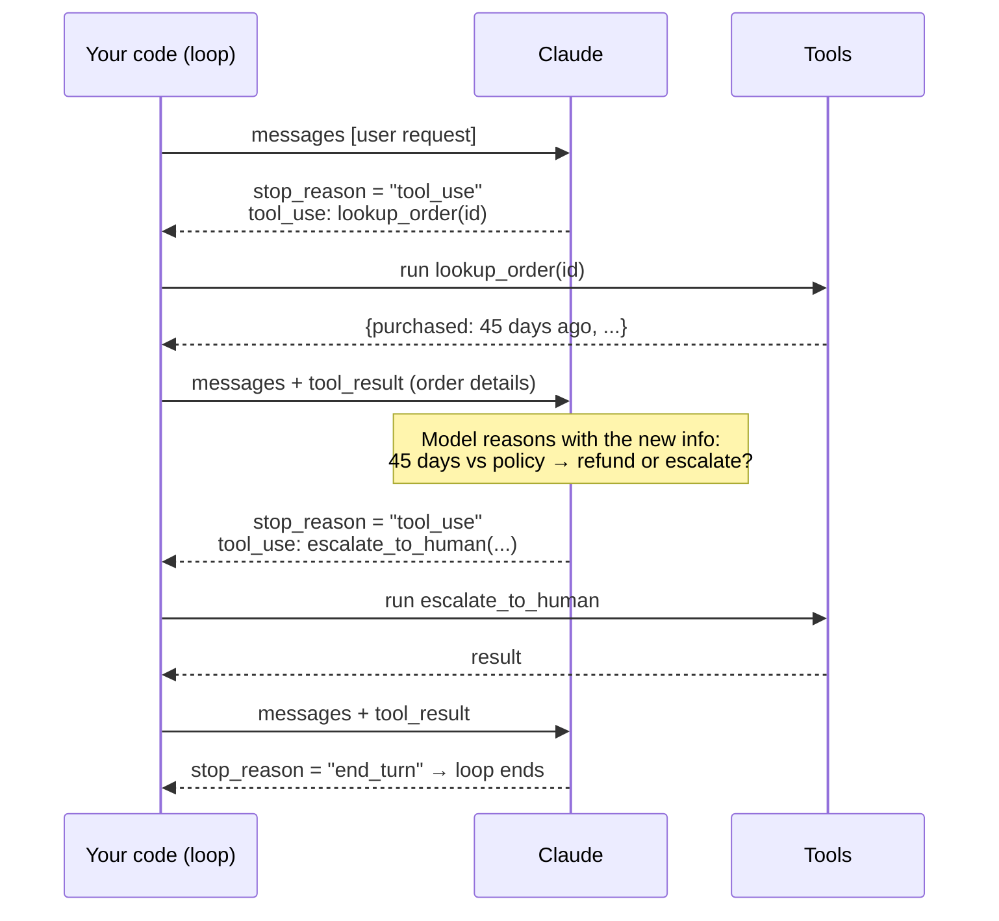

# Q13 — Who decides the next tool in an agentic loop?

**Domain / lesson:** D1 › 1.1 Agentic Loops
**Also touches:** D1 › 1.4 Workflow Enforcement (refund gates) · D5 › 5.2 Escalation
**New scenario:** customer-support agent (lookup_order → process_refund / escalate_to_human)

## Question

When the agent calls `lookup_order` and receives order details showing the item was purchased 45 days ago, how does the agentic loop determine whether to call `process_refund` or `escalate_to_human` next?

- **A.** The orchestration layer automatically routes to the next tool based on the order's status field.
- **B.** The order details are added to the conversation and the model reasons about which action to take.
- **C.** The agent executes the remaining steps in a tool sequence planned at the start of the request.
- **D.** The agent follows a pre-configured decision tree mapping order attributes to specific tool calls.

## Answer: **B**

## Diagram: one turn of the agentic loop



## Concept

The agentic loop works like this:
1. **Your code** sends the conversation to Claude.
2. Claude replies. If `stop_reason == "tool_use"`, it has asked for a tool.
3. **Your code** runs the tool and **appends the `tool_result` to the conversation**.
4. Send again. **Claude reasons over the updated conversation and decides the next step**: another tool, or finish (`stop_reason == "end_turn"`).

So after `lookup_order` returns "45 days ago," that result becomes part of the conversation, and **the model reasons** about whether this means refund or escalation. Nothing outside the model picks the next tool.

The guide: *"Claude uses the current context to decide which tool to call."* That flexibility is what makes it an **agent** instead of a fixed workflow: it handles cases the developer didn't plan for.

## Why the others are wrong

| Option | Why not |
|---|---|
| **A** Orchestration layer routes by status field | That's a **hard-coded router**, not an agentic loop. The loop's code only runs tools and passes results back. It doesn't choose the next tool. |
| **C** Tool sequence planned at the start | A plan made **before** seeing the order data can't react to "45 days." The point of the loop is that each step is decided **after** seeing the latest result. (Same idea as Q05/Q11: fixed plans break on the unexpected.) |
| **D** Pre-configured decision tree | That's a **workflow**, where *"the developer hard-codes which tool runs at which point."* Valid for some systems, but it's not how an agentic loop decides. |

## Pattern to remember

> **In an agentic loop, tool results go back into the conversation, and the model decides the next action.** Your code runs tools and checks `stop_reason`. It doesn't choose tools.

### Important nuance: model decides, code enforces
The model **chooses** the next action, but business rules that **must** hold are **enforced in code** (D1 › 1.4, Q05 refund gate). The guide: where business logic needs deterministic compliance (financial, security, regulatory), *"programmatic enforcement overrides that flexibility."*

| Layer | Who | Example |
|---|---|---|
| **Decide** what to try next | Model (agentic loop) | "45 days, outside the 30-day window → escalate" |
| **Guarantee** rules hold | Code (gate in `process_refund`) | Refund tool rejects orders > 30 days, whatever the model tried |

This doesn't contradict B: the loop **mechanism** is model reasoning, and gates sit **inside the tools** as guardrails.

## Loop control facts (same lesson, likely exam material)

| `stop_reason` | Meaning | Loop action |
|---|---|---|
| `"tool_use"` | Claude wants to call tool(s) | Run them, append `tool_result`, call again |
| `"end_turn"` | Claude is finished | Stop the loop |
| `max_tokens`, `pause_turn`, `refusal` | Other cases | Handle explicitly in production |

**Anti-patterns:**
1. ❌ Parsing text like "I'm done" to stop. Natural language is *"ambiguous and unreliable."*
2. ❌ An iteration cap as the **main** stop condition. OK only as a **safety** limit.
3. ❌ Checking whether the response has text. Claude can return text **alongside** `tool_use`.

> *"The `stop_reason` field is the only reliable signal to control the loop."*

### Where this comes from in the guide

**D1 › 1.1 Agentic Loops:**
- *"Your code must append the tool results to the conversation history."* Otherwise *"the model never sees what the tool returned."*
- *"Claude uses the current context to decide which tool to call."* That's model-driven, as in B.
- Pre-configured: *"the developer hard-codes which tool runs at which point."* That's C and D.
- Exception: deterministic compliance → *"programmatic enforcement overrides that flexibility."*

## Check question

**Refund policy is 30 days. The model usually escalates for "45 days," but in testing it sometimes calls `process_refund` anyway. What do you add, and where?**
*My answer:* "The gate to prevent the agent from doing it." ✅ **Correct: a gate.** I went straight to the code-level fix. The *where*:

**Option 1: inside the `process_refund` tool** (most common answer)
```python
def process_refund(order_id, amount):
    order = orders.get(order_id)
    if order.days_since_purchase > 30:                       # gate
        return {"error": "REFUND_WINDOW_EXCEEDED",
                "days": order.days_since_purchase,
                "action": "call escalate_to_human with the order details"}
    return payments.refund(order_id, amount)
```

**Option 2: a PreToolUse hook** (D1 › 1.5) that intercepts every `process_refund` call before it runs and blocks it when the policy fails. Useful for keeping policy checks central, outside the tool code.

**Two details that make it complete:**
1. **Return a structured error, not just "no".** It tells the model what to do instead. The model reads the `tool_result`, reasons again, and calls `escalate_to_human`, so the **loop corrects itself** (Q13 mechanism + D2 › 2.2).
2. **Keep the policy in the prompt too.** It helps the model choose right most of the time. The **gate guarantees** it every time.

> **Model decides → gate guarantees → structured error steers the loop back.**

## Glossary

- **Agentic loop:** a repeating cycle of model request → tool call → tool result appended → model request, until `stop_reason == "end_turn"`.
- **`stop_reason`:** the field in Claude's response that says why it stopped (`tool_use`, `end_turn`, …). It's the only reliable loop-control signal.
- **`tool_result`:** the message block your code appends with a tool's output, so the model can see it.
- **Model-driven vs pre-configured:** the model chooses the next tool from context, vs the developer hard-codes the sequence or tree (a workflow).

## Related course lessons

### Udemy A (primary): Claude Certified Architect (CCAR-F) - 2026 Exam Prep
| # | Lecture | Part | Why |
|---|---|---|---|
| **5** | **Perception, Reasoning, Action, and Observation** | 1A | ⭐ The loop: observe the result → reason → act |
| **6** | **Loop Control — Stopping, Iterating, and Escalating** | 1A | ⭐ stop_reason, when to stop, escalation |
| 4 | Tool Use as the Foundation of Agency | 1A | Why tools + model reasoning = agent |
| 8 | When Workflows Outperform Agents | 1A | C/D are workflows: when that's the right choice |
| 28 | Why Prompts Are Not Sufficient for High-Stakes Paths | 1D | The "code enforces" nuance |
| Quiz 1 | 1A quiz | | Self-test |

**▶ Watch in this order (~36 min):** #4 → #5 → #6 → #8 → #28, then do **Quiz 1**.
(tools → loop → loop control → workflows vs agents → enforcement → self-test)

### Udemy B: Claude Certified Architect Foundations: Complete Course (Voroniuk)
| # | Lecture | Section | Why |
|---|---|---|---|
| **38** | **The Agentic Loop on stop_reason** | S5 Tools & MCP | ⭐ Exactly this question |
| **39** | **When the Agentic Loop Stops** | S5 Tools & MCP | ⭐ end_turn and other stop reasons |
| 40 | Practice: The Agentic Loop in Code | S5 Tools & MCP | Seeing tool_result appended in code |
| 49 | Prerequisite Gates in Code | S6 Support Agent | The "code enforces" nuance (refund) |
| 52 | When to Escalate to a Human | S6 Support Agent | Refund vs escalate decision |
| Quiz 5 | Tools & MCP quiz | S5 | Self-test |

**▶ Watch in this order (~28 min):** #38 → #39 → #40 → #49 → #52, then do **Quiz 5**.

### CBT Nuggets: CCA-F course
| Skill | Why |
|---|---|
| **20. Handle Tool Calls and Tool Results** | ⭐ Appending tool_result to the conversation |
| **21. Build Multi Turn Tool Conversations** | ⭐ The loop over multiple tool calls |
| 36. Design Workflows and Agent Systems | Workflow (C/D) vs agent (B) |
