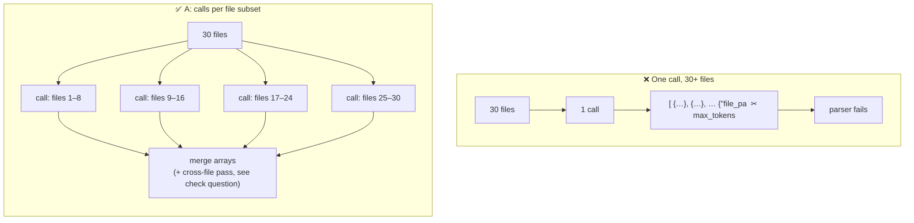

# Q130

**Scenario:** Claude Code in CI/CD (same as [Q116](../Q116-batch-if-24h-feedback-still-actionable/question.md)–[Q129](../Q129-split-review-by-concern-focused-prompts/question.md))

## Question

You are integrating Claude Code into your Continuous Integration/Continuous Deployment (CI/CD) pipeline. The system runs automated code reviews, generates test cases, and provides feedback on pull requests. You need to design prompts that provide actionable feedback and minimize false positives.

Your automated review calls the Claude API for each PR, using tool_use with a `report_findings` tool that returns a JSON array of finding objects (each with `file_path`, `line_number`, `severity`, `category`, and `description`). During testing on a large PR touching 30+ files, the response hits the `max_tokens` limit and the output is truncated mid-JSON, causing your pipeline's parser to fail.

What is the most effective way to handle this?

- **A.** Split the review into multiple API calls that each analyze a subset of the changed files, then merge the resulting findings arrays.
- **B.** Add retry logic that detects truncated JSON and re-sends the request with instructions to report only critical and high severity findings.
- **C.** Switch from tool_use to prompting Claude to return findings as a markdown list.
- **D.** Increase `max_tokens` to the model's maximum and instruct Claude to keep finding descriptions under 50 words each.

<details>
<summary><b>Show answer and explanation</b></summary>

**Topic:** 30-file PR truncates the `report_findings` JSON at `max_tokens`: split into calls per file subset, merge
**Domain / lesson:** D4 › 4.6 Multi-Instance & Multi-Pass Review (per-file passes instead of one pass over a large PR)
**Also touches:** D4 › 4.3 Structured Output with Tool Use (tool_use guarantees the schema, not completeness) · D1 › 1.6 Task Decomposition
**Follows:** [Q129](../Q129-split-review-by-concern-focused-prompts/question.md) (split by concern) · [Q118](../Q118-agentic-review-follows-cross-file-references/question.md) (cross-file issues)

## Answer: **A**

## Diagram



## Concept

**Why it truncates:** output size grows with **PR size**. More files → more findings → a longer `report_findings` array. At some size, any single call runs out of output tokens and the JSON is cut off mid-object.

**`tool_use` guarantees the *shape*, not the *length*.** Guide 4.3: strict schemas *"eliminate syntax errors"*. But if generation stops at `max_tokens`, the tool call itself is **incomplete** (`stop_reason: "max_tokens"`). The schema can't save output that was never generated.

**A fixes the cause:** each call covers a **bounded** set of files, so its output stays **well under the limit, however big the PR gets**. Merging is easy because each finding already has `file_path` and `line_number`.

**And it improves the review itself.** Guide 4.6 lists *"Using a single pass for large multi-file reviews"* as a trap: *"Single-pass multi-file reviews produce inconsistent depth, miss bugs, and generate contradictory findings."* Focused calls give each file *"full attention"*. So A fixes truncation **and** attention dilution together.

The calls are independent, so they can run **in parallel** (Q115): faster too.

## Why the others are wrong

| Option | Why not |
|---|---|
| **B** On truncation, retry with "only critical and high" | **Drops real findings to fit the budget.** Medium-severity bugs disappear on large PRs, exactly the ones with the most changes. And it costs a failed call first. Hides the problem instead of fixing it (compare Q126: don't suppress to make output fit). |
| **C** Markdown list instead of tool_use | **Makes it worse.** A markdown list is still truncated at `max_tokens`, and now you also lose the schema guarantee: guide 4.3: *"Prompt-based JSON is plain text with no structural guarantees."* The downstream pipeline needs structured findings. |
| **D** `max_tokens` to the maximum + descriptions under 50 words | **Raises the ceiling, doesn't remove it.** A PR with 60 or 100 files will hit the new maximum too: output still grows with PR size. The 50-word cap makes findings **less actionable** (the stem's goal). And one pass over 30+ files is still attention-diluted. |

**About D, to be fair:** the Claude API docs do say that for a truncated `tool_use` block, *"you'll need to retry the request with a higher `max_tokens` value to get the full tool use."* That's the right **quick fix for an occasional overflow**. But here the overflow is **structural** (it scales with PR size), so the fix must be structural too: bound each call's output.

## Pattern to remember

> **Output too big for one call because the input is big → split the input into bounded chunks, one call each, merge the structured results.** Raising `max_tokens` only moves the ceiling.

**Exam signals:**
- "large PR, 30+ files" + "hits max_tokens" + "truncated mid-JSON" → **split by files, merge**.
- Reject: shrink output by dropping findings (B), abandon structured output (C), bigger limit + shorter text (D).

**Ways to split a review (now with a fourth reason):**

| Split by | Fixes | Q |
|---|---|---|
| File (subsets) | Uneven depth **and** output limits on large PRs | Q130 |
| Concern | Categories competing for attention | Q129 |
| Instance | Self-review bias | Q119 |

### Where this comes from

**Guide D4 › 4.6 Multi-Instance & Multi-Pass Review** (checked 2026-11-03):
- Trap: *"Using a single pass for large multi-file reviews"*: *"Single-pass multi-file reviews produce inconsistent depth, miss bugs, and generate contradictory findings"*
- *"Each invocation reviews one file with a focused prompt, so that file gets full attention"*
- *"After the review of every file is complete, a separate pass receives all the per-file findings."* *"This pass catches cross-file issues that no single-file review would identify."*

**Guide D4 › 4.3 Structured Output with Tool Use:**
- *"Prompt-based JSON is plain text with no structural guarantees."*
- *"This constraint eliminates syntax errors, such as missing brackets, trailing commas and unquoted keys."* (Only for **complete** output.)

**Claude API docs: [Handling stop reasons](https://platform.claude.com/docs/en/build-with-claude/handling-stop-reasons)** (checked 2026-11-03):
- `max_tokens`: *"Claude stopped because it reached the `max_tokens` limit specified in your request."*
- *"If Claude's response is cut off because it hit the `max_tokens` limit, and the truncated response contains an incomplete tool use block, you'll need to retry the request with a higher `max_tokens` value to get the full tool use."*

## How this connects to earlier questions

| Question | Link |
|---|---|
| [Q129](../Q129-split-review-by-concern-focused-prompts/question.md) | Split by concern; here split by files |
| [Q118](../Q118-agentic-review-follows-cross-file-references/question.md) | Cross-file bugs: what per-file chunks can miss (check question) |
| [Q115](../Q115-parallel-task-calls-one-response/question.md) | Run the chunk calls in parallel |
| [Q126](../Q126-report-all-tagged-filter-downstream/question.md) | Don't drop findings to make output fit (vs B) |
| [Q110](../Q110-resubmit-only-failures-chunked/question.md) | Chunking + retry only the failed chunk |

## Check question

**(1) The API docs' own fix for a truncated tool call is "retry with a higher `max_tokens`". Why isn't that enough here? (2) What kind of bug can A miss by reviewing files in separate chunks, and what would you add to catch it?**

*My answer:* "1. Overflow is structural (it scales with PR size), so the fix must be structural too. 2. The bug that spans multiple files." 🟡 Numbered, both parts addressed (good).

**(1) ✅** (wording taken from this file's concept section, which is fine). Concretely: raising `max_tokens` from 8k to the model maximum might fit a 30-file PR, but a 100-file refactor overflows again. A limit that **grows with input** needs a design where each call's output is **bounded**, whatever the input size.

**(2) Half: the bug is named, the fix is missing.** Yes: a **cross-file** bug, e.g. chunk 1 renames `get_user(id)` → `get_user(user_id, tenant)`, while chunk 3 still calls `get_user(id)`. Each chunk looks correct alone.

**What to add: an integration pass** (guide 4.6): *"After the review of every file is complete, a separate pass receives all the per-file findings."* *"This pass catches cross-file issues that no single-file review would identify."* It checks *"data flow between modules, consistent API usage across services, dependency conflicts."* Give it the **per-file findings + a compact summary of the changes** (changed signatures, exports, schemas), not all 30 files again, so it doesn't overflow either.

```text
files 1–8  ─┐
files 9–16 ─┼─► per-file findings ─► integration pass (summaries + findings) ─► merge ─► post
files 17–30─┘                         catches cross-file bugs
```

> **Split for depth and size; add an integration pass for what crosses the split.**

**Follow-up:** *`models.py` (chunk 1) renames column `price` → `price_cents`; `invoice.py` (chunk 2) still reads `price`. Which pass catches it, and what input does it need?*
*My answer:* "integration pass with per-file findings as an input" 🟡 **Right pass. The input isn't enough on its own.**

Think about what each chunk actually **reports**:
- Chunk 1 sees a clean rename inside `models.py`: **no finding**.
- Chunk 2 sees `invoice.py` reading `price`, which looks normal: **no finding**.

So the per-file findings are **empty** for this bug. An integration pass that only sees findings has nothing to connect. It needs **what changed**, not just what was wrong:

| Input | Contains the clue? |
|---|---|
| Per-file findings | ❌ Both empty |
| **Change summary** per chunk: *"`models.py`: column `price` renamed to `price_cents`"* | ✅ The interface changed |
| **References** to changed names: *"`invoice.py:42` reads `.price`"* (a Grep for the old name) | ✅ Someone still uses the old name |

> **Cross-file bugs are often invisible as findings; they live in the *changes*.** Feed the integration pass the per-chunk **change summaries** (signatures, columns, exports) + where those names are used, together with the findings. That's why the guide says it checks *"data flow between modules, consistent API usage across services."*

## Glossary

- **`max_tokens`:** the request's cap on output tokens; generation stops when it's reached.
- **`stop_reason: "max_tokens"`:** the response was cut off by that cap, not finished.
- **Truncated tool call:** a `tool_use` block whose JSON input was cut off; not parseable.
- **Chunking:** splitting a large input into bounded pieces processed by separate calls.
- **Merge:** combining the findings arrays from the chunk calls (dedupe, sort by file/line or severity).

## Related course lessons

*Lecture lengths aren't recorded in the study-map files, so the watch times below are estimates.*

### Udemy A (primary): Claude Certified Architect (CCAR-F) - 2026 Exam Prep
| # | Lecture | Part | Why |
|---|---|---|---|
| **103** | **Multi-Pass Review** | 4C | ⭐ Per-file passes + integration pass *(also in Q119, Q126, Q129)* |
| **99** | **Structured Outputs Limits** | 4C | ⭐ What structured output does and doesn't guarantee |
| 100 | Using Tool Definitions to Extract Structured Data | 4C | `tool_use` for findings |
| 13 | Parallel Execution — Fan-Out, Fan-In | 1B | Chunk calls in parallel, then merge *(also in Q129)* |
| Quiz 14, Quiz 2 | 4C and 1B quizzes | | Self-test |

**▶ Watch in this order (~20 min, est.):** #100 → #99 → #103 → #13, then do **Quiz 14** and **Quiz 2**.

### Udemy B: Claude Certified Architect Foundations: Complete Course (Voroniuk)
| # | Lecture | Section | Why |
|---|---|---|---|
| **93** | **Multi-Pass Review** | S9 Claude Code in CI | ⭐ Per-file + cross-file passes *(also in Q119, Q126, Q129)* |
| 28 | Practice: Schema-Valid Output from Claude | S4 Structured Output | What tool_use output guarantees |
| Quiz 9, Quiz 4 | CI and Structured Output quizzes | S9, S4 | Self-test |

**▶ Watch in this order (~10 min, est.):** #28 → #93, then do **Quiz 4** and **Quiz 9**.

### CBT Nuggets: CCA-F course
| Skill | Why |
|---|---|
| 13. Control Outputs with Prompts and Stops | ⭐ Stop reasons and output limits *(also in Q122, Q126)* |

</details>
