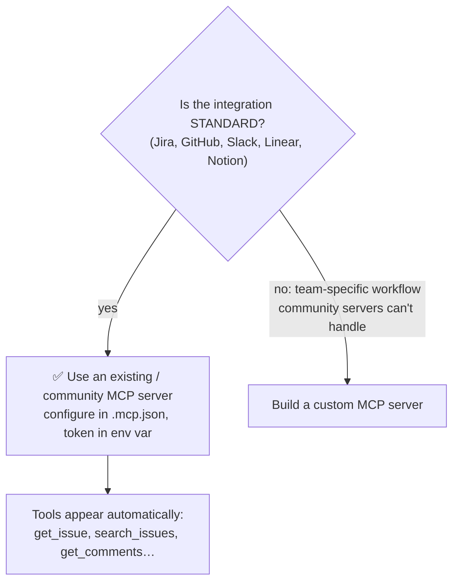

# Q131 — Agent needs standard Jira ticket data: integrate an existing Jira MCP server

**Domain / lesson:** D2 › 2.4 MCP Server Integration (community servers for standard integrations; build custom only for team-specific workflows)
**Also touches:** D2 › 2.5 Built-in Tools (why not Bash + curl)
**Scenario:** Developer productivity tools with the Claude Agent SDK (built-in tools + MCP servers)
**Follows:** [Q59](../Q59-mcp-scopes-project-vs-user/question.md) (`.mcp.json` project scope, credentials in env vars) · [Q74](../Q74-mcp-descriptions-compete-with-built-ins/question.md) (MCP tool descriptions vs built-ins)

## Question

You are building developer productivity tools using the Claude Agent SDK. The agent helps engineers explore unfamiliar codebases, understand legacy systems, generate boilerplate code, and automate repetitive tasks. It uses the built-in tools (Read, Write, Bash, Grep, Glob) and integrates with Model Context Protocol (MCP) servers.

Engineers frequently ask the agent to cross-reference code changes with Jira tickets during reviews – checking ticket descriptions, acceptance criteria, and recent comments. This currently requires manually copy-pasting content into conversations. The team wants the agent to access this standard Jira ticket data directly.

What's the most effective approach?

- **A.** Integrate an existing Jira MCP server that exposes tickets, comments, and metadata through discoverable tool interfaces.
- **B.** Use the Bash tool with `curl` to call Jira's REST API, including authentication headers and parsing JSON responses inline.
- **C.** Build a custom MCP server wrapping Jira's API with tools designed specifically for this team's code review workflow.
- **D.** Export Jira tickets to markdown files in the repository that the agent accesses using the Read tool.

## Answer: **A**

## Diagram

## Concept

**The keyword is "standard Jira ticket data".** Descriptions, acceptance criteria and comments are what **every** Jira integration exposes. Nothing here is team-specific.

Guide 2.4: *"Use community servers for standard integrations"*; *"Jira, GitHub, Slack, Linear and Notion all have maintained community MCP servers."* *"Build custom servers only when"*: *"Your team has specific workflows that community servers cannot handle."* And: *"On build-vs-use questions, the exam consistently favours the pragmatic choice."*

**Why an MCP server (and not ad-hoc access):**
- **Discoverable tools:** *"If a server is configured and reachable, its tools appear in the agent's toolkit."* *"There is no manual activation step."* The agent sees typed tools (`get_issue`, `get_comments`) with descriptions.
- **Live data:** the agent reads the ticket **as it is now**, including today's comments.
- **Credentials handled properly:** configured once in `.mcp.json`, with the token in an environment variable (Q59).

## Why the others are wrong

| Option | Why not |
|---|---|
| **B** Bash + `curl` to Jira's REST API | **Ad-hoc and fragile.** The model must build URLs, handle auth headers and parse raw JSON **every time**, with no typed interface or tool description to guide it. Auth tokens end up in commands and the transcript. It reinvents what an existing server already provides, worse. |
| **C** Build a custom MCP server for the team's workflow | **Over-engineering for a standard need.** Building and maintaining a server is justified *"only when"* the workflow is something *"community servers cannot handle"*. Reading tickets, criteria and comments isn't. Guide trap: *"Community MCP servers exist for standard integrations and should be evaluated first."* |
| **D** Export tickets to markdown in the repo | **Stale copies.** "Recent comments" are out of date as soon as they're exported; someone has to keep re-exporting. It also clutters the repo with ticket content that doesn't belong in version control (possibly sensitive). |

## Pattern to remember

> **Standard external system (Jira, GitHub, Slack, Linear, Notion) → existing/community MCP server first. Custom server only for team-specific workflows it can't handle.**

**Exam signals:**
- "standard … data" + a well-known SaaS → **existing MCP server**.
- "designed specifically for this team" without a stated gap → over-engineering (C).
- Reject: raw API calls through Bash (B), exported copies (D).

**Build vs use (2.4):**

| Situation | Choice |
|---|---|
| Standard reads/writes on a popular service | ✅ Existing / community MCP server |
| Team-specific workflow the community server can't do (e.g. a custom approval flow combining Jira + internal deploy DB) | Custom MCP server |
| Internal system with no server at all | Custom MCP server |

### Where this comes from

**Guide D2 › 2.4 MCP Server Integration** (checked 2026-11-03):
- *"Use community servers for standard integrations:"* *"Jira, GitHub, Slack, Linear and Notion all have maintained community MCP servers"*
- *"Build custom servers only when:"* *"Your team has specific workflows that community servers cannot handle"*
- *"On build-vs-use questions, the exam consistently favours the pragmatic choice."*
- *"If a server is configured and reachable, its tools appear in the agent's toolkit."* *"There is no manual activation step."*
- *"The file references variable names, not values."* *"This syntax keeps credentials out of version control whilst the server configuration stays shared."*
- Traps: *"Community MCP servers exist for standard integrations and should be evaluated first."* *"Custom builds are only justified for team-specific workflows that community servers cannot handle."*

## How this connects to earlier questions

| Question | Link |
|---|---|
| [Q59](../Q59-mcp-scopes-project-vs-user/question.md) | Share the server config in `.mcp.json`, token in an env var |
| [Q74](../Q74-mcp-descriptions-compete-with-built-ins/question.md) | The agent picks MCP tools by their descriptions; sparse ones lose to built-ins |
| [Q29](../Q29-compose-mechanical-keep-judgment/question.md) | When a custom/composite tool *is* worth building |
| [Q25](../Q25-mcp-protocol-vs-tool-errors/question.md) / [Q33](../Q33-mcp-iserror-result/question.md) | How an MCP server reports errors |

## Check question

**(1) Give a concrete situation where C (a custom MCP server) *would* be the right answer. (2) The team shares the Jira server config in the repo. Where does the Jira API token go, and why not in the config file?**

*My answer:* "1) When the situation requires more (features) than a standard MCP server can offer. 2) The API token should go somewhere secure, like a vault, as it is sensitive information which you do not want leaked." 🟡 Numbered, both parts (good).

**(1) 🟡 That's the rule, not a situation.** The question asked for a concrete case. Examples:
- **Combining systems in one step:** "Before approving a PR, check that its Jira ticket is in *Ready for QA* **and** the linked feature flag exists in our internal flag service": the community Jira server knows nothing about the internal flag service.
- **Team-specific fields and rules:** a custom Jira workflow where "acceptance criteria" live in a custom field `customfield_10234` with a team rule like "a ticket is reviewable only if risk ≤ 2"; a generic server returns raw fields but not the team's logic.
- **An internal system with no server at all** (an in-house ticket tracker).

Test: **can I name the specific thing the community server can't do?** If not, use the community server.

**(2) ✅ Right instinct, now the exact mechanism (guide 2.4 / Q59):**
- `.mcp.json` (committed) holds only the **variable name**: `"JIRA_API_TOKEN": "${JIRA_API_TOKEN}"`. *"The file references variable names, not values."*
- Each developer sets the **value locally**: *"in a shell profile, a `.env` file or a secrets manager"* (your vault). In CI, a CI secret.
- **Why not in the file:** `.mcp.json` is version-controlled, so the token would be in **git history forever**: *"A private repository is not a secret store; every clone and fork carries the token in its history."*
- Bonus: each person uses **their own** token, so Jira permissions and audit logs stay per person.

> **Config shared in git, secrets per person in the environment.**

## Glossary

- **MCP server:** a process that exposes tools (and resources, prompts) to an agent through the Model Context Protocol.
- **Community / existing MCP server:** a maintained, ready-made server for a common service (Jira, GitHub, Slack…).
- **Discoverable tools:** tools the agent sees automatically, with names, schemas and descriptions, once the server is configured.
- **`.mcp.json`:** project-scoped MCP config at the repo root, version-controlled; references env var **names** for secrets.
- **Build vs use:** the decision to write your own integration or adopt an existing one; the exam favours the pragmatic "use".

## Related course lessons

*Lecture lengths aren't recorded in the study-map files, so the watch times below are estimates.*

### Udemy A (primary): Claude Certified Architect (CCAR-F) - 2026 Exam Prep
| # | Lecture | Part | Why |
|---|---|---|---|
| **43** | **What MCP Is** | 2B | ⭐ Servers, clients, discoverable tools |
| **55** | **MCP in Production** | 2C | ⭐ Adopting servers in real teams |
| 54 | Tool Boundaries, Access Scoping, and Least Privilege | 2C | Credentials and scope for the Jira server |
| Quiz 6, Quiz 7 | 2B and 2C quizzes | | Self-test |

**▶ Watch in this order (~15 min, est.):** #43 → #55 → #54, then do **Quiz 6** and **Quiz 7**.

### Udemy B: Claude Certified Architect Foundations: Complete Course (Voroniuk)
| # | Lecture | Section | Why |
|---|---|---|---|
| **91** | **Dev Agent Case: MCP Servers** | S8 Claude Code Setup | ⭐ Exactly this scenario |
| **77** | **Sharing MCP Servers Safely** | S8 Claude Code Setup | ⭐ `.mcp.json` + env var tokens (check question part 2) |
| 46 | MCP: Servers, Tools and Resources | S5 Tools & MCP | MCP basics |
| Quiz 8, Quiz 5 | Claude Code Setup and Tools & MCP quizzes | S8, S5 | Self-test |

**▶ Watch in this order (~15 min, est.):** #46 → #91 → #77, then do **Quiz 5** and **Quiz 8**.

### CBT Nuggets: CCA-F course
| Skill | Why |
|---|---|
| **5. Extend Claude Code with MCP Servers** | ⭐ Adding existing MCP servers |
| 33. Explain MCP Clients and Servers | How the agent discovers the tools |
