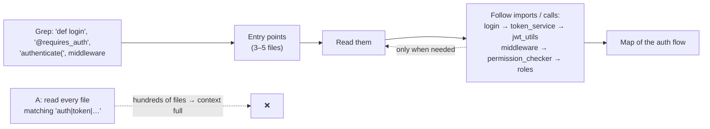

# Q132 — Understanding auth across 800+ files: Grep for entry points, then follow imports incrementally

**Domain / lesson:** D2 › 2.5 Built-in Tools (incremental discovery: Grep → Read → follow imports)
**Also touches:** D5 › 5.4 Codebase Exploration & Context Degradation · D1 › 1.3 Subagent Invocation (why C is premature)
**Scenario:** Developer productivity tools with the Claude Agent SDK (same as [Q131](../Q131-existing-jira-mcp-server/question.md))
**Follows:** [Q131](../Q131-existing-jira-mcp-server/question.md)

## Question

You are building developer productivity tools using the Claude Agent SDK. The agent helps engineers explore unfamiliar codebases, understand legacy systems, generate boilerplate code, and automate repetitive tasks. It uses the built-in tools (Read, Write, Bash, Grep, Glob) and integrates with Model Context Protocol (MCP) servers.

An engineer who just joined the team asks the agent to help them understand the authentication and authorization architecture before making security improvements. The codebase has 800+ files across multiple services.

What exploration strategy will most effectively build understanding, given Claude built-in tools and context limits?

- **A.** Read all files containing "auth", "login", "permission", or "token" in their content or filename.
- **B.** Use Grep to find authentication entry points, read those files, then follow imports and function calls to map the auth flow incrementally.
- **C.** Launch parallel subagents to explore different services simultaneously, then synthesize their findings into an architectural overview.
- **D.** Read any CLAUDE.md and README files first, then ask the engineer to specify which 10-15 files are most important for understanding the auth system.

## Answer: **B**

## Diagram

## Concept

**Two constraints in the stem:** 800+ files and **context limits**. You can't read everything, so you need to read the **right** things, in the **right order**.

**B is incremental discovery** (guide 2.5): *"Incremental discovery reads a few files first and reads more only when it needs them."*
1. **Grep** for where the flow starts: *"Search for the function name, class name or error message that starts your investigation."* For auth: `login(`, `authenticate`, `@requires_auth`, auth middleware.
2. **Read** those few entry-point files.
3. **Follow imports and calls**: *"Follow their import statements to discover related files."* Login → token service → JWT utils; middleware → permission checker → roles.

Each step is chosen by what the last one revealed, so the agent builds a **map of the flow**, which is exactly what "understand the architecture" means.

## Why the others are wrong

| Option | Why not |
|---|---|
| **A** Read every file containing "auth", "login", "permission", "token" | **The guide's "most costly mistake".** In 800 files these words appear in hundreds (tests, logs, configs, comments, `tokenizer.py`…). *"Reading every file upfront, before you know what you need, is the most costly mistake in exploring a codebase."* *"Never read all files upfront."* It also gives a **pile of files**, not a **flow**. |
| **C** Parallel subagents per service, then synthesise | **Splits along the wrong line, too early.** Auth is a **cross-cutting flow** (gateway → auth service → each service's permission checks); dividing by service before you know the flow cuts it into pieces, and the synthesis has to reconstruct connections no subagent saw. Subagents are valuable (see below), but for **specific investigations** once you know what to investigate. |
| **D** README/CLAUDE.md, then ask the engineer for 10–15 files | Reading docs first is fine, but **the engineer just joined**: they're the one asking for help and can't know which files matter. It hands the agent's job back to the person who can least do it. |

**About C, to be fair:** guide 5.4 does recommend subagents for exploration, but for **context isolation**, not parallelism: *"The obvious interpretation is that subagents are for parallelisation, but their main value is context isolation."* *"Spawning subagents for specific investigation tasks"* is the right move **after** B finds the flow, e.g. "subagent: map how the billing service checks permissions, return a summary".

## Pattern to remember

> **Large codebase + context limit → incremental discovery: Grep for entry points → Read them → follow imports/calls. Never read everything upfront.**

**Exam signals:**
- "800+ files" + "context limits" + "understand the X flow" → **Grep entry points, follow the trail**.
- Reject: keyword-match-and-read-all (A), parallel split before you know the shape (C), handing the choice to a newcomer (D).

**Tool roles (2.5):**

| Tool | Finds | Example |
|---|---|---|
| **Grep** | What's **inside** files | `def authenticate`, `@requires_auth` |
| **Glob** | Files by **name / path** | `**/auth/**/*.py`, `**/*middleware*` |
| **Read** | The content of a file you've chosen | The entry point, then its imports |

### Where this comes from

**Guide D2 › 2.5 Built-in Tools** (checked 2026-11-03):
- *"Incremental discovery reads a few files first and reads more only when it needs them."*
- *"Search for the function name, class name or error message that starts your investigation."*
- *"Follow their import statements to discover related files."*
- *"Reading every file upfront, before you know what you need, is the most costly mistake in exploring a codebase."* *"Never read all files upfront."*
- *"Every file read into context costs tokens, and the context window has a limit."*
- *"Grep finds what is inside files. Glob finds files by their names."*

**Guide D5 › 5.4 Codebase Exploration & Context Degradation:**
- *"Exploring a large codebase is one of the most context-intensive tasks that a Claude-based agent performs."*
- *"The obvious interpretation is that subagents are for parallelisation, but their main value is context isolation."*
- *"Each subagent explores verbosely in its own isolated context, then returns a structured summary."*
- *"Scratchpad files are the primary way to limit context degradation."*
- *"Exploration can run in phases: Phase 1 to understand the architecture, Phase 2 to investigate specific components."*

## How this connects to earlier questions

| Question | Link |
|---|---|
| [Q118](../Q118-agentic-review-follows-cross-file-references/question.md) | Same move in review: Grep/Read to follow references across files |
| [Q115](../Q115-parallel-task-calls-one-response/question.md) | When parallel subagents **are** right: independent tasks with a known split |
| [Q10](../Q10-missing-context-in-subagent-prompt/question.md) / [Q12](../Q12-include-complete-findings-in-prompt/question.md) | Subagents see only what you pass them, one reason C's per-service split loses the flow |
| [Q130](../Q130-max-tokens-truncation-split-by-files/question.md) | Splitting by files misses what crosses the split; same risk for C |

## Check question

**B works, but a long exploration still fills the context with verbose output and the agent starts forgetting early findings. Name the two techniques from guide 5.4 that keep it healthy, and say what each one does.**

*(Your answer and feedback will be recorded here.)*

## Glossary

- **Incremental discovery:** read a few files, then decide what to read next based on what you found.
- **Entry point:** where a flow starts (login handler, auth middleware, decorator).
- **Following imports:** reading the modules an entry point imports or calls, to trace the flow.
- **Cross-cutting concern:** something that spans many services (auth, logging), not owned by one.
- **Context degradation:** the model losing track of earlier findings as verbose output piles up, even before the window is full.

## Related course lessons

*Lecture lengths aren't recorded in the study-map files, so the watch times below are estimates.*

### Udemy A (primary): Claude Certified Architect (CCAR-F) - 2026 Exam Prep
| # | Lecture | Part | Why |
|---|---|---|---|
| **56** | **The Built-in Toolset** | 2C | ⭐ Grep / Glob / Read roles |
| **59** | **The Tool System — Reads, Bash, Edits, and Web Search** | 3A | ⭐ How Read/Grep are used to explore |
| 122 | Why Delegate Discovery to a Subagent | 5C | When subagents help (context isolation, about C) |
| 120 | The Scratchpad Pattern | 5C | Check question |
| Quiz 7, Quiz 8, Quiz 17 | 2C, 3A and 5C quizzes | | Self-test |

**▶ Watch in this order (~20 min, est.):** #56 → #59 → #122 → #120, then do **Quiz 7**, **Quiz 8** and **Quiz 17**.

### Udemy B: Claude Certified Architect Foundations: Complete Course (Voroniuk)
| # | Lecture | Section | Why |
|---|---|---|---|
| **80** | **Exploring a Codebase Step by Step** | S8 Claude Code Setup | ⭐ Exactly this question |
| **79** | **Built-in Tools: Grep, Glob, Read, Write and Edit** | S8 Claude Code Setup | ⭐ Tool roles |
| 81 | The Explore Subagent | S8 Claude Code Setup | Subagents for exploration (about C) |
| 86 | Keeping Long Explorations Sharp | S8 Claude Code Setup | Check question |
| 90 | Dev Agent Case: Exploring Code | S8 Claude Code Setup | Exam-style case |
| Quiz 8 | Claude Code Setup quiz | S8 | Self-test |

**▶ Watch in this order (~25 min, est.):** #79 → #80 → #81 → #86 → #90, then do **Quiz 8**.

### CBT Nuggets: CCA-F course
| Skill | Why |
|---|---|
| **23. Apply Built In Tools Safely** | ⭐ Built-in tools |

*CBT doesn't cover 5.4 (see the study map). Use the guide and Udemy B #80, #86.*
