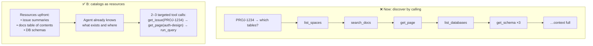

# Q133 — Exploratory calls across three MCP servers: expose content catalogs as MCP resources

**Domain / lesson:** D2 › 2.4 MCP Server Integration (MCP resources = content catalogs that remove exploratory tool calls)
**Also touches:** D5 › 5.1 Context Window Management (fewer calls → less context used) · D2 › 2.1 Tool Interface Design (why D's generic tool is weak)
**Scenario:** Developer productivity tools with the Claude Agent SDK (same as [Q131](../Q131-existing-jira-mcp-server/question.md)–[Q132](../Q132-grep-entry-points-follow-imports/question.md))
**Follows:** [Q131](../Q131-existing-jira-mcp-server/question.md) (existing MCP servers) · [Q57](../Q57-mcp-prompts-become-slash-commands/question.md) (MCP prompts, another primitive)

## Question

You are building developer productivity tools using the Claude Agent SDK. The agent helps engineers explore unfamiliar codebases, understand legacy systems, generate boilerplate code, and automate repetitive tasks. It uses the built-in tools (Read, Write, Bash, Grep, Glob) and integrates with Model Context Protocol (MCP) servers.

Your productivity agent connects to three MCP servers: an issue tracker (search_issues, get_issue, create_comment), a documentation wiki (search_docs, get_page, list_spaces), and a database explorer (run_query, get_schema, list_databases). When engineers ask cross-system questions like "What database tables are affected by the authentication refactor in PROJ-1234?", monitoring shows the agent makes 8-10 sequential tool calls, frequently issues exploratory calls because it lacks visibility into what content each server contains, and exhausts context space before completing complex investigations.

What architectural change best leverages MCP capabilities to address these issues?

- **A.** Add an orchestrator that routes questions to a single server based on keywords
- **B.** Expose each server's content catalog as MCP resources – issue summaries, documentation hierarchy, database schemas
- **C.** Consolidate all three servers into a unified MCP server with cross-referencing capabilities
- **D.** Add a prepare_investigation tool to each server that accepts a natural language question and returns relevant content summaries

## Answer: **B**

## Diagram

## Concept

**Read the symptom:** *"exploratory calls because it lacks visibility into what content each server contains."* The agent spends most of its calls just **finding out what exists**: which spaces, which databases, which tables. Each call's output fills the context.

**MCP has a primitive made for exactly this: resources.** Guide 2.4: *"An MCP resource exposes a content catalogue to an agent upfront."* *"So the agent needs no exploratory tool calls to discover what data exists."*

What to expose (the guide's own list, matching option B word for word):
- *"Issue summaries: a list of current Jira issues with titles and statuses"*
- *"Documentation hierarchies: a table of contents for your internal docs"*
- *"Database schemas: table names, column types, and relationships"*

**The effect:** *"Without resources, an agent might call `list_tables`, then `describe_table` for every table, to learn what data exists. With a database schema resource, the agent has that information immediately."* *"The benefit is fewer wasted calls"*, and less context spent on discovery output.

**Division of labour:** *"Resources show agents what data is available. Tools let them act on it."*

**Spec note (from the guide):** the current MCP spec makes resources **application-driven**: *"the client decides when to attach one to the model's context."* In Claude Code you attach them with `@server:resource` mentions or a resource-listing tool. The exam (guide v1.0) still marks "resources = catalog upfront" as correct.

## Why the others are wrong

| Option | Why not |
|---|---|
| **A** Keyword router to a **single** server | **The questions are cross-system.** "Tables affected by PROJ-1234" needs the issue tracker **and** the docs **and** the database. Routing to one server breaks exactly these questions. And keyword routing is brittle; it does nothing about the agent not knowing what each server contains. |
| **C** Merge into one unified server with cross-referencing | **Big rebuild, wrong problem.** Merging servers doesn't give the agent visibility into *content*; it still has to explore. It also throws away existing (possibly community) servers (Q131) and couples three systems. Not "leveraging MCP capabilities", it's custom engineering. |
| **D** `prepare_investigation(question)` tool on each server | **A vague generic tool** (Q30: one tool that does "everything" is unclear). It's **still a tool call** per server for every question, the server must interpret natural language, and the agent still doesn't know what exists before calling. It reinvents what resources do, worse. |

## Pattern to remember

> **Agent wastes calls discovering *what exists* → expose catalogs (issue summaries, doc ToC, DB schemas) as MCP resources. Resources = what's there; tools = act on it.**

**Exam signals:**
- "exploratory calls" + "lacks visibility into what content each server contains" → **MCP resources**.
- "leverages MCP capabilities" → use an MCP primitive (resources), not custom orchestration.
- Reject: single-server routing for cross-system questions (A), consolidation (C), NL "do-everything" tools (D).

**MCP primitives:**

| Primitive | Purpose | Example | Q |
|---|---|---|---|
| **Tools** | Actions the model calls | `get_issue`, `run_query`, `create_comment` | Q17, Q23, Q30 |
| **Resources** | Content/data exposed for context | DB schema, docs ToC, issue list | **Q133** |
| **Prompts** | Reusable templates the user invokes | Become slash commands in Claude Code | Q57 |

### Where this comes from

**Guide D2 › 2.4 MCP Server Integration** (checked 2026-11-03):
- *"An MCP resource exposes a content catalogue to an agent upfront."* *"So the agent needs no exploratory tool calls to discover what data exists."*
- *"Issue summaries: a list of current Jira issues with titles and statuses"*; *"Documentation hierarchies: a table of contents for your internal docs"*; *"Database schemas: table names, column types, and relationships"*
- *"The benefit is fewer wasted calls."*
- *"Without resources, an agent might call `list_tables`, then `describe_table` for every table, to learn what data exists."* *"With a database schema resource, the agent has that information immediately."*
- *"Resources show agents what data is available. Tools let them act on it."*
- Spec note: *"the MCP specification says resources are application-driven."* *"The server lists them, but the client decides when to attach one to the model's context."* *"Claude Code shows resources through `@server:resource` mentions and a resource-listing tool."*

## How this connects to earlier questions

| Question | Link |
|---|---|
| [Q131](../Q131-existing-jira-mcp-server/question.md) | Use existing servers; here, add resources to them rather than rebuild (vs C) |
| [Q57](../Q57-mcp-prompts-become-slash-commands/question.md) | Another MCP primitive: prompts |
| [Q30](../Q30-split-generic-analyze-document/question.md) | Why a generic `prepare_investigation` tool is weak (vs D) |
| [Q132](../Q132-grep-entry-points-follow-imports/question.md) | Same principle for code: know where to look before reading; don't burn context exploring |

## Check question

**(1) In one sentence each: what's the difference between an MCP *resource* and an MCP *tool*? (2) From this scenario, name one thing that must stay a tool and could never be a resource, and say why.**

*(Your answer and feedback will be recorded here.)*

## Glossary

- **MCP resource:** read-only content a server exposes (with a URI, name, description, mimeType), e.g. `db://schema/main`; tells the agent what data exists.
- **Content catalog:** a compact index of what a system holds: issue list, docs table of contents, DB schema.
- **Exploratory call:** a tool call made only to discover what exists, not to answer the question.
- **Application-driven:** the host/client decides when a resource enters the model's context (current MCP spec).
- **Cross-system question:** one that needs data from several servers together.

## Related course lessons

*Lecture lengths aren't recorded in the study-map files, so the watch times below are estimates.*

### Udemy A (primary): Claude Certified Architect (CCAR-F) - 2026 Exam Prep
| # | Lecture | Part | Why |
|---|---|---|---|
| **44** | **Tools, Resources, and Prompts — The Three MCP Primitives** | 2B | ⭐ Exactly this: resources vs tools |
| **43** | **What MCP Is** | 2B | ⭐ Servers and clients *(also in Q131)* |
| 55 | MCP in Production | 2C | Designing servers for real teams *(also in Q131)* |
| Quiz 6, Quiz 7 | 2B and 2C quizzes | | Self-test |

**▶ Watch in this order (~15 min, est.):** #43 → #44 → #55, then do **Quiz 6** and **Quiz 7**.

### Udemy B: Claude Certified Architect Foundations: Complete Course (Voroniuk)
| # | Lecture | Section | Why |
|---|---|---|---|
| **46** | **MCP: Servers, Tools and Resources** | S5 Tools & MCP | ⭐ Resources vs tools *(also in Q131)* |
| **91** | **Dev Agent Case: MCP Servers** | S8 Claude Code Setup | ⭐ Same productivity-agent scenario *(also in Q131)* |
| 47 | Practice: BUILD - Backend Tools and an MCP Server | S5 Tools & MCP | Building a server with resources |
| Quiz 5, Quiz 8 | Tools & MCP and Claude Code Setup quizzes | S5, S8 | Self-test |

**▶ Watch in this order (~15 min, est.):** #46 → #47 → #91, then do **Quiz 5** and **Quiz 8**.

### CBT Nuggets: CCA-F course
| Skill | Why |
|---|---|
| **34. Build MCP Tools Resources and Prompts** | ⭐ The three primitives, hands-on |
| 33. Explain MCP Clients and Servers | How clients attach resources *(also in Q131)* |
