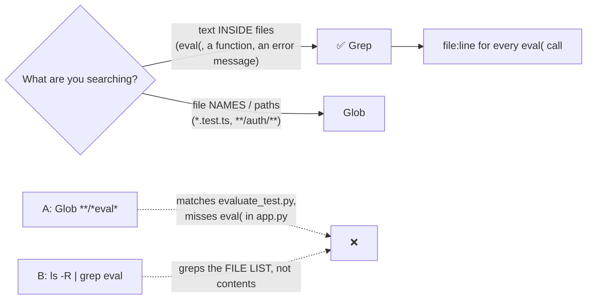

# Q134 — Find every `eval()` in a large codebase: Grep searches file contents

**Domain / lesson:** D2 › 2.5 Built-in Tools (Grep = content, Glob = file names)
**Scenario:** Developer productivity tools with the Claude Agent SDK (same as [Q131](../Q131-existing-jira-mcp-server/question.md)–[Q133](../Q133-mcp-resources-content-catalogs/question.md))
**Follows:** [Q132](../Q132-grep-entry-points-follow-imports/question.md) (Grep for entry points, then follow imports)

## Question

You are building developer productivity tools using the Claude Agent SDK. The agent helps engineers explore unfamiliar codebases, understand legacy systems, generate boilerplate code, and automate repetitive tasks. It uses the built-in tools (Read, Write, Bash, Grep, Glob) and integrates with Model Context Protocol (MCP) servers.

You're building a security scanning workflow.

When engineers need to locate all occurrences of a dangerous function like eval() across a large codebase, which tool should your agent use for content search?

- **A.** Use Glob with a pattern like `**/*eval*` to find files, then Read each matching file.
- **B.** Use Bash to run `ls -R | grep eval` to recursively list files containing eval.
- **C.** Read the project's main entry file and follow import statements to trace where eval might be used.
- **D.** Use Grep to search for the pattern "eval(" across all files in the codebase.

## Answer: **D**

## Diagram

## Concept

**"Content search" is the hint.** You want the text `eval(` **inside** files, in every file. That's exactly what Grep is for.

Guide 2.5: *"Grep searches file contents for patterns."* *"Glob matches file paths by naming patterns: name, extension or directory structure."* *"Grep finds what is inside files. Glob finds files by their names."*

Grep returns every match with its **file and line number**, without reading whole files into context, so it's also the cheapest option for a large codebase (*"Every file read into context costs tokens"*).

## Why the others are wrong

| Option | Why not |
|---|---|
| **A** Glob `**/*eval*`, then Read | **Glob only sees file names.** It finds `evaluation.py` (which may not call `eval`) and **misses** `app.py` that does. Guide trap: *"Glob matches file paths by naming pattern. It cannot search inside files for function calls."* Then reading each match wastes context. |
| **B** Bash `ls -R \| grep eval` | **Greps the file listing, not the contents**: the same mistake as A, through the shell. (`grep -r "eval(" .` would search contents, but then you'd be re-implementing the built-in Grep tool through Bash, with less structured output.) |
| **C** Read the entry file and follow imports | **Tracing a flow ≠ finding every occurrence.** Import-following (Q132) finds code reachable from one entry point; a security scan needs **all** occurrences, including scripts, tests, dead code and files nothing imports. It's also slow and expensive. |

## Pattern to remember

> **Text inside files → Grep. File names/paths → Glob. Read only the files you've chosen.** "Find all occurrences of X" = Grep.

**Exam signals:**
- "locate all occurrences" / "content search" / "function calls" → **Grep**.
- "find files named / with extension / in directory" → **Glob**.
- Reject: Glob for content (A), shell listing + grep on names (B), import-tracing for exhaustive search (C).

**Q132 vs Q134: Grep, then what?**

| | Q132: understand the auth flow | Q134: find every `eval(` |
|---|---|---|
| Goal | **A flow** (how pieces connect) | **Every occurrence** (completeness) |
| Grep finds | The entry points | **All** the matches: that's the answer |
| Then | Read and follow imports | Read only the matches worth checking |

### Where this comes from

**Guide D2 › 2.5 Built-in Tools** (checked 2026-11-03):
- *"Grep searches file contents for patterns."*
- *"Glob matches file paths by naming patterns: name, extension or directory structure."*
- *"Grep finds what is inside files. Glob finds files by their names."*
- Trap: *"Glob matches file paths by naming pattern. It cannot search inside files for function calls."*
- *"Every file read into context costs tokens, and the context window has a limit."*

## How this connects to earlier questions

| Question | Link |
|---|---|
| [Q132](../Q132-grep-entry-points-follow-imports/question.md) | Grep to start a flow trace; here Grep **is** the whole search |
| [Q118](../Q118-agentic-review-follows-cross-file-references/question.md) | Reviewer using Grep to find callers across files |
| [Q74](../Q74-mcp-descriptions-compete-with-built-ins/question.md) | Built-in tools like Grep are what the agent prefers by default |

## Check question

**(1) Grepping for `eval(` also matches `retrieval(` and `my_eval(`. How would you make the pattern match only real `eval` calls? (2) Give one way `eval` could be used in a file that a Grep for `eval(` would still miss.**

*My answer:* "1) Searching with grep `\beval(` instead. 2) In code there could be something like referencing the function from an object, like `my_executor = eval`, or type checks that use no brackets." ✅ Numbered, both parts, **concrete examples**: this is the answer shape to aim for.

**(1) ✅ Word boundary `\b` is the right idea.** Two refinements:
- **Escape the bracket:** Grep takes a **regex**, where `(` opens a group. Use `\beval\(` (an unescaped `(` is an error or matches the wrong thing).
- **`\b` still matches after a dot:** `model.eval()` (PyTorch!) matches `\beval\(`, because `.` is a boundary. And `eval (` with a space is missed. Tighter: `(?<![.\w])eval\s*\(`: not after a dot or letter, optional spaces.

| Pattern | `eval(x)` | `eval (x)` | `retrieval(` | `model.eval()` |
|---|---|---|---|---|
| `eval(` | ✅ | ❌ miss | ⚠️ false hit | ⚠️ false hit |
| `\beval\(` | ✅ | ❌ miss | ✅ skipped | ⚠️ false hit |
| `(?<![.\w])eval\s*\(` | ✅ | ✅ | ✅ skipped | ✅ skipped |

**(2) ✅ Aliasing is a great example:** `run = eval` … `run(user_input)`: the dangerous call never contains `eval(`. Other misses:
- **Space before the bracket:** `eval (code)`.
- **Dynamic lookup:** `getattr(builtins, "eval")(code)`, `globals()["eval"](code)`.
- **Siblings with the same risk:** `exec(`, `compile(`, JS `new Function(`, `setTimeout("string")`.

> **Grep finds text, not meaning.** For a security scan, grep for `eval` **without** the bracket too (to catch aliases), and grep for the sibling functions. A real scanner (AST-based, e.g. Semgrep/Bandit) catches what text search can't.

## Glossary

- **Grep:** built-in tool that searches file **contents** for a text/regex pattern; returns file:line matches.
- **Glob:** built-in tool that matches file **paths** by pattern (`**/*.py`, `src/**/test_*`).
- **Content search:** looking for text inside files, not file names.
- **Exhaustive search:** finding *every* occurrence, not just the ones reachable from one starting point.
- **`eval()`:** executes a string as code; dangerous when the string can contain user input.

## Related course lessons

*Lecture lengths aren't recorded in the study-map files, so the watch times below are estimates.*

### Udemy A (primary): Claude Certified Architect (CCAR-F) - 2026 Exam Prep
| # | Lecture | Part | Why |
|---|---|---|---|
| **56** | **The Built-in Toolset** | 2C | ⭐ Grep vs Glob vs Read *(also in Q132)* |
| 57 | Choosing Built-in vs Custom | 2C | Why built-in Grep over Bash pipelines |
| Quiz 7 | 2C quiz | | Self-test |

**▶ Watch in this order (~10 min, est.):** #56 → #57, then do **Quiz 7**.

### Udemy B: Claude Certified Architect Foundations: Complete Course (Voroniuk)
| # | Lecture | Section | Why |
|---|---|---|---|
| **79** | **Built-in Tools: Grep, Glob, Read, Write and Edit** | S8 Claude Code Setup | ⭐ Exactly this question *(also in Q132)* |
| 80 | Exploring a Codebase Step by Step | S8 Claude Code Setup | Grep-first exploration *(also in Q132)* |
| Quiz 8 | Claude Code Setup quiz | S8 | Self-test |

**▶ Watch in this order (~10 min, est.):** #79 → #80, then do **Quiz 8**.

### CBT Nuggets: CCA-F course
| Skill | Why |
|---|---|
| **23. Apply Built In Tools Safely** | ⭐ Built-in tools *(also in Q132)* |
