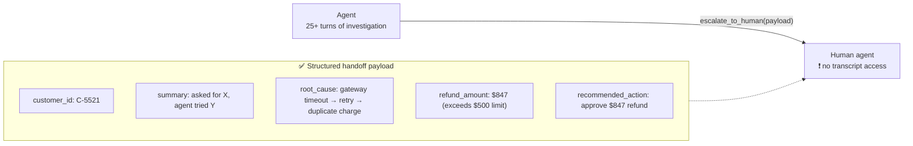

# Q14 — What to pass to a human on escalation

**Domain / lesson:** D1 › 1.4 Workflow Enforcement and Handoff
**Also touches:** D5 › 5.2 Escalation & Ambiguity · D5 › 5.1 Context Window (case facts)
**Scenario:** customer-support agent (same as [Q13](../Q13-agentic-loop-model-decides-next-tool/question.md))

## Question

After investigating a billing dispute over 25+ turns, you've identified that duplicate charges occurred due to a payment gateway timeout triggering retry logic. The required refund ($847) exceeds your $500 authorization limit. You need to call `escalate_to_human`, and the human agent won't have access to your conversation transcript. What context should you pass to enable effective resolution?

- **A.** A structured summary: customer ID, root cause, refund amount, and recommended action.
- **B.** Your diagnosis and the refund amount only.
- **C.** The customer's original complaint verbatim plus the tool result excerpts showing duplicate transactions.
- **D.** The complete conversation transcript with all tool results.

## Answer: **A**

## Diagram

## Concept

The human **can't see the conversation**, so the handoff payload is **everything they know**. It must be **self-contained**: the human should be able to act **without re-investigating** and **without asking the customer to repeat** anything.

A **structured summary** gives exactly the decision-ready facts:

| Field | Why the human needs it |
|---|---|
| **Customer ID** | To open the account and act |
| **Conversation summary** | What the customer asked for and what the agent already tried, so nothing is repeated |
| **Root cause** | Gateway timeout → retry → duplicate charge, so the human trusts the diagnosis without redoing it |
| **Refund amount** | The exact figure ($847), not "a refund" |
| **Recommended action** | What the agent thinks should happen, e.g. approve $847 |

The human gets the agent's **25 turns of work in seconds**: the conclusions, not the process.

## Why the others are wrong

| Option | Why not |
|---|---|
| **B** Diagnosis + amount only | **Incomplete.** No **customer ID**, so the human can't even open the account. No **recommended action** and no record of what was tried. The human has to ask the customer again, which the guide calls *"a poor experience."* |
| **C** Original complaint verbatim + tool excerpts | **Raw evidence without conclusions.** No root cause, no amount, no recommendation, no customer ID. The human has to **redo the diagnosis**. (Excerpts are good **supporting** evidence, as in Q02, but not a replacement for the summary.) |
| **D** Complete transcript with all tool results | **Too much and unstructured.** The human has to read 25+ turns to find the answer, so the agent's work is wasted. The same family as Q02 A: complete ≠ everything. |

## Pattern to remember

> **Escalation handoff = a self-contained, structured summary: who (customer ID), what happened (summary + root cause), how much (exact amount), what to do (recommended action).** Conclusions, not the raw history.

**Exam signal:** for handoffs, pick the **structured, decision-ready** summary. Reject options that are **too little** (missing ID/action) or **too much / too raw** (full transcript, verbatim excerpts only).

### Where this comes from in the guide

**D1 › 1.4 Workflow Enforcement and Handoff:**
- *"The human agent does not have access to the conversation transcript."* The summary is *"the only information they receive, so it must be self-contained."*
- Required fields: *"Customer ID…"*, *"Conversation summary: what the customer asked for and what the agent has attempted"*, *"Root cause analysis…"*, *"Refund amount (if applicable): the specific financial figure, not a vague reference"*, *"Recommended action…"*
- *"If the summary is incomplete, the human agent must ask the customer to repeat everything. That is a poor experience."*

## How this connects to earlier questions

| Question | Link |
|---|---|
| [Q02](../Q02-context-passing-source-index/question.md) / [Q12](../Q12-include-complete-findings-in-prompt/question.md) | **Findings, not context.** Pass conclusions + key evidence, not the raw transcript. Same rule for humans as for agents |
| [Q10](../Q10-missing-context-in-subagent-prompt/question.md) | The human, like a subagent, knows **only what's in the handoff** |
| [Q13](../Q13-agentic-loop-model-decides-next-tool/question.md) | The $500 limit should be a **gate** in the refund tool: >$500 → structured error → the model calls `escalate_to_human` |
| [extract-first concept](../../concepts/extract-first-summarize-second.md) | Customer ID, amounts, transaction IDs should come from the **verbatim fact block**, not be re-typed from memory after 25 turns |

## Check question

**The guide lists five handoff fields, but option A names only four. Which one is missing, and what could go wrong without it?**
*My answer:* "Missing: 'Conversation summary'. Without it some important nuance might be missed." ✅ **Correct field.** Made specific below. The guide defines it as *"what the customer asked for and what the agent has attempted."*

| Missing piece | What goes wrong |
|---|---|
| **What the customer asked for** | They may have wanted the refund **and** a credit, or had a second issue (multi-concern, Udemy B #51). The human fixes only part |
| **What the agent already tried** | The human **repeats steps** (re-checks gateway logs, re-verifies transactions) |
| **What the customer was told** | Promises like "refund within 24h" are unknown to the human, so communication becomes inconsistent |
| **Overall** | The human asks the customer to repeat everything: *"a poor experience"* |

**Why A is still the answer:** it's the **closest** to the five fields. The others miss **more** (no ID, no recommendation, no structure).

> **Exam tip:** an option doesn't need to be perfect. It needs to be **better than the others**. Compare what each one is missing.

## Glossary

- **Handoff payload:** the structured data an agent passes when transferring a case to a human (or another agent).
- **Self-contained:** understandable and actionable without any other source (no transcript, no follow-up questions).
- **Authorization limit:** the maximum action (e.g. refund amount) an agent may take on its own. Above it, a human must decide. Enforce it in **code** (Q13).

## Related course lessons

### Udemy A (primary): Claude Certified Architect (CCAR-F) - 2026 Exam Prep
| # | Lecture | Part | Why |
|---|---|---|---|
| **115** | **The Handoff Payload — What the Next Actor Needs** | 5B | ⭐ Exactly this question |
| **114** | **When to Escalate — Trigger Design** | 5B | ⭐ The $500 limit as an escalation trigger |
| 20 | Handoff Protocols and Continuity Across Agents | 1C | Handoff structure in general |
| 31 | Interruption Points and Review Workflows | 1D | Where humans step in |
| Quiz 16, Quiz 4 | 5B and 1D quizzes | | Self-test |

**▶ Watch in this order (~29 min):** #114 → #115 → #20 → #31, then do **Quiz 16** and **Quiz 4**.
(when to escalate → what to pass → handoff protocols → review points → self-tests)

### Udemy B: Claude Certified Architect Foundations: Complete Course (Voroniuk)
| # | Lecture | Section | Why |
|---|---|---|---|
| **51** | **Handoffs and Multi-Concern Requests** | S6 Support Agent | ⭐ Handoff contents |
| **57** | **Support Case: Escalation Calls** | S6 Support Agent | ⭐ Exam-style escalation case |
| 52 | When to Escalate to a Human | S6 Support Agent | Escalation triggers |
| 54 | Case Facts in Long Conversations | S6 Support Agent | Keeping exact IDs/amounts over 25+ turns |
| 49 | Prerequisite Gates in Code | S6 Support Agent | Enforcing the $500 limit |
| Quiz 6 | Support Agent quiz | S6 | Self-test |

**▶ Watch in this order (~25 min):** #52 → #51 → #54 → #57 → #49, then do **Quiz 6**.

### CBT Nuggets: CCA-F course
| Skill | Why |
|---|---|
| 21. Build Multi Turn Tool Conversations | Long conversations ending in a tool call (escalate) |
| 6. Implement Hooks for Safer Automation | Enforcing the authorization limit |

*CBT has no dedicated lesson on handoff payloads. Use Udemy A #115 or Udemy B #51.*
