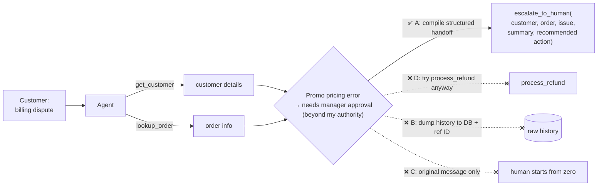

# Q15 — Mid-process escalation: what to hand over

**Domain / lesson:** D1 › 1.4 Workflow Enforcement and Handoff
**Also touches:** D5 › 5.2 Escalation & Ambiguity · D1 › 1.1 Agentic Loops (the model decides to escalate)
**Scenario:** customer-support agent (same as [Q13](../Q13-agentic-loop-model-decides-next-tool/question.md) and [Q14](../Q14-escalation-handoff-summary/question.md))

## Question

Your agent is handling a billing dispute. After calling `get_customer` and `lookup_order`, it identifies that the dispute involves a promotional pricing error requiring manager approval – beyond the agent's authorization level. How should the workflow handle this mid-process escalation?

- **A.** Compile a structured handoff with customer details, order info, and the identified issue before calling `escalate_to_human`.
- **B.** Persist the complete conversation and tool response history to a database, then call `escalate_to_human` with a reference ID.
- **C.** Call `escalate_to_human` passing only the customer's original message.
- **D.** Attempt the refund with `process_refund` anyway, escalating only if the system rejects the transaction.

## Answer: **A**

## Diagram

## Concept

Same rule as Q14, but now the escalation happens **mid-process**, after only two tool calls.

1. The agent **recognizes** that the case is beyond its authority (manager approval needed). That is a correct escalation trigger (5.2).
2. It **stops** acting on the case. It doesn't try the action anyway.
3. It **packages what it has already learned** (customer details from `get_customer`, order info from `lookup_order`, the identified issue) into a **structured, self-contained handoff**.
4. Then it calls `escalate_to_human`.

The work the agent already did is **valuable**: the human shouldn't have to call the same lookups again or re-diagnose the promo error.

## Why the others are wrong

| Option | Why not |
|---|---|
| **B** Persist full history to a DB + reference ID | **Nothing is lost, but nothing is summarized.** The human has to open the record and read raw turns and tool JSON to work out the issue, which is the same problem as Q14 D (full transcript), plus extra infrastructure. A reference instead of content is the Q12 C pattern. *Storing history for audit is fine as an addition. It doesn't replace the handoff summary.* |
| **C** Only the customer's original message | **Throws away the agent's work.** The human doesn't know the customer ID, the order, or that it's a promo pricing error, so they start from zero and may ask the customer to repeat everything (*"a poor experience"*). |
| **D** Attempt the refund anyway, escalate if rejected | **Acts beyond authority on purpose.** The agent *knows* manager approval is required. "Try and see if the system blocks it" treats a safeguard as a strategy. If the system **accepts** it (the promo error isn't something the refund tool checks), money moves without approval. Escalation must happen **before** the unauthorized action. |

## Pattern to remember

> **When the agent hits its authority limit: stop, then hand over a structured, self-contained summary of what it has found.** Don't attempt the action, don't hand over raw history, don't hand over nothing.

**Exam signal:** for escalation questions, the answer is the **structured handoff built from what the agent already knows**. Reject:
- "**try anyway**, escalate if rejected" (acting beyond authority)
- "**persist everything + reference ID**" (raw, not decision-ready)
- "**only the original message**" (loses the agent's work)

### Where this comes from in the guide

**D1 › 1.4 Workflow Enforcement and Handoff:**
- *"The human agent does not have access to the conversation transcript."* The summary is *"the only information they receive, so it must be self-contained."*
- Fields: Customer ID, Conversation summary, Root cause analysis, Refund amount, Recommended action.
- *"If the summary is incomplete, the human agent must ask the customer to repeat everything. That is a poor experience."*

## How this connects to earlier questions

| Question | Link |
|---|---|
| [Q14](../Q14-escalation-handoff-summary/question.md) | Same 5-field handoff. Q14 = end of a 25-turn investigation, Q15 = mid-process after 2 tool calls. **Same answer shape** |
| [Q13](../Q13-agentic-loop-model-decides-next-tool/question.md) | The **model** decides to escalate after reading the tool results. **Gates** in tools are a safety net, not the plan (see D) |
| [Q12](../Q12-include-complete-findings-in-prompt/question.md) | "Reference ID to a store" instead of content: same distractor family as Q12 C |
| [Q02](../Q02-context-passing-source-index/question.md) | Complete ≠ everything. Summarize, don't dump |

## Check question

**Q13 said: put a gate inside `process_refund`. Option D also relies on the system rejecting the refund. So why is D still wrong?**

*My answer:* "The human manager might decide not to approve the refund." 🟡 **Partial: right direction, but the key consequence is missing.**

The manager *might* say no. With D, though, the refund may already have happened **before the manager is asked**:

| Step | With D |
|---|---|
| 1 | Agent calls `process_refund` |
| 2 | The refund tool checks amount / 30-day window. It does **not** know about "promo pricing error needs manager approval" |
| 3 | ✅ The system **accepts** it, so the money is gone |
| 4 | There's nothing left to escalate. The manager's decision was **bypassed**, not just ignored |

**Three precise reasons D fails:**
1. **Acts first, asks later.** Approval must come **before** the action. Afterwards it's too late, and refunds are hard to reverse.
2. **The gate may not cover this rule.** Q13's gate checks the 30-day window. "Promo pricing error → manager approval" is a different rule, so the system may happily accept the refund.
3. **A gate is a safety net, not a strategy.** The agent already **knows** it lacks authority. Deliberately trying the action and hoping something blocks it is the wrong design, even when a gate exists.

> **Model recognizes the limit → escalates first. The gate only catches what the model misses.** Never "try and see."

## Glossary

- **Mid-process escalation:** handing a case to a human partway through the workflow, as soon as the agent detects it can't (or mustn't) finish it.
- **Authorization level:** the set of actions an agent may take on its own. Outside it, a human must approve.
- **Reference ID handoff:** passing a pointer to stored data instead of the data itself. The receiver must go and dig it out.

## Related course lessons

### Udemy A (primary): Claude Certified Architect (CCAR-F) - 2026 Exam Prep
| # | Lecture | Part | Why |
|---|---|---|---|
| **114** | **When to Escalate — Trigger Design** | 5B | ⭐ "Beyond authorization level" as a trigger |
| **115** | **The Handoff Payload — What the Next Actor Needs** | 5B | ⭐ Exactly option A |
| 20 | Handoff Protocols and Continuity Across Agents | 1C | Handoff structure in general |
| 28 | Why Prompts Are Not Sufficient for High-Stakes Paths | 1D | Why D ("try anyway") is dangerous on money paths |
| Quiz 16, Quiz 4 | 5B and 1D quizzes | | Self-test |

**▶ Watch in this order (~29 min):** #114 → #115 → #20 → #28, then do **Quiz 16** and **Quiz 4**.

### Udemy B: Claude Certified Architect Foundations: Complete Course (Voroniuk)
| # | Lecture | Section | Why |
|---|---|---|---|
| **52** | **When to Escalate to a Human** | S6 Support Agent | ⭐ The escalation trigger |
| **51** | **Handoffs and Multi-Concern Requests** | S6 Support Agent | ⭐ Handoff contents |
| 57 | Support Case: Escalation Calls | S6 Support Agent | Exam-style escalation case |
| 49 | Prerequisite Gates in Code | S6 Support Agent | Gates as a safety net (vs D) |
| Quiz 6 | Support Agent quiz | S6 | Self-test |

**▶ Watch in this order (~22 min):** #52 → #51 → #57 → #49, then do **Quiz 6**.

### CBT Nuggets: CCA-F course
| Skill | Why |
|---|---|
| 21. Build Multi Turn Tool Conversations | Tool calls → decision → escalate tool call |
| 6. Implement Hooks for Safer Automation | Blocking unauthorized actions (vs D) |

*CBT has no dedicated lesson on handoff payloads. Use Udemy A #115 or Udemy B #51.*
