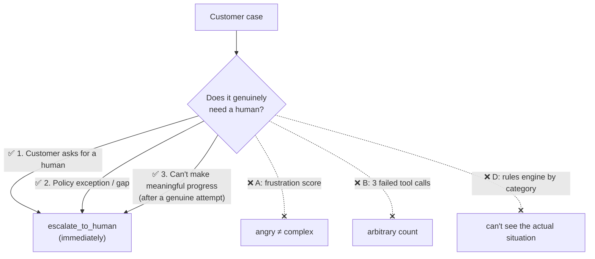

# Q16 — Which escalation triggers are reliable?

**Domain / lesson:** D5 › 5.2 Escalation & Ambiguity Resolution
**Also touches:** D1 › 1.4 Workflow Enforcement and Handoff · D1 › 1.1 Agentic Loops (model judgment)
**Scenario:** customer-support agent (same as [Q13](../Q13-agentic-loop-model-decides-next-tool/question.md)–[Q15](../Q15-mid-process-escalation-handoff/question.md))

## Question

You're implementing the escalation logic for when the agent should call `escalate_to_human`. Your team proposes four different approaches for triggering escalation. Which approach will most reliably identify cases that genuinely require human intervention?

- **A.** Implement sentiment analysis that monitors for frustration indicators (negative language, repeated questions, exclamation marks) and trigger escalation when the frustration score exceeds a configured threshold.
- **B.** Configure the agent to escalate after three consecutive tool calls that fail to resolve the customer's stated issue, ensuring a reasonable attempt before involving a human.
- **C.** Instruct the agent to escalate when the customer requests a human, when the issue requires policy exceptions, or when the agent cannot make meaningful progress.
- **D.** Build a rules engine that maps specific issue types, customer segments, and product categories to escalation decisions, removing the need for model judgment calls.

## Answer: **C**

## Diagram



## Concept

The guide lists exactly **three valid escalation triggers** (5.2). Option C is those three, word for word:

| Trigger | Guide wording | Notes |
|---|---|---|
| **1. Explicit human request** | *"The customer explicitly requests a human."* | Honour it **immediately**. Don't try to resolve first: *"an absolute rule with no exceptions."* |
| **2. Policy exception or gap** | *"The request is outside documented policy."* | A **gap** (policy is silent) → escalate. A **violation** (policy has a clear answer, e.g. "no") → don't escalate, apply the policy |
| **3. Inability to progress** | *"The agent has tried and cannot advance."* | Only after a **genuine attempt** |

All three are about **whether the case actually needs a human**, not about proxies like mood, counts or categories.

### "But 'instruct' is usually a distractor!"

In earlier questions, "instruct the agent to…" lost to a gate/schema/code. Here it wins, because these triggers **need judgment**: "is this a policy gap?" or "am I making progress?" can't be computed from a status field. The model reads the situation; code can't. (Hard limits that **can** be computed, like the $500 refund cap, still belong in a **gate**: Q13/Q14.)

## Why the others are wrong

| Option | Why not |
|---|---|
| **A** Sentiment / frustration score | Guide: *"Frustration does not correlate with case complexity."* An angry customer with a simple issue should get a **resolution**, not a handoff. A calm customer with a policy gap needs a human but never triggers it. Named as an exam trap. |
| **B** Escalate after 3 failed tool calls | **Arbitrary count.** Three failures may be normal on a hard case that's progressing, and a policy gap needs a human after **zero** failures. It also ignores an explicit human request until 3 calls have failed (the guide says escalate **immediately**). Counts are fine as a **safety cap**, not as the trigger (same as Q13's iteration cap). |
| **D** Rules engine by issue type / segment / product | **Static categories can't see the situation.** The same issue type can be trivial or a policy gap. It can't detect "customer asked for a human" or "can't make progress". "Removing the need for model judgment" removes exactly what escalation needs. |

## Pattern to remember

> **Escalate on the 3 valid triggers: (1) the customer asks for a human (immediately), (2) a policy exception or gap, (3) no meaningful progress after a genuine attempt.** Not on sentiment, self-reported confidence, fixed counts or static categories.

**Exam traps (from the guide):**
- ❌ Escalating when **frustration / negative sentiment** crosses a threshold
- ❌ **Self-reported confidence** as an escalation signal (*"poorly calibrated"*)
- ❌ **Trying to resolve first** when the customer explicitly asked for a human
- ❌ Picking the **most recent / most active** record when a customer match is ambiguous → **ask for more identifiers** instead

### Where this comes from in the guide

**D5 › 5.2 Escalation & Ambiguity Resolution:**
- Valid triggers: *"The customer explicitly requests a human."* · *"The request is outside documented policy."* · *"The agent has tried and cannot advance."*
- *"Frustration does not correlate with case complexity."*
- *"LLM self-reported confidence is poorly calibrated."*
- Explicit request: *"an absolute rule with no exceptions."*

## How this connects to earlier questions

| Question | Link |
|---|---|
| [Q15](../Q15-mid-process-escalation-handoff/question.md) | Promo pricing error needing manager approval = trigger 2 (policy exception) |
| [Q14](../Q14-escalation-handoff-summary/question.md) | $847 > $500 limit = a **computable** limit, enforced by a gate. Q16 = **when** to escalate, Q14/Q15 = **what** to hand over |
| [Q13](../Q13-agentic-loop-model-decides-next-tool/question.md) | The model decides; code enforces hard limits. A count (B) = safety cap, not the main signal |
| [Q05](../Q05-goals-not-procedures-delegation/question.md) | Rigid rules (D) break on the unexpected; criteria + judgment adapt |

## Check question

**C says "instruct the agent to…". In earlier questions "instruct" was usually the wrong answer and a gate in code was right. Why is "instruct" correct here, and which escalation-related rule *should* still be enforced in code?**

*My answer (part 1):* "Because this is the situation where judgement is required, not a binary logic." ✅ **Correct, that's exactly the reason.**

| Trigger | Can code compute it? | So… |
|---|---|---|
| "Is this a policy **gap** or a policy **violation**?" | ❌ Needs reading the situation against the policy | Model judgment (instruct) |
| "Am I making **meaningful** progress?" | ❌ "Meaningful" isn't a field | Model judgment |
| "Did the customer ask for a human?" | ❌ "Can I talk to someone real?", "get me your manager", … many phrasings | Model judgment (honoured immediately) |

**Rule of thumb:** *if you could write it as an `if` statement on data, put it in code. If you need to understand the conversation, instruct the model with clear criteria.*

*My answer (part 2):* "Something like `if human_escalation_required: handoff_to_human`." 🟡 **Right shape (an `if` in code), but the condition is circular.**

`human_escalation_required` **is** the judgment call from part 1. Code can't compute it, so the `if` just moves the problem. The code half needs a condition that's **plain data**:

| Computable limit | Data it checks | From |
|---|---|---|
| **Refund > $500 authorization cap** | `amount` | [Q14](../Q14-escalation-handoff-summary/question.md) ($847) |
| **Order older than 30 days** | `days_since_purchase` | [Q13](../Q13-agentic-loop-model-decides-next-tool/question.md) |

**Where:** inside `process_refund` (or a PreToolUse hook on it), returning a **structured error** that points to escalation:

```python
def process_refund(order_id, amount):
    if amount > 500:                                          # gate: authorization cap
        return {"error": "EXCEEDS_AUTHORIZATION_LIMIT",
                "limit": 500, "requested": amount,
                "action": "call escalate_to_human with a structured handoff"}
    ...
```

**How the two halves fit together:**

| Layer | Decides | Example |
|---|---|---|
| **Model (instructed, Q16 C)** | *Should* this go to a human? | Customer asked for one · policy gap · stuck |
| **Code (gate, Q13/Q14)** | *Can* the agent do this action at all? | `amount > 500` → blocked → structured error → model escalates |

> **Instruct the judgment. Gate the numbers.** The gate doesn't decide to escalate; it blocks the action and its error steers the model to `escalate_to_human`.

## Glossary

- **Escalation trigger:** the condition that makes the agent hand a case to a human.
- **Policy gap:** a situation the documented policy doesn't cover → needs a human. Different from a **policy violation**, where the policy gives a clear answer (apply it, don't escalate).
- **Sentiment analysis:** scoring text for emotion (e.g. frustration). An unreliable proxy for case complexity.
- **Self-reported confidence:** the model's own estimate of how sure it is. Poorly calibrated, so not a trigger.

## Related course lessons

### Udemy A (primary): Claude Certified Architect (CCAR-F) - 2026 Exam Prep
| # | Lecture | Part | Why |
|---|---|---|---|
| **114** | **When to Escalate — Trigger Design** | 5B | ⭐ Exactly this question |
| 115 | The Handoff Payload — What the Next Actor Needs | 5B | What happens after the trigger (Q14/Q15) |
| 6 | Loop Control — Stopping, Iterating, and Escalating | 1A | Why a count (B) is a safety cap, not a trigger |
| 28 | Why Prompts Are Not Sufficient for High-Stakes Paths | 1D | When to use code instead (the check question) |
| Quiz 16 | 5B quiz | | Self-test |

**▶ Watch in this order (~26 min):** #114 → #6 → #28 → #115, then do **Quiz 16**.

### Udemy B: Claude Certified Architect Foundations: Complete Course (Voroniuk)
| # | Lecture | Section | Why |
|---|---|---|---|
| **52** | **When to Escalate to a Human** | S6 Support Agent | ⭐ Exactly this question |
| **57** | **Support Case: Escalation Calls** | S6 Support Agent | ⭐ Exam-style trigger cases |
| 51 | Handoffs and Multi-Concern Requests | S6 Support Agent | After the trigger: the handoff |
| 49 | Prerequisite Gates in Code | S6 Support Agent | Computable limits go in code |
| Quiz 6 | Support Agent quiz | S6 | Self-test |

**▶ Watch in this order (~22 min):** #52 → #57 → #49 → #51, then do **Quiz 6**.

### CBT Nuggets: CCA-F course
| Skill | Why |
|---|---|
| 21. Build Multi Turn Tool Conversations | The model deciding to call `escalate_to_human` |
| 6. Implement Hooks for Safer Automation | Code-enforced limits (vs judgment triggers) |

*CBT has no dedicated lesson on escalation triggers. Use Udemy A #114 or Udemy B #52.*
