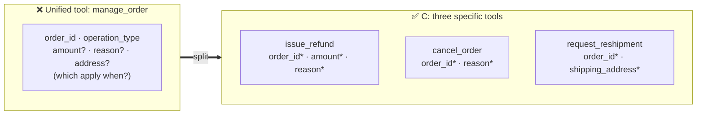

# Q17 — One unified tool or three specific tools?

**Domain / lesson:** D2 › 2.1 Tool Interface Design
**Also touches:** D2 › 2.3 Tool Distribution & Tool Choice · D4 › 4.2 Few-Shot (why D fails)
**Scenario:** customer-support / order management agent

## Question

Your order management system requires tools for three distinct operations: issuing refunds (requires amount and reason), canceling orders (requires reason), and requesting reshipments (requires shipping address). Each operation shares an `order_id` parameter but has different additional requirements. You notice during testing that with your current unified tool design, the agent frequently omits required parameters or includes irrelevant ones. What design change will most effectively improve parameter accuracy?

- **A.** Keep one unified tool with a nested `operation_details` object parameter whose internal structure varies by operation type, documented in the tool description.
- **B.** Keep one unified tool but add JSON Schema if-then-else conditionals to enforce that parameters like `amount` are required only when the operation type is "refund".
- **C.** Split into three separate tools (`issue_refund`, `cancel_order`, `request_reshipment`), each defining only the parameters required for that specific operation.
- **D.** Keep one unified tool with all parameters marked optional, but add detailed few-shot examples in the system prompt showing correct parameter combinations for each operation type.

## Answer: **C**

## Diagram

`*` = required. Each tool's schema says exactly what's needed, nothing more.

## Concept

With one unified tool, the model has to work out **"which parameters apply to this operation?"** every time, from prose or conditional logic. That's where it slips: it omits `amount` on a refund, or adds `shipping_address` to a cancel.

Split it into **three purpose-specific tools** and the problem disappears **by construction**:
- Each schema lists **only** the parameters that operation needs, all marked **required**.
- There is **nothing irrelevant to add**, and nothing required is optional.
- Picking the tool **is** picking the operation, so `operation_type` is no longer needed.

Guide (2.1): *"Generic tools with broad responsibilities create ambiguity… Split them into purpose-specific tools with defined input and output contracts."*

This is **"structure beats instructions"** applied to tool design: make the wrong call **impossible to express**, don't explain how to avoid it.

## Why the others are wrong

| Option | Why not |
|---|---|
| **A** Nested `operation_details` that varies by type, documented in the description | **Still one tool, and the hard part is now hidden in prose.** The schema can't say which fields belong to which operation, so the model has to read and follow the description. That's the same ambiguity, nested one level deeper. |
| **B** JSON Schema if-then-else conditionals | **Looks like "structure", but it's complex structure.** The model still has to reason through conditional logic to build a valid call. Validation can **reject** a bad call, but it doesn't help the model **produce** a good one first time. It's also more complex than simply having three clear schemas. The tempting distractor. |
| **D** All params optional + few-shot examples | **Removes structure, then patches with examples.** Marking everything optional makes it **easier** to omit required fields. Guide: *"Few-shot examples add token overhead without addressing the root cause."* Probabilistic fix for a structural problem. |

## Pattern to remember

> **Different operations with different required parameters → separate, purpose-specific tools, each with only its own required parameters.** Don't make one tool do many jobs and then explain the rules.

**Exam signal:** when the problem is a **tool doing too many things**, the answer is **split it**. Reject: nest it (A), add conditional schema logic (B), make things optional + add examples (D).

**Careful, the opposite trap (2.1):** *"Consolidating similar tools into one as the first step"* is listed as a trap. The direction is **split**, not merge.

### Where this comes from in the guide

**D2 › 2.1 Tool Interface Design:**
- *"Tool descriptions are the primary mechanism LLMs use for tool selection."*
- *"Generic tools with broad responsibilities create ambiguity, because a broad description fits many requests."* → *"Split them into purpose-specific tools with defined input and output contracts."* (Example: `analyze_document` → `extract_data_points`, `summarize_content`, `verify_claim_against_source`.)
- A good description states *"required versus optional fields."*
- *"Few-shot examples add token overhead without addressing the root cause."*

## How this connects to earlier questions

| Question | Link |
|---|---|
| [Q04](../Q04-tool-scoping-per-subagent/question.md) | Same family: **fewer, clearer choices = more reliable selection**. Q04 = which tools an agent has. Q17 = how each tool is shaped |
| [Q01](../Q01-source-attribution-multi-agent/question.md) / [Q09](../Q09-synthesis-preserve-merge-mappings/question.md) | Structure beats prose. A schema that says exactly what's required beats a description that explains it |
| [Q13](../Q13-agentic-loop-model-decides-next-tool/question.md) | With split tools, a gate can live **inside** `issue_refund` (amount > $500, days > 30) without touching cancel or reship |

## Check question

**Option B *also* uses structure (JSON Schema enforces the rules deterministically). Your cheat sheet says "structure beats instructions". So why is B still worse than C?**

*(Your answer and feedback will be recorded here.)*

## Glossary

- **Unified (generic) tool:** one tool that handles several operations, usually selected by an `operation_type` parameter.
- **Purpose-specific tool:** a tool that does one thing, with an input contract containing only what that thing needs.
- **Input contract:** the tool's input schema: which parameters exist, their types, and which are required.
- **JSON Schema if-then-else:** conditional schema rules ("if `type` is refund then `amount` is required"). Valid JSON Schema, but harder for the model to follow than separate simple schemas.

## Related course lessons

### Udemy A (primary): Claude Certified Architect (CCAR-F) - 2026 Exam Prep
| # | Lecture | Part | Why |
|---|---|---|---|
| **34** | **Designing Tool Input Schemas** | 2A | ⭐ How to shape each tool's parameters |
| **35** | **Required vs. Optional Parameters, Enums, and Constraints** | 2A | ⭐ Why "all optional" (D) hurts accuracy |
| 32 | How Claude Selects Tools | 2A | Selection = description + schema |
| 33 | Writing Tool Descriptions That Route Correctly | 2A | Describing three distinct tools |
| 36 | Strict Tool Use and Valid Inputs | 2A | Schema-valid inputs (relevant to B) |
| Quiz 5 | 2A quiz | | Self-test |

**▶ Watch in this order (~35 min, est.):** #32 → #33 → #34 → #35 → #36, then do **Quiz 5**.

### Udemy B: Claude Certified Architect Foundations: Complete Course (Voroniuk)
| # | Lecture | Section | Why |
|---|---|---|---|
| **42** | **Renaming, Splitting and Keyword Triggers** | S5 Tools & MCP | ⭐ Exactly this question: splitting tools |
| 41 | How Claude Chooses a Tool | S5 Tools & MCP | Why one broad tool confuses selection |
| 25 | Functions, JSON and Schemas | S4 Structured Output | Schema basics: required vs optional |
| Quiz 5 | Tools & MCP quiz | S5 | Self-test |

**▶ Watch in this order (~20 min, est.):** #25 → #41 → #42, then do **Quiz 5**.

### CBT Nuggets: CCA-F course
| Skill | Why |
|---|---|
| **19. Explain Tool Use and Tool Schemas** | ⭐ Defining tool parameters and required fields |
| 34. Build MCP Tools Resources and Prompts | Designing tools with clear contracts |
| 22. Route Requests Across Multiple Tools | Selecting between several specific tools |
