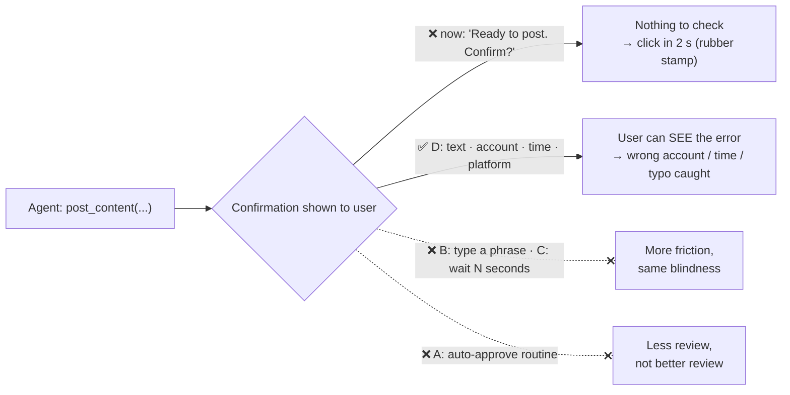

# Q18 — Users approve 98% in 2 seconds: fixing a rubber-stamp confirmation

**Domain / lesson (closest fit):** D5 › 5.5 Human Review & Confidence Calibration
**Also touches:** D1 › 1.4 Workflow Enforcement and Handoff (the human only knows what you show them) · D1 › 1.5 Agent SDK Hooks (PreToolUse `ask` = where the confirmation lives)
**Note:** the guide has no lesson specifically on confirmation prompts. I checked 1.4, 1.5 and 5.5 on 2026-10-30. 5.5 (*"Human review is a safety check"*) is the closest. The reasoning below combines it with the 1.4 handoff rule.

## Question

Your `post_content` tool requires user confirmation before publishing. The current workflow displays "Ready to post to social media. Confirm?" and analytics show users approve 98% of requests within 2 seconds. Post-mortems reveal incidents where posts went to wrong accounts, were scheduled for wrong times, or contained errors – all confirmed by users without catching the mistakes. How should you redesign the confirmation workflow?

- **A.** Auto-approve routine posts and only require explicit confirmation for unusual patterns like posting to new accounts or large audiences.
- **B.** Require users to type a confirmation phrase instead of clicking a button.
- **C.** Add a mandatory waiting period before the confirm option becomes available.
- **D.** Include the complete post text, target account, scheduled time, and platform in the confirmation request.

## Answer: **D**

## Diagram

## Concept

**Diagnose first:** why did users miss the wrong account, wrong time and typos? Because **the confirmation didn't show any of them.** "Ready to post. Confirm?" gives the reviewer **nothing to review**, so clicking yes is the only possible response. The 98%-in-2-seconds number isn't laziness; it's the **design**.

**The fix:** show the reviewer **exactly the fields that went wrong in the incidents**:

| Incident in post-mortem | Field the confirmation must show |
|---|---|
| Wrong account | **Target account** |
| Wrong time | **Scheduled time** |
| Errors in content | **Complete post text** |
| (Wrong network) | **Platform** |

A human review step is only a **safety check** (5.5) if the human **has the information to check**. Same rule as the escalation handoff (1.4, Q14): the human knows **only what you put in front of them**, so it must be **self-contained**.

## Why the others are wrong

| Option | Why not |
|---|---|
| **A** Auto-approve routine posts, confirm only unusual ones | **Less review, not better review.** "Wrong time" and "typo" happen on **routine** posts too, and those would now go out with no check at all. When unusual posts *are* confirmed, the prompt still shows nothing, so they're rubber-stamped too. (Risk-based routing can be a good **later** optimization, *after* the confirmation is meaningful.) |
| **B** Type a confirmation phrase | **Friction without information.** The user types "CONFIRM" just as blindly. It slows them down; it doesn't show them the wrong account. |
| **C** Mandatory waiting period | **Same: friction without information.** Waiting 5 seconds staring at "Confirm?" reveals nothing. Users learn to wait and click. |

## Pattern to remember

> **If reviewers approve everything instantly and still miss errors, they can't see what they're approving.** Fix the **content** of the review (show the exact details that can go wrong), not the **friction** (typing, waiting) or the **amount** (auto-approving).

**Exam signal:** for a "rubber-stamp" confirmation, pick the option that puts the **specific, decision-relevant details** in front of the human. Reject:
- **friction** (type a phrase, waiting period, extra clicks)
- **less review** (auto-approve) as the first fix

### Where this comes from in the guide

- **D5 › 5.5:** *"Human review is a safety check for automated extraction and classification systems."* A check only works if the reviewer can see what to check.
- **D1 › 1.4:** the handoff summary *"is the only information they receive, so it must be self-contained."* The same logic applies to a confirmation prompt.
- **D1 › 1.4:** *"if a single failure would cause financial loss, a security breach or a compliance violation, use programmatic enforcement."* Posting publicly is outward-facing, so it's worth a real check.

## How this connects to earlier questions

| Question | Link |
|---|---|
| [Q14](../Q14-escalation-handoff-summary/question.md) / [Q15](../Q15-mid-process-escalation-handoff/question.md) | Same rule: the human sees **only** what you pass them. Make it specific and self-contained |
| [Q16](../Q16-escalation-triggers/question.md) | Same trap shape as sentiment/count triggers: changing a **proxy** (time spent, typing) instead of the real cause |
| [Q17](../Q17-split-unified-tool/question.md) | Separate tools make the confirmation easy to build: `post_content`'s own parameters are exactly what to display |

## Check question

**The confirmation now shows text, account, time and platform. A few weeks later analytics still show ~95% approval in ~3 seconds. Is the redesign failing? What would you look at to find out?**

*(Your answer and feedback will be recorded here.)*

## Glossary

- **Rubber-stamping:** approving without really reviewing, usually because the request gives nothing to check or approvals are always routine.
- **Approval fatigue:** reviewers stop paying attention after many identical, low-information prompts.
- **Friction:** extra effort added to an action (typing, waiting). It slows people down but doesn't help them see mistakes.
- **Decision-relevant details:** the exact fields that determine whether the action is right (here: text, account, time, platform).

## Related course lessons

### Udemy A (primary): Claude Certified Architect (CCAR-F) - 2026 Exam Prep
| # | Lecture | Part | Why |
|---|---|---|---|
| **31** | **Interruption Points and Review Workflows** | 1D | ⭐ Designing where and how humans review |
| 129 | Routing Low-Confidence Output Through a Review Queue | 5D | Reviewers need the right items **and** the right info (vs A) |
| 115 | The Handoff Payload — What the Next Actor Needs | 5B | Same principle: show the human what they need to decide |
| 30 | Hook Lifecycle Events | 1D | Where a confirmation step sits (before the tool runs) |
| Quiz 4 | 1D quiz | | Self-test |

**▶ Watch in this order (~25 min, est.):** #31 → #115 → #129 → #30, then do **Quiz 4**.

### Udemy B: Claude Certified Architect Foundations: Complete Course (Voroniuk)
| # | Lecture | Section | Why |
|---|---|---|---|
| **32** | **Confidence Calibration and Human Review** | S4 Structured Output | ⭐ What makes human review effective |
| 50 | Hooks: Intercepting Tool Calls | S6 Support Agent | Pausing a tool call for confirmation |
| 51 | Handoffs and Multi-Concern Requests | S6 Support Agent | Self-contained info for the human |
| Quiz 4, Quiz 6 | S4 and S6 quizzes | | Self-test |

**▶ Watch in this order (~20 min, est.):** #32 → #50 → #51, then do **Quiz 4** and **Quiz 6**.

### CBT Nuggets: CCA-F course
| Skill | Why |
|---|---|
| **6. Implement Hooks for Safer Automation** | ⭐ Pausing risky tool calls for approval |
| 16. Improve Graders with Model Feedback | Human review quality (5.5) |

*CBT has no dedicated lesson on confirmation design. Use Udemy A #31.*
